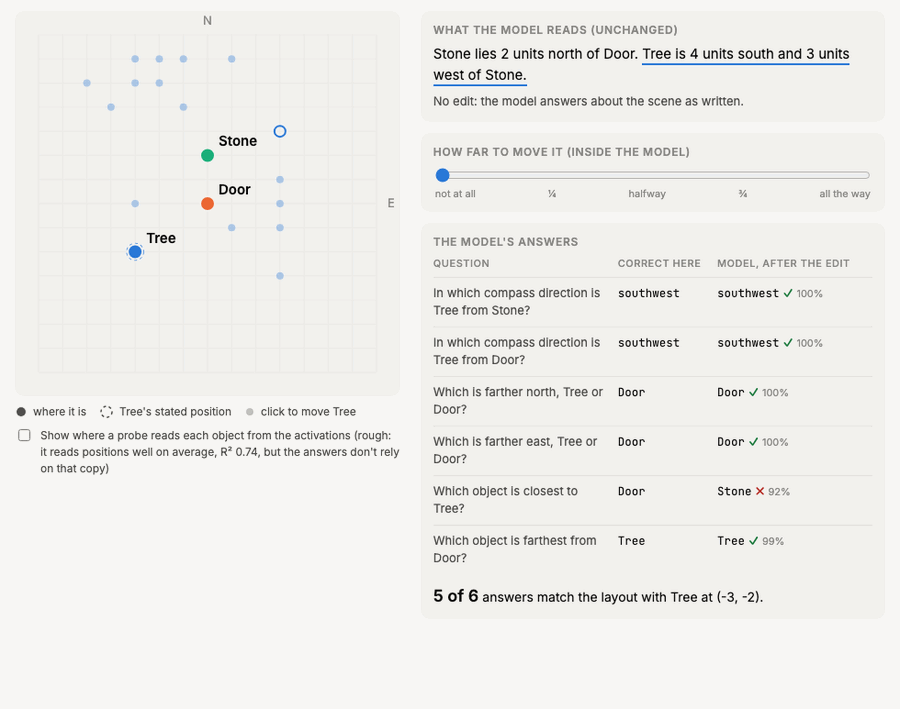

# The AI Worked Out Where Things Are, Even When Nobody Told It

*Notes from an ongoing experiment on whether language models "picture" a scene they only read about.*

---

Read this: *"Ana is 3 units north of Bo. Cy is 2 units east of Ana."* Now answer: who is farthest from Bo?

You probably didn't reread the sentences. You placed three dots in your head and looked. Notice that nobody told you where Cy is relative to Bo: you worked it out by chaining the two sentences. Psychologists have argued for decades about what that inner picture is and what it does. I want to ask the same of AI: **when a language model reads a scene described only in words, does it build something like a map inside?**

## The setup

I generated thousands of small layouts that no model could have seen before, described only in words. Each came with questions the text never answers directly: farthest, closest, which direction, who is further north.

First, a filter: there's no point looking for a map inside a model that can't do the task. Eight open models (Qwen, Llama and Gemma, from 1.7 to 27 billion parameters) had to answer instantly, without "thinking out loud". Most struggled. The smallest that handled three-object layouts reliably was **Gemma 3 12B**, so that's the one I opened up. Before looking inside, I wrote down in advance what would count as evidence, so I couldn't move the goalposts later.

## Finding 1: it works out positions nobody stated

Each object is mentioned once more after the description, in a list ("The objects are: Ana, Bo, Cy"). At each mention, I trained a simple linear decoder to read that object's x and y coordinates from the model's internal activations.

- **It works, and well:** R² = 0.74 on layouts the decoder never saw. Shuffled labels, the model's first layer and an untrained copy of the model all score zero.
- **The interesting part is objects like Cy,** whose position only follows from combining two sentences. The decoder reads those as well as directly stated ones (0.74 vs 0.76). A decoder that only gets what each object's own sentence says reaches 0.22 on them.
- **It's computed, not just stored.** A skeptic could say the model keeps both sentences side by side and the decoder adds them up. So I also decoded each object's *distance* to the first one, which you can't get by adding the stated steps. The activations give it (R² 0.62); the best decoder built from the stated steps alone gets nothing (−0.05).
- **It appears suddenly.** The coordinates show up around layer 12 and peak at layer 21, as if the model spends its early layers reading and then assembles the layout.

Earlier work has read real-world coordinates of famous places out of language models, which is memorised geography. For scenes described in the prompt, recent probes found categorical relations (left of, above) or weaker, fragmented coordinate signals. Here, a model works out a coordinate for every object in a scene it has never seen, including positions it had to compute.

## Finding 2: two numbers move the object

Reading a map out of a model isn't the same as the model *using* it. So I went looking for the part of the model its answers actually depend on, and found something compact: inside the sentence that places an object, **two numbers** control where the model thinks that object is.

Change those two numbers (and nothing else: the text stays the same) and the model's answers move with the object. Across 300 new scenes, on questions where the move should change the answer, the edit gives the answer the model would give if the sentence really said the new position **72% of the time**. Editing two random numbers instead does nothing (0%).

A note on that number. I first found the effect while exploring, at 81%. But I'd picked the sentence and the layer after looking at the data, which flatters the result. So I wrote the test down in advance (that sentence, that layer, a pass mark of 70%) and reran everything on scenes the model had never been tested on. It passed: **72%, against 0% for random numbers.** It is strongest for "who is further north / east" (about 90%), weaker for direction (60%), and weakest for closest and farthest (about 35%), which depend on every object at once.

And it isn't a quirk of one model. I ran the same test, with the same rules fixed in advance, on **Gemma 3 27B**, more than twice the size, at the matching depth. It passed more clearly: **83%, against 0% for random numbers**, with direction questions up from 60% to 81%. The bigger model has the same kind of two-number code, and its answers follow it more reliably.

*Try it yourself: pick a scene, click a spot, drag the slider.*

https://codepen.io/CristhianGomezN/pen/myWvzwJ

## Finding 3: it's a switch, not a slider

Here's the twist. If those two numbers were coordinates on an inner map, setting them *halfway* between two positions should put the object halfway. Suppose an object is north of you in one layout and east in another: halfway, it should be north-east.

That's not what happens. Set halfway, the model snaps to one layout or the other. On questions whose answer should change to something in-between, it gives that answer 9% of the time, below the 14% you'd get by guessing (this was also fixed in advance; the exploratory run gave 6%). On Gemma 3 27B it is even clearer: 5%, with the model snapping back to the original layout most of the time. The model computes positions, and a compact code steers its answers, but that code behaves like a **switch between stated facts**, not a dial on a map.

## Finding 4: the worked-out positions aren't what it answers from

Back to Cy, whose position the model has to work out. Finding 1 showed that position is in there. Is it the one the answers use?

Take a chain: Ana is placed relative to Bo, and Cy relative to Ana. Now change only Ana's sentence. Ana moves, and Cy moves with Ana, but Cy's own sentence is word-for-word the same. Whatever differs inside the model over Cy's sentence can only be Cy's worked-out position. So I copied the model's activations over Cy's sentence from the moved version into the original one, layer by layer, and asked: do the answers now put Cy at its moved spot?

Almost never. At the best layer, 7% of the answers that should change did; at most layers, under 2%. (Again, the test and the pass mark were written down before the data existed.) The model works out where Cy is, but when it answers, it goes back to the sentences it was given and recombines them.

## So, does an AI picture the scene?

Partly. It builds the picture: positions it was never told are sitting in its activations (Finding 1). But when it answers, it doesn't consult that picture. It reaches for something more like a filing card for each sentence: a compact, editable code for what each sentence stated (Findings 2 and 3), recombined on demand (Finding 4). That's a sharper answer than I expected, and it gives the next experiments a target.

## The question this leaves

Which raises the obvious question: **if the model answers from what it was told, why build the map at all?** I see three possibilities.

- **It's a backup.** In my chain test, the original sentences were still there, and the model could always work Cy out again from them. The map might be one of several copies that simply loses the vote when they disagree.
- **It's a by-product.** Models learn from mountains of text where tracking where things are helps predict the next word. The map may be a trace of that: real, readable, but nothing here depends on it.
- **It's for other jobs.** I asked five kinds of questions. The map may serve ones I didn't ask: describing the scene, continuing the story, harder geometry.

The next experiment is designed to tell these apart: erase the map wherever the model stores the positions it worked out, and see whether its answers get worse. If they do, the map is doing real work. If nothing changes, it's a by-product.

## What's next

- **Bigger models.** From 12B to 27B, the code got stronger but stayed a switch. Does that ever change with scale?
- **Shapes, not points.** Triangles, holes, rotations: geometry where a real picture would pay off.
- **Seeing.** What changes when the same model is shown an actual image.

*Code, preregistration and results will be released with the paper.*
