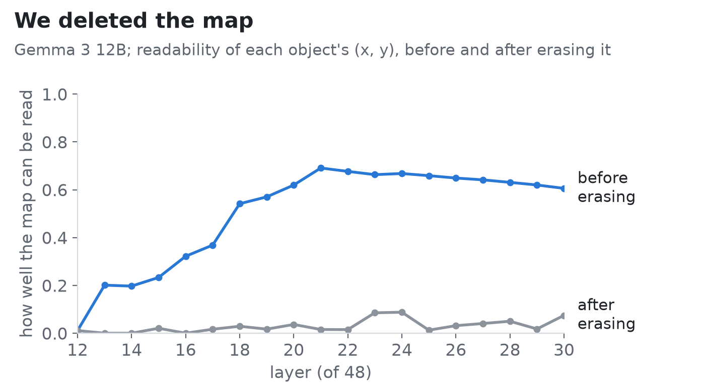
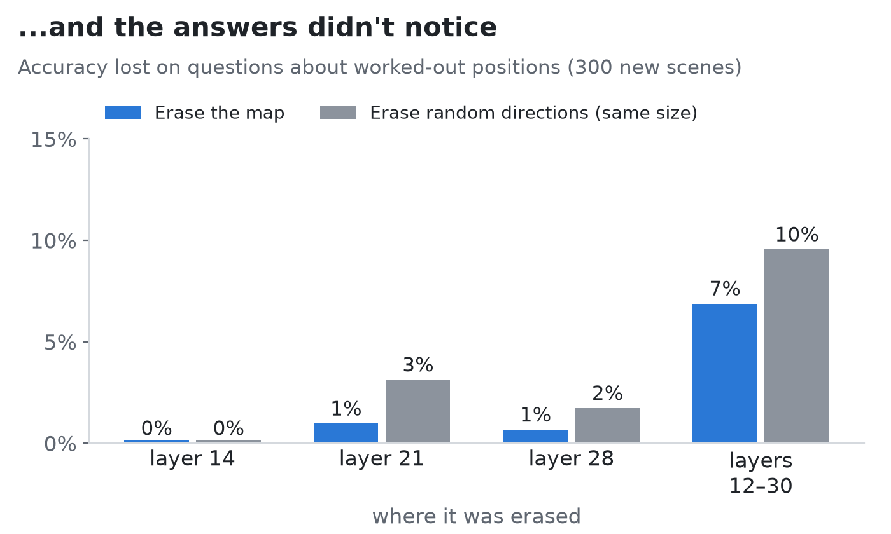

# I Found the Map Inside the AI. Then I Deleted It, and Nothing Happened.

*Part 2 of an experiment on whether language models "picture" a scene they only read about.*

---

In [Part 1](https://medium.com/@gfcristhian98/the-ai-worked-out-where-things-are-even-when-nobody-told-it-d4f9faed80ea), I gave an AI model (Gemma 3, an open model from Google) small scenes described only in words: *"Ana is 3 units north of Bo. Cy is 2 units east of Ana."* Then I looked inside it while it answered questions like "who is farthest from Bo?"

Two things came out of that.

- **It works out a map.** From the model's internal numbers, I could read where every object is, even objects like Cy whose position nobody stated. You have to combine two sentences to get it, and the model does.
- **Its answers run on something else.** What actually moves the answers is a small code, two numbers, sitting on each sentence. Edit those two numbers and the model answers as if the object had moved. Set them halfway between two positions, and the model doesn't put the object halfway. It snaps to one or the other, like a switch.

That left an obvious question: **if the answers don't use the map, why is it there? Is it really not used?**

So I tried the most direct test I could think of. I deleted it.

## Deleting the map

The map lives in a handful of directions inside the model's activations. Those are the directions a simple decoder uses to read each object's coordinates. You can find those directions and remove them, then check that the decoder can't read the positions anymore. I did that at every layer where the map shows up, and at every word of the prompt, not just one spot.

It worked. Before erasing, the coordinates could be read out well (up to 0.69 on a 0-to-1 scale). After erasing, they can't (at most 0.09).

Then I asked the model 5,320 questions about 300 new scenes and compared its answers with and without the map. As a control, I also erased random directions of exactly the same size. If the map mattered, deleting it should hurt, especially on questions about positions the model had to work out, and it should hurt more than deleting random directions.

It didn't. Deleting the map cost **no more accuracy than deleting random directions**, and a bit less, at every place I tried. Even when I deleted it at all 19 layers at once, the model lost 7% of its answers to the map erasure and 10% to the random one.

The model builds a map of the scene, and you can take it out without its answers noticing.

## Two more surprises about the code it does use

While I was at it, I tested the small "two-number code" from Part 1 more carefully.

**It isn't a coordinate.** If those two numbers were x and y, they would change smoothly with the sentence: "2 units north" a little, "4 units north" twice as much. They don't. A straight-line fit from the sentence's distances to the two numbers works no better than for random directions. This fits the switch from Part 1. The code behaves more like a category ("north-ish, east-ish") than a ruler.

**But it's real.** A fair criticism of this kind of edit is that it might work through a back door: you find *some* two numbers that change the answer without them meaning anything to the model. So instead of copying the two numbers from another run, I wrote them in myself, computed only from what the sentence says. That still moved 27% of the answers, against 0% for the same procedure on random directions. Values the model would produce from the sentence act on the answers through this code. It's a genuine part of how the model answers, even if a simple straight-line reading only captures part of it.

## So why build a map at all?

Honestly, I don't know yet. Here are three candidates.

1. **It comes for free.** Inside the model, information is constantly mixed and added together. If each sentence leaves a trace of its direction, and the model gathers those traces at each object's name, the sum can look like a coordinate to a decoder. That would be a map nobody built on purpose. It isn't the whole story, since the model also encodes distances, which you can't get by adding, but it's probably part of it.
2. **My questions were too easy to need it.** Everything I asked can be answered by chaining sentences: north of Bo, then east of that. With three objects, chaining is cheap and reliable. A map would pay off where chaining breaks down: many objects, long chains, questions about the whole layout.
3. **It's for other jobs.** Describing the scene, continuing a story, things I didn't test.

The second one is the hopeful one, and it's testable. If I make the scenes harder and erasing the map *starts* to hurt, that would show when a model starts relying on a mental map. That's the next experiment.

## What this does and doesn't show

- **It shows** that in this task, the map the model computes can be read, can be deleted, and isn't what the answers depend on.
- **It doesn't show** that language models never use maps. I erased the *straight-line* (linear) version that decoders read; a more tangled version could still exist. And this is one model family on one kind of puzzle.

There's also a broader lesson. A lot of AI research finds something inside a model with a decoder and concludes the model "has" it, and implicitly, uses it. Here the decoder found a real map, and the model didn't need it. **Being able to read something out of a model isn't the same as the model using it.**

## How I kept myself honest

Every test in this post was written down, including what would count as success or failure, before any data existed. Some predictions failed along the way, and they are reported as failures. The code and the full write-up will be released with the paper.

---

*Part 1, with an interactive demo where you can move an object inside the model yourself: [The AI Worked Out Where Things Are, Even When Nobody Told It](https://medium.com/@gfcristhian98/the-ai-worked-out-where-things-are-even-when-nobody-told-it-d4f9faed80ea).*
