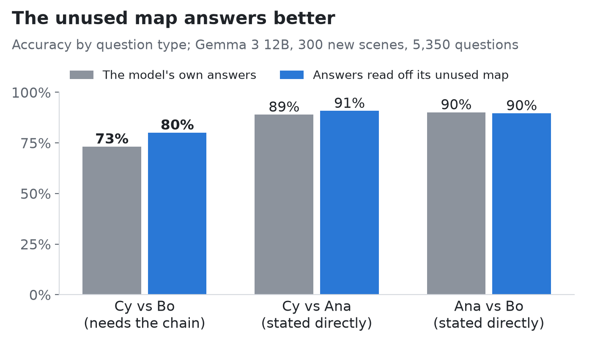

# The AI Knew Better Than It Answered

*Part 3 of an experiment on whether language models "picture" a scene they only read about.*

---

In [Part 2](https://medium.com/@gfcristhian98/i-found-the-map-inside-the-ai-then-i-deleted-it-and-nothing-happened-70f599a6fc83), I found a map inside an AI model and deleted it, and the model's answers didn't change. That result bugged me. If the model doesn't need its map, why build one? And if it isn't using the map, what *is* it using?

So I kept digging. The answer turned out to be more interesting than "the map is useless".

**Quick recap.** I give Gemma 3 (an open model from Google) small scenes in words: *"Ana is 3 units north of Bo. Cy is 2 units east of Ana."* Then I ask questions like "is Cy further north than Bo?". Nobody says where Cy is relative to Bo. You have to chain two sentences: north of Bo, then east of that. Inside the model, I can read a map with every object's position, Cy included. But deleting that map didn't hurt the answers.

## Step 1: what does the question actually look at?

A language model answers by letting each word "look back" at earlier words. That's called attention, and you can switch it off selectively. So I blocked the question from seeing one part of the scene at a time:

- **Blocked from the object list** (where the map lives): nothing changed.
- **Blocked from Cy's own sentence:** questions about Cy and Ana got much worse (35 points).
- **Blocked from Ana's sentence:** questions about Ana and Bo got much worse (41 points).

So the question reads each object's own sentence (mostly in the middle of the model, layers 16 to 31) and never visits the map. That's why deleting the map did nothing: the answering process never goes there.

There was a surprise, though. For questions that *need* the chain, like "Cy versus Bo", blocking Ana's sentence barely mattered (3 points). The question never reads Ana's sentence, yet it needs Ana's position. So where was that information coming from?

## Step 2: the model cuts corners

I checked directly. I took pairs of scenes where Cy ends up in **exactly the same new spot**, but for different reasons:
- in one, Cy's own sentence changes ("Cy is 4 units east of Ana");
- in the other, only *Ana's* sentence changes, and Cy moves along with Ana.

The geometry is identical, so a model that really chains the sentences should update its answers about Cy equally often in both. It doesn't:

- **When Cy's own sentence changes,** the model updates its answers about Cy versus Bo correctly **39%** of the time.
- **When only Ana's sentence changes,** it does so **21%** of the time. Most of the time (72%) it doesn't change its answer at all.

So the model answers questions about Cy mostly from Cy's own sentence, and gives Ana's part about half the weight it deserves. It doesn't fully chain; it takes a shortcut.

## Step 3: the map would have done better

Here's the twist. The map inside the model *does* chain properly: it reads Cy's position as accurately as Ana's. So I asked one more question, written down in advance like every test in this series: **if you answered from the model's own unused map, would you do better than the model?**

I read every object's position off the map with a simple decoder, answered each question with plain geometry, and compared that with the model's own answers on 300 new scenes:

- **On questions that need the chain (Cy vs Bo),** the map wins: **80% versus 73%**.
- **On questions stated directly in a sentence,** it's a tie (about 90% each).

The map wins exactly where the model cuts corners. **The model holds a better answer than the one it gives**, in a place its answering process never looks.

## So why build the map?

I still can't say for sure, but the picture is much clearer now:

- **The map gets built along the way.** While reading, the model works out where everything is: a genuine, composed map, accurate enough to beat its own answers.
- **The answers come from a different, shortcut route.** When a question arrives, the model goes back to the sentence about each object it's asked about, and leans on that sentence alone.
- **The two routes never meet.** The map sits off to the side, accurate and unused.

People do something similar, by the way. Psychologists found that readers who build accurate mental maps from descriptions still answer questions about stated relations from the text itself, and consult the map only for real inferences (Taylor & Tversky, 1992). The difference is that our model doesn't consult the map even when it should.

## The fine print

- **"Read off the map" means a simple decoder I trained,** using the true positions. That shows the right answer is present and easy to read out. It doesn't prove the model could use it without some extra machinery.
- **The advantage depends on where I read the map.** It shows up clearly in the layers where the map is sharpest, and fades or reverses where it's blurrier. All of it is reported.
- **This is one model family** (Gemma 3) on one kind of puzzle.
- **One bug, found and fixed along the way:** in one test, some direction questions were sorted into the wrong group. It didn't change any conclusion, and it's documented.

## What's next

The obvious question: can we *connect* the two routes? If you nudge the model to read its own map, or fine-tune it slightly, does it start answering better? That would turn this from an observation into a lever. The model already has what it needs; it just doesn't look.

*Every test in this series was written down, with what would count as success or failure, before the data existed. The paper, code and preregistrations are coming soon.*

---

*Part 1, with an interactive demo: [The AI Worked Out Where Things Are, Even When Nobody Told It](https://medium.com/@gfcristhian98/the-ai-worked-out-where-things-are-even-when-nobody-told-it-d4f9faed80ea). Part 2: [I Found the Map Inside the AI. Then I Deleted It, and Nothing Happened.](https://medium.com/@gfcristhian98/i-found-the-map-inside-the-ai-then-i-deleted-it-and-nothing-happened-70f599a6fc83)*
