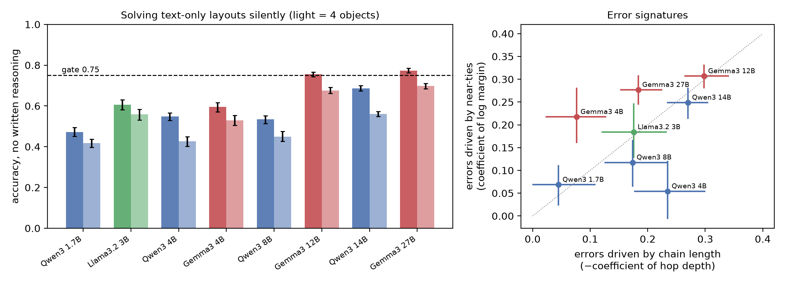
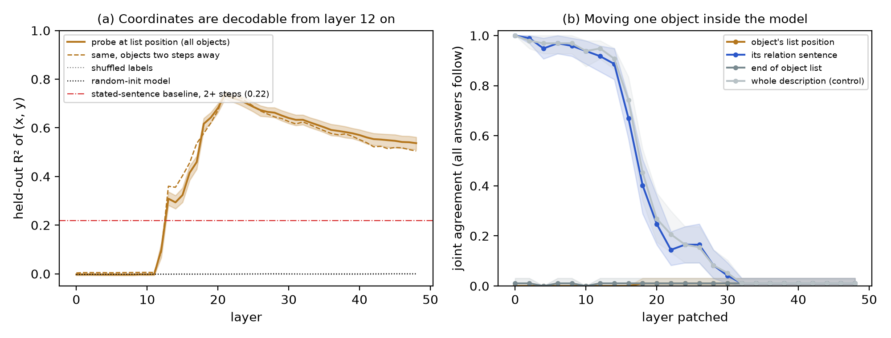
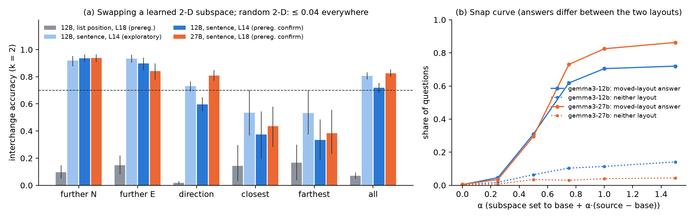
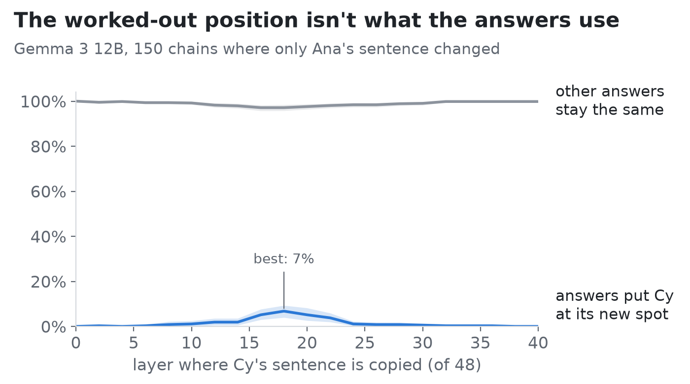

# Decodable, Not Used: A Language Model Composes a Spatial Map but Answers from a Code for Each Stated Relation

*Cristhian Gómez Neira*

## Abstract

When people read "A is 3 units north of B; C is 2 units east of A", they can answer questions the text never answers, as if consulting an inner picture. We ask whether a language model does the same, and whether it *uses* such a picture. We generate unseen layouts described only in text and study Gemma 3 12B, the smallest of eight open models that solves 3-object layouts without written reasoning. Linear probes decode each object's (x, y) from its activations (R² = 0.74, controls ≈ 0), including positions that follow only by combining two sentences, and a nonlinear quantity (distance to the root) that no additive code of the stated offsets predicts (0.62 vs −0.05). Yet copying these decodable representations from a layout where the object sits elsewhere changes no answer. The answers depend instead on a 2-D subspace over the sentence that states the object's position. Swapping it moves 0.72 of the affected answers in a preregistered test (0.83 in Gemma 3 27B; random subspaces 0.00). Set halfway between two layouts, this code does not produce in-between answers: it switches between the stated ones (0.085 and 0.055 vs chance 0.141). Composed positions are decodable but are not the variable the answers read: erasing the linearly decodable coordinates at every token and layer 12–30 (probe R² ≤ 0.09 after erasure) costs no more accuracy than erasing random directions of the same rank. This holds on 3-object scenes and on 4–5-object scenes where questions require chaining up to four relations. Attention knockout and transfer tests show why: the question reads each object's own sentence in layers 16–31 and never reads the object list. The answers also use the chain only partially. When only a parent's sentence moves an object, the model updates its answers about that object about half as often as when the object's own sentence moves it the same distance. The decodable map composes the chain correctly, but the answers do not. The 2-D code is not a linear function of the stated offset, yet values written from a fitted linear map still move 0.27 of the answers (random 0.00).

## 1. Introduction

Does a language model solve a spatial problem by consulting something like a map, or by chaining the relations it was given? This is a question about the *format* of its internal computation, and written reasoning cannot settle it, because written reasoning contains only words. Geometry can be *read out* of language models: world coordinates of places (Gurnee & Tegmark, 2023), circular features for days and months (Engels et al., 2024), and spatial relations in described scenes (Tehenan et al., 2025). Some of it is used. Tehenan et al. steer single answers along probed relation directions, and An et al. (2026) find spatial information in 7–8B models that "can causally influence behavior" but is "transient, fragmented across task families, and weakly integrated into final predictions".

We test the property that separates a usable map from a readable one: **editing one object's internal position should move every spatial answer consistently, including to positions no sentence states.** Our contributions:

- A text-only layout task with a behaviour gate, so that the analysed model actually solves it without writing.
- Evidence that Gemma 3 12B *composes* per-object coordinates across sentences, including a nonlinear quantity (distance) that rules out simple sentence copying.
- A dissociation: copying the decodable coordinates, or steering along the probe's directions, changes no answer (preregistered).
- A 2-D subspace over the stated sentence that does control the answers, confirmed on fresh data with a preregistered rule and replicated in Gemma 3 27B.
- Evidence that this code behaves as a switch between stated values, not as a coordinate: halfway settings snap, and a composed position copied from a word-identical sentence is not used (both preregistered).
- Preregistered erasure tests: removing the decodable coordinates everywhere does not hurt answers about inferred positions more than a random erasure, on 3-object scenes or on 4–5-object scenes that need chains of up to four relations; and a write-in test that bears on the subspace-illusion critique.

## 2. Task and methods

**Scenes.** Each scene places 3 named objects on an integer grid in [−6, 6]². Positions are fixed by a tree of relations ("X is k units north of Y", or "k north and m east"). One object is the root. An object placed relative to an object that is itself placed relative to the root is "two steps" away. A *leaf* is an object nothing else is placed relative to. After the description, the prompt lists the objects ("The objects are: A, B, C."). Each name in this list can attend to every sentence, so it is a natural *readout position* for a finished map.

**Questions.** Five types are used: farthest from X; closest to X; compass direction of Y from X (8 options); which of two objects is farther north; and which is farther east. Each allowed answer is scored by its log-probability, with no generation. Correct answers win by at least 1 unit (10° for direction). All causal metrics below are *model-relative*: they compare the patched answer with the model's own answer on the scene being imitated.

**Behaviour gate** (preregistered). A model qualifies with ≥ 0.75 accuracy on 4-object scenes and above-chance accuracy on multi-step questions. If none qualifies, 3-object scenes are used. The smallest qualifying model is analysed, and question types at chance are excluded.

**Probes.** Ridge regression maps the residual stream at an object's list position to its (x, y) relative to the scene centre, with 3,000 scenes split 80/20 by scene. Controls are shuffled labels, layer 0, and a randomly initialised model. A *stated-sentence baseline* regresses position on the object's own stated offset and chain depth: what a reader who never combines sentences would know. A distance probe predicts each object's distance to the root. Distance is not a sum of stated offsets, so the best *additive* baseline (one-hot codes of the object's and its parent's offsets) cannot fit it for two-step objects.

**Patching.** Each pair of scenes differs in the one sentence that places a leaf. We run the model on the base scene but copy in the source scene's hidden states at one site and one layer. Sites: the object's list position; the end of the list; the object's sentence; the whole description (positive control); and, exploratorily, parts of the sentence and the question tokens. *Joint agreement* is the share of pairs in which every answer then equals the model's answer on the source scene, among pairs where at least one answer differs.

**Distributed alignment search (DAS).** Following Geiger et al. (2024), we learn an orthonormal $Q \in \mathbb{R}^{d\times 2}$ and set $h' = h_{\text{base}} + QQ^\top(h_{\text{src}} - h_{\text{base}})$ at every position of a site at one layer. Q is trained with Adam (lr 10⁻³, 2 epochs) so that the patched run gives the model's answer on the source scene. *Interchange accuracy* is the share of questions, among those where the model's source and base answers differ, on which the patched answer equals the source answer. The control is a random 2-D subspace. Training and test use disjoint pairs (300 each).

**Interpolation test.** With Q fixed, we set the subspace to base + α(source − base) for α ∈ {0, ¼, ½, ¾, 1, 1½} on 150 test pairs. Answers are scored against the layout with the object at the matching interpolated position (margin ≥ 1 unit / 10° there). The key subset is *novel* questions, whose answer at the interpolated position differs from the answer in both stated layouts. A coordinate code should give that in-between answer; a switch between stated values should not. Chance on this subset is the mean of 1/8 (direction) and 1/2 (binary questions), 0.141.

**Composed-position transfer (E3).** In a chain R → M → C, the source scene changes only M's sentence, so M and C both move, while C's sentence is word-for-word identical. Activations over C's sentence can then differ only through what they read from M's sentence: C's composed position. We copy C's sentence from the source run into the base run at one layer (0–40, step 2; 150 pairs). *follow_T* is the share of answers equal to the model's answer on a *target* scene, with C at its moved absolute position and M unmoved, among questions where target and base answers differ. *stable* is the share of control answers left unchanged.

**Preregistration.** Hypotheses, metrics and decision rules were committed before the corresponding data (`docs/preregistration*.md`). Section 6 lists which results are preregistered, which are exploratory, and which preregistered predictions failed.

## 3. Results

### 3.1 Behaviour

We screened eight models (Qwen3 1.7B–14B, Llama 3.2 3B, Gemma 3 4B–27B) on fresh scenes (Fig. 1). None reached 0.75 on 4 objects. On 3 objects, the smallest model to qualify was **Gemma 3 12B** (0.76 [0.74, 0.77]; 0.68 on 4 objects; Gemma 3 27B: 0.77). "Is Y closer to X than Z?" was at chance for every model and was excluded. The object list does not help: removing it leaves Gemma 3 12B's accuracy unchanged (0.66 with and without). Written reasoning does help: on 60 4-object questions, Qwen3-14B scored 0.98 with thinking enabled and 0.57 without (different scoring methods; see Limitations).

*Figure 1. Left: accuracy without written reasoning (dashed: preregistered gate). Qwen models put little probability on bare one-word answers (median < 0.02), so their accuracies are lower bounds. Right: standardised logistic coefficients of errors on chain depth and on how close the competing answers are.*

### 3.2 Composed coordinates are decodable

On 3,000 fresh scenes, R² at the list position is ≈ 0 up to layer 11, jumps at layers 12–13 and peaks at **layer 21 (0.74 [0.72, 0.75])**; shuffled labels, layer 0 and the random-init model all give 0.00 (Fig. 2a). Two-step objects are decoded as well as one-step objects (0.74 vs 0.76), while the stated-sentence baseline reaches only 0.22 on them. The code is per object: no probe reads all objects from the end of the list (R² ≤ 0.03), and activation distances track true distances only weakly (Spearman 0.19).

The coordinates are also *computed*, not merely the two stated offsets held side by side. For two-step objects, a probe for distance to the root reaches **R² = 0.62 [0.56, 0.67]** at layer 21, against −0.05 for the best additive baseline (exploratory). The same coordinates are decodable at the object's name inside a question ("Which object is farthest from X?": 0.74 for two-step objects, distance 0.63) and, for two-step objects, at the end of the object's own sentence (0.76 at layer 24). The preregistered probing criteria for a map are met.

### 3.3 The answers do not read them where they are decodable

- **Copying the readout positions moves no answer** (preregistered). At the moved object's list position, joint agreement is ≤ 0.01 at every layer of a 100-pair sweep, including layer 21 where the probe peaks. On 390 new pairs it is **0.00 [0.00, 0.00]** at the two best sweep layers, and the same holds at the end of the list. The patch is not inert, but small: it shifts the base answer's log-probability by at most 0.13 nats on average, against 3–7 nats for the sentence patch (layers 6–24). Copying everything *except* the readout positions works as well as copying the whole description (layer 21: 0.20 vs 0.25; exploratory).
- **Nor do the other decodable sites.** Copying only the moved object's name in the question gives 0.00 at every layer, although the coordinates are decodable there (exploratory). Copying only the last token of its sentence gives ≤ 0.01, while copying the rest of the sentence matches the whole sentence (exploratory).
- **Steering along the probe directions fails** (preregistered). Moving the list-position representation along the probe's (x, y) directions at layer 21, over ±5 units, flips an answer in 2% of the 268 sweeps where geometry says some answer must flip; predicted and observed flip points are uncorrelated (r = 0.03), and all steered states stay within the natural norm range.
- **A learned 2-D subspace at the list position fails** (preregistered). DAS at layer 18 reaches an interchange accuracy of **0.07 [0.05, 0.09]** (Fig. 3a, grey).

Where does the information go? Copying the moved object's *sentence* gives 0.94 [0.91, 0.96] at layer 6, close to the whole-description control (0.95). Between layers 16 and 32 both lose their effect (layer 20: 0.18 and 0.23; layer 32: 0.01). Over the same layers, copying the question tokens gains it (0.01 at layer 16, 0.20 at layer 28, 0.78 at layer 32; exploratory). The final position alone carries it only at layers 46–48 (≥ 0.56). The information flows from the stated sentence to the question; the list and mention positions, where the coordinates are best decoded, are bypassed. Against the original preregistration, the P3 criterion for a map fails and the criterion for relational processing is met, so the overall verdict was **mixed**.

*Figure 2. (a) Probe R² of (x, y) at the list position by layer, with controls and the stated-sentence baseline. (b) Joint agreement after copying one site from the source scene (100 pairs). The subspace results are in Figure 3.*

### 3.4 A 2-D code at the stated sentence controls the answers

Because the sentence carries the information, we moved DAS to the sentence site. Exploratorily, at layer 14 (chosen after the sweep), a 2-D subspace reached 0.81 [0.78, 0.83]. We then fixed the site, layer, k = 2, training procedure and decision rule in advance (ALL ≥ 0.70 and random ≤ 0.05; `docs/preregistration_p4c.md`) and reran on fresh pairs (seeds 105/106).

| | Gemma 3 12B, layer 14 / 48 | Gemma 3 27B, layer 18 / 62 |
|---|---|---|
| DAS k = 2, all questions | **0.72 [0.68, 0.75]** | **0.83 [0.80, 0.85]** |
| random k = 2 | 0.00 [0.00, 0.01] | 0.00 [0.00, 0.01] |
| further north / east | 0.94 / 0.90 | 0.94 / 0.84 |
| direction | 0.60 [0.54, 0.65] | 0.81 [0.77, 0.85] |
| closest / farthest | 0.38 / 0.33 | 0.43 / 0.38 |
| verdict | confirmed | confirmed |

The 27B layer was set by matched relative depth (14/48 × 62 ≈ 18), not searched. The drop from 0.81 to 0.72 is the expected shrinkage after a post-hoc choice of site and layer. The code is reliable for questions about one coordinate, weaker for direction, and weak for closest and farthest, which depend on all objects at once (Fig. 3a).

Three follow-up analyses use only saved results (exploratory; `results/free/`):

- **Stability.** The exploratory and confirmation subspaces were trained on disjoint scenes. Their principal angles are 47.0° and 56.1° (cosines 0.68 and 0.56). For random 2-D subspaces of the same 3,840-d space, the largest cosine is at most 0.07 in 2,000 draws. Independent runs find overlapping, though not identical, planes.
- **Failures.** At α = 1 on the 150 interpolation pairs, the answer follows the edit on 0.70 (12B) and 0.82 (27B) of affected questions. Most failures leave the base answer in place (0.18 and 0.14) rather than producing a third answer (0.11 and 0.04).
- **Competence.** The edit succeeds more often where the model answers the moved scene correctly when reading it as text: 0.75 vs 0.48 (12B) and 0.85 vs 0.59 (27B). The code is tied to the computation the model uses when it gets the answer right.

*Figure 3. (a) Interchange accuracy of a learned 2-D subspace by question type (95% CIs; dashed: 0.7). Grey: list position, the preregistered readout site. Blue and orange: the moved object's sentence, exploratory and preregistered runs. Random 2-D subspaces give ≤ 0.04 for every type. (b) Share of affected questions whose answer equals the model's moved-layout answer (solid) or neither layout's answer (dotted), as the subspace is set to base + α(source − base).*

### 3.5 The code is a switch, not a coordinate

If the two dimensions encoded the object's position, setting them halfway should put the object halfway, and questions whose answer at that position differs from both stated layouts should get that in-between answer. They rarely do (preregistered rule: *switch* if the upper 95% bound of the in-between rate is below chance):

| | Gemma 3 12B | Gemma 3 27B |
|---|---|---|
| α = ½, in-between answer (n = 164) | **0.085 [0.041, 0.137]** | **0.055 [0.019, 0.096]** |
| original-layout answer | 0.60 [0.51, 0.68] | 0.73 [0.64, 0.81] |
| moved-layout answer | 0.23 [0.16, 0.31] | 0.21 [0.14, 0.28] |
| verdict (chance 0.141) | switch | switch |

The exploratory run gave the same picture (0.06 [0.02, 0.10], n = 150). The transition is sharp and the same in both models: on questions where the two layouts' answers differ, the share taking the moved-layout answer is 0.00 / 0.05 / 0.31 / 0.62 / 0.70 for α = 0, ¼, ½, ¾, 1 in 12B and 0.01 / 0.04 / 0.29 / 0.73 / 0.82 in 27B, while answers matching neither layout stay at 0.14 or below (Fig. 3b). The code selects between the stated values; it is not a metric dial.

### 3.6 A composed position is not what the answers take

Two preregistered chain experiments ask where C's composed position lives when C is placed relative to M.

*Copying M's sentence (E2).* C follows M wherever the patch is effective (C follows 0.95 at layer 14, M 0.96), which met the preregistered criterion for lazy, relational processing. On a stricter question set, defined after the data (a dated deviation), C follows less than M from layer 16 (0.70 vs 0.92), giving a mixed verdict.

*Copying C's identical sentence (E3).* If C's sentence carried C's composed position and the answers read it there, copying it should move C without moving M. It does not. At layer 0, as required by design, follow_T is 0.00. Over layers 2–40 it never exceeds **0.07 [0.04, 0.09]** (layer 18), while control answers stay at ≥ 0.97 (369 target and 625 control questions). The preregistered verdict is **not carried**. (A reported "follows source" column is ≈ 0.85 already at layer 0, because base and source answers mostly agree on those questions; it is uninformative.)

*Figure 4. E3: share of answers that place C at its moved position with M unmoved (blue) and share of control answers unchanged (grey), by the layer at which C's word-identical sentence is copied (Gemma 3 12B, 150 chains; 95% CIs).*

### 3.7 Is the code genuine, and is the map used? (P5, preregistered)

Three follow-ups on Gemma 3 12B, with rules fixed before the data (`docs/preregistration_p5.md`).

*Natural encoding (P5a).* For 600 new aligned pairs, we regress the change in the two P4c subspace coordinates at each token of the moved object's sentence on the change in its stated offset (one 2×2 map per token position from the sentence end; pair-grouped 5-fold CV). The fit reaches **R² = 0.31**, inside the range of 200 random 2-D subspaces (95th percentile 0.35, 99th 0.39). Random directions score this high because the number words themselves change between the two sentences. The preregistered verdict is **no linear encoding**: the code is not a linear coordinate of the stated offset.

*Write-in (P5b).* On the 300 P4c test pairs, instead of copying the source run's coordinates, we set them to base + $W_j\,\Delta\mathrm{off}$ using the fitted maps. The copy edit reproduces the P4c result exactly (**0.72 [0.68, 0.75]**). The write-in moves **0.27 [0.22, 0.31]** of the affected answers; the same write-in through the random P4 control subspace moves **0.00**. The ratio, 0.37, gives the preregistered verdict **partial**. The write-in works for "further east" (0.65) far better than for "further north" (0.28) or direction (0.14). Values derived from the stated offset therefore act on the answers through this subspace, so it is not a purely dormant direction; but a linear map from the offset captures only part of what the copied values carry.

*Erasing the map (P5c).* At each layer 12–30 we fit the P2 ridge probe on object-list activations of 2,000 new scenes and remove its directions by iterative nullspace projection (Ravfogel et al., 2020) until the probe's held-out R² falls below 0.1. That takes rank 2–10 and leaves R² ≤ 0.09 at every layer (from up to 0.69). We then erase this basis at every token position, at layer 14, 21 or 28, or at all layers 12–30, and compare with random bases of the same rank. On 300 new chains (5,320 questions), erasing the map never hurts questions that involve the two-step object more than random erasure does. The excess drop is −0.003, −0.022, −0.011 and −0.027 for the four configurations; the largest upper CI bound is 0.001. Stated-only questions behave the same way. The preregistered verdict is **map not used (in this subspace)**.

*When chaining is hard (P6).* Three-object scenes need at most two chained relations, so the map might be unused only because the task is easy. P6 repeats the erasure on 4–5-object scenes (`docs/preregistration_p6.md`). The INLP fit (2,000 scenes) takes rank 2–8 and leaves R² ≤ 0.095 at every layer, from up to 0.60. Questions are grouped by the hop of the deepest object they involve. On 300 new scenes (7,200 questions), clean accuracy is 0.82 at depth 1, 0.69 at depth 2, 0.65 at depth 3 and 0.66 at depth 4, against chance ≈ 0.36, so deep questions have headroom (0.29 above chance). Erasing the map does not hurt deep questions more than random erasure: the excess drop is −0.005, 0.023, 0.001 and −0.031 at layers 14, 21, 28 and 12–30. The only reliably positive value, 0.023 [0.004, 0.041] at layer 21, is a fifth of the preregistered threshold of 0.10, and erasing at every layer 12–30 again hurts less than random erasure. The preregistered verdict is **still not used**.

### 3.8 What the question reads (P7, preregistered)

To find where the answers take positions from, we block attention from the question tokens to one span of the prompt. The question tokens are everything after the object list. We block either in all 48 layers or in one third of them, on 300 new chains R → M → C (4,842 questions; `docs/preregistration_p7.md`). Questions fall into three classes:
- **CR** involve C and R, so they need C's composed position (clean accuracy 0.70);
- **CM** involve only C and its parent (0.96);
- **MR** do not involve C (0.90).

*The object list is not read.* Blocking it changes accuracy by at most 0.018 in any class or layer window. The answers never need the place where the map is decodable.

*Each object's own sentence is read, in layers 16–31.* Blocking C's sentence costs CM questions **0.351 [0.317, 0.384]** and CR questions 0.133. Blocking M's sentence costs MR questions **0.410 [0.380, 0.443]**. Nearly all of each effect comes from layers 16–31 (0.259 and 0.327). The knockout is therefore effective and selective. Blocking C's sentence even helps MR questions slightly (−0.065), as if it competes with them.

*The question does not re-read the chain.* Blocking M's sentence costs CR questions only **0.027 [0.017, 0.039]**, although these need M's offset. The preregistered verdict is **composed position available without M's sentence**. This rejects our hypothesis that the question re-reads the chain of relations.

The list is not read, and C's own sentence is. So whatever M-dependent information reaches the question must arrive through C's sentence tokens, which can themselves attend to M's sentence, or must be small.

### 3.9 How much of the chain do the answers use? (P8, preregistered; P8b, exploratory)

E3 copied C's sentence at a single layer, and the copy could have been overwritten by later layers that re-read M's unchanged sentence. P8 (`docs/preregistration_p8.md`) closes that loophole. On 150 new pairs, it copies C's word-identical sentence from the run where M (and with it C) moved, at **every layer from L to the last**. Even a complete copy from L = 0 moves only **0.13 [0.09, 0.17]** of the target answers, with controls stable at 0.96. The effect stays near that level up to L = 16, falls to 0.02 by L = 24 and to 0.00 from L = 32. The copy only matters before the question reads C's sentence, consistent with P7's layers 16–31. The preregistered verdict is **partial**: C's sentence carries only a small part of C's composed position.

An exploratory analysis of the same pairs, added after the data, explains why (`scripts/p8_behavior.py`). In each pair, C ends up at the same new position in two scenes. In the source only M's sentence changed; in the target only C's own sentence changed. On questions about C and R alone, the geometric change is therefore identical. The model updates to the correct new answer in **0.39 [0.32, 0.45]** of these questions when C's own sentence changes, but in only **0.21 [0.15, 0.26]** when only M's sentence changes (n = 290); 72% of its answers do not change at all. The answers use the parent's offset only partially. Unsurprisingly, the knockout and transfer tests find little of it to remove. By contrast, the probes read two-step positions as accurately as one-step ones (§3.2): the unused map composes the chain, and the answers do not.

## 4. Discussion

**What we found.** Gemma 3 12B (and 27B) composes per-object coordinates, including positions and distances that require combining sentences. These coordinates are linearly decodable at every place we looked: the object list, the object's name in the question, and the end of its sentence. None of these representations is what the answers read. The answers depend on a compact code over the sentence that *states* an object's position, and this code behaves like a selector between stated values: it moves answers to the stated alternative, rarely to anything in between. When an object's position must be inferred, the question reads that object's own sentence and never the object list (P7). The answers use the parent's offset only partially (P8, P8b). The model's internal map composes the chain more faithfully than its answers do.

**A filing card, not a map.** A useful summary is that the model keeps something like a filing card per sentence, a low-dimensional code for what that sentence stated. The question reads each named object's card in layers 16–31 (P7). A dependent object's card carries only part of its parent's offset, so answers about inferred positions lean on the object's own stated relation (P8b). It also builds a map-like code for every object, but in this task the map is decodable and not causally used. Because our moved objects are leaves, the 2-D code cannot be distinguished from a code for the object's stated offset; the switch behaviour favours the offset reading.

**Decodability bounds use from above.** Our probes beat every control, including a nonlinear target that rules out sentence copying, and still sit off the causal path. Probing evidence for "world models" and "maps" should be paired with an intervention at the decoded site (cf. Hewitt & Liang, 2019; Vafa et al., 2024; An et al., 2026). The contrast with Tehenan et al. (2025), who steer answers along relation directions, fits the same picture: relation codes steer, coordinate codes did not. "Imagining" is likewise a causal claim. The imagery debate concerned whether depictive representations do work in reasoning, not whether they exist (Kosslyn et al., 1978; Pylyshyn, 2002).

**Why build the map?** We see three possibilities. (i) *Redundancy*: the map is one of several copies, and when the copies disagree, as in our patches, the stated sentences win. (ii) *By-product*: representations that track positions help next-token prediction in general and are decodable here without being needed. (iii) *Other uses*: the map serves questions or tasks we did not ask, such as describing the scene or continuing the story. P5c and P6 speak against (i) in its linear form, and P6 against the view that the map is held in reserve for long chains. Erasing every linearly decodable copy, at every position and across layers 12–30, leaves the answers as intact as a random erasure does. A backup the model falls back on would have to live outside that subspace or be nonlinear. P7 adds the mechanism: the answer pathway reads the objects' own sentences and never reads the list. The map at the list is built off the path the answers take. P8b adds a cost: the map composes the chain, while the answers under-use the parent's offset. Using the map would have improved them. This resembles the gap between faithful internal state and unfaithful decoding reported for propositional probes (Feng, Russell & Steinhardt, 2024) [verify citation]. (ii) and (iii) remain. P6 lengthens the chains but keeps the question types, all of which can be answered by chaining. Questions that are hard to answer without a layout (collinearity, containment) would test (iii) more sharply.

## 5. Limitations

- **Scope.** Two models of one family (Gemma 3); 3-object scenes; five question types; fixed sentence templates and integer grids. Other families did not pass the behaviour gate, which limits what we can say about them.
- **DAS illusions.** A learned subspace can move behaviour through a direction the model does not naturally use (Makelov et al., 2024). Disjoint-data stability, the random control, the link to model competence, and the sentence-site location argue against a pure illusion, and so does P5b: values written from a fitted linear map of the offset move 0.27 of the answers (random subspace 0.00). But P5a finds no linear encoding, and the write-in recovers only 37% of the copy edit, so part of what the copied values carry is not captured by a linear reading of the stated offset.
- **E3 and redundancy.** A null transfer from C's sentence is compatible with the composed position being present there but overridden by recomputation from M's unchanged sentence. "Not carried" means not decisive, not absent.
- **Erasure scope.** P5c removes the linear subspace that the list-position probe reads. Information coded differently at other positions, or nonlinearly, is not removed; "not used" means not used in that subspace. The P5 and P6 tests were run on 12B only.
- **Leaf-only moves.** Moving a leaf changes its sentence and its position together, so the sentence-site experiments locate the information but do not identify its format.
- **Other.** The Qwen3 thinking comparison mixes two scoring methods and covers 60 questions. Small question types (closest, farthest) have wide intervals.

## 6. Preregistration and deviations

- **Preregistered, as planned** (`docs/preregistration.md`): the behaviour gate; P2 probing criteria (met); P3 patching criteria (map criterion failed; relational criterion met); the probe-direction slider (failed, 2% flips); DAS at the list position (failed, 0.07). Overall E1 verdict: mixed. Clarifications are dated in the file: one before any model data, two after the behaviour screen but before any probe or patching result. Rescoring after a code review changed the model the unchanged rule selected, from Gemma 3 27B to Gemma 3 12B.
- **Preregistered follow-ups** (`docs/preregistration_e2.md`, `_e3.md`, `_p4c.md`): E2 (lazy; mixed on a stricter set defined after the data, a dated deviation); P4c confirmation and 27B replication (both confirmed under ALL ≥ 0.70, random ≤ 0.05; the original per-type ≥ 0.7 criterion, reported only, is not met); halfway test (switch in both models); E3 (not carried). P5 (`docs/preregistration_p5.md`, Gemma 3 12B): natural encoding (no linear encoding), write-in (partial), erasure (map not used in this subspace). P6 (`docs/preregistration_p6.md`, 12B, 4–5 objects): still not used. P7 (`docs/preregistration_p7.md`, attention knockout): composed position available without M's sentence (the re-reading hypothesis rejected); list not read. P8 (`docs/preregistration_p8.md`, multi-layer transfer): partial (0.13 at most).
- **Exploratory**: the distance, sentence-end and question-mention probes; the necessity, sentence-part, question-token and mention patches; DAS at the sentence site at layer 14 (the choice that P4c then confirmed); the first interpolation run; the stability, failure and competence analyses; P8b, the comparison of parent-sentence and own-sentence changes.

## Code and data

Code, preregistrations (with their commit history), and all result files will be released at [repo URL].

## References

- An, J., Yang, L., Wang, M., Lu, L., An, W., & Yang, E. (2026). From Human Cognition to Neural Activations: Probing the Computational Primitives of Spatial Reasoning in LLMs. arXiv:2603.26323.
- Engels, J., Michaud, E. J., Liao, I., Gurnee, W., & Tegmark, M. (2024). Not All Language Model Features Are One-Dimensionally Linear. *ICLR 2025*. arXiv:2405.14860.
- Geiger, A., Wu, Z., Potts, C., Icard, T., & Goodman, N. (2024). Finding Alignments Between Interpretable Causal Variables and Distributed Neural Representations. *CLeaR 2024*, PMLR 236, 160–187. arXiv:2303.02536.
- Gurnee, W., & Tegmark, M. (2023). Language Models Represent Space and Time. *ICLR 2024*. arXiv:2310.02207.
- Hewitt, J., & Liang, P. (2019). Designing and Interpreting Probes with Control Tasks. *EMNLP-IJCNLP*, 2733–2743. doi:10.18653/v1/D19-1275
- Kosslyn, S. M., Ball, T. M., & Reiser, B. J. (1978). Visual images preserve metric spatial information: Evidence from studies of image scanning. *JEP:HPP*, 4(1), 47–60. doi:10.1037/0096-1523.4.1.47
- Makelov, A., Lange, G., Geiger, A., & Nanda, N. (2024). Is This the Subspace You Are Looking for? An Interpretability Illusion for Subspace Activation Patching. *ICLR 2024*. arXiv:2311.17030.
- Pylyshyn, Z. W. (2002). Mental imagery: In search of a theory. *BBS*, 25(2), 157–182. doi:10.1017/S0140525X02000043
- Ravfogel, S., Elazar, Y., Gonen, H., Twiton, M., & Goldberg, Y. (2020). Null It Out: Guarding Protected Attributes by Iterative Nullspace Projection. *ACL 2020*, 7237–7256. doi:10.18653/v1/2020.acl-main.647. arXiv:2004.07667.
- Tehenan, M., Bolivar Moya, C., Long, T., & Lin, G. (2025). Linear Spatial World Models Emerge in Large Language Models. arXiv:2506.02996.
- Vafa, K., Chen, J. Y., Rambachan, A., Kleinberg, J., & Mullainathan, S. (2024). Evaluating the World Model Implicit in a Generative Model. *NeurIPS 2024*. arXiv:2406.03689.
