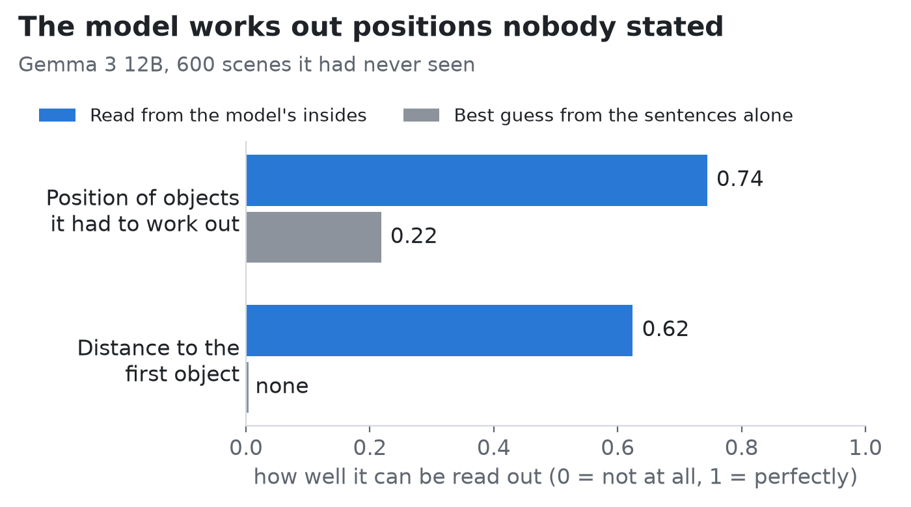
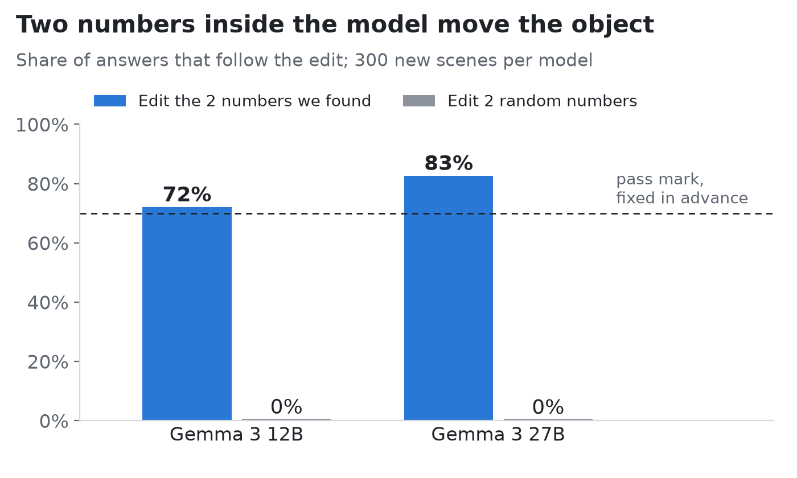
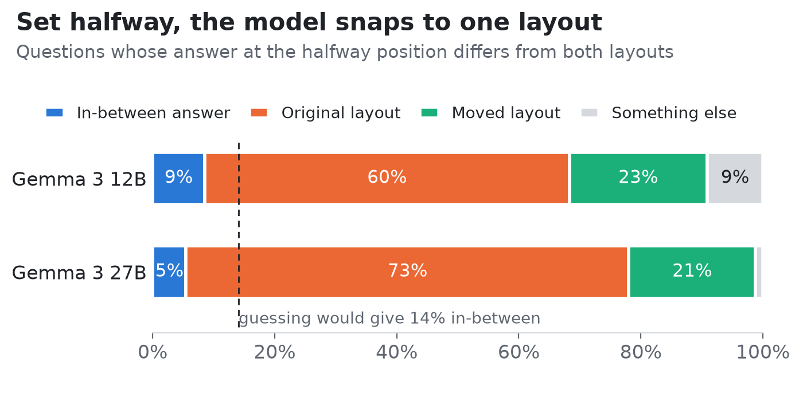
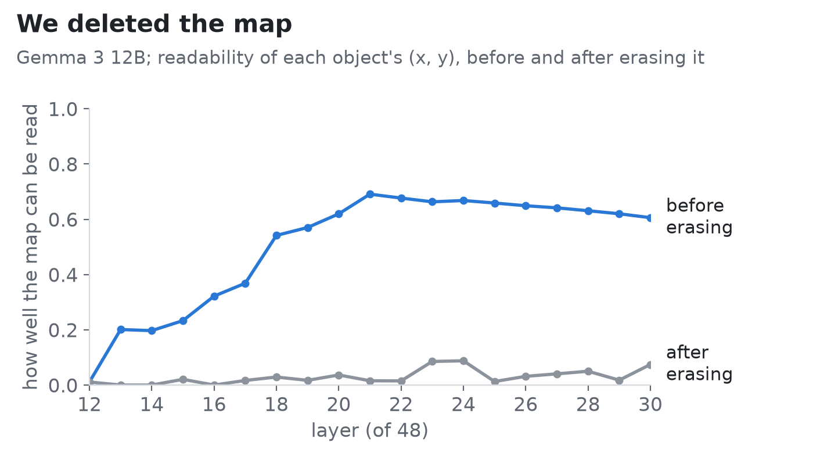
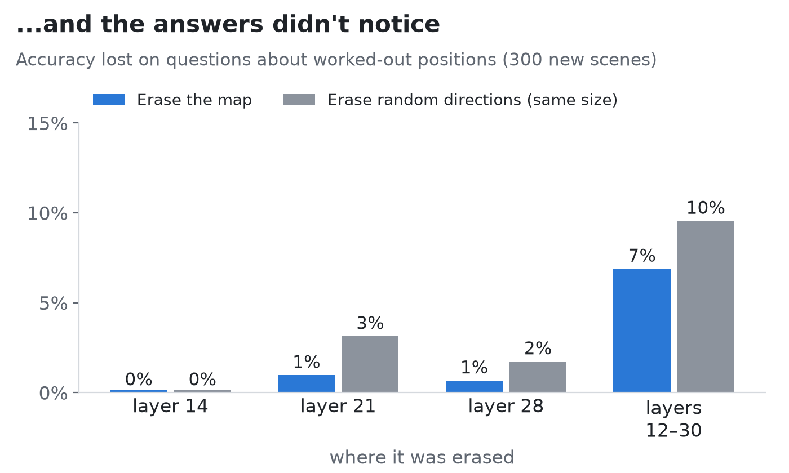

# Decodable but not used: Gemma 3 builds a spatial map it doesn't need (preregistered probes, DAS, and erasure)

**TL;DR.** I gave Gemma 3 (12B and 27B) small layouts described only in text ("A is 3 units north of B. C is 2 units east of A.") and asked spatial questions. Linear probes read every object's (x, y) from the activations, including positions that only follow from combining two sentences, and even a nonlinear quantity (distance to the root) that no additive code of the stated offsets predicts. But that map is off the causal path:
- copying it doesn't change answers;
- steering along it doesn't either;
- **erasing it at every token and every layer from 12 to 30 costs no more accuracy than erasing random directions of the same rank.**

What the answers do depend on is a 2-D subspace over the sentence that *states* an object's position. Swapping it moves 72% (12B) and 83% (27B) of the affected answers, against 0% for random subspaces. It behaves like a switch between stated values, not a coordinate: set halfway, it doesn't give in-between answers. The main results were preregistered, including several that failed.

**Epistemic status.** I'm fairly confident about the dissociation for this task and this model family: the rules were fixed in advance, the effects are large, and both 12B and 27B agree. I'm much less confident about how far it generalises. It's one family, 3-object scenes and five question types, and the erasure only removes the *linear* map the probes read.

---

## Setup

- **Task.**
  - Random 2-D integer layouts of 3 objects, described in text as relative offsets ("Cy lies 2 units east of Ana").
  - Questions the text never answers directly: compass direction, further north or east, closest, farthest.
  - Margins are enforced so that answers aren't borderline.
- **Behaviour gate.**
  - I screened eight open models (Qwen3, Llama 3.2 and Gemma 3, 1.7B–27B) on answering *without* chain of thought, scoring candidate log-probabilities.
  - Gemma 3 12B was the smallest that handled 3-object layouts reliably, so it's the main model, with Gemma 3 27B as a replication.
- **Methods.**
  - Ridge probes with scene-grouped CV and per-scene centring.
  - Activation patching at several sites.
  - Distributed alignment search (DAS; Geiger et al.) with k = 2.
  - An interpolation test.
  - A chain-transfer test.
  - Iterative nullspace projection (INLP; Ravfogel et al. 2020) for erasure.
- **Preregistration.** Each confirmatory test was committed to git, with its decision rule, before its data existed. Exploratory analyses are labelled as such below.

## 1. The model composes a map

At the object-list positions ("The objects are: Ana, Bo, Cy"), a linear probe reads each object's (x, y):
- **Overall:** R² = 0.74 [0.72, 0.75] at layer 21 of 48. Shuffled labels, layer 0 and a random-init model all give ≈ 0.
- **Objects two steps from the root,** whose position requires combining two sentences: 0.74 (one-step objects: 0.76). A baseline that only gets each object's own stated offset reaches 0.22 on them.
- **Distance to the root** (exploratory), which isn't a sum of offsets: R² 0.62 [0.56, 0.67], against −0.05 for the best additive baseline built from both stated offsets.

So this isn't the probe adding up two sentence codes; something nonlinear has been computed.

## 2. ...but the answers don't read it there

- **Copying the list-position activations** from a layout where an object sits elsewhere barely moves the answers.
- **DAS at the list position, preregistered:** interchange accuracy **0.07**. The prediction failed.
- **Steering along the probe's directions,** to positions no sentence states, preregistered: answers flip where geometry predicts in **2%** of sweeps. Also failed.
- **The object's name inside the question,** exploratory: patching it does essentially nothing (joint agreement 0.00; per-question peak 0.09).

## 3. A 2-D code at the stated sentence does control the answers

DAS with k = 2 over the moved object's own sentence, at layer 14, moved 0.81 of the affected answers in an exploratory run. I had chosen that site and layer after looking at the data, so I preregistered a confirmation on fresh scenes, with the rule ALL ≥ 0.70 and random ≤ 0.05, and a replication on 27B at matched depth (layer 18 of 62):

| | Gemma 3 12B (L14) | Gemma 3 27B (L18) |
|---|---|---|
| DAS k=2, all question types | **0.72** [0.68, 0.75] | **0.83** [0.80, 0.85] |
| random 2-D subspace | 0.00 | 0.00 |
| further east / north | 0.90 / 0.94 | 0.84 / 0.94 |
| direction | 0.60 | 0.81 |
| closest / farthest | 0.38 / 0.33 | 0.43 / 0.38 |

Interchange accuracy is model-relative: on questions where the model's clean answers differ between the two layouts, it's the share where the edited run gives the source layout's answer.

Some checks on whether this subspace is real:
- **Stability.** The exploratory and confirmation runs trained on disjoint scenes and land on overlapping subspaces: principal angles 47° and 56°, against a maximum cosine of 0.07 for random 2-D subspaces.
- **Competence.** The edit works where the model works. When the model answers the moved scene correctly from text, the edit succeeds 75% of the time (12B), against 48% when it doesn't; for 27B, 85% against 59%.
- **Write-in** (preregistered, see §6). Values computed from the stated offset, instead of copied from a source run, still move answers through this subspace (0.27, random 0.00).

## 4. It's a switch, not a coordinate (preregistered)

I set the subspace to base + α(source − base) and looked at questions whose correct answer at the *interpolated* position differs from both stated layouts. If the code were a coordinate, α = ½ should often give the in-between answer.

- **12B:** 0.085 [0.041, 0.137]
- **27B:** 0.055 [0.019, 0.096]
- **Chance on that subset:** 0.141

The CI upper bound is below chance in both models, so the preregistered verdict is "switch". Across α the flip is sharp: the share taking the moved layout goes 0 → 5% → 31% → 62% → 70% for 12B and 1 → 4 → 29 → 73 → 82% for 27B.

Consistent with this, a preregistered test of *natural encoding* found no linear encoding (§6, P5a). The change in the 2-D coordinates isn't linearly predicted by the change in the stated offset any better than for random 2-D subspaces (R² 0.31 against a 95th percentile of 0.35). The number tokens themselves change, which is why random directions score that high.

## 5. The composed position isn't transferred either (preregistered)

Take a chain R → M → C and change only M's sentence, so that M moves and C moves with it while C's own sentence stays word-for-word identical. Then copy C's sentence activations into the original run, layer by layer.

If that sentence carried C's composed position and the answers read it, C should move while M stays put. It doesn't:
- the patched answers follow C's moved position on at most 0.07 [0.04, 0.09] of questions (layer 18);
- control answers stay ≥ 0.97.

Verdict: "not carried". Caveat: the answers may simply recompute C from M's unchanged sentence.

## 6. Erasing the map (preregistered)

This is the direct test of "is the map used anywhere?"

**Fitting the erasure.**
- At each layer from 12 to 30, I fit the ridge probe on object-list activations of 2,000 new scenes.
- INLP removes its directions until held-out probe R² falls below 0.1. That takes rank 2–10, and R² drops from up to 0.69 to at most 0.09 at every layer.

**Applying it.**
- The basis is erased (mean-preserving) at **every token position**: at layer 14, 21 or 28 alone, or at all layers 12–30.
- The control is a random orthonormal basis of the same rank at the same layers.

**Testing it.** On 300 new chains (5,320 questions), I compared:
- questions involving the two-step object (whose position must be composed);
- questions involving only stated objects.

**Results.** The excess drop (probe-basis erasure minus random-basis erasure) on composed questions is −0.003, −0.022, −0.011 and −0.027 for the four configurations. The largest upper CI bound is 0.001, and stated-only questions behave the same way. Preregistered verdict: **map not used (in this subspace).**

Write-in (P5b). Setting the subspace from a per-token linear map of the offset, rather than copying it:
- moves **0.27** [0.22, 0.31] of the affected answers;
- the copy edit gives 0.72 and the same procedure through a random subspace gives 0.00.

The write-in reaches 0.37 of the copy edit, so the verdict is "partial". It works much better for "further east" (0.65) than "further north" (0.28) or direction (0.14).

## What I take from this

1. **Decodability is an upper bound on use, not evidence of it.** The probes here pass every control I know of, including a nonlinear target that rules out sentence copying, and the representation can still be deleted without behavioural cost. Probe-based claims about "world models" or "maps" need an intervention at the decoded site, and ideally an erasure.
2. **This model's answers look more like a filing card than a map.** There's a low-dimensional, switch-like code for what each sentence stated, recombined at question time; patching suggests that happens roughly in layers 16–32. The code is causally real (it replicates, it's stable, and values written from the offset act through it) but not coordinate-like.
3. **Why compute the map at all?** My candidates:
   - **It's nearly free.** Gathering offset directions at each object's name produces something coordinate-like. That doesn't explain distance, though.
   - **The task doesn't need it.** With three objects, chaining stated relations is cheap.
   - **It serves other uses.**

   The second is testable: make chaining hard (more objects, longer chains, whole-layout questions) and see whether erasure starts to hurt. That's my next experiment, and I'd welcome suggestions.

## Limitations

- One model family (Gemma 3), and the other families failed the behaviour gate. Scenes are 3 objects on integer grids with fixed templates. The P5 tests ran on 12B only.
- INLP removes the linear subspace the list-position probe reads. Information coded differently elsewhere, or nonlinearly, survives.
- DAS illusions (Makelov et al.): stability, the random controls, the competence link and the partial write-in argue against a pure illusion. They don't fully settle it.
- E3's null is compatible with redundancy and recomputation.
- The small question types (closest, farthest) have wide intervals.

## Links

- A non-technical write-up with an interactive demo where you edit the 2-D code yourself: [Part 1](https://medium.com/@gfcristhian98/the-ai-worked-out-where-things-are-even-when-nobody-told-it-d4f9faed80ea), [Part 2](https://medium.com/@gfcristhian98/i-found-the-map-inside-the-ai-then-i-deleted-it-and-nothing-happened-70f599a6fc83).
- Paper, code, preregistrations and results: https://github.com/ccgomezn/geometry-llm.

*AI assistance: I used Claude (Anthropic) extensively for the code, the analysis and drafting this post. The experimental design decisions, preregistrations and conclusions were reviewed by me, and every number above comes from the committed results files.*
