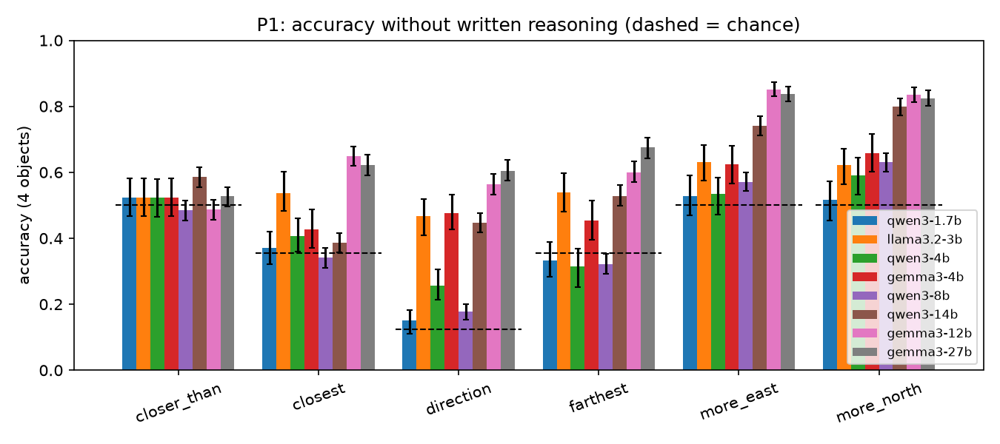
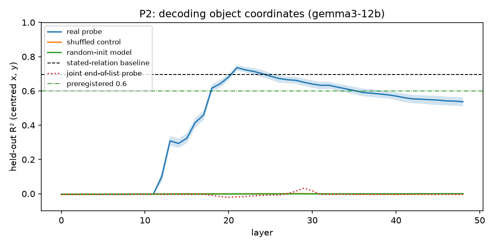
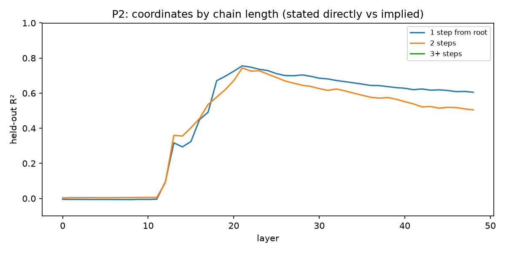
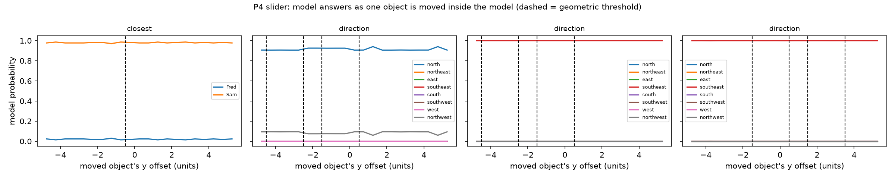
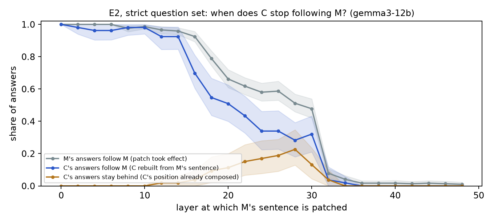
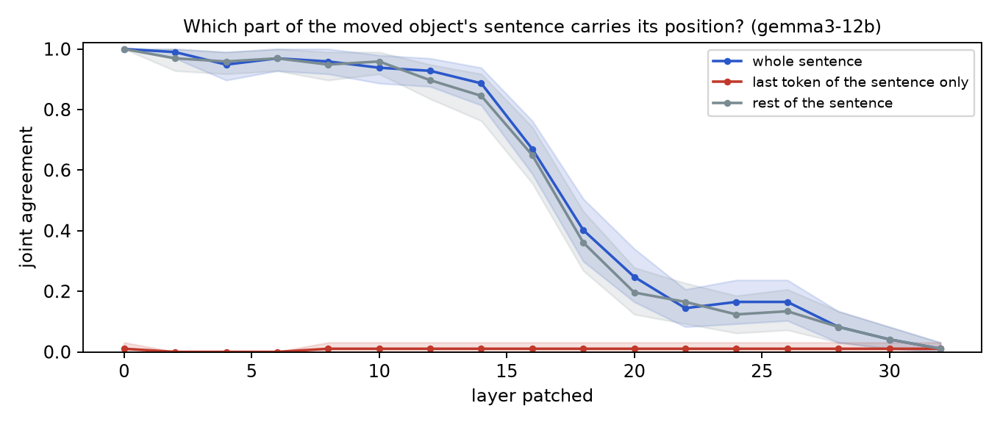
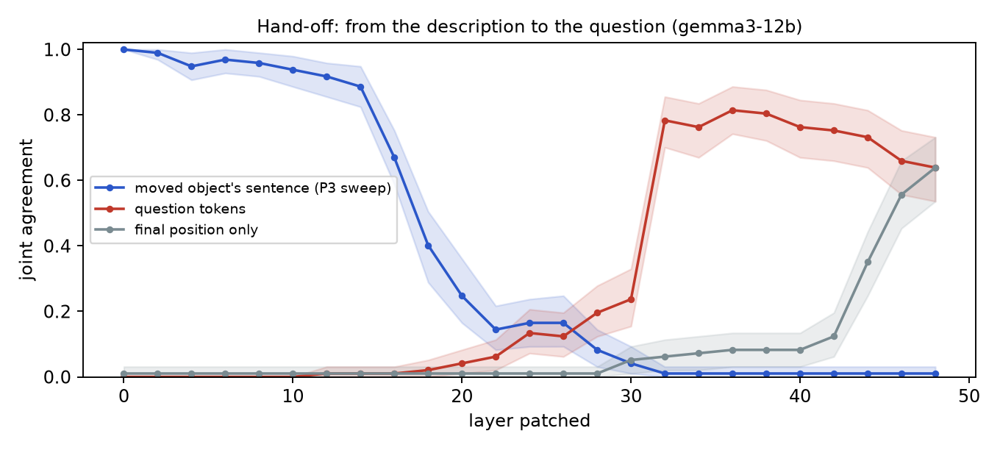
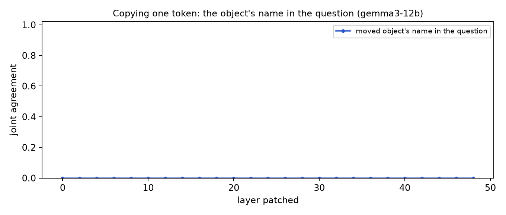

# E1 results log

Dated entries are appended after each phase. Every number carries a 95% bootstrap CI. Thresholds are preregistered in `docs/preregistration.md`.

## 2026-11-09 16:06 · P1 behaviour screen
**No model passed the gate**, so the fallback applies: qwen3-8b locally, then 14B on a rented GPU, then 3-object scenes.

### qwen3-1.7b
- 4-object accuracy: 0.40 [0.38, 0.43]; accuracy above chance on 2+ hop questions: 0.03 [0.01, 0.04] → gate **fail**

| question | chance | 3 objects | 4 objects | 5 objects |
|---|---|---|---|---|
| closer_than | 0.50 | 0.49 [0.44, 0.53] | 0.52 [0.47, 0.58] | 0.52 [0.47, 0.57] |
| closest | 0.36 | 0.54 [0.48, 0.61] | 0.37 [0.31, 0.43] | 0.30 [0.25, 0.35] |
| direction | 0.12 | 0.24 [0.19, 0.28] | 0.15 [0.11, 0.19] | 0.18 [0.14, 0.23] |
| farthest | 0.36 | 0.50 [0.44, 0.57] | 0.33 [0.27, 0.40] | 0.23 [0.17, 0.28] |
| more_east | 0.50 | 0.54 [0.47, 0.61] | 0.53 [0.47, 0.59] | 0.54 [0.48, 0.60] |
| more_north | 0.50 | 0.57 [0.51, 0.63] | 0.52 [0.46, 0.57] | 0.52 [0.47, 0.57] |

- By deepest object involved: hop 1: 0.42 [0.40, 0.44]; hop 2: 0.43 [0.41, 0.44]; hop 3: 0.41 [0.38, 0.44]; hop 4: 0.43 [0.37, 0.50]
- Error signature (standardised logistic coefficients): hop -0.04 [-0.11, 0.02], log margin 0.07 [0.02, 0.11]
- Near-tie set (margin 0.25–1 unit / 2.5–10°): 0.32 [0.29, 0.35]
- Object-list line: with 0.38, without 0.38, difference -0.01 [-0.03, 0.02]
- Chain of thought on: 0.52 [0.40, 0.63] vs off 0.42 [0.30, 0.53] (same 60 questions; unparsed 38%, median 1024 tokens)

## 2026-11-09 16:42 · P1 behaviour screen
**No model passed the gate**, so the fallback applies: qwen3-8b locally, then 14B on a rented GPU, then 3-object scenes.

### llama3.2-3b
- 4-object accuracy: 0.55 [0.52, 0.58]; accuracy above chance on 2+ hop questions: 0.13 [0.11, 0.15] → gate **fail**

| question | chance | 3 objects | 4 objects | 5 objects |
|---|---|---|---|---|
| closer_than | 0.50 | 0.51 [0.46, 0.55] | 0.52 [0.47, 0.58] | 0.52 [0.47, 0.57] |
| closest | 0.36 | 0.64 [0.58, 0.70] | 0.54 [0.47, 0.59] | 0.48 [0.42, 0.54] |
| direction | 0.12 | 0.53 [0.47, 0.58] | 0.47 [0.41, 0.52] | 0.39 [0.34, 0.45] |
| farthest | 0.36 | 0.66 [0.60, 0.73] | 0.54 [0.48, 0.60] | 0.40 [0.33, 0.47] |
| more_east | 0.50 | 0.56 [0.48, 0.62] | 0.63 [0.57, 0.68] | 0.61 [0.56, 0.67] |
| more_north | 0.50 | 0.66 [0.59, 0.72] | 0.62 [0.56, 0.68] | 0.64 [0.58, 0.70] |

- By deepest object involved: hop 1: 0.61 [0.58, 0.63]; hop 2: 0.54 [0.52, 0.56]; hop 3: 0.50 [0.46, 0.53]; hop 4: 0.48 [0.41, 0.56]
- Error signature (standardised logistic coefficients): hop -0.16 [-0.22, -0.10], log margin 0.23 [0.17, 0.29]
- Near-tie set (margin 0.25–1 unit / 2.5–10°): 0.36 [0.32, 0.39]
- Object-list line: with 0.53, without 0.51, difference 0.02 [-0.01, 0.04]

## 2026-11-09 17:34 · P1 behaviour screen
**No model passed the gate**, so the fallback applies: qwen3-8b locally, then 14B on a rented GPU, then 3-object scenes.

### qwen3-4b
- 4-object accuracy: 0.44 [0.42, 0.46]; accuracy above chance on 2+ hop questions: 0.03 [0.01, 0.05] → gate **fail**

| question | chance | 3 objects | 4 objects | 5 objects |
|---|---|---|---|---|
| closer_than | 0.50 | 0.53 [0.47, 0.58] | 0.52 [0.47, 0.58] | 0.52 [0.47, 0.57] |
| closest | 0.36 | 0.53 [0.47, 0.60] | 0.41 [0.34, 0.47] | 0.27 [0.22, 0.32] |
| direction | 0.12 | 0.44 [0.38, 0.50] | 0.26 [0.21, 0.30] | 0.22 [0.18, 0.27] |
| farthest | 0.36 | 0.53 [0.46, 0.59] | 0.31 [0.25, 0.38] | 0.19 [0.14, 0.25] |
| more_east | 0.50 | 0.71 [0.64, 0.77] | 0.54 [0.48, 0.60] | 0.48 [0.41, 0.54] |
| more_north | 0.50 | 0.72 [0.65, 0.78] | 0.59 [0.53, 0.65] | 0.53 [0.48, 0.59] |

- By deepest object involved: hop 1: 0.53 [0.50, 0.56]; hop 2: 0.45 [0.43, 0.47]; hop 3: 0.37 [0.34, 0.40]; hop 4: 0.39 [0.33, 0.45]
- Error signature (standardised logistic coefficients): hop -0.27 [-0.33, -0.21], log margin 0.10 [0.04, 0.15]
- Near-tie set (margin 0.25–1 unit / 2.5–10°): 0.31 [0.28, 0.35]
- Object-list line: with 0.42, without 0.44, difference -0.02 [-0.05, 0.01]
- Chain of thought on: 0.43 [0.32, 0.57] vs off 0.45 [0.32, 0.58] (same 60 questions; unparsed 43%, median 1024 tokens)

## 2026-11-09 18:05 · P1 behaviour screen
**No model passed the gate**, so the fallback applies: qwen3-8b locally, then 14B on a rented GPU, then 3-object scenes.

### gemma3-4b
- 4-object accuracy: 0.53 [0.51, 0.55]; accuracy above chance on 2+ hop questions: 0.13 [0.11, 0.14] → gate **fail**

| question | chance | 3 objects | 4 objects | 5 objects |
|---|---|---|---|---|
| closer_than | 0.50 | 0.49 [0.44, 0.53] | 0.52 [0.47, 0.58] | 0.52 [0.47, 0.57] |
| closest | 0.36 | 0.61 [0.54, 0.66] | 0.43 [0.37, 0.48] | 0.37 [0.32, 0.42] |
| direction | 0.12 | 0.48 [0.43, 0.54] | 0.48 [0.42, 0.53] | 0.38 [0.33, 0.44] |
| farthest | 0.36 | 0.62 [0.56, 0.68] | 0.45 [0.38, 0.52] | 0.44 [0.37, 0.50] |
| more_east | 0.50 | 0.71 [0.65, 0.77] | 0.62 [0.56, 0.68] | 0.60 [0.54, 0.66] |
| more_north | 0.50 | 0.64 [0.58, 0.70] | 0.66 [0.60, 0.72] | 0.67 [0.61, 0.73] |

- By deepest object involved: hop 1: 0.57 [0.55, 0.60]; hop 2: 0.52 [0.50, 0.54]; hop 3: 0.50 [0.47, 0.54]; hop 4: 0.55 [0.49, 0.62]
- Error signature (standardised logistic coefficients): hop -0.08 [-0.14, -0.03], log margin 0.21 [0.16, 0.26]
- Near-tie set (margin 0.25–1 unit / 2.5–10°): 0.36 [0.32, 0.39]
- Object-list line: with 0.53, without 0.48, difference 0.05 [0.01, 0.08]

## 2026-11-09 19:27 · P1 behaviour screen
**No model passed the gate**, so the fallback applies: qwen3-8b locally, then 14B on a rented GPU, then 3-object scenes.

### qwen3-8b
- 4-object accuracy: 0.42 [0.41, 0.44]; accuracy above chance on 2+ hop questions: 0.01 [0.00, 0.02] → gate **fail**

| question | chance | 3 objects | 4 objects | 5 objects |
|---|---|---|---|---|
| closer_than | 0.50 | 0.49 [0.46, 0.51] | 0.49 [0.46, 0.51] | 0.48 [0.45, 0.51] |
| closest | 0.36 | 0.59 [0.55, 0.62] | 0.34 [0.31, 0.38] | 0.26 [0.24, 0.29] |
| direction | 0.12 | 0.36 [0.33, 0.39] | 0.18 [0.15, 0.20] | 0.13 [0.11, 0.15] |
| farthest | 0.36 | 0.44 [0.40, 0.47] | 0.32 [0.29, 0.35] | 0.22 [0.19, 0.26] |
| more_east | 0.50 | 0.69 [0.66, 0.73] | 0.57 [0.54, 0.60] | 0.50 [0.47, 0.53] |
| more_north | 0.50 | 0.73 [0.70, 0.76] | 0.63 [0.60, 0.66] | 0.55 [0.52, 0.58] |

- By deepest object involved: hop 1: 0.52 [0.50, 0.53]; hop 2: 0.42 [0.41, 0.43]; hop 3: 0.36 [0.34, 0.38]; hop 4: 0.35 [0.31, 0.38]
- Error signature (standardised logistic coefficients): hop -0.29 [-0.32, -0.26], log margin 0.08 [0.05, 0.11]
- Near-tie set (margin 0.25–1 unit / 2.5–10°): 0.36 [0.34, 0.39]
- Object-list line: with 0.43, without 0.42, difference 0.00 [-0.01, 0.02]
- Chain of thought on: 0.87 [0.77, 0.95] vs off 0.27 [0.17, 0.38] (same 60 questions; unparsed 10%, median 1625 tokens)

## 2026-11-09 20:44 · P1 behaviour screen
**No model passed the gate**, so the fallback applies: qwen3-8b locally, then 14B on a rented GPU, then 3-object scenes.

### qwen3-14b
- 4-object accuracy: 0.58 [0.57, 0.60]; accuracy above chance on 2+ hop questions: 0.17 [0.16, 0.18] → gate **fail**

| question | chance | 3 objects | 4 objects | 5 objects |
|---|---|---|---|---|
| closer_than | 0.50 | 0.57 [0.54, 0.60] | 0.59 [0.56, 0.62] | 0.60 [0.57, 0.64] |
| closest | 0.36 | 0.63 [0.59, 0.66] | 0.39 [0.35, 0.42] | 0.28 [0.25, 0.30] |
| direction | 0.12 | 0.61 [0.57, 0.64] | 0.45 [0.41, 0.48] | 0.33 [0.30, 0.36] |
| farthest | 0.36 | 0.73 [0.70, 0.76] | 0.53 [0.49, 0.56] | 0.29 [0.26, 0.33] |
| more_east | 0.50 | 0.81 [0.79, 0.84] | 0.74 [0.71, 0.77] | 0.71 [0.68, 0.74] |
| more_north | 0.50 | 0.87 [0.85, 0.90] | 0.80 [0.77, 0.82] | 0.77 [0.75, 0.80] |

- By deepest object involved: hop 1: 0.66 [0.65, 0.67]; hop 2: 0.58 [0.57, 0.60]; hop 3: 0.52 [0.50, 0.54]; hop 4: 0.48 [0.44, 0.52]
- Error signature (standardised logistic coefficients): hop -0.27 [-0.30, -0.24], log margin 0.33 [0.29, 0.37]
- Near-tie set (margin 0.25–1 unit / 2.5–10°): 0.40 [0.37, 0.43]
- Object-list line: with 0.57, without 0.55, difference 0.02 [-0.00, 0.04]
- Chain of thought on: 0.98 [0.95, 1.00] vs off 0.57 [0.43, 0.70] (same 60 questions; unparsed 2%, median 844 tokens)

## 2026-11-09 21:08 · P1 behaviour screen
**No model passed the gate**, so the fallback applies: qwen3-8b locally, then 14B on a rented GPU, then 3-object scenes.

### gemma3-12b
- 4-object accuracy: 0.66 [0.65, 0.68]; accuracy above chance on 2+ hop questions: 0.22 [0.21, 0.23] → gate **fail**

| question | chance | 3 objects | 4 objects | 5 objects |
|---|---|---|---|---|
| closer_than | 0.50 | 0.50 [0.47, 0.53] | 0.49 [0.46, 0.52] | 0.48 [0.45, 0.51] |
| closest | 0.36 | 0.79 [0.76, 0.82] | 0.65 [0.62, 0.68] | 0.55 [0.51, 0.58] |
| direction | 0.12 | 0.72 [0.69, 0.75] | 0.56 [0.53, 0.60] | 0.48 [0.45, 0.51] |
| farthest | 0.36 | 0.75 [0.72, 0.78] | 0.60 [0.56, 0.64] | 0.45 [0.41, 0.49] |
| more_east | 0.50 | 0.86 [0.83, 0.88] | 0.85 [0.83, 0.87] | 0.78 [0.76, 0.81] |
| more_north | 0.50 | 0.87 [0.85, 0.89] | 0.84 [0.81, 0.86] | 0.81 [0.78, 0.83] |

- By deepest object involved: hop 1: 0.77 [0.75, 0.78]; hop 2: 0.63 [0.62, 0.64]; hop 3: 0.59 [0.57, 0.61]; hop 4: 0.56 [0.53, 0.60]
- Error signature (standardised logistic coefficients): hop -0.29 [-0.33, -0.25], log margin 0.35 [0.31, 0.39]
- Near-tie set (margin 0.25–1 unit / 2.5–10°): 0.44 [0.41, 0.46]
- Object-list line: with 0.65, without 0.65, difference 0.01 [-0.01, 0.02]

## 2026-11-09 21:56 · P1 behaviour screen
**No model passed the gate**, so the fallback applies: qwen3-8b locally, then 14B on a rented GPU, then 3-object scenes.

### gemma3-27b
- 4-object accuracy: 0.68 [0.67, 0.69]; accuracy above chance on 2+ hop questions: 0.27 [0.26, 0.27] → gate **fail**

| question | chance | 3 objects | 4 objects | 5 objects |
|---|---|---|---|---|
| closer_than | 0.50 | 0.53 [0.50, 0.56] | 0.53 [0.50, 0.56] | 0.54 [0.51, 0.57] |
| closest | 0.36 | 0.76 [0.73, 0.79] | 0.62 [0.59, 0.66] | 0.55 [0.52, 0.58] |
| direction | 0.12 | 0.77 [0.75, 0.80] | 0.60 [0.57, 0.64] | 0.53 [0.50, 0.56] |
| farthest | 0.36 | 0.77 [0.74, 0.80] | 0.68 [0.64, 0.71] | 0.59 [0.55, 0.62] |
| more_east | 0.50 | 0.87 [0.84, 0.89] | 0.84 [0.81, 0.86] | 0.79 [0.76, 0.81] |
| more_north | 0.50 | 0.86 [0.83, 0.89] | 0.82 [0.80, 0.85] | 0.79 [0.76, 0.82] |

- By deepest object involved: hop 1: 0.75 [0.74, 0.76]; hop 2: 0.67 [0.66, 0.68]; hop 3: 0.63 [0.61, 0.65]; hop 4: 0.62 [0.58, 0.66]
- Error signature (standardised logistic coefficients): hop -0.18 [-0.21, -0.13], log margin 0.33 [0.30, 0.36]
- Near-tie set (margin 0.25–1 unit / 2.5–10°): 0.48 [0.45, 0.51]
- Object-list line: with 0.67, without 0.64, difference 0.03 [0.02, 0.05]

## 2026-11-09 21:57 · P1 behaviour screen
**No model passed the gate**, so the fallback applies: qwen3-8b locally, then 14B on a rented GPU, then 3-object scenes.

### qwen3-1.7b
- 4-object accuracy: 0.40 [0.38, 0.43]; accuracy above chance on 2+ hop questions: 0.03 [0.01, 0.04] → gate **fail**

| question | chance | 3 objects | 4 objects | 5 objects |
|---|---|---|---|---|
| closer_than | 0.50 | 0.49 [0.44, 0.53] | 0.52 [0.47, 0.58] | 0.52 [0.47, 0.57] |
| closest | 0.36 | 0.54 [0.48, 0.61] | 0.37 [0.31, 0.43] | 0.30 [0.25, 0.35] |
| direction | 0.12 | 0.24 [0.19, 0.28] | 0.15 [0.11, 0.19] | 0.18 [0.14, 0.23] |
| farthest | 0.36 | 0.50 [0.44, 0.57] | 0.33 [0.27, 0.40] | 0.23 [0.17, 0.28] |
| more_east | 0.50 | 0.54 [0.47, 0.61] | 0.53 [0.47, 0.59] | 0.54 [0.48, 0.60] |
| more_north | 0.50 | 0.57 [0.51, 0.63] | 0.52 [0.46, 0.57] | 0.52 [0.47, 0.57] |

- By deepest object involved: hop 1: 0.42 [0.40, 0.44]; hop 2: 0.43 [0.41, 0.44]; hop 3: 0.41 [0.38, 0.44]; hop 4: 0.43 [0.37, 0.50]
- Error signature (standardised logistic coefficients): hop -0.04 [-0.11, 0.02], log margin 0.07 [0.02, 0.11]
- Near-tie set (margin 0.25–1 unit / 2.5–10°): 0.32 [0.29, 0.35]
- Object-list line: with 0.38, without 0.38, difference -0.01 [-0.03, 0.02]
- Chain of thought on: 0.52 [0.40, 0.63] vs off 0.42 [0.30, 0.53] (same 60 questions; unparsed 38%, median 1024 tokens)

### llama3.2-3b
- 4-object accuracy: 0.55 [0.52, 0.58]; accuracy above chance on 2+ hop questions: 0.13 [0.11, 0.15] → gate **fail**

| question | chance | 3 objects | 4 objects | 5 objects |
|---|---|---|---|---|
| closer_than | 0.50 | 0.51 [0.46, 0.55] | 0.52 [0.47, 0.58] | 0.52 [0.47, 0.57] |
| closest | 0.36 | 0.64 [0.58, 0.70] | 0.54 [0.47, 0.59] | 0.48 [0.42, 0.54] |
| direction | 0.12 | 0.53 [0.47, 0.58] | 0.47 [0.41, 0.52] | 0.39 [0.34, 0.45] |
| farthest | 0.36 | 0.66 [0.60, 0.73] | 0.54 [0.48, 0.60] | 0.40 [0.33, 0.47] |
| more_east | 0.50 | 0.56 [0.48, 0.62] | 0.63 [0.57, 0.68] | 0.61 [0.56, 0.67] |
| more_north | 0.50 | 0.66 [0.59, 0.72] | 0.62 [0.56, 0.68] | 0.64 [0.58, 0.70] |

- By deepest object involved: hop 1: 0.61 [0.58, 0.63]; hop 2: 0.54 [0.52, 0.56]; hop 3: 0.50 [0.46, 0.53]; hop 4: 0.48 [0.41, 0.56]
- Error signature (standardised logistic coefficients): hop -0.16 [-0.22, -0.10], log margin 0.23 [0.17, 0.29]
- Near-tie set (margin 0.25–1 unit / 2.5–10°): 0.36 [0.32, 0.39]
- Object-list line: with 0.53, without 0.51, difference 0.02 [-0.01, 0.04]

### qwen3-4b
- 4-object accuracy: 0.44 [0.42, 0.46]; accuracy above chance on 2+ hop questions: 0.03 [0.01, 0.05] → gate **fail**

| question | chance | 3 objects | 4 objects | 5 objects |
|---|---|---|---|---|
| closer_than | 0.50 | 0.53 [0.47, 0.58] | 0.52 [0.47, 0.58] | 0.52 [0.47, 0.57] |
| closest | 0.36 | 0.53 [0.47, 0.60] | 0.41 [0.34, 0.47] | 0.27 [0.22, 0.32] |
| direction | 0.12 | 0.44 [0.38, 0.50] | 0.26 [0.21, 0.30] | 0.22 [0.18, 0.27] |
| farthest | 0.36 | 0.53 [0.46, 0.59] | 0.31 [0.25, 0.38] | 0.19 [0.14, 0.25] |
| more_east | 0.50 | 0.71 [0.64, 0.77] | 0.54 [0.48, 0.60] | 0.48 [0.41, 0.54] |
| more_north | 0.50 | 0.72 [0.65, 0.78] | 0.59 [0.53, 0.65] | 0.53 [0.48, 0.59] |

- By deepest object involved: hop 1: 0.53 [0.50, 0.56]; hop 2: 0.45 [0.43, 0.47]; hop 3: 0.37 [0.34, 0.40]; hop 4: 0.39 [0.33, 0.45]
- Error signature (standardised logistic coefficients): hop -0.27 [-0.33, -0.21], log margin 0.10 [0.04, 0.15]
- Near-tie set (margin 0.25–1 unit / 2.5–10°): 0.31 [0.28, 0.35]
- Object-list line: with 0.42, without 0.44, difference -0.02 [-0.05, 0.01]
- Chain of thought on: 0.43 [0.32, 0.57] vs off 0.45 [0.32, 0.58] (same 60 questions; unparsed 43%, median 1024 tokens)

### gemma3-4b
- 4-object accuracy: 0.53 [0.51, 0.55]; accuracy above chance on 2+ hop questions: 0.13 [0.11, 0.14] → gate **fail**

| question | chance | 3 objects | 4 objects | 5 objects |
|---|---|---|---|---|
| closer_than | 0.50 | 0.49 [0.44, 0.53] | 0.52 [0.47, 0.58] | 0.52 [0.47, 0.57] |
| closest | 0.36 | 0.61 [0.54, 0.66] | 0.43 [0.37, 0.48] | 0.37 [0.32, 0.42] |
| direction | 0.12 | 0.48 [0.43, 0.54] | 0.48 [0.42, 0.53] | 0.38 [0.33, 0.44] |
| farthest | 0.36 | 0.62 [0.56, 0.68] | 0.45 [0.38, 0.52] | 0.44 [0.37, 0.50] |
| more_east | 0.50 | 0.71 [0.65, 0.77] | 0.62 [0.56, 0.68] | 0.60 [0.54, 0.66] |
| more_north | 0.50 | 0.64 [0.58, 0.70] | 0.66 [0.60, 0.72] | 0.67 [0.61, 0.73] |

- By deepest object involved: hop 1: 0.57 [0.55, 0.60]; hop 2: 0.52 [0.50, 0.54]; hop 3: 0.50 [0.47, 0.54]; hop 4: 0.55 [0.49, 0.62]
- Error signature (standardised logistic coefficients): hop -0.08 [-0.14, -0.03], log margin 0.21 [0.16, 0.26]
- Near-tie set (margin 0.25–1 unit / 2.5–10°): 0.36 [0.32, 0.39]
- Object-list line: with 0.53, without 0.48, difference 0.05 [0.01, 0.08]

### qwen3-8b
- 4-object accuracy: 0.42 [0.41, 0.44]; accuracy above chance on 2+ hop questions: 0.01 [0.00, 0.02] → gate **fail**

| question | chance | 3 objects | 4 objects | 5 objects |
|---|---|---|---|---|
| closer_than | 0.50 | 0.49 [0.46, 0.51] | 0.49 [0.46, 0.51] | 0.48 [0.45, 0.51] |
| closest | 0.36 | 0.59 [0.55, 0.62] | 0.34 [0.31, 0.38] | 0.26 [0.24, 0.29] |
| direction | 0.12 | 0.36 [0.33, 0.39] | 0.18 [0.15, 0.20] | 0.13 [0.11, 0.15] |
| farthest | 0.36 | 0.44 [0.40, 0.47] | 0.32 [0.29, 0.35] | 0.22 [0.19, 0.26] |
| more_east | 0.50 | 0.69 [0.66, 0.73] | 0.57 [0.54, 0.60] | 0.50 [0.47, 0.53] |
| more_north | 0.50 | 0.73 [0.70, 0.76] | 0.63 [0.60, 0.66] | 0.55 [0.52, 0.58] |

- By deepest object involved: hop 1: 0.52 [0.50, 0.53]; hop 2: 0.42 [0.41, 0.43]; hop 3: 0.36 [0.34, 0.38]; hop 4: 0.35 [0.31, 0.38]
- Error signature (standardised logistic coefficients): hop -0.29 [-0.32, -0.26], log margin 0.08 [0.05, 0.11]
- Near-tie set (margin 0.25–1 unit / 2.5–10°): 0.36 [0.34, 0.39]
- Object-list line: with 0.43, without 0.42, difference 0.00 [-0.01, 0.02]
- Chain of thought on: 0.87 [0.77, 0.95] vs off 0.27 [0.17, 0.38] (same 60 questions; unparsed 10%, median 1625 tokens)

### qwen3-14b
- 4-object accuracy: 0.58 [0.57, 0.60]; accuracy above chance on 2+ hop questions: 0.17 [0.16, 0.18] → gate **fail**

| question | chance | 3 objects | 4 objects | 5 objects |
|---|---|---|---|---|
| closer_than | 0.50 | 0.57 [0.54, 0.60] | 0.59 [0.56, 0.62] | 0.60 [0.57, 0.64] |
| closest | 0.36 | 0.63 [0.59, 0.66] | 0.39 [0.35, 0.42] | 0.28 [0.25, 0.30] |
| direction | 0.12 | 0.61 [0.57, 0.64] | 0.45 [0.41, 0.48] | 0.33 [0.30, 0.36] |
| farthest | 0.36 | 0.73 [0.70, 0.76] | 0.53 [0.49, 0.56] | 0.29 [0.26, 0.33] |
| more_east | 0.50 | 0.81 [0.79, 0.84] | 0.74 [0.71, 0.77] | 0.71 [0.68, 0.74] |
| more_north | 0.50 | 0.87 [0.85, 0.90] | 0.80 [0.77, 0.82] | 0.77 [0.75, 0.80] |

- By deepest object involved: hop 1: 0.66 [0.65, 0.67]; hop 2: 0.58 [0.57, 0.60]; hop 3: 0.52 [0.50, 0.54]; hop 4: 0.48 [0.44, 0.52]
- Error signature (standardised logistic coefficients): hop -0.27 [-0.30, -0.24], log margin 0.33 [0.29, 0.37]
- Near-tie set (margin 0.25–1 unit / 2.5–10°): 0.40 [0.37, 0.43]
- Object-list line: with 0.57, without 0.55, difference 0.02 [-0.00, 0.04]
- Chain of thought on: 0.98 [0.95, 1.00] vs off 0.57 [0.43, 0.70] (same 60 questions; unparsed 2%, median 844 tokens)

### gemma3-12b
- 4-object accuracy: 0.66 [0.65, 0.68]; accuracy above chance on 2+ hop questions: 0.22 [0.21, 0.23] → gate **fail**

| question | chance | 3 objects | 4 objects | 5 objects |
|---|---|---|---|---|
| closer_than | 0.50 | 0.50 [0.47, 0.53] | 0.49 [0.46, 0.52] | 0.48 [0.45, 0.51] |
| closest | 0.36 | 0.79 [0.76, 0.82] | 0.65 [0.62, 0.68] | 0.55 [0.51, 0.58] |
| direction | 0.12 | 0.72 [0.69, 0.75] | 0.56 [0.53, 0.60] | 0.48 [0.45, 0.51] |
| farthest | 0.36 | 0.75 [0.72, 0.78] | 0.60 [0.56, 0.64] | 0.45 [0.41, 0.49] |
| more_east | 0.50 | 0.86 [0.83, 0.88] | 0.85 [0.83, 0.87] | 0.78 [0.76, 0.81] |
| more_north | 0.50 | 0.87 [0.85, 0.89] | 0.84 [0.81, 0.86] | 0.81 [0.78, 0.83] |

- By deepest object involved: hop 1: 0.77 [0.75, 0.78]; hop 2: 0.63 [0.62, 0.64]; hop 3: 0.59 [0.57, 0.61]; hop 4: 0.56 [0.53, 0.60]
- Error signature (standardised logistic coefficients): hop -0.29 [-0.33, -0.25], log margin 0.35 [0.31, 0.39]
- Near-tie set (margin 0.25–1 unit / 2.5–10°): 0.44 [0.41, 0.46]
- Object-list line: with 0.65, without 0.65, difference 0.01 [-0.01, 0.02]

### gemma3-27b
- 4-object accuracy: 0.68 [0.67, 0.69]; accuracy above chance on 2+ hop questions: 0.27 [0.26, 0.27] → gate **fail**

| question | chance | 3 objects | 4 objects | 5 objects |
|---|---|---|---|---|
| closer_than | 0.50 | 0.53 [0.50, 0.56] | 0.53 [0.50, 0.56] | 0.54 [0.51, 0.57] |
| closest | 0.36 | 0.76 [0.73, 0.79] | 0.62 [0.59, 0.66] | 0.55 [0.52, 0.58] |
| direction | 0.12 | 0.77 [0.75, 0.80] | 0.60 [0.57, 0.64] | 0.53 [0.50, 0.56] |
| farthest | 0.36 | 0.77 [0.74, 0.80] | 0.68 [0.64, 0.71] | 0.59 [0.55, 0.62] |
| more_east | 0.50 | 0.87 [0.84, 0.89] | 0.84 [0.81, 0.86] | 0.79 [0.76, 0.81] |
| more_north | 0.50 | 0.86 [0.83, 0.89] | 0.82 [0.80, 0.85] | 0.79 [0.76, 0.82] |

- By deepest object involved: hop 1: 0.75 [0.74, 0.76]; hop 2: 0.67 [0.66, 0.68]; hop 3: 0.63 [0.61, 0.65]; hop 4: 0.62 [0.58, 0.66]
- Error signature (standardised logistic coefficients): hop -0.18 [-0.21, -0.13], log margin 0.33 [0.30, 0.36]
- Near-tie set (margin 0.25–1 unit / 2.5–10°): 0.48 [0.45, 0.51]
- Object-list line: with 0.67, without 0.64, difference 0.03 [0.02, 0.05]

## 2026-11-09 23:13 · P1 behaviour screen
**No model passed the gate**, so the fallback applies: qwen3-8b locally, then 14B on a rented GPU, then 3-object scenes.

### gemma3-12b
- 4-object accuracy: 0.68 [0.66, 0.69]; accuracy above chance on 2+ hop questions: 0.23 [0.22, 0.24] → gate **fail**

| question | chance | 3 objects | 4 objects | 5 objects |
|---|---|---|---|---|
| closer_than | 0.50 | 0.51 [0.48, 0.54] | 0.49 [0.46, 0.52] | 0.48 [0.45, 0.51] |
| closest | 0.36 | 0.79 [0.76, 0.82] | 0.65 [0.62, 0.69] | 0.55 [0.51, 0.58] |
| direction | 0.12 | 0.77 [0.74, 0.79] | 0.62 [0.59, 0.66] | 0.50 [0.47, 0.53] |
| farthest | 0.36 | 0.75 [0.72, 0.78] | 0.60 [0.57, 0.64] | 0.45 [0.41, 0.49] |
| more_east | 0.50 | 0.86 [0.83, 0.88] | 0.85 [0.83, 0.87] | 0.78 [0.76, 0.81] |
| more_north | 0.50 | 0.87 [0.85, 0.89] | 0.83 [0.81, 0.86] | 0.81 [0.78, 0.83] |

- By deepest object involved: hop 1: 0.78 [0.76, 0.79]; hop 2: 0.64 [0.63, 0.65]; hop 3: 0.59 [0.57, 0.61]; hop 4: 0.57 [0.53, 0.61]
- Error signature (standardised logistic coefficients): hop -0.30 [-0.33, -0.26], log margin 0.31 [0.27, 0.33]
- Validity: median probability on the allowed answers 1.00 (5th percentile 0.95)
- Near-tie set (margin 0.25–1 unit / 2.5–10°): 0.45 [0.42, 0.48]
- Object-list line: with 0.66, without 0.66, difference 0.01 [-0.01, 0.03]

## 2026-11-09 23:27 · P1 behaviour screen
**No model passed the gate**, so the fallback applies: qwen3-8b locally, then 14B on a rented GPU, then 3-object scenes.

### qwen3-14b
- 4-object accuracy: 0.56 [0.55, 0.57]; accuracy above chance on 2+ hop questions: 0.15 [0.14, 0.16] → gate **fail**

| question | chance | 3 objects | 4 objects | 5 objects |
|---|---|---|---|---|
| closer_than | 0.50 | 0.55 [0.52, 0.58] | 0.53 [0.50, 0.56] | 0.51 [0.48, 0.55] |
| closest | 0.36 | 0.63 [0.59, 0.66] | 0.39 [0.35, 0.42] | 0.28 [0.25, 0.30] |
| direction | 0.12 | 0.55 [0.52, 0.58] | 0.38 [0.34, 0.41] | 0.25 [0.22, 0.28] |
| farthest | 0.36 | 0.73 [0.70, 0.76] | 0.53 [0.49, 0.56] | 0.29 [0.25, 0.33] |
| more_east | 0.50 | 0.82 [0.79, 0.85] | 0.74 [0.71, 0.77] | 0.71 [0.68, 0.74] |
| more_north | 0.50 | 0.87 [0.85, 0.90] | 0.80 [0.77, 0.82] | 0.77 [0.75, 0.80] |

- By deepest object involved: hop 1: 0.63 [0.62, 0.65]; hop 2: 0.57 [0.56, 0.58]; hop 3: 0.49 [0.47, 0.50]; hop 4: 0.45 [0.41, 0.48]
- Error signature (standardised logistic coefficients): hop -0.27 [-0.31, -0.24], log margin 0.25 [0.21, 0.28]
- Validity: median probability on the allowed answers 0.02 (5th percentile 0.00)
- Near-tie set (margin 0.25–1 unit / 2.5–10°): 0.41 [0.38, 0.44]
- Object-list line: with 0.55, without 0.53, difference 0.02 [-0.01, 0.04]

## 2026-11-09 23:34 · P1 behaviour screen
**No model passed the gate**, so the fallback applies: qwen3-8b locally, then 14B on a rented GPU, then 3-object scenes.

### qwen3-8b
- 4-object accuracy: 0.45 [0.43, 0.47]; accuracy above chance on 2+ hop questions: 0.04 [0.02, 0.05] → gate **fail**

| question | chance | 3 objects | 4 objects | 5 objects |
|---|---|---|---|---|
| closer_than | 0.50 | 0.49 [0.45, 0.54] | 0.53 [0.47, 0.58] | 0.52 [0.47, 0.57] |
| closest | 0.36 | 0.54 [0.48, 0.60] | 0.40 [0.34, 0.47] | 0.27 [0.22, 0.33] |
| direction | 0.12 | 0.31 [0.26, 0.36] | 0.25 [0.21, 0.30] | 0.21 [0.17, 0.26] |
| farthest | 0.36 | 0.45 [0.39, 0.52] | 0.34 [0.28, 0.41] | 0.23 [0.18, 0.29] |
| more_east | 0.50 | 0.69 [0.63, 0.75] | 0.55 [0.49, 0.60] | 0.51 [0.44, 0.57] |
| more_north | 0.50 | 0.76 [0.69, 0.81] | 0.61 [0.55, 0.67] | 0.56 [0.50, 0.62] |

- By deepest object involved: hop 1: 0.50 [0.48, 0.53]; hop 2: 0.44 [0.42, 0.46]; hop 3: 0.41 [0.38, 0.44]; hop 4: 0.43 [0.37, 0.50]
- Error signature (standardised logistic coefficients): hop -0.17 [-0.22, -0.11], log margin 0.12 [0.06, 0.17]
- Validity: median probability on the allowed answers 0.00 (5th percentile 0.00)

## 2026-11-10 00:32 · P1 behaviour screen
**No model passed the gate**, so the fallback applies: qwen3-8b locally, then 14B on a rented GPU, then 3-object scenes.

### gemma3-27b
- 4-object accuracy: 0.70 [0.68, 0.71]; accuracy above chance on 2+ hop questions: 0.28 [0.27, 0.29] → gate **fail**

| question | chance | 3 objects | 4 objects | 5 objects |
|---|---|---|---|---|
| closer_than | 0.50 | 0.53 [0.50, 0.56] | 0.53 [0.50, 0.56] | 0.54 [0.51, 0.57] |
| closest | 0.36 | 0.76 [0.73, 0.79] | 0.62 [0.59, 0.66] | 0.55 [0.52, 0.58] |
| direction | 0.12 | 0.86 [0.83, 0.88] | 0.70 [0.67, 0.73] | 0.59 [0.56, 0.62] |
| farthest | 0.36 | 0.77 [0.74, 0.80] | 0.68 [0.64, 0.71] | 0.59 [0.55, 0.62] |
| more_east | 0.50 | 0.87 [0.84, 0.89] | 0.84 [0.81, 0.86] | 0.79 [0.76, 0.81] |
| more_north | 0.50 | 0.86 [0.83, 0.89] | 0.82 [0.80, 0.85] | 0.79 [0.76, 0.82] |

- By deepest object involved: hop 1: 0.76 [0.75, 0.78]; hop 2: 0.69 [0.68, 0.70]; hop 3: 0.64 [0.62, 0.66]; hop 4: 0.62 [0.58, 0.67]
- Error signature (standardised logistic coefficients): hop -0.18 [-0.22, -0.15], log margin 0.28 [0.24, 0.31]
- Validity: median probability on the allowed answers 1.00 (5th percentile 0.05)
- Near-tie set (margin 0.25–1 unit / 2.5–10°): 0.51 [0.48, 0.54]
- Object-list line: with 0.68, without 0.64, difference 0.05 [0.03, 0.07]

## 2026-11-10 00:32 · P1 rescored: model choice
**Chosen: gemma3-12b** on 3-object scenes; excluded question types (at chance): closer_than.

| model | 4-object accuracy | 3-object accuracy | 4-object gate |
|---|---|---|---|
| qwen3-1.7b | 0.42 | 0.47 | fail |
| llama3.2-3b | 0.56 | 0.61 | fail |
| qwen3-4b | 0.43 | 0.55 | fail |
| gemma3-4b | 0.53 | 0.60 | fail |
| qwen3-8b | 0.45 | 0.53 | fail |
| gemma3-12b | 0.68 | 0.76 | fail |
| qwen3-14b | 0.56 | 0.69 | fail |
| gemma3-27b | 0.70 | 0.77 | fail |

## 2026-11-10 00:53 · P2 probes (gemma3-12b)
Model **gemma3-12b**, 3000 scenes (80/20 split by scene), per-object readout in the object list; ridge penalty chosen by scene-grouped cross-validation.

- **Best layer 21: R² = 0.74 [0.72, 0.75]** (1000 bootstrap resamples over test scenes)
- Controls at that layer: shuffled -0.00, layer 0 -0.00, random-init (same layer) -0.00
- Stated-relation baseline (each object's own sentence only): overall 0.70; 1-step 0.92, 2+-step 0.22
- By chain length at layer 21: probe 1-step 0.76, 2+-step 0.74 (gap +0.01); 2+-step advantage over the stated-relation baseline +0.53
- RSA (activation vs true distances, Spearman) at layer 21: 0.19 [0.16, 0.21]; peak 0.20 at layer 19
- Joint end-of-list probe (all objects from one position): peak R² 0.03 at layer 29

Against the preregistered P2 criteria (as clarified):
- R² ≥ 0.6: yes
- beats shuffled, layer-0 and random-init by ≥ 0.3, and the stated-relation baseline by ≥ 0.3 on 2-step objects: yes
- 2-step objects within 0.1 of 1-step: yes
- H-rel signature (R² < 0.3, or 2-step more than 0.2 below 1-step): no

## 2026-11-10 03:45 · P4 slider (gemma3-12b)
Model **gemma3-12b**, layer 21, using probe directions; 50 scenes, x and y sweeps of ±5.0 units in 0.5-unit steps (including positions no sentence states).

- Agreement with geometry along the sweeps: 0.64 [0.60, 0.68]
- Sweeps where geometry predicts a flip: 268; the model also flips in 2% of them
- Predicted vs observed flip position: r = 0.03; median offset -2.50 units
- Steered activations within the natural norm range (1st–99th percentile): 100%

## 2026-11-10 05:09 · P3 patching (gemma3-12b)
Model **gemma3-12b**. Each pair differs in one sentence that moves one leaf object; the source's activations are copied into the base run at one site and layer, then every question is asked.

**Joint agreement** = share of pairs where, after patching, *every* answer equals what the model says when the object really is elsewhere (pairs where at least one of those answers differs from the base run). Geometric joint consistency (all answers match the true layout) is shown for reference.

- Positive control (copy the whole prefix, earliest layer): 0.95 (should be 1.00)
- Best layers in the sweep: list → [18, 20], relation → [2, 6], eol → [2, 6]

Confirmation run:

| site | layer | joint agreement [95% CI] | per-question agreement | geometric joint | pairs |
|---|---|---|---|---|---|
| all | 2 | 0.95 [0.93, 0.97] | 0.99 | 0.28 | 390 |
| all | 6 | 0.95 [0.93, 0.97] | 0.99 | 0.28 | 390 |
| all | 18 | 0.50 [0.45, 0.55] | 0.76 | 0.22 | 390 |
| all | 20 | 0.23 [0.19, 0.27] | 0.55 | 0.14 | 390 |
| eol | 2 | 0.00 [0.00, 0.00] | 0.00 | 0.01 | 390 |
| eol | 6 | 0.00 [0.00, 0.00] | 0.00 | 0.01 | 390 |
| eol | 18 | 0.00 [0.00, 0.00] | 0.00 | 0.01 | 390 |
| eol | 20 | 0.00 [0.00, 0.00] | 0.00 | 0.01 | 390 |
| list | 2 | 0.00 [0.00, 0.00] | 0.00 | 0.01 | 390 |
| list | 6 | 0.00 [0.00, 0.00] | 0.00 | 0.01 | 390 |
| list | 18 | 0.00 [0.00, 0.00] | 0.01 | 0.01 | 390 |
| list | 20 | 0.00 [0.00, 0.00] | 0.01 | 0.01 | 390 |
| relation | 2 | 0.94 [0.92, 0.96] | 0.99 | 0.28 | 390 |
| relation | 6 | 0.94 [0.91, 0.96] | 0.99 | 0.28 | 390 |
| relation | 18 | 0.36 [0.32, 0.41] | 0.67 | 0.19 | 390 |
| relation | 20 | 0.18 [0.15, 0.22] | 0.50 | 0.13 | 390 |

Pairs the model answers fully correctly when unpatched (44 pairs):

| site | layer | joint agreement [95% CI] | per-question agreement | geometric joint | pairs |
|---|---|---|---|---|---|
| all | 2 | 0.98 [0.93, 1.00] | 1.00 | 0.98 | 44 |
| all | 6 | 0.98 [0.93, 1.00] | 0.99 | 0.98 | 44 |
| all | 18 | 0.64 [0.48, 0.77] | 0.76 | 0.64 | 44 |
| all | 20 | 0.34 [0.20, 0.48] | 0.54 | 0.34 | 44 |
| eol | 2 | 0.00 [0.00, 0.00] | 0.00 | 0.00 | 44 |
| eol | 6 | 0.00 [0.00, 0.00] | 0.00 | 0.00 | 44 |
| eol | 18 | 0.00 [0.00, 0.00] | 0.00 | 0.00 | 44 |
| eol | 20 | 0.00 [0.00, 0.00] | 0.00 | 0.00 | 44 |
| list | 2 | 0.00 [0.00, 0.00] | 0.00 | 0.00 | 44 |
| list | 6 | 0.00 [0.00, 0.00] | 0.00 | 0.00 | 44 |
| list | 18 | 0.00 [0.00, 0.00] | 0.00 | 0.00 | 44 |
| list | 20 | 0.00 [0.00, 0.00] | 0.01 | 0.00 | 44 |
| relation | 2 | 0.98 [0.93, 1.00] | 0.99 | 0.98 | 44 |
| relation | 6 | 1.00 [1.00, 1.00] | 1.00 | 1.00 | 44 |
| relation | 18 | 0.57 [0.41, 0.70] | 0.70 | 0.57 | 44 |
| relation | 20 | 0.34 [0.20, 0.48] | 0.53 | 0.34 | 44 |

Against the preregistered P3 criteria (as clarified):
- H-map: joint agreement ≥ 0.6 at the object's list position or the end of list → best 0.00 (layer 2) → not met
- H-rel: < 0.2 at the readout positions, and at that layer the relation sentence carries more → readout 0.00, relation sentence at layer 2: 0.94 → met

## 2026-11-10 05:10 · E1 summary
Model **gemma3-12b**. Verdict against `docs/preregistration.md`: **Mixed**: see the per-criterion breakdown.

| criterion | met |
|---|---|
| map_r2 | yes |
| map_hops | yes |
| rel_r2 | no |
| map_jc | no |
| rel_jc | yes |

Not yet evaluated: map_das

- P2: best layer 21, R² 0.74; 1-step 0.76 vs 2-step 0.74; stated-relation baseline on 2-step objects 0.22
- P3: joint agreement at readout positions 0.00 (layer 2); relation sentence at that layer 0.94

Prior work to engage in the write-up: Tehenan et al. 2025 (linear spatial models, single-answer steering) and An et al. 2026 (weak, fragmented coordinate probes in 7–8B models).

## 2026-11-10 07:56 · P3 necessity (gemma3-12b) — exploratory
Model **gemma3-12b**, 100 pairs (the P3 sweep's pairs). Exploratory, not preregistered: added after P3 showed that patching the readout positions alone changes no answer (insufficiency). Here the source description is copied everywhere *except* the objects' list positions and the end of the list.

| layer | whole description | all but readout positions | difference |
|---|---|---|---|
| 6 | 0.97 [0.93, 1.00] | 0.98 [0.95, 1.00] | +0.01 |
| 14 | 0.92 [0.86, 0.97] | 0.89 [0.82, 0.94] | -0.03 |
| 18 | 0.45 [0.35, 0.56] | 0.42 [0.32, 0.53] | -0.03 |
| 21 | 0.25 [0.16, 0.34] | 0.20 [0.12, 0.28] | -0.05 |
| 24 | 0.15 [0.08, 0.23] | 0.16 [0.09, 0.24] | +0.01 |

Effect sizes in the P3 sweep (mean |change in log-probability of the base answer|, nats):

| layer | all | eol | list | relation |
|---|---|---|---|---|
| 6 | 7.51 | 0.05 | 0.05 | 7.50 |
| 10 | 7.45 | 0.05 | 0.05 | 7.41 |
| 14 | 7.42 | 0.05 | 0.04 | 7.32 |
| 18 | 5.45 | 0.05 | 0.13 | 4.89 |
| 20 | 4.10 | 0.05 | 0.10 | 3.90 |
| 24 | 2.99 | 0.04 | 0.10 | 2.88 |
| 30 | 1.71 | 0.04 | 0.06 | 1.63 |

## 2026-11-10 08:04 · P2b sentence-end probe (gemma3-12b) — exploratory
Model **gemma3-12b**, same 3,000 scenes and split as P2. Exploratory: added after P3 showed that patching the object's sentence moves the answers while patching its list mention does not.

- Sentence end: best layer 24, R² 0.44 [0.42, 0.46]; one-step objects 0.42, two-step objects 0.76 (stated-sentence baseline 0.22); shuffled -0.00
- List mention (P2): best layer 21, R² 0.74; two-step 0.74

| layer | sentence end | sentence end, two-step | list mention | list, two-step |
|---|---|---|---|---|
| 4 | 0.26 | 0.43 | -0.00 | 0.00 |
| 8 | 0.26 | 0.43 | -0.00 | 0.01 |
| 10 | 0.27 | 0.44 | -0.00 | 0.01 |
| 12 | 0.28 | 0.48 | 0.10 | 0.09 |
| 14 | 0.34 | 0.61 | 0.29 | 0.36 |
| 16 | 0.38 | 0.68 | 0.42 | 0.46 |
| 18 | 0.39 | 0.69 | 0.62 | 0.58 |
| 21 | 0.43 | 0.76 | 0.74 | 0.74 |
| 24 | 0.44 | 0.76 | 0.70 | 0.71 |
| 30 | 0.40 | 0.70 | 0.64 | 0.63 |
| 40 | 0.33 | 0.56 | 0.57 | 0.55 |
| 48 | 0.29 | 0.48 | 0.54 | 0.50 |

## 2026-11-10 08:49 · E2 composition timing (gemma3-12b)
Model **gemma3-12b**, 150 chain pairs (R → M → C, M's sentence first). M's sentence is copied from a scene where M (and therefore C) sits elsewhere. *follow* = answer equals the model's answer on that scene; *stay* = answer equals the model's answer on a scene where M moved but C kept its old position.

| layer | M follows | C follows | C stays | M-questions | C-questions |
|---|---|---|---|---|---|
| 0 | 1.00 [1.00, 1.00] | 1.00 [1.00, 1.00] | 0.00 [0.00, 0.00] | 293 | 348 |
| 4 | 1.00 [1.00, 1.00] | 0.99 [0.97, 1.00] | 0.01 [0.00, 0.02] | 293 | 348 |
| 8 | 0.98 [0.95, 0.99] | 0.98 [0.97, 0.99] | 0.02 [0.01, 0.03] | 293 | 348 |
| 10 | 0.99 [0.97, 1.00] | 0.98 [0.96, 0.99] | 0.02 [0.01, 0.04] | 293 | 348 |
| 12 | 0.97 [0.94, 0.99] | 0.95 [0.92, 0.97] | 0.04 [0.02, 0.06] | 293 | 348 |
| 14 | 0.96 [0.94, 0.98] | 0.95 [0.92, 0.97] | 0.05 [0.02, 0.07] | 293 | 348 |
| 16 | 0.92 [0.89, 0.96] | 0.85 [0.81, 0.89] | 0.09 [0.06, 0.12] | 293 | 348 |
| 18 | 0.79 [0.74, 0.84] | 0.77 [0.72, 0.82] | 0.15 [0.11, 0.19] | 293 | 348 |
| 20 | 0.66 [0.61, 0.72] | 0.72 [0.67, 0.77] | 0.20 [0.15, 0.26] | 293 | 348 |
| 24 | 0.58 [0.53, 0.64] | 0.69 [0.63, 0.75] | 0.22 [0.16, 0.27] | 293 | 348 |
| 28 | 0.51 [0.46, 0.57] | 0.68 [0.62, 0.73] | 0.24 [0.19, 0.29] | 293 | 348 |
| 32 | 0.08 [0.05, 0.11] | 0.61 [0.55, 0.66] | 0.25 [0.20, 0.31] | 293 | 348 |

Preregistered verdict: **lazy**

## 2026-11-10 08:53 · P2d distance probe (gemma3-12b) — exploratory
Model **gemma3-12b**, same 3,000 scenes and split as P2, readout at the list mention. Exploratory. Target: each non-root object's distance to the root. Distance is not a sum of the stated offsets, so the best *additive* baseline (one-hot codes of the object's own and its parent's offsets) cannot fully fit it for two-step objects. Activations that beat it carry an interaction of the two offsets.

- Best layer for two-step objects: 21, R² 0.62 [0.56, 0.67]
- Best additive baseline: two-step -0.05, one-step 0.91
- Reference from the true position (x, y, x², y², xy): two-step 0.95

| layer | two-step | one-step |
|---|---|---|
| 0 | -0.12 | -0.04 |
| 8 | -0.02 | 0.24 |
| 12 | 0.13 | 0.40 |
| 14 | 0.16 | 0.46 |
| 16 | 0.33 | 0.55 |
| 18 | 0.45 | 0.74 |
| 21 | 0.62 | 0.80 |
| 24 | 0.60 | 0.78 |
| 30 | 0.52 | 0.73 |
| 40 | 0.39 | 0.66 |
| 48 | 0.42 | 0.67 |

## 2026-11-10 08:58 · E2 strict question set (gemma3-12b) — deviation
Model **gemma3-12b**. Deviation from the E2 preregistration (dated there): C-questions restricted to those whose model answers differ across base, source and hybrid. Under the preregistered definition, a C-question whose answer the move leaves unchanged counts as "follow" even when the patch does nothing.

| layer | M follows | C follows | C stays | C-questions |
|---|---|---|---|---|
| 0 | 1.00 | 1.00 [1.00, 1.00] | 0.00 [0.00, 0.00] | 53 |
| 8 | 0.98 | 0.98 [0.93, 1.00] | 0.00 [0.00, 0.00] | 53 |
| 12 | 0.97 | 0.92 [0.84, 0.98] | 0.02 [0.00, 0.06] | 53 |
| 14 | 0.96 | 0.92 [0.85, 0.98] | 0.02 [0.00, 0.06] | 53 |
| 16 | 0.92 | 0.70 [0.60, 0.81] | 0.04 [0.00, 0.10] | 53 |
| 18 | 0.79 | 0.55 [0.44, 0.67] | 0.09 [0.02, 0.18] | 53 |
| 20 | 0.66 | 0.51 [0.40, 0.62] | 0.11 [0.03, 0.20] | 53 |
| 22 | 0.62 | 0.43 [0.33, 0.56] | 0.15 [0.07, 0.26] | 53 |
| 24 | 0.58 | 0.34 [0.22, 0.46] | 0.17 [0.08, 0.28] | 53 |
| 26 | 0.59 | 0.34 [0.23, 0.47] | 0.19 [0.09, 0.29] | 53 |
| 28 | 0.51 | 0.28 [0.18, 0.39] | 0.23 [0.13, 0.35] | 53 |
| 30 | 0.48 | 0.32 [0.21, 0.43] | 0.13 [0.04, 0.24] | 53 |
| 32 | 0.08 | 0.04 [0.00, 0.12] | 0.04 [0.00, 0.10] | 53 |

Decision rule applied to the strict set: **mixed**

## 2026-11-10 10:18 · P3c which tokens carry the position (gemma3-12b) — exploratory
Model **gemma3-12b**, 100 pairs (the P3 sweep's pairs). Exploratory. Joint agreement (all answers equal the model's answers on the moved scene) after copying one part of the moved object's sentence.

| layer | whole sentence | last token of the sentence only | rest of the sentence |
|---|---|---|---|
| 0 | 1.00 | 0.01 | 1.00 |
| 2 | 0.99 | 0.00 | 0.97 |
| 4 | 0.95 | 0.00 | 0.96 |
| 6 | 0.97 | 0.00 | 0.97 |
| 8 | 0.96 | 0.01 | 0.95 |
| 10 | 0.94 | 0.01 | 0.96 |
| 12 | 0.93 | 0.01 | 0.90 |
| 14 | 0.89 | 0.01 | 0.85 |
| 16 | 0.67 | 0.01 | 0.65 |
| 18 | 0.40 | 0.01 | 0.36 |
| 20 | 0.25 | 0.01 | 0.20 |
| 22 | 0.14 | 0.01 | 0.16 |
| 24 | 0.16 | 0.01 | 0.12 |
| 26 | 0.16 | 0.01 | 0.13 |
| 28 | 0.08 | 0.01 | 0.08 |
| 30 | 0.04 | 0.01 | 0.04 |
| 32 | 0.01 | 0.01 | 0.01 |

## 2026-11-10 10:32 · P3q hand-off to the question (gemma3-12b) — exploratory
Model **gemma3-12b**, 100 pairs (the P3 sweep's pairs). Exploratory. Joint agreement after copying the question tokens (or only the final position) from the run where the object sits elsewhere. The question text is identical, so the copied states differ only through what they read from the description.

| layer | sentence (sweep) | question tokens | final position |
|---|---|---|---|
| 0 | 1.00 | 0.00 | 0.01 |
| 2 | 0.99 | 0.00 | 0.01 |
| 4 | 0.95 | 0.00 | 0.01 |
| 6 | 0.97 | 0.00 | 0.01 |
| 8 | 0.96 | 0.00 | 0.01 |
| 10 | 0.94 | 0.00 | 0.01 |
| 12 | 0.92 | 0.01 | 0.01 |
| 14 | 0.89 | 0.01 | 0.01 |
| 16 | 0.67 | 0.01 | 0.01 |
| 18 | 0.40 | 0.02 | 0.01 |
| 20 | 0.25 | 0.04 | 0.01 |
| 22 | 0.14 | 0.06 | 0.01 |
| 24 | 0.16 | 0.13 | 0.01 |
| 26 | 0.16 | 0.12 | 0.01 |
| 28 | 0.08 | 0.20 | 0.01 |
| 30 | 0.04 | 0.24 | 0.05 |
| 32 | 0.01 | 0.78 | 0.06 |
| 34 | 0.01 | 0.76 | 0.07 |
| 36 | 0.01 | 0.81 | 0.08 |
| 38 | 0.01 | 0.80 | 0.08 |
| 40 | 0.01 | 0.76 | 0.08 |
| 42 | 0.01 | 0.75 | 0.12 |
| 44 | 0.01 | 0.73 | 0.35 |
| 46 | 0.01 | 0.66 | 0.56 |
| 48 | 0.01 | 0.64 | 0.64 |

## 2026-11-10 10:34 · P2m question-mention probe (gemma3-12b) — exploratory
Model **gemma3-12b**, same 3,000 scenes and split as P2. Exploratory. Readout: the object's name in "Which object is farthest from X?" (one prompt per object).

- (x, y): best layer for two-step objects 21, R² 0.74 (all objects 0.73 [0.72, 0.75]); list mention best 0.74; shuffled -0.00
- Distance to root, two-step: best layer 22, R² 0.63; list mention best 0.62; best additive baseline -0.05

| layer | (x, y) two-step | (x, y) all | distance two-step |
|---|---|---|---|
| 0 | 0.00 | -0.00 | -0.12 |
| 8 | 0.02 | 0.02 | 0.03 |
| 12 | 0.15 | 0.19 | 0.20 |
| 14 | 0.41 | 0.35 | 0.30 |
| 16 | 0.47 | 0.43 | 0.43 |
| 18 | 0.57 | 0.60 | 0.52 |
| 21 | 0.74 | 0.73 | 0.61 |
| 24 | 0.72 | 0.72 | 0.63 |
| 28 | 0.71 | 0.71 | 0.60 |
| 32 | 0.67 | 0.68 | 0.57 |
| 40 | 0.59 | 0.61 | 0.51 |
| 48 | 0.56 | 0.59 | 0.49 |

## 2026-11-10 10:57 · P3m one-token patch at the question's mention (gemma3-12b) — exploratory
Model **gemma3-12b**, 100 of the P3 sweep's pairs (questions that name the moved object). Exploratory. Joint agreement after copying only the moved object's name token in the question from the run where it sits elsewhere.

| layer | joint agreement [95% CI] |
|---|---|
| 0 | 0.00 [0.00, 0.00] |
| 2 | 0.00 [0.00, 0.00] |
| 4 | 0.00 [0.00, 0.00] |
| 6 | 0.00 [0.00, 0.00] |
| 8 | 0.00 [0.00, 0.00] |
| 10 | 0.00 [0.00, 0.00] |
| 12 | 0.00 [0.00, 0.00] |
| 14 | 0.00 [0.00, 0.00] |
| 16 | 0.00 [0.00, 0.00] |
| 18 | 0.00 [0.00, 0.00] |
| 20 | 0.00 [0.00, 0.00] |
| 22 | 0.00 [0.00, 0.00] |
| 24 | 0.00 [0.00, 0.00] |
| 26 | 0.00 [0.00, 0.00] |
| 28 | 0.00 [0.00, 0.00] |
| 30 | 0.00 [0.00, 0.00] |
| 32 | 0.00 [0.00, 0.00] |
| 34 | 0.00 [0.00, 0.00] |
| 36 | 0.00 [0.00, 0.00] |
| 38 | 0.00 [0.00, 0.00] |
| 40 | 0.00 [0.00, 0.00] |
| 42 | 0.00 [0.00, 0.00] |
| 44 | 0.00 [0.00, 0.00] |
| 46 | 0.00 [0.00, 0.00] |
| 48 | 0.00 [0.00, 0.00] |

## 2026-11-10 12:37 · P4 DAS (gemma3-12b) — exploratory: relation site, layer 14
Model **gemma3-12b**, layer 14, site relation; 300 training pairs, 300 test pairs. Interchange accuracy = on questions where the model answers differently when the object is really elsewhere, the share whose answer after swapping only the learned subspace equals that answer (ceiling 1). Geometric accuracy (answers equal the moved layout) in the last column.

| method | closest | direction | farthest | more_east | more_north | ALL | |
|---|---|---|---|---|---|---|---|
| random k=2 | 0.00 [0.00, 0.00] | 0.00 [0.00, 0.00] | 0.03 [0.00, 0.09] | 0.00 [0.00, 0.00] | 0.00 [0.00, 0.01] | 0.00 [0.00, 0.00] | geometric 0.10 |
| DAS k=2 | 0.54 [0.37, 0.70] | 0.73 [0.69, 0.77] | 0.53 [0.37, 0.70] | 0.93 [0.90, 0.96] | 0.92 [0.88, 0.95] | 0.81 [0.78, 0.83] | geometric 0.72 |

Preregistered criterion (k = 2, ≥ 0.7 on every question type): **not met** (lowest: 0.53 on farthest).

## 2026-11-10 14:10 · P4 DAS (gemma3-12b)
Model **gemma3-12b**, layer 18, site list; 300 training pairs, 300 test pairs. Interchange accuracy = on questions where the model answers differently when the object is really elsewhere, the share whose answer after swapping only the learned subspace equals that answer (ceiling 1). Geometric accuracy (answers equal the moved layout) in the last column.

| method | closest | direction | farthest | more_east | more_north | ALL | |
|---|---|---|---|---|---|---|---|
| random k=2 | 0.00 [0.00, 0.00] | 0.00 [0.00, 0.01] | 0.00 [0.00, 0.00] | 0.00 [0.00, 0.01] | 0.01 [0.00, 0.02] | 0.00 [0.00, 0.01] | geometric 0.10 |
| DAS k=2 | 0.14 [0.03, 0.30] | 0.02 [0.01, 0.03] | 0.17 [0.04, 0.30] | 0.15 [0.08, 0.22] | 0.10 [0.05, 0.15] | 0.07 [0.05, 0.09] | geometric 0.14 |

Preregistered criterion (k = 2, ≥ 0.7 on every question type): **not met** (lowest: 0.02 on direction).

## 2026-11-10 14:46 · P4i 2-D code set to unstated positions (gemma3-12b) — exploratory
Model **gemma3-12b**, the 2-D subspace learned by DAS at the relation site, layer 14; 150 of its held-out test pairs. Exploratory. The subspace is set to base + α·(moved − base); answers are scored against the layout with the object at the matching interpolated position (questions with margin ≥ 1 unit / 10° there). *Novel*: questions whose answer at that position differs from the answer in both stated layouts (chance 0.15). Clean model accuracy on the base layouts: 0.85.

| α | agrees with interpolated layout | novel: interpolated answer | novel: original-layout answer | novel: moved-layout answer | n novel |
|---|---|---|---|---|---|
| 0 | 0.85 [0.82, 0.87] | – | – | – | 0 |
| 0.25 | 0.86 [0.83, 0.88] | 0.00 [0.00, 0.00] | 0.85 [0.54, 1.00] | 0.00 [0.00, 0.00] | 13 |
| 0.5 | 0.66 [0.63, 0.68] | 0.06 [0.02, 0.10] | 0.63 [0.54, 0.72] | 0.23 [0.16, 0.31] | 150 |
| 0.75 | 0.75 [0.72, 0.78] | 0.00 [0.00, 0.00] | 0.18 [0.00, 0.44] | 0.73 [0.33, 1.00] | 11 |
| 1 | 0.78 [0.75, 0.81] | – | – | – | 0 |
| 1.5 | 0.80 [0.77, 0.83] | 0.26 [0.09, 0.45] | 0.22 [0.07, 0.42] | 0.59 [0.37, 0.81] | 27 |

## 2026-11-10 14:46 · E1 summary
Model **gemma3-12b**. Verdict against `docs/preregistration.md`: **Mixed**: see the per-criterion breakdown.

| criterion | met |
|---|---|
| map_r2 | yes |
| map_hops | yes |
| rel_r2 | no |
| map_jc | no |
| rel_jc | yes |
| map_das | no |

- P2: best layer 21, R² 0.74; 1-step 0.76 vs 2-step 0.74; stated-relation baseline on 2-step objects 0.22
- P3: joint agreement at readout positions 0.00 (layer 2); relation sentence at that layer 0.94
- P4: DAS k=2 lowest per-type interchange accuracy 0.02

Prior work to engage in the write-up: Tehenan et al. 2025 (linear spatial models, single-answer steering) and An et al. 2026 (weak, fragmented coordinate probes in 7–8B models).

## 2026-11-10 18:59 · P4 DAS (gemma3-12b) — preregistered 'confirm' run: relation site, layer 14
Model **gemma3-12b**, layer 14, site relation; 300 training pairs, 300 test pairs. Interchange accuracy = on questions where the model answers differently when the object is really elsewhere, the share whose answer after swapping only the learned subspace equals that answer (ceiling 1). Geometric accuracy (answers equal the moved layout) in the last column.

| method | closest | direction | farthest | more_east | more_north | ALL | |
|---|---|---|---|---|---|---|---|
| random k=2 | 0.00 [0.00, 0.00] | 0.00 [0.00, 0.01] | 0.00 [0.00, 0.00] | 0.01 [0.00, 0.03] | 0.00 [0.00, 0.01] | 0.00 [0.00, 0.01] | geometric 0.13 |
| DAS k=2 | 0.38 [0.19, 0.55] | 0.60 [0.54, 0.65] | 0.33 [0.19, 0.48] | 0.90 [0.85, 0.94] | 0.94 [0.91, 0.96] | 0.72 [0.68, 0.75] | geometric 0.65 |

Preregistered criterion (k = 2, ≥ 0.7 on every question type): **not met** (lowest: 0.33 on farthest).
Seeds (train, test): 105, 106. Decision rule: see docs/preregistration_p4c.md.

## 2026-11-10 19:39 · E3 composed-position transfer (gemma3-12b)
Model **gemma3-12b**, 150 chain pairs (R → M → C). Only M's sentence differs between the two runs; C's sentence is copied (same words) from the run where M, and with it C, sits elsewhere. *Follows target* = answer equals the model's answer on a scene with C at its moved position and M unmoved.

| layer | follows target | follows source (M moved too) | controls stable | target Qs | control Qs |
|---|---|---|---|---|---|
| 0 | 0.00 [0.00, 0.00] | 0.85 | 1.00 [1.00, 1.00] | 369 | 625 |
| 2 | 0.00 [0.00, 0.01] | 0.85 | 1.00 [0.99, 1.00] | 369 | 625 |
| 4 | 0.00 [0.00, 0.00] | 0.85 | 1.00 [0.99, 1.00] | 369 | 625 |
| 6 | 0.00 [0.00, 0.01] | 0.85 | 0.99 [0.99, 1.00] | 369 | 625 |
| 8 | 0.01 [0.00, 0.02] | 0.85 | 0.99 [0.99, 1.00] | 369 | 625 |
| 10 | 0.01 [0.00, 0.03] | 0.86 | 0.99 [0.98, 1.00] | 369 | 625 |
| 12 | 0.02 [0.01, 0.04] | 0.86 | 0.98 [0.97, 0.99] | 369 | 625 |
| 14 | 0.02 [0.01, 0.04] | 0.86 | 0.98 [0.97, 0.99] | 369 | 625 |
| 16 | 0.05 [0.03, 0.08] | 0.86 | 0.97 [0.96, 0.98] | 369 | 625 |
| 18 | 0.07 [0.04, 0.09] | 0.87 | 0.97 [0.96, 0.98] | 369 | 625 |
| 20 | 0.05 [0.03, 0.08] | 0.88 | 0.98 [0.96, 0.99] | 369 | 625 |
| 22 | 0.04 [0.02, 0.06] | 0.88 | 0.98 [0.97, 0.99] | 369 | 625 |
| 24 | 0.01 [0.00, 0.02] | 0.86 | 0.98 [0.97, 0.99] | 369 | 625 |
| 26 | 0.01 [0.00, 0.02] | 0.86 | 0.98 [0.97, 0.99] | 369 | 625 |
| 28 | 0.01 [0.00, 0.02] | 0.85 | 0.99 [0.98, 1.00] | 369 | 625 |
| 30 | 0.01 [0.00, 0.01] | 0.85 | 0.99 [0.98, 1.00] | 369 | 625 |
| 32 | 0.00 [0.00, 0.01] | 0.85 | 1.00 [1.00, 1.00] | 369 | 625 |
| 34 | 0.00 [0.00, 0.01] | 0.85 | 1.00 [0.99, 1.00] | 369 | 625 |
| 36 | 0.00 [0.00, 0.01] | 0.86 | 1.00 [0.99, 1.00] | 369 | 625 |
| 38 | 0.00 [0.00, 0.00] | 0.86 | 1.00 [1.00, 1.00] | 369 | 625 |
| 40 | 0.00 [0.00, 0.00] | 0.86 | 1.00 [1.00, 1.00] | 369 | 625 |

Preregistered verdict: **not carried**

## 2026-11-10 19:53 · P4i 2-D code set to unstated positions (gemma3-12b) — preregistered 'confirm' run
Model **gemma3-12b**, the 2-D subspace learned by DAS at the relation site, layer 14; 150 of its held-out test pairs. Exploratory. The subspace is set to base + α·(moved − base); answers are scored against the layout with the object at the matching interpolated position (questions with margin ≥ 1 unit / 10° there). *Novel*: questions whose answer at that position differs from the answer in both stated layouts (chance 0.15). Clean model accuracy on the base layouts: 0.82.

| α | agrees with interpolated layout | novel: interpolated answer | novel: original-layout answer | novel: moved-layout answer | n novel |
|---|---|---|---|---|---|
| 0 | 0.82 [0.79, 0.85] | – | – | – | 0 |
| 0.25 | 0.82 [0.79, 0.85] | 0.10 [0.00, 0.25] | 0.81 [0.65, 0.95] | 0.05 [0.00, 0.17] | 21 |
| 0.5 | 0.66 [0.63, 0.69] | 0.09 [0.04, 0.14] | 0.60 [0.51, 0.68] | 0.23 [0.16, 0.31] | 164 |
| 0.75 | 0.76 [0.72, 0.78] | 0.00 [0.00, 0.00] | 0.25 [0.06, 0.48] | 0.50 [0.25, 0.75] | 20 |
| 1 | 0.74 [0.70, 0.76] | – | – | – | 0 |
| 1.5 | 0.78 [0.74, 0.81] | 0.24 [0.10, 0.38] | 0.17 [0.06, 0.33] | 0.35 [0.18, 0.53] | 46 |

## 2026-11-10 23:14 · P4 DAS (gemma3-27b) — preregistered 'confirm' run: relation site, layer 18
Model **gemma3-27b**, layer 18, site relation; 300 training pairs, 300 test pairs. Interchange accuracy = on questions where the model answers differently when the object is really elsewhere, the share whose answer after swapping only the learned subspace equals that answer (ceiling 1). Geometric accuracy (answers equal the moved layout) in the last column.

| method | closest | direction | farthest | more_east | more_north | ALL | |
|---|---|---|---|---|---|---|---|
| random k=2 | 0.00 [0.00, 0.00] | 0.00 [0.00, 0.00] | 0.04 [0.00, 0.12] | 0.00 [0.00, 0.00] | 0.01 [0.00, 0.02] | 0.00 [0.00, 0.01] | geometric 0.10 |
| DAS k=2 | 0.43 [0.28, 0.58] | 0.81 [0.77, 0.85] | 0.38 [0.23, 0.56] | 0.84 [0.78, 0.90] | 0.94 [0.90, 0.97] | 0.83 [0.80, 0.85] | geometric 0.74 |

Preregistered criterion (k = 2, ≥ 0.7 on every question type): **not met** (lowest: 0.38 on farthest).
Seeds (train, test): 105, 106. Decision rule: see docs/preregistration_p4c.md.

## 2026-11-11 00:38 · P4i 2-D code set to unstated positions (gemma3-27b) — preregistered 'confirm' run
Model **gemma3-27b**, the 2-D subspace learned by DAS at the relation site, layer 18; 150 of its held-out test pairs. Exploratory. The subspace is set to base + α·(moved − base); answers are scored against the layout with the object at the matching interpolated position (questions with margin ≥ 1 unit / 10° there). *Novel*: questions whose answer at that position differs from the answer in both stated layouts (chance 0.15). Clean model accuracy on the base layouts: 0.85.

| α | agrees with interpolated layout | novel: interpolated answer | novel: original-layout answer | novel: moved-layout answer | n novel |
|---|---|---|---|---|---|
| 0 | 0.85 [0.82, 0.87] | – | – | – | 0 |
| 0.25 | 0.84 [0.80, 0.86] | 0.00 [0.00, 0.00] | 0.81 [0.60, 1.00] | 0.05 [0.00, 0.17] | 21 |
| 0.5 | 0.64 [0.61, 0.67] | 0.05 [0.02, 0.10] | 0.73 [0.64, 0.81] | 0.21 [0.14, 0.28] | 164 |
| 0.75 | 0.79 [0.75, 0.81] | 0.05 [0.00, 0.16] | 0.20 [0.00, 0.42] | 0.70 [0.45, 0.95] | 20 |
| 1 | 0.80 [0.77, 0.83] | – | – | – | 0 |
| 1.5 | 0.80 [0.77, 0.83] | 0.20 [0.08, 0.33] | 0.11 [0.04, 0.21] | 0.63 [0.47, 0.79] | 46 |

### Note on the 2026-11-10/11 'confirm' entries (added by hand)

Decision rules: docs/preregistration_p4c.md (P4c) and docs/preregistration_e3.md (E3). The auto-printed "Preregistered criterion (≥ 0.7 on every question type) … not met" lines apply the original per-type rule, which P4c demoted to reported-only; the P4c rule is ALL ≥ 0.70 and random ≤ 0.05. The P4i entries' "Exploratory" wording comes from the script template; the 'confirm' runs are the preregistered ones. Their "chance 0.15" pools all α; at α = ½ the chance on the novel subset is 0.141 (n = 164, both models).

| test | gemma3-12b (L14) | gemma3-27b (L18) |
|---|---|---|
| P4c DAS k=2, ALL | 0.72 [0.68, 0.75] | 0.83 [0.80, 0.85] |
| random k=2, ALL | 0.00 | 0.00 |
| verdict | **2-D code confirmed** | **2-D code confirmed** |
| P4i α = ½, novel rate | 0.085 [0.041, 0.137] | 0.055 [0.019, 0.096] |
| verdict (upper CI < 0.141) | **switch** | **switch** |

- **E3 (gemma3-12b):** follow_T ≤ 0.07 at every layer ≥ 1 → **not carried**. The "follows source" column is ≈ 0.85 already at layer 0 (base and source answers mostly agree on those questions), so it is not informative.

## 2026-11-11 23:44 · P5a/P5b natural encoding and write-in (gemma3-12b) — preregistered
Model **gemma3-12b**, the preregistered P4c subspace (layer 14, moved object's sentence).

**P5a, natural encoding.** Change in the 2 subspace coordinates predicted linearly from the change in the stated offset (one 2×2 map per token from the sentence end), 600 new pairs, pair-grouped 5-fold CV: **R² = 0.31**. Random 2-D subspaces (200): 95th percentile 0.35, 99th 0.39, max 0.42. Preregistered verdict: **no linear encoding**.

**P5b, write-in.** On the 300 P4c test pairs, interchange accuracy (ALL question types):

| edit | ALL | 95% CI |
|---|---|---|
| copy (P4c edit) | 0.72 | [0.68, 0.75] |
| write-in | 0.27 | [0.22, 0.31] |
| write-in, random subspace | 0.00 | [0.00, 0.01] |

Write-in / copy = 0.37. Preregistered verdict: **partial**.
Rules: docs/preregistration_p5.md.

## 2026-11-12 00:08 · P5c erase the map (gemma3-12b) — preregistered
Model **gemma3-12b**. INLP basis fitted per layer at the object-list positions (2000 scenes); erased at every token position. Rank per layer 0–10; probe R² before 0.01–0.69, after ≤ 0.088. Test: 300 new chains, 5320 questions.

| erased at | questions | clean acc | drop (probe basis) | drop (random basis) | excess drop [95% CI] | n |
|---|---|---|---|---|---|---|
| L14 | stated only | 0.91 | 0.003 | -0.002 | 0.006 [-0.005, 0.016] | 1266 |
| L14 | composed (involve C) | 0.77 | -0.004 | -0.001 | -0.003 [-0.008, 0.001] | 4054 |
| L21 | stated only | 0.91 | 0.058 | 0.087 | -0.028 [-0.052, -0.004] | 1266 |
| L21 | composed (involve C) | 0.77 | 0.010 | 0.031 | -0.022 [-0.032, -0.012] | 4054 |
| L28 | stated only | 0.91 | 0.036 | 0.028 | 0.008 [-0.005, 0.020] | 1266 |
| L28 | composed (involve C) | 0.77 | 0.007 | 0.017 | -0.011 [-0.018, -0.002] | 4054 |
| window 12-30 | stated only | 0.91 | 0.171 | 0.237 | -0.066 [-0.094, -0.036] | 1266 |
| window 12-30 | composed (involve C) | 0.77 | 0.069 | 0.095 | -0.027 [-0.042, -0.012] | 4054 |

Preregistered verdict: **map not used (in this subspace)**. Rules: docs/preregistration_p5.md.

## 2026-11-12 18:37 · P6 is the map used when chaining is hard? (gemma3-12b) — preregistered
Model **gemma3-12b**, scenes of 4–5 objects. INLP basis fitted per layer at the object-list positions (2000 scenes); erased at every token position. Rank per layer 0–8; probe R² before 0.01–0.60, after ≤ 0.095. Test: 300 new scenes, 7200 questions.

Clean accuracy by depth (deepest object involved): 1: 0.82 (chance 0.37, n = 1734); 2: 0.69 (chance 0.37, n = 3125); 3: 0.65 (chance 0.36, n = 1950); 4: 0.66 (chance 0.35, n = 391). Headroom on deep questions: 0.29.

| erased at | questions | clean acc | drop (probe basis) | drop (random basis) | excess drop [95% CI] | n |
|---|---|---|---|---|---|---|
| L14 | shallow | 0.82 | 0.004 | -0.006 | 0.010 [0.002, 0.018] | 1734 |
| L14 | middle | 0.69 | 0.000 | -0.002 | 0.002 [-0.005, 0.008] | 3125 |
| L14 | deep | 0.65 | 0.002 | 0.007 | -0.005 [-0.013, 0.003] | 2341 |
| L21 | shallow | 0.82 | 0.052 | 0.057 | -0.004 [-0.022, 0.012] | 1734 |
| L21 | middle | 0.69 | 0.040 | 0.026 | 0.014 [-0.000, 0.030] | 3125 |
| L21 | deep | 0.65 | 0.045 | 0.022 | 0.023 [0.004, 0.041] | 2341 |
| L28 | shallow | 0.82 | 0.020 | 0.013 | 0.007 [-0.004, 0.019] | 1734 |
| L28 | middle | 0.69 | 0.002 | 0.008 | -0.006 [-0.016, 0.004] | 3125 |
| L28 | deep | 0.65 | 0.012 | 0.011 | 0.001 [-0.010, 0.013] | 2341 |
| window 12-30 | shallow | 0.82 | 0.091 | 0.123 | -0.032 [-0.052, -0.010] | 1734 |
| window 12-30 | middle | 0.69 | 0.055 | 0.075 | -0.020 [-0.039, 0.001] | 3125 |
| window 12-30 | deep | 0.65 | 0.053 | 0.084 | -0.031 [-0.053, -0.011] | 2341 |

Preregistered verdict: **still not used**. Rules: docs/preregistration_p6.md.

## 2026-11-12 20:14 · P7 attention knockout: what does the question read? (gemma3-12b) — preregistered
Model **gemma3-12b**, 300 new chains R → M → C, 4842 questions (CM: 744, CR: 2802, MR: 1296). The question tokens (everything after the object list) may not attend to one span, in the given layers. Clean accuracy: CM 0.96, CR 0.70, MR 0.90.

Accuracy drop (clean − knocked out), with scene-bootstrap 95% CIs:

| blocked span | layers | CR (needs C's composed position) | CM (C vs its parent) | MR (no C) |
|---|---|---|---|---|
| list | all | 0.018 [0.003, 0.031] | -0.017 [-0.030, -0.004] | 0.015 [0.001, 0.032] |
| list | 0-15 | 0.003 [-0.004, 0.010] | -0.004 [-0.014, 0.005] | 0.010 [-0.002, 0.022] |
| list | 16-31 | 0.004 [-0.008, 0.015] | -0.013 [-0.022, -0.005] | 0.011 [-0.004, 0.026] |
| list | 32-47 | 0.002 [-0.001, 0.006] | 0.000 [-0.005, 0.005] | 0.002 [-0.002, 0.006] |
| own | all | 0.133 [0.110, 0.154] | 0.351 [0.317, 0.384] | -0.065 [-0.081, -0.049] |
| own | 0-15 | 0.000 [-0.007, 0.007] | 0.030 [0.013, 0.046] | -0.017 [-0.028, -0.007] |
| own | 16-31 | 0.124 [0.103, 0.144] | 0.259 [0.223, 0.294] | -0.062 [-0.079, -0.048] |
| own | 32-47 | 0.007 [0.001, 0.013] | -0.005 [-0.011, -0.001] | 0.002 [-0.002, 0.006] |
| parent | all | 0.027 [0.017, 0.039] | -0.015 [-0.028, -0.001] | 0.410 [0.380, 0.443] |
| parent | 0-15 | 0.005 [-0.001, 0.011] | -0.008 [-0.019, 0.001] | 0.046 [0.032, 0.059] |
| parent | 16-31 | 0.020 [0.011, 0.031] | 0.003 [-0.012, 0.017] | 0.327 [0.302, 0.354] |
| parent | 32-47 | 0.001 [-0.004, 0.006] | -0.004 [-0.008, 0.000] | 0.009 [-0.003, 0.021] |

Preregistered verdicts: **composed position available without M's sentence**; **list not read**. Rules: docs/preregistration_p7.md.

## 2026-11-12 20:44 · P8 multi-layer transfer of the dependent's sentence (gemma3-12b) — preregistered
Model **gemma3-12b**, 150 new chain pairs (R → M → C). Only M's sentence differs between base and source; C's word-identical sentence is copied from the source run at **every layer from L to the last** (0 = embeddings). *Follows target* = answer equals the model's answer on a scene with C at its moved position and M unmoved. L = 48 copies only final outputs, which nothing downstream reads (a null).

| copied from layer L onward | follows target | follows source (M moved too) | controls stable | target Qs | control Qs |
|---|---|---|---|---|---|
| 0 | 0.13 [0.09, 0.17] | 0.90 | 0.96 [0.94, 0.97] | 374 | 606 |
| 4 | 0.12 [0.09, 0.16] | 0.91 | 0.96 [0.94, 0.97] | 374 | 606 |
| 8 | 0.12 [0.08, 0.16] | 0.91 | 0.96 [0.94, 0.97] | 374 | 606 |
| 12 | 0.12 [0.08, 0.16] | 0.91 | 0.96 [0.94, 0.97] | 374 | 606 |
| 16 | 0.12 [0.09, 0.16] | 0.90 | 0.96 [0.93, 0.97] | 374 | 606 |
| 20 | 0.09 [0.06, 0.12] | 0.87 | 0.98 [0.96, 0.99] | 374 | 606 |
| 24 | 0.02 [0.01, 0.04] | 0.86 | 0.99 [0.98, 1.00] | 374 | 606 |
| 28 | 0.02 [0.01, 0.03] | 0.87 | 1.00 [0.99, 1.00] | 374 | 606 |
| 32 | 0.00 [0.00, 0.01] | 0.89 | 1.00 [0.99, 1.00] | 374 | 606 |
| 36 | 0.00 [0.00, 0.01] | 0.89 | 1.00 [0.99, 1.00] | 374 | 606 |
| 40 | 0.00 [0.00, 0.01] | 0.89 | 1.00 [0.99, 1.00] | 374 | 606 |
| 44 | 0.00 [0.00, 0.00] | 0.89 | 1.00 [0.99, 1.00] | 374 | 606 |
| 48 | 0.00 [0.00, 0.00] | 0.88 | 1.00 [0.99, 1.00] | 374 | 606 |

Preregistered verdict: **partial**. Rules: docs/preregistration_p8.md.

## 2026-11-12 21:53 · P8b does the model use M's offset for C at all? (gemma3-12b) — exploratory
Exploratory (added after P8's data). Model **gemma3-12b**, the 150 P8 chain pairs (R → M → C), clean answers only. In the *source* only M's sentence changed (M and C moved); in the *target* only C's own sentence changed (M unmoved); C sits at the same new position in both. On questions whose geometric answer changes when C moves, the share where the model moves to the correct new answer:

| questions | n | when C's own sentence changes | when only M's sentence changes | answer unchanged (M changed) |
|---|---|---|---|---|
| C&M only | 153 | 0.66 [0.58, 0.73] | 0.06 [0.03, 0.10] | 0.88 |
| C&R only | 290 | 0.39 [0.32, 0.45] | 0.21 [0.15, 0.26] | 0.72 |
| all three | 237 | 0.24 [0.18, 0.29] | 0.05 [0.02, 0.08] | 0.93 |

For C&R-only questions the geometric change is identical in both scenes, so a model that composes C's position from the chain should update equally often in both columns.

### Note on P7 question classes (added by hand, 2026-11-13)

A bug in `p7_class` counted the compass words offered by direction questions as if they were objects. Direction
questions about C and M alone therefore got no class and were dropped before scoring, so P7's **CM** class contains only
the further-north / further-east questions about C and M (744). CR (questions involving C and R) and MR (questions not
involving C) were classified correctly, and the preregistered verdicts rest on CR and on the effectiveness checks, which
are unchanged. Fixed in `src/geomap/followups.py` (only object names count), with a regression test. The exploratory P8b
analysis had the same issue in its "all three" group; it was rerun after the fix (entry above), and its key C&R-only
row is unchanged.

## 2026-11-12 21:02 · P9 would the model's own map have answered better? (gemma3-12b) — preregistered
Model **gemma3-12b**. Linear probes for scene-centred (x, y) at the object-list positions, fitted on 2000 new 3-object scenes. Test: 300 new chains R → M → C, 5350 questions. The *map* answers each question geometrically from the decoded positions; the *model* answers as usual. Accuracy against the true layout (95% scene-bootstrap CI for the difference):

| layer (probe CV R²) | questions | n | model | map | map − model | agreement |
|---|---|---|---|---|---|---|
| 18 (0.56) | CM | 1286 | 0.89 | 0.82 | -0.067 [-0.099, -0.033] | 0.75 |
| 18 (0.56) | CR | 2772 | 0.73 | 0.71 | -0.024 [-0.056, +0.007] | 0.61 |
| 18 (0.56) | MR | 1292 | 0.90 | 0.83 | -0.071 [-0.103, -0.042] | 0.77 |
| 21 (0.71) | CM | 1286 | 0.89 | 0.91 | +0.019 [-0.009, +0.047] | 0.82 |
| 21 (0.71) | CR | 2772 | 0.73 | 0.80 | +0.069 [+0.042, +0.094] | 0.67 |
| 21 (0.71) | MR | 1292 | 0.90 | 0.90 | -0.005 [-0.033, +0.022] | 0.82 |
| 24 (0.68) | CM | 1286 | 0.89 | 0.89 | +0.005 [-0.025, +0.034] | 0.81 |
| 24 (0.68) | CR | 2772 | 0.73 | 0.79 | +0.056 [+0.029, +0.082] | 0.66 |
| 24 (0.68) | MR | 1292 | 0.90 | 0.88 | -0.020 [-0.050, +0.009] | 0.80 |
| 28 (0.65) | CM | 1286 | 0.89 | 0.87 | -0.020 [-0.049, +0.009] | 0.80 |
| 28 (0.65) | CR | 2772 | 0.73 | 0.74 | +0.010 [-0.017, +0.037] | 0.63 |
| 28 (0.65) | MR | 1292 | 0.90 | 0.87 | -0.026 [-0.057, +0.002] | 0.81 |

Preregistered verdict (layer 21, CR questions): **the map would have answered better**. Rules: docs/preregistration_p9.md.

## 2026-11-12 21:45 · P10 attention boost toward the map (gemma3-12b) — preregistered
Model **gemma3-12b**, 300 new chains R → M → C, 5334 questions. In attention layers 16–31, +b is added to the attention logits from every query after the object list to the three object-name tokens in the list (*names*, where the map is decoded), or to the list token just before each name (*control*). Accuracy change vs clean; contrast = Δ(names) − Δ(control) with a scene-bootstrap 95% CI.

| boost b | questions | clean | Δ names | Δ control | contrast [95% CI] | n |
|---|---|---|---|---|---|---|
| +1 | CM | 0.90 | -0.016 | -0.007 | -0.009 [-0.018, +0.000] | 1254 |
| +1 | CR | 0.71 | -0.004 | +0.001 | -0.005 [-0.013, +0.002] | 2804 |
| +1 | MR | 0.89 | -0.007 | -0.007 | +0.000 [-0.012, +0.011] | 1276 |
| +2 | CM | 0.90 | -0.065 | -0.015 | -0.049 [-0.065, -0.033] | 1254 |
| +2 | CR | 0.71 | -0.017 | -0.007 | -0.010 [-0.021, +0.001] | 2804 |
| +2 | MR | 0.89 | -0.009 | -0.023 | +0.014 [-0.002, +0.031] | 1276 |
| +4 | CM | 0.90 | -0.262 | -0.127 | -0.136 [-0.167, -0.106] | 1254 |
| +4 | CR | 0.71 | -0.083 | -0.091 | +0.009 [-0.010, +0.027] | 2804 |
| +4 | MR | 0.89 | -0.123 | -0.099 | -0.024 [-0.051, +0.002] | 1276 |
| +8 | CM | 0.90 | -0.555 | -0.534 | -0.021 [-0.049, +0.009] | 1254 |
| +8 | CR | 0.71 | -0.253 | -0.271 | +0.018 [-0.003, +0.039] | 2804 |
| +8 | MR | 0.89 | -0.493 | -0.492 | -0.001 [-0.037, +0.035] | 1276 |

Preregistered verdict (CR): **no benefit**. Rules: docs/preregistration_p10.md.

## 2026-11-13 10:34 · Study 2 pilot: can the model tell inside the triangle? (gemma3-12b) — preregistered
Model **gemma3-12b**. 400 new triangle scenes (seed 702), 4017 questions. Balanced accuracy with a 95% scene-bootstrap CI; *hard* = P inside the triangle vs inside its bounding box but outside the triangle. Baselines fitted on 2000 other scenes (seed 701); box and feature and magnitude rules are map-free, the centroid rule is a reference only. *model − best map-free* is a paired scene-bootstrap difference.

| who | rung | subset | n | balanced acc [95% CI] | acc | prob. on yes/no or names |
|---|---|---|---|---|---|---|
| model | 1 direct | all | 722 | 0.90 [0.88, 0.92] | 0.90 | 1.00 |
| model | 2 chain | all | 1403 | 0.66 [0.63, 0.68] | 0.65 | 1.00 |
| model | 3 extremes | all | 1492 | 0.76 [0.73, 0.79] | 0.61 | 1.00 |
| model | 4 inside | all | 400 | 0.52 [0.49, 0.54] | 0.46 | 1.00 |
| model | 4 inside | hard | 342 | 0.51 [0.49, 0.54] | 0.37 | 1.00 |
| model | 4 inside | inside | 226 | – [–, –] | 0.08 | 1.00 |
| model | 4 inside | box_hard | 116 | – [–, –] | 0.95 | 1.00 |
| model | 4 inside | outside_box | 58 | – [–, –] | 0.97 | 1.00 |
| box | 4 inside | hard | 342 | 0.50 [0.50, 0.50] | 0.66 | – |
| feature | 4 inside | hard | 342 | 0.49 [0.43, 0.54] | 0.44 | – |
| magnitude | 4 inside | hard | 342 | 0.63 [0.58, 0.69] | 0.63 | – |
| centroid | 4 inside | hard | 342 | 0.92 [0.89, 0.95] | 0.92 | – |
| model − magnitude | 4 inside | hard | 342 | -0.12 [-0.18, -0.06] | – | – |

Preregistered verdict: **fail**. Rules: docs/preregistration_s2_pilot.md.

*Hand note (exploratory, not preregistered).* The model answers "no" to 93.5% of rung-4 questions. With people names
(even scenes) it never says "yes" in any stratum; with object names it says "yes" to 16% of inside and 11% of box_hard
points. Rung 3 says "yes" to 93% of true-yes and 40% of true-no items. The run saved only the chosen answer, not the
yes/no log-probabilities, so whether the model's yes-score separates inside from outside (despite the "no" answers)
cannot be checked from these files. Per the preregistration, the main study does not start; next step decided with
the author.

## 2026-11-13 16:36 · Study 2: does the yes-score separate inside from outside? (gemma3-12b) — exploratory
Model **gemma3-12b**, exploratory (not preregistered). The pilot's 400 rung-4 questions (same scenes, seed 702), re-scored keeping log P(yes) and log P(no). AUC: how often the score ranks an inside point above a box_hard point (0.5 = no separation), 95% scene-bootstrap CI. *Refit BA*: balanced accuracy if the yes/no cut-off on the model's score were chosen on half the scenes and tested on the other half (removes the 'no' bias).

| subset | score | n | AUC [95% CI] | refit BA |
|---|---|---|---|---|
| hard | model yes − no | 342 | 0.58 [0.52, 0.64] | 0.57 |
| hard | magnitude rule (map-free) | 342 | 0.68 [0.62, 0.74] | – |
| hard | centroid (reference) | 342 | 0.98 [0.96, 0.99] | – |
| hard, people names | model yes − no | 174 | 0.62 [0.53, 0.70] | 0.56 |
| hard, people names | magnitude rule (map-free) | 174 | 0.68 [0.59, 0.76] | – |
| hard, people names | centroid (reference) | 174 | 0.97 [0.95, 0.99] | – |
| hard, object names | model yes − no | 168 | 0.55 [0.45, 0.63] | 0.49 |
| hard, object names | magnitude rule (map-free) | 168 | 0.67 [0.58, 0.76] | – |
| hard, object names | centroid (reference) | 168 | 0.98 [0.97, 1.00] | – |

Mean yes − no (log-odds): inside -3.36, box_hard -3.83, outside_box -4.50.
Check: the argmax reproduces 99.8% of the pilot's rung-4 answers.

*Hand note (exploratory).* The model's yes − no score adds nothing beyond the size shortcut: cross-validated AUC of the
magnitude rule alone 0.674, magnitude + model score 0.671 (hard subset, 10-fold). The score correlates with the size
cues (Spearman 0.25 with the magnitude rule's probability, −0.23 with the length of P's stated offset). So the weak
lean (AUC 0.58) is consistent with "a short stated offset means inside", not with reading the triangle's shape.

## 2026-11-13 18:04 · Study 2: could the model's own map tell inside the triangle? (gemma3-12b) — preregistered
Model **gemma3-12b**. Linear probes for scene-centred (x, y) at the object-list positions, fitted on 2000 new triangle scenes (seed 711); primary layer = best training CV R² (**L21**). Test: the pilot's 400 scenes (seed 702), 4017 questions. The *map* answers every question geometrically from the decoded positions; the *model* answers are the pilot's. Balanced accuracy with 95% scene-bootstrap CIs; differences are paired.

| layer (CV R² / test R²) | rung | subset | n | model | map | map − model | agreement | map − size rule |
|---|---|---|---|---|---|---|---|---|
| 14 (0.11 / 0.19) | 1 direct | all | 722 | 0.90 | 0.80 [0.77, 0.83] | -0.10 [-0.13, -0.06] | 0.78 |  |
| 14 (0.11 / 0.19) | 2 chain | all | 1403 | 0.66 | 0.58 [0.56, 0.61] | -0.07 [-0.10, -0.04] | 0.60 |  |
| 14 (0.11 / 0.19) | 3 extremes | all | 1492 | 0.76 | 0.64 [0.58, 0.69] | -0.13 [-0.18, -0.07] | 0.66 |  |
| 14 (0.11 / 0.19) | 4 inside | all | 400 | 0.52 | 0.50 [0.48, 0.53] | -0.01 [-0.05, 0.02] | 0.86 | -0.17 [-0.22, -0.11] |
| 14 (0.11 / 0.19) | 4 inside | hard | 342 | 0.51 | 0.50 [0.47, 0.53] | -0.01 [-0.05, 0.03] | 0.86 | -0.13 [-0.19, -0.07] |
| 18 (0.47 / 0.53) | 1 direct | all | 722 | 0.90 | 0.95 [0.94, 0.97] | 0.05 [0.02, 0.07] | 0.88 |  |
| 18 (0.47 / 0.53) | 2 chain | all | 1403 | 0.66 | 0.68 [0.66, 0.71] | 0.03 [-0.00, 0.06] | 0.67 |  |
| 18 (0.47 / 0.53) | 3 extremes | all | 1492 | 0.76 | 0.69 [0.64, 0.75] | -0.07 [-0.13, -0.01] | 0.67 |  |
| 18 (0.47 / 0.53) | 4 inside | all | 400 | 0.52 | 0.50 [0.46, 0.53] | -0.02 [-0.06, 0.02] | 0.81 | -0.17 [-0.23, -0.12] |
| 18 (0.47 / 0.53) | 4 inside | hard | 342 | 0.51 | 0.48 [0.44, 0.52] | -0.03 [-0.08, 0.02] | 0.80 | -0.15 [-0.21, -0.07] |
| 21 (0.57 / 0.62) | 1 direct | all | 722 | 0.90 | 0.95 [0.94, 0.97] | 0.05 [0.03, 0.08] | 0.87 |  |
| 21 (0.57 / 0.62) | 2 chain | all | 1403 | 0.66 | 0.76 [0.74, 0.79] | 0.11 [0.08, 0.14] | 0.68 |  |
| 21 (0.57 / 0.62) | 3 extremes | all | 1492 | 0.76 | 0.76 [0.70, 0.81] | -0.01 [-0.06, 0.05] | 0.66 |  |
| 21 (0.57 / 0.62) | 4 inside | all | 400 | 0.52 | 0.51 [0.47, 0.56] | -0.00 [-0.05, 0.05] | 0.75 | -0.16 [-0.21, -0.10] |
| 21 (0.57 / 0.62) | 4 inside | hard | 342 | 0.51 | 0.47 [0.41, 0.52] | -0.05 [-0.10, 0.02] | 0.72 | -0.16 [-0.24, -0.09] |
| 24 (0.56 / 0.61) | 1 direct | all | 722 | 0.90 | 0.94 [0.92, 0.96] | 0.04 [0.01, 0.06] | 0.85 |  |
| 24 (0.56 / 0.61) | 2 chain | all | 1403 | 0.66 | 0.76 [0.74, 0.78] | 0.10 [0.08, 0.13] | 0.69 |  |
| 24 (0.56 / 0.61) | 3 extremes | all | 1492 | 0.76 | 0.75 [0.70, 0.81] | -0.01 [-0.07, 0.05] | 0.66 |  |
| 24 (0.56 / 0.61) | 4 inside | all | 400 | 0.52 | 0.54 [0.50, 0.57] | 0.02 [-0.02, 0.06] | 0.78 | -0.13 [-0.19, -0.08] |
| 24 (0.56 / 0.61) | 4 inside | hard | 342 | 0.51 | 0.52 [0.48, 0.56] | 0.00 [-0.04, 0.06] | 0.75 | -0.11 [-0.18, -0.04] |
| 28 (0.52 / 0.56) | 1 direct | all | 722 | 0.90 | 0.94 [0.93, 0.96] | 0.04 [0.02, 0.07] | 0.88 |  |
| 28 (0.52 / 0.56) | 2 chain | all | 1403 | 0.66 | 0.72 [0.70, 0.75] | 0.07 [0.04, 0.10] | 0.69 |  |
| 28 (0.52 / 0.56) | 3 extremes | all | 1492 | 0.76 | 0.75 [0.69, 0.81] | -0.02 [-0.07, 0.05] | 0.68 |  |
| 28 (0.52 / 0.56) | 4 inside | all | 400 | 0.52 | 0.54 [0.50, 0.57] | 0.02 [-0.02, 0.06] | 0.81 | -0.13 [-0.19, -0.07] |
| 28 (0.52 / 0.56) | 4 inside | hard | 342 | 0.51 | 0.53 [0.49, 0.56] | 0.01 [-0.03, 0.06] | 0.80 | -0.11 [-0.17, -0.04] |

Preregistered verdict (layer 21, rung 4 hard): **no evidence the map carries the shape**. Rules: docs/preregistration_s2_map.md.

*Hand note (2026-11-13).* The decoded map gets chain questions right more often than the model does (rung 2, L21: 0.76 vs
0.66, as in P9), but at every layer it is at chance on "inside" (hard subset 0.47–0.53), below the size rule (0.63). It
says "yes" for 31% of box_hard points and only 24% of inside points. *Exploratory check, not preregistered*
(`scripts/s2_noise_ceiling.py`): true positions blurred with random noise to the same R² (0.62, about 2 grid units)
still score 0.59 on the hard subset. So the decoded map is worse than a randomly blurred true map: its errors are
systematic and wipe out the shape. Caveat: even that blurred map scores below the size rule (0.63); a decoded map would
need R² ≈ 0.85 to clear it. The test could therefore have passed only with a much more accurate probe than Study 1's (0.74).

## 2026-11-13 21:51 · Study 2 pilot: can the model tell inside the triangle? (gemma3-27b) — preregistered
Model **gemma3-27b**. 400 new triangle scenes (seed 702), 4017 questions. Balanced accuracy with a 95% scene-bootstrap CI; *hard* = P inside the triangle vs inside its bounding box but outside the triangle. Baselines fitted on 2000 other scenes (seed 701); box and feature and magnitude rules are map-free, the centroid rule is a reference only. *model − best map-free* is a paired scene-bootstrap difference.

| who | rung | subset | n | balanced acc [95% CI] | acc | prob. on yes/no or names |
|---|---|---|---|---|---|---|
| model | 1 direct | all | 722 | 0.91 [0.89, 0.93] | 0.91 | 1.00 |
| model | 2 chain | all | 1403 | 0.67 [0.64, 0.69] | 0.67 | 1.00 |
| model | 3 extremes | all | 1492 | 0.78 [0.71, 0.84] | 0.95 | 1.00 |
| model | 4 inside | all | 400 | 0.56 [0.51, 0.61] | 0.55 | 1.00 |
| model | 4 inside | hard | 342 | 0.54 [0.49, 0.59] | 0.51 | 1.00 |
| model | 4 inside | inside | 226 | – [–, –] | 0.44 | 1.00 |
| model | 4 inside | box_hard | 116 | – [–, –] | 0.65 | 1.00 |
| model | 4 inside | outside_box | 58 | – [–, –] | 0.76 | 1.00 |
| box | 4 inside | hard | 342 | 0.50 [0.50, 0.50] | 0.66 | – |
| feature | 4 inside | hard | 342 | 0.49 [0.43, 0.54] | 0.44 | – |
| magnitude | 4 inside | hard | 342 | 0.63 [0.58, 0.69] | 0.63 | – |
| centroid | 4 inside | hard | 342 | 0.92 [0.89, 0.95] | 0.92 | – |
| model − magnitude | 4 inside | hard | 342 | -0.09 [-0.16, -0.02] | – | – |

Preregistered verdict: **fail**. Rules: docs/preregistration_s2_pilot.md.

*Hand note (2026-11-13).* Run on Colab (G4, whole model on the GPU). The 27B model is less biased than the 12B (says
"yes" to 38% of rung-4 questions vs 6.5%), but on the hard subset it is still near chance (0.54 vs 0.51 for 12B) and
below the size rule (0.63). There is a weak signal with people names only ("yes" for 45% of inside points, 28% of
box_hard, 15% of outside_box) and none with object names (43% / 43% / 31%). Rungs 1–3 barely move from 12B (0.91 / 0.67
/ 0.78 vs 0.90 / 0.66 / 0.76). Doubling the model size does not make "inside" judgeable from text.

## 2026-11-13 23:01 · Study 2: can the model tell inside the triangle when it thinks step by step? (gemma3-27b) — preregistered
Model **gemma3-27b**. The pilot's 400 rung-4 questions (same scenes, seed 702), with the one-word instruction replaced by *think it through step by step, then end with 'Answer: yes' or 'Answer: no'*. Greedy decoding, up to 1536 new tokens; a reply with no final answer line counts as wrong. *One word* = the same model's pilot answers. Balanced accuracy with 95% scene-bootstrap CIs; differences are paired.

| subset | n | step by step | one word | size rule | step by step − one word | step by step − size rule |
|---|---|---|---|---|---|---|
| hard | 342 | 0.73 [0.69, 0.78] | 0.54 | 0.63 | 0.19 [0.12, 0.27] | 0.10 [0.03, 0.18] |
| all | 400 | 0.76 [0.72, 0.80] | 0.56 | 0.67 | 0.20 [0.13, 0.26] | 0.09 [0.02, 0.14] |

Says yes: inside 0.78, box_hard 0.31, outside_box 0.17. No final answer: 1; hit the token limit: 1; median reply length 686 tokens.
Exploratory: 342 of 342 hard replies write (x, y) coordinates (accuracy 0.75), 0 do not (accuracy –).

Preregistered verdict (hard subset): **step-by-step reasoning can tell inside**. Rules: docs/preregistration_s2_reasoning.md.

*Hand note (2026-11-14).* Run on Colab (G4). Every hard reply writes explicit (x, y) coordinates for the objects and then
applies a textbook test (barycentric coordinates or "same side of each edge"). *Exploratory, not preregistered*
(`scripts/s2_reasoning_coords.py`, positions compared up to a shift): in 322 of the 342 hard replies all four written
positions are correct, in 2 at least one is wrong, and in 18 the parser could not find all four. With correct
coordinates the final answer is still right only 75% of the time ("yes" for 79% of inside points, "no" for 69% of
box_hard), and the errors are slips in the edge test (a sign or comparison read the wrong way). So in writing, the
model builds the map almost perfectly; what fails is the 2-D test applied to it. In one step (pilot) neither happens
reliably: the one-word answer is at chance, and the 12B model's internal map is too distorted to answer from.

## 2026-11-14 01:29 · Study 2: can the model tell inside the triangle when it thinks step by step? (gemma3-12b) — preregistered
Model **gemma3-12b**. The pilot's 400 rung-4 questions (same scenes, seed 702), with the one-word instruction replaced by *think it through step by step, then end with 'Answer: yes' or 'Answer: no'*. Greedy decoding, up to 1536 new tokens; a reply with no final answer line counts as wrong. *One word* = the same model's pilot answers. Balanced accuracy with 95% scene-bootstrap CIs; differences are paired.

| subset | n | step by step | one word | size rule | step by step − one word | step by step − size rule |
|---|---|---|---|---|---|---|
| hard | 342 | 0.67 [0.62, 0.72] | 0.51 | 0.63 | 0.15 [0.10, 0.21] | 0.04 [-0.04, 0.11] |
| all | 400 | 0.67 [0.62, 0.71] | 0.52 | 0.67 | 0.15 [0.10, 0.20] | -0.00 [-0.07, 0.05] |

Says yes: inside 0.52, box_hard 0.11, outside_box 0.16. No final answer: 19; hit the token limit: 19; median reply length 950 tokens.
Exploratory: 342 of 342 hard replies write (x, y) coordinates (accuracy 0.62), 0 do not (accuracy –).

Preregistered verdict (hard subset): **partial**. Rules: docs/preregistration_s2_reasoning.md.

*Hand note (2026-11-14).* Run on Colab (A100). Like the 27B, the 12B model writes explicit (x, y) coordinates in every
hard reply and then applies an edge or barycentric test. *Exploratory, not preregistered*
(`scripts/s2_reasoning_coords.py`, positions compared up to a shift): all four written positions are correct in 333 of
the 342 hard replies (97%), and the parser could not find all four in 9. With correct coordinates the final answer is
right only 62% of the time ("yes" for 52% of inside points, "no" for 80% of box_hard), against 75% for the 27B. 19
replies hit the 1536-token limit without a final answer and count as wrong. So the 12B model turns the sentences into
correct coordinates as reliably as the 27B; what is weaker is the geometric test it then runs on them in writing.

## 2026-11-14 08:49 · Check A: do the model's mistakes follow its decoded map? (gemma3-12b) — preregistered
Model **gemma3-12b**, P9's 300 test chains (5,350 questions; scenes regenerated from the seed and matched). *Follows the map's mistakes* = among questions the probe-decoded map gets wrong, the share where the model gives that same answer. *Blurred map* = the true positions plus Gaussian noise, with the noise calibrated per question type × class so it is as accurate as the decoded map (200 draws). 95% scene-bootstrap CIs.

| layer | questions | n | map wrong | follows decoded map | follows blurred map | difference [95% CI] | phi (decoded / blurred) |
|---|---|---|---|---|---|---|---|
| 18 | all | 5350 | 1258 | 0.17 | 0.16 | +0.017 [-0.008, +0.040] | 0.12 / 0.16 |
| 18 | CM | 1286 | 228 | 0.04 | 0.06 | -0.023 [-0.046, -0.002] | 0.11 / 0.14 |
| 18 | CR | 2772 | 810 | 0.24 | 0.22 | +0.024 [-0.012, +0.057] | 0.09 / 0.15 |
| 18 | MR | 1292 | 220 | 0.06 | 0.03 | +0.027 [-0.006, +0.067] | 0.08 / 0.02 |
| 21 | all | 5350 | 804 | 0.22 | 0.17 | +0.053 [+0.023, +0.086] | 0.16 / 0.16 |
| 21 | CM | 1286 | 118 | 0.05 | 0.06 | -0.009 [-0.047, +0.028] | 0.11 / 0.09 |
| 21 | CR | 2772 | 552 | 0.30 | 0.22 | +0.081 [+0.040, +0.123] | 0.16 / 0.14 |
| 21 | MR | 1292 | 134 | 0.04 | 0.03 | +0.004 [-0.030, +0.043] | 0.04 / 0.04 |
| 24 | all | 5350 | 878 | 0.19 | 0.16 | +0.033 [+0.003, +0.062] | 0.13 / 0.15 |
| 24 | CM | 1286 | 136 | 0.06 | 0.06 | +0.003 [-0.036, +0.050] | 0.10 / 0.09 |
| 24 | CR | 2772 | 588 | 0.27 | 0.22 | +0.049 [+0.005, +0.093] | 0.13 / 0.15 |
| 24 | MR | 1292 | 154 | 0.03 | 0.04 | -0.010 [-0.035, +0.023] | 0.05 / 0.03 |
| 28 | all | 5350 | 1046 | 0.19 | 0.17 | +0.024 [-0.005, +0.050] | 0.15 / 0.18 |
| 28 | CM | 1286 | 168 | 0.05 | 0.06 | -0.010 [-0.043, +0.026] | 0.15 / 0.11 |
| 28 | CR | 2772 | 716 | 0.25 | 0.22 | +0.033 [-0.004, +0.067] | 0.12 / 0.15 |
| 28 | MR | 1292 | 162 | 0.06 | 0.03 | +0.027 [-0.011, +0.071] | 0.10 / 0.03 |

Preregistered verdict (layer 21, all questions): **the model's mistakes follow the map**. Rules: docs/preregistration_map_use_checks.md (check A).

*Hand note (2026-11-14).* The noise calibration matched the decoded map's accuracy within 0.01 in every stratum. The
overlap is just over the preregistered 0.05 and sits almost entirely in the **CR** questions (C relative to R, the ones
that need C's composed position): there the model gives the decoded map's wrong answer in 30% of its mistakes, against
22% for an equally accurate blurred map (+0.08 [+0.04, +0.12]). CM and MR show none. It is largest at layer 21, the
layer with the best probe (R² 0.71), and smaller at 18, 24 and 28. So where the decoded map misplaces the composed
object, the model tends to misplace it the same way. As stated in advance, this shows a shared source of error, not
necessarily that the answer reads the map. It sits beside P5c, where erasing the linear map did not hurt the answers.
Check B (nonlinear probe after erasure) tests one way both can be true.

## 2026-11-14 08:09 · Check B: does a nonlinear map survive the erasure? (gemma3-12b) — preregistered
Model **gemma3-12b**. 2000 new 3-object scenes (seed 901); object-list positions. Erasure as in P5c's "window 12–30": the INLP basis (rank 0–10 per layer) or a random basis of the same rank, removed at every token at the output of layers 12–30, and the activations captured after it. Probes on scene-centred activations, 3-fold scene-grouped CV; R² pooled over x and y, 95% scene-bootstrap CIs. MLP: 2 × 512 GELU, early stopping.

| layer | probe | no erasure | probe basis erased | random basis erased |
|---|---|---|---|---|
| 14 | linear | 0.21 [0.19, 0.23] | 0.12 [0.10, 0.13] | 0.21 [0.19, 0.22] |
| 14 | mlp | 0.10 [0.07, 0.12] | -0.06 [-0.08, -0.05] | 0.07 [0.05, 0.09] |
| 21 | linear | 0.68 [0.67, 0.69] | 0.57 [0.56, 0.58] | 0.64 [0.63, 0.66] |
| 21 | mlp | 0.73 [0.72, 0.74] | 0.60 [0.59, 0.62] | 0.69 [0.68, 0.70] |
| 28 | linear | 0.63 [0.61, 0.64] | 0.44 [0.42, 0.45] | 0.56 [0.54, 0.57] |
| 28 | mlp | 0.64 [0.63, 0.66] | 0.35 [0.34, 0.37] | 0.57 [0.55, 0.58] |
| 36 | linear | 0.54 [0.53, 0.55] | 0.43 [0.42, 0.45] | 0.50 [0.48, 0.51] |
| 36 | mlp | 0.42 [0.40, 0.44] | 0.20 [0.18, 0.21] | 0.40 [0.38, 0.41] |

MLP R² by hop at layer 21 (hop 0, hop 1, hop 2): clean 0.68 / 0.74 / 0.76; probe 0.56 / 0.62 / 0.63; random 0.62 / 0.72 / 0.72.

Preregistered verdict (layer 21): **a nonlinear map survives the erasure**. Rules: docs/preregistration_map_use_checks.md (check B).

*Hand note (2026-11-14).* The MLP passed the validity check (clean, layer 21: 0.73 vs linear 0.68). The striking number
is the **linear** probe: refitted on the erased run's activations it still reads positions with R² 0.57 at layer 21
(0.64 after random erasure, 0.68 clean), even though P5c's INLP basis took the probe's R² to 0.02 on the activations it
was fitted on. The erasure removes the map's *original* directions, but in the erased forward pass the map reappears
in other directions (the model recomputes it from the text downstream of the erased layers, or holds redundant
copies). So P5c's erasure was not effective in the running model: about 85% of the linearly readable map was still
there while the answers were scored. P5c's "erasing the map costs no more than random" therefore does not show that the
map is unused, and the same applies to any erasure fitted once on clean activations. (Its own "R² after" figure was
measured on the fitting activations, not on the erased run.) With check A (the model's mistakes follow the decoded
map on the composed C–R questions), the "decodable but not used" conclusion is now open again. The next test is an
erasure that holds in the running model: fit the basis iteratively on activations captured under the erasure until a
freshly fitted probe fails, then rescore the answers against a matched random erasure.

## 2026-11-14 09:24 · Closed-loop erasure: does erasing the map (for real) hurt the answers? (gemma3-12b) — preregistered
Model **gemma3-12b**. Erasure at every token except the first, at every layer 12–48. Basis fitted in closed loop on 2000 scenes (seed 1001), starting from P5c's: 7 rounds, converged (every layer's refitted probe R² < 0.05); rank per layer 0–24 (total 494). Random control: random orthonormal bases of the same rank.

**Is the map gone?** Fresh scenes (seed 1002, 1000): largest linear-probe R² over the erased layers after the erasure **0.135** (layer 24).

| layer | linear R², map erased | linear R², random erased | MLP R², map erased | MLP R², random erased |
|---|---|---|---|---|
| 14 | 0.00 | 0.08 | -0.12 | -0.08 |
| 21 | 0.05 | 0.66 | 0.02 | 0.65 |
| 28 | 0.04 | 0.60 | -0.08 | 0.56 |
| 36 | 0.00 | 0.48 | -0.12 | 0.36 |
| 44 | 0.02 | 0.40 | -0.13 | 0.30 |

**Do the answers suffer?** P5c's test set (300 chains, 5320 questions). Excess drop = drop with the map erased − drop with the random basis; 95% scene-bootstrap CIs.

| erasure | questions | clean acc | drop (map erased) | drop (random) | excess drop [95% CI] | n |
|---|---|---|---|---|---|---|
| P5c bases, first token spared | stated only | 0.91 | 0.164 | 0.083 | +0.081 [+0.056, +0.106] | 1266 |
| P5c bases, first token spared | composed (involve C) | 0.77 | 0.027 | 0.002 | +0.024 [+0.014, +0.034] | 4054 |
| closed loop | stated only | 0.91 | 0.205 | 0.142 | +0.062 [+0.033, +0.095] | 1266 |
| closed loop | composed (involve C) | 0.77 | 0.051 | 0.044 | +0.007 [-0.008, +0.021] | 4054 |

Accuracy by question class (CM: C and M; CR: C and R; MR: no C):

| erasure | condition | CM | CR | MR |
|---|---|---|---|---|
| - | clean | 0.89 | 0.71 | 0.91 |
| P5c bases, first token spared | probe | 0.84 | 0.69 | 0.74 |
| P5c bases, first token spared | random | 0.88 | 0.71 | 0.82 |
| closed loop | probe | 0.79 | 0.68 | 0.70 |
| closed loop | random | 0.85 | 0.66 | 0.76 |

Random erasure, composed accuracy 0.72 (chance 0.42). MLP R² at layer 21 after the erasure: 0.02. Fit rounds: max refitted R² per round 0.59, 0.46, 0.33, 0.27, 0.16, 0.08, 0.05.

Preregistered verdict: **the map could not be erased**. Rules: docs/preregistration_erase_closed_loop.md.

*Hand note (2026-11-14).* **Preregistered verdict as above: the map could not be erased.** On the fresh scenes the
linear probe stays above 0.10 at three layers (20: 0.13, 24: 0.13, 25: 0.11); everywhere else it is below 0.10, at
most layers below 0.03, and the MLP probe is at or below 0.02 at all five probed layers (clean, layer 21: 0.68 linear,
0.73 MLP). The fit converged on its own 2,000 scenes but not quite on new ones, so the basis overfits a little. About
80–95% of the readable map is gone, but by the rule that is not enough for a verdict on use.

What the answers did, reported without a verdict:

- **Overall, composed questions lose nothing beyond random** (+0.007 [−0.008, +0.021]); stated-only ones lose +0.062
  [+0.033, +0.095].
- **By question type (exploratory, `results/erase/gemma3-12b_erase_closed_loop_by_qtype.csv`) the overall number hides
  a split.** Erasing the map hurts the single-axis comparisons (*more east*, *more north*) beyond random in every class:
  stated MR +0.16 and +0.13, CM +0.08 and +0.09, and the truly composed CR +0.06 [+0.02, +0.10] and +0.04 [+0.01,
  +0.08]. It does not hurt distance (*closest*, *farthest*) or *direction* questions beyond random; there the random
  erasure hurts more (CR direction: random 0.34, map erased 0.48, clean 0.53), which cancels the axis effect in the
  composed total.
- **The same split appears with P5c's original bases once the first token is spared** (CR more east +0.05 [+0.02,
  +0.08]; MR +0.14 and +0.17), so it does not depend on the closed-loop fit.
- **The first-token explanation holds.** Sparing the first token cuts the damage of P5c's random erasure from 0.237 to
  0.083 (stated-only) and from 0.095 to 0.002 (composed), while the map erasure costs about the same as before
  (0.171 → 0.164; 0.069 → 0.027). With a fair random control, P5c's own erasure now shows a positive excess drop
  (stated-only +0.081 [+0.056, +0.106], composed +0.024 [+0.014, +0.034]) instead of P5c's negative one. P5c's
  "not used" verdict rested partly on a random control that broke the model at the first token.

Reading: the answers to "which is further east / north" depend on the map's coordinates, including for the composed
object C relative to R, which no single sentence states. Distance and direction answers do not show it, and the random
control is not neutral for them. This is exploratory and was not the preregistered test; it needs its own
preregistered run with an erasure that passes the 0.10 check on fresh scenes.

## 2026-11-14 14:22 · Confirmatory erasure: do composed axis answers use the map? (gemma3-12b) — preregistered
Model **gemma3-12b**. Erasure at every token except the first, at every layer 12–48, fitted in closed loop from the closed-loop test's bases on 4000 scenes (seed 1101) down to refitted probe R² < 0.02: 8 rounds; dev checks: seed 1103 after round 8: max R² 0.018 (layer 21). Rank per layer 2–40 (total 960). Matched random control: α 0.00–0.07; removed variance matched/probe 0.98–43.57; isotropic/probe 10.11 (median).

**Is the map gone?** Fresh scenes (seed 1102, 1000): largest linear-probe R² over the erased layers **0.009** (layer 24); layers ≥ 0.10: none.

| layer | linear, map erased | linear, matched random | linear, isotropic | MLP, map erased | MLP, matched random | MLP, isotropic |
|---|---|---|---|---|---|---|
| 14 | -0.00 | 0.09 | 0.09 | -0.10 | -0.09 | -0.07 |
| 21 | 0.00 | 0.60 | 0.63 | -0.02 | 0.59 | 0.62 |
| 28 | 0.00 | 0.53 | 0.54 | -0.07 | 0.50 | 0.52 |
| 36 | -0.00 | 0.39 | 0.40 | -0.10 | 0.28 | 0.28 |
| 44 | -0.00 | 0.29 | 0.29 | -0.10 | 0.21 | 0.22 |

**Do the answers suffer?** New test set (600 chains, seed 1203, 10700 questions). Excess drop = random-erased accuracy − map-erased accuracy; 95% scene-bootstrap CIs. Primary: **CR axis** against the matched control.

| control | questions | n | clean | map erased | random | excess drop [95% CI] |
|---|---|---|---|---|---|---|
| isotropic random | CM axis | 1530 | 0.95 | 0.86 | 0.74 | -0.124 [-0.155, -0.093] |
| isotropic random | CM direction | 1036 | 0.83 | 0.75 | 0.57 | -0.171 [-0.194, -0.148] |
| isotropic random | CR axis | 2092 | 0.73 | 0.67 | 0.62 | -0.053 [-0.082, -0.023] |
| isotropic random | CR direction | 778 | 0.51 | 0.38 | 0.30 | -0.080 [-0.112, -0.046] |
| isotropic random | CR distance | 2670 | 0.75 | 0.74 | 0.63 | -0.109 [-0.129, -0.087] |
| isotropic random | MR axis | 1564 | 0.89 | 0.70 | 0.67 | -0.027 [-0.067, +0.014] |
| isotropic random | MR direction | 1030 | 0.89 | 0.65 | 0.65 | -0.004 [-0.034, +0.025] |
| matched random (primary) | CM axis | 1530 | 0.95 | 0.86 | 0.63 | -0.225 [-0.260, -0.192] |
| matched random (primary) | CM direction | 1036 | 0.83 | 0.75 | 0.54 | -0.204 [-0.230, -0.176] |
| matched random (primary) | CR axis **(primary)** | 2092 | 0.73 | 0.67 | 0.64 | -0.036 [-0.066, -0.005] |
| matched random (primary) | CR direction | 778 | 0.51 | 0.38 | 0.29 | -0.091 [-0.125, -0.055] |
| matched random (primary) | CR distance | 2670 | 0.75 | 0.74 | 0.56 | -0.183 [-0.207, -0.157] |
| matched random (primary) | MR axis | 1564 | 0.89 | 0.70 | 0.60 | -0.101 [-0.128, -0.074] |
| matched random (primary) | MR direction | 1030 | 0.89 | 0.65 | 0.52 | -0.128 [-0.160, -0.097] |

Overall:

| control | questions | n | clean | excess drop [95% CI] |
|---|---|---|---|---|
| matched random (primary) | stated only | 2594 | 0.89 | -0.112 [-0.134, -0.090] |
| matched random (primary) | composed | 8106 | 0.77 | -0.147 [-0.164, -0.130] |
| isotropic random | stated only | 2594 | 0.89 | -0.018 [-0.046, +0.010] |
| isotropic random | composed | 8106 | 0.77 | -0.102 [-0.116, -0.087] |

Matched random erasure, composed accuracy 0.56 (chance 0.42).

Preregistered verdict: **uninformative**. Rules: docs/preregistration_erase_axis_confirm.md.

*Hand note (2026-11-14).* **Preregistered verdict: uninformative**, by a hair: the matched random erasure left composed
accuracy at 0.56, under the 0.57 floor (chance 0.42 + 0.15).

- **The erasure worked this time.** On the fresh scenes the linear probe reads nothing at any layer 12–48 (max 0.009),
  and the MLP probe is at or below −0.02 at all five probed layers. The dev check passed on the first try (0.018).
- **The random controls were not fair, and the cause is a design error in the matched control.** The map lives in
  *low-variance* directions: isotropic random directions of the same rank remove a median 10× more variance than the
  map's basis (0.5× to 57× by layer). `variance_matched_random` only searched from isotropic towards higher-variance
  directions, so where the target was below isotropic it returned isotropic directions. The 2% match the
  preregistration required held at only 7 of 37 layers (24–30); elsewhere the "matched" basis removed up to 44× more
  variance than the map's. Both controls are much harsher than the map erasure, so the negative excess drops say
  nothing about map use.
- **What stands without a control.** With the map gone at every layer, accuracy changes as follows (clean → map erased):

  | questions | clean | map erased |
  |---|---|---|
  | composed, all | 0.77 | 0.71 |
  | CR distance | 0.75 | 0.74 |
  | CR axis | 0.73 | 0.67 |
  | CR direction | 0.51 | 0.38 |
  | CM axis | 0.95 | 0.86 |
  | stated MR axis | 0.89 | 0.70 |
  | stated MR direction | 0.89 | 0.65 |

  These drops are upper bounds on map use, because they also include whatever damage removing 960 directions does by
  itself. The composed distance answers survive the erasure intact. Axis and direction answers lose 0.06–0.13. The
  largest losses are on the stated R–M questions, which suggests the erased directions also carry the stated relation
  itself.

A fair control needs random directions matched downward in removed variance (towards the low-variance end). That is a
new, small run: the bases are saved, so only one extra scoring pass is needed.
