# E1 results log

Dated entries are appended after each phase. Every number carries a 95% bootstrap CI. Thresholds are preregistered in `docs/preregistration.md`.

## 2026-11-09 16:06 · P1 behaviour screen
**No model passed the gate**, so the fallback applies: qwen3-8b locally, then 14B on a rented GPU, then 3-object scenes.

### qwen3-1.7b
- 4-object accuracy: 0.40 [0.38, 0.43]; accuracy above chance on 2+ hop questions: 0.03 [0.01, 0.04] → gate **fail**

| question | chance | 3 objects | 4 objects | 5 objects |
|---|---|---|---|---|
| closer_than | 0.50 | 0.49 [0.44, 0.53] | 0.52 [0.47, 0.58] | 0.52 [0.47, 0.57] |
| closest | 0.36 | 0.54 [0.48, 0.61] | 0.37 [0.31, 0.43] | 0.30 [0.25, 0.35] |
| direction | 0.12 | 0.24 [0.19, 0.28] | 0.15 [0.11, 0.19] | 0.18 [0.14, 0.23] |
| farthest | 0.36 | 0.50 [0.44, 0.57] | 0.33 [0.27, 0.40] | 0.23 [0.17, 0.28] |
| more_east | 0.50 | 0.54 [0.47, 0.61] | 0.53 [0.47, 0.59] | 0.54 [0.48, 0.60] |
| more_north | 0.50 | 0.57 [0.51, 0.63] | 0.52 [0.46, 0.57] | 0.52 [0.47, 0.57] |

- By deepest object involved: hop 1: 0.42 [0.40, 0.44]; hop 2: 0.43 [0.41, 0.44]; hop 3: 0.41 [0.38, 0.44]; hop 4: 0.43 [0.37, 0.50]
- Error signature (standardised logistic coefficients): hop -0.04 [-0.11, 0.02], log margin 0.07 [0.02, 0.11]
- Near-tie set (margin 0.25–1 unit / 2.5–10°): 0.32 [0.29, 0.35]
- Object-list line: with 0.38, without 0.38, difference -0.01 [-0.03, 0.02]
- Chain of thought on: 0.52 [0.40, 0.63] vs off 0.42 [0.30, 0.53] (same 60 questions; unparsed 38%, median 1024 tokens)

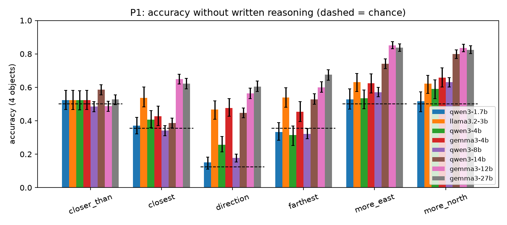

## 2026-11-09 16:42 · P1 behaviour screen
**No model passed the gate**, so the fallback applies: qwen3-8b locally, then 14B on a rented GPU, then 3-object scenes.

### llama3.2-3b
- 4-object accuracy: 0.55 [0.52, 0.58]; accuracy above chance on 2+ hop questions: 0.13 [0.11, 0.15] → gate **fail**

| question | chance | 3 objects | 4 objects | 5 objects |
|---|---|---|---|---|
| closer_than | 0.50 | 0.51 [0.46, 0.55] | 0.52 [0.47, 0.58] | 0.52 [0.47, 0.57] |
| closest | 0.36 | 0.64 [0.58, 0.70] | 0.54 [0.47, 0.59] | 0.48 [0.42, 0.54] |
| direction | 0.12 | 0.53 [0.47, 0.58] | 0.47 [0.41, 0.52] | 0.39 [0.34, 0.45] |
| farthest | 0.36 | 0.66 [0.60, 0.73] | 0.54 [0.48, 0.60] | 0.40 [0.33, 0.47] |
| more_east | 0.50 | 0.56 [0.48, 0.62] | 0.63 [0.57, 0.68] | 0.61 [0.56, 0.67] |
| more_north | 0.50 | 0.66 [0.59, 0.72] | 0.62 [0.56, 0.68] | 0.64 [0.58, 0.70] |

- By deepest object involved: hop 1: 0.61 [0.58, 0.63]; hop 2: 0.54 [0.52, 0.56]; hop 3: 0.50 [0.46, 0.53]; hop 4: 0.48 [0.41, 0.56]
- Error signature (standardised logistic coefficients): hop -0.16 [-0.22, -0.10], log margin 0.23 [0.17, 0.29]
- Near-tie set (margin 0.25–1 unit / 2.5–10°): 0.36 [0.32, 0.39]
- Object-list line: with 0.53, without 0.51, difference 0.02 [-0.01, 0.04]

## 2026-11-09 17:34 · P1 behaviour screen
**No model passed the gate**, so the fallback applies: qwen3-8b locally, then 14B on a rented GPU, then 3-object scenes.

### qwen3-4b
- 4-object accuracy: 0.44 [0.42, 0.46]; accuracy above chance on 2+ hop questions: 0.03 [0.01, 0.05] → gate **fail**

| question | chance | 3 objects | 4 objects | 5 objects |
|---|---|---|---|---|
| closer_than | 0.50 | 0.53 [0.47, 0.58] | 0.52 [0.47, 0.58] | 0.52 [0.47, 0.57] |
| closest | 0.36 | 0.53 [0.47, 0.60] | 0.41 [0.34, 0.47] | 0.27 [0.22, 0.32] |
| direction | 0.12 | 0.44 [0.38, 0.50] | 0.26 [0.21, 0.30] | 0.22 [0.18, 0.27] |
| farthest | 0.36 | 0.53 [0.46, 0.59] | 0.31 [0.25, 0.38] | 0.19 [0.14, 0.25] |
| more_east | 0.50 | 0.71 [0.64, 0.77] | 0.54 [0.48, 0.60] | 0.48 [0.41, 0.54] |
| more_north | 0.50 | 0.72 [0.65, 0.78] | 0.59 [0.53, 0.65] | 0.53 [0.48, 0.59] |

- By deepest object involved: hop 1: 0.53 [0.50, 0.56]; hop 2: 0.45 [0.43, 0.47]; hop 3: 0.37 [0.34, 0.40]; hop 4: 0.39 [0.33, 0.45]
- Error signature (standardised logistic coefficients): hop -0.27 [-0.33, -0.21], log margin 0.10 [0.04, 0.15]
- Near-tie set (margin 0.25–1 unit / 2.5–10°): 0.31 [0.28, 0.35]
- Object-list line: with 0.42, without 0.44, difference -0.02 [-0.05, 0.01]
- Chain of thought on: 0.43 [0.32, 0.57] vs off 0.45 [0.32, 0.58] (same 60 questions; unparsed 43%, median 1024 tokens)

## 2026-11-09 18:05 · P1 behaviour screen
**No model passed the gate**, so the fallback applies: qwen3-8b locally, then 14B on a rented GPU, then 3-object scenes.

### gemma3-4b
- 4-object accuracy: 0.53 [0.51, 0.55]; accuracy above chance on 2+ hop questions: 0.13 [0.11, 0.14] → gate **fail**

| question | chance | 3 objects | 4 objects | 5 objects |
|---|---|---|---|---|
| closer_than | 0.50 | 0.49 [0.44, 0.53] | 0.52 [0.47, 0.58] | 0.52 [0.47, 0.57] |
| closest | 0.36 | 0.61 [0.54, 0.66] | 0.43 [0.37, 0.48] | 0.37 [0.32, 0.42] |
| direction | 0.12 | 0.48 [0.43, 0.54] | 0.48 [0.42, 0.53] | 0.38 [0.33, 0.44] |
| farthest | 0.36 | 0.62 [0.56, 0.68] | 0.45 [0.38, 0.52] | 0.44 [0.37, 0.50] |
| more_east | 0.50 | 0.71 [0.65, 0.77] | 0.62 [0.56, 0.68] | 0.60 [0.54, 0.66] |
| more_north | 0.50 | 0.64 [0.58, 0.70] | 0.66 [0.60, 0.72] | 0.67 [0.61, 0.73] |

- By deepest object involved: hop 1: 0.57 [0.55, 0.60]; hop 2: 0.52 [0.50, 0.54]; hop 3: 0.50 [0.47, 0.54]; hop 4: 0.55 [0.49, 0.62]
- Error signature (standardised logistic coefficients): hop -0.08 [-0.14, -0.03], log margin 0.21 [0.16, 0.26]
- Near-tie set (margin 0.25–1 unit / 2.5–10°): 0.36 [0.32, 0.39]
- Object-list line: with 0.53, without 0.48, difference 0.05 [0.01, 0.08]

## 2026-11-09 19:27 · P1 behaviour screen
**No model passed the gate**, so the fallback applies: qwen3-8b locally, then 14B on a rented GPU, then 3-object scenes.

### qwen3-8b
- 4-object accuracy: 0.42 [0.41, 0.44]; accuracy above chance on 2+ hop questions: 0.01 [0.00, 0.02] → gate **fail**

| question | chance | 3 objects | 4 objects | 5 objects |
|---|---|---|---|---|
| closer_than | 0.50 | 0.49 [0.46, 0.51] | 0.49 [0.46, 0.51] | 0.48 [0.45, 0.51] |
| closest | 0.36 | 0.59 [0.55, 0.62] | 0.34 [0.31, 0.38] | 0.26 [0.24, 0.29] |
| direction | 0.12 | 0.36 [0.33, 0.39] | 0.18 [0.15, 0.20] | 0.13 [0.11, 0.15] |
| farthest | 0.36 | 0.44 [0.40, 0.47] | 0.32 [0.29, 0.35] | 0.22 [0.19, 0.26] |
| more_east | 0.50 | 0.69 [0.66, 0.73] | 0.57 [0.54, 0.60] | 0.50 [0.47, 0.53] |
| more_north | 0.50 | 0.73 [0.70, 0.76] | 0.63 [0.60, 0.66] | 0.55 [0.52, 0.58] |

- By deepest object involved: hop 1: 0.52 [0.50, 0.53]; hop 2: 0.42 [0.41, 0.43]; hop 3: 0.36 [0.34, 0.38]; hop 4: 0.35 [0.31, 0.38]
- Error signature (standardised logistic coefficients): hop -0.29 [-0.32, -0.26], log margin 0.08 [0.05, 0.11]
- Near-tie set (margin 0.25–1 unit / 2.5–10°): 0.36 [0.34, 0.39]
- Object-list line: with 0.43, without 0.42, difference 0.00 [-0.01, 0.02]
- Chain of thought on: 0.87 [0.77, 0.95] vs off 0.27 [0.17, 0.38] (same 60 questions; unparsed 10%, median 1625 tokens)

## 2026-11-09 20:44 · P1 behaviour screen
**No model passed the gate**, so the fallback applies: qwen3-8b locally, then 14B on a rented GPU, then 3-object scenes.

### qwen3-14b
- 4-object accuracy: 0.58 [0.57, 0.60]; accuracy above chance on 2+ hop questions: 0.17 [0.16, 0.18] → gate **fail**

| question | chance | 3 objects | 4 objects | 5 objects |
|---|---|---|---|---|
| closer_than | 0.50 | 0.57 [0.54, 0.60] | 0.59 [0.56, 0.62] | 0.60 [0.57, 0.64] |
| closest | 0.36 | 0.63 [0.59, 0.66] | 0.39 [0.35, 0.42] | 0.28 [0.25, 0.30] |
| direction | 0.12 | 0.61 [0.57, 0.64] | 0.45 [0.41, 0.48] | 0.33 [0.30, 0.36] |
| farthest | 0.36 | 0.73 [0.70, 0.76] | 0.53 [0.49, 0.56] | 0.29 [0.26, 0.33] |
| more_east | 0.50 | 0.81 [0.79, 0.84] | 0.74 [0.71, 0.77] | 0.71 [0.68, 0.74] |
| more_north | 0.50 | 0.87 [0.85, 0.90] | 0.80 [0.77, 0.82] | 0.77 [0.75, 0.80] |

- By deepest object involved: hop 1: 0.66 [0.65, 0.67]; hop 2: 0.58 [0.57, 0.60]; hop 3: 0.52 [0.50, 0.54]; hop 4: 0.48 [0.44, 0.52]
- Error signature (standardised logistic coefficients): hop -0.27 [-0.30, -0.24], log margin 0.33 [0.29, 0.37]
- Near-tie set (margin 0.25–1 unit / 2.5–10°): 0.40 [0.37, 0.43]
- Object-list line: with 0.57, without 0.55, difference 0.02 [-0.00, 0.04]
- Chain of thought on: 0.98 [0.95, 1.00] vs off 0.57 [0.43, 0.70] (same 60 questions; unparsed 2%, median 844 tokens)

## 2026-11-09 21:08 · P1 behaviour screen
**No model passed the gate**, so the fallback applies: qwen3-8b locally, then 14B on a rented GPU, then 3-object scenes.

### gemma3-12b
- 4-object accuracy: 0.66 [0.65, 0.68]; accuracy above chance on 2+ hop questions: 0.22 [0.21, 0.23] → gate **fail**

| question | chance | 3 objects | 4 objects | 5 objects |
|---|---|---|---|---|
| closer_than | 0.50 | 0.50 [0.47, 0.53] | 0.49 [0.46, 0.52] | 0.48 [0.45, 0.51] |
| closest | 0.36 | 0.79 [0.76, 0.82] | 0.65 [0.62, 0.68] | 0.55 [0.51, 0.58] |
| direction | 0.12 | 0.72 [0.69, 0.75] | 0.56 [0.53, 0.60] | 0.48 [0.45, 0.51] |
| farthest | 0.36 | 0.75 [0.72, 0.78] | 0.60 [0.56, 0.64] | 0.45 [0.41, 0.49] |
| more_east | 0.50 | 0.86 [0.83, 0.88] | 0.85 [0.83, 0.87] | 0.78 [0.76, 0.81] |
| more_north | 0.50 | 0.87 [0.85, 0.89] | 0.84 [0.81, 0.86] | 0.81 [0.78, 0.83] |

- By deepest object involved: hop 1: 0.77 [0.75, 0.78]; hop 2: 0.63 [0.62, 0.64]; hop 3: 0.59 [0.57, 0.61]; hop 4: 0.56 [0.53, 0.60]
- Error signature (standardised logistic coefficients): hop -0.29 [-0.33, -0.25], log margin 0.35 [0.31, 0.39]
- Near-tie set (margin 0.25–1 unit / 2.5–10°): 0.44 [0.41, 0.46]
- Object-list line: with 0.65, without 0.65, difference 0.01 [-0.01, 0.02]

## 2026-11-09 21:56 · P1 behaviour screen
**No model passed the gate**, so the fallback applies: qwen3-8b locally, then 14B on a rented GPU, then 3-object scenes.

### gemma3-27b
- 4-object accuracy: 0.68 [0.67, 0.69]; accuracy above chance on 2+ hop questions: 0.27 [0.26, 0.27] → gate **fail**

| question | chance | 3 objects | 4 objects | 5 objects |
|---|---|---|---|---|
| closer_than | 0.50 | 0.53 [0.50, 0.56] | 0.53 [0.50, 0.56] | 0.54 [0.51, 0.57] |
| closest | 0.36 | 0.76 [0.73, 0.79] | 0.62 [0.59, 0.66] | 0.55 [0.52, 0.58] |
| direction | 0.12 | 0.77 [0.75, 0.80] | 0.60 [0.57, 0.64] | 0.53 [0.50, 0.56] |
| farthest | 0.36 | 0.77 [0.74, 0.80] | 0.68 [0.64, 0.71] | 0.59 [0.55, 0.62] |
| more_east | 0.50 | 0.87 [0.84, 0.89] | 0.84 [0.81, 0.86] | 0.79 [0.76, 0.81] |
| more_north | 0.50 | 0.86 [0.83, 0.89] | 0.82 [0.80, 0.85] | 0.79 [0.76, 0.82] |

- By deepest object involved: hop 1: 0.75 [0.74, 0.76]; hop 2: 0.67 [0.66, 0.68]; hop 3: 0.63 [0.61, 0.65]; hop 4: 0.62 [0.58, 0.66]
- Error signature (standardised logistic coefficients): hop -0.18 [-0.21, -0.13], log margin 0.33 [0.30, 0.36]
- Near-tie set (margin 0.25–1 unit / 2.5–10°): 0.48 [0.45, 0.51]
- Object-list line: with 0.67, without 0.64, difference 0.03 [0.02, 0.05]

## 2026-11-09 21:57 · P1 behaviour screen
**No model passed the gate**, so the fallback applies: qwen3-8b locally, then 14B on a rented GPU, then 3-object scenes.

### qwen3-1.7b
- 4-object accuracy: 0.40 [0.38, 0.43]; accuracy above chance on 2+ hop questions: 0.03 [0.01, 0.04] → gate **fail**

| question | chance | 3 objects | 4 objects | 5 objects |
|---|---|---|---|---|
| closer_than | 0.50 | 0.49 [0.44, 0.53] | 0.52 [0.47, 0.58] | 0.52 [0.47, 0.57] |
| closest | 0.36 | 0.54 [0.48, 0.61] | 0.37 [0.31, 0.43] | 0.30 [0.25, 0.35] |
| direction | 0.12 | 0.24 [0.19, 0.28] | 0.15 [0.11, 0.19] | 0.18 [0.14, 0.23] |
| farthest | 0.36 | 0.50 [0.44, 0.57] | 0.33 [0.27, 0.40] | 0.23 [0.17, 0.28] |
| more_east | 0.50 | 0.54 [0.47, 0.61] | 0.53 [0.47, 0.59] | 0.54 [0.48, 0.60] |
| more_north | 0.50 | 0.57 [0.51, 0.63] | 0.52 [0.46, 0.57] | 0.52 [0.47, 0.57] |

- By deepest object involved: hop 1: 0.42 [0.40, 0.44]; hop 2: 0.43 [0.41, 0.44]; hop 3: 0.41 [0.38, 0.44]; hop 4: 0.43 [0.37, 0.50]
- Error signature (standardised logistic coefficients): hop -0.04 [-0.11, 0.02], log margin 0.07 [0.02, 0.11]
- Near-tie set (margin 0.25–1 unit / 2.5–10°): 0.32 [0.29, 0.35]
- Object-list line: with 0.38, without 0.38, difference -0.01 [-0.03, 0.02]
- Chain of thought on: 0.52 [0.40, 0.63] vs off 0.42 [0.30, 0.53] (same 60 questions; unparsed 38%, median 1024 tokens)

### llama3.2-3b
- 4-object accuracy: 0.55 [0.52, 0.58]; accuracy above chance on 2+ hop questions: 0.13 [0.11, 0.15] → gate **fail**

| question | chance | 3 objects | 4 objects | 5 objects |
|---|---|---|---|---|
| closer_than | 0.50 | 0.51 [0.46, 0.55] | 0.52 [0.47, 0.58] | 0.52 [0.47, 0.57] |
| closest | 0.36 | 0.64 [0.58, 0.70] | 0.54 [0.47, 0.59] | 0.48 [0.42, 0.54] |
| direction | 0.12 | 0.53 [0.47, 0.58] | 0.47 [0.41, 0.52] | 0.39 [0.34, 0.45] |
| farthest | 0.36 | 0.66 [0.60, 0.73] | 0.54 [0.48, 0.60] | 0.40 [0.33, 0.47] |
| more_east | 0.50 | 0.56 [0.48, 0.62] | 0.63 [0.57, 0.68] | 0.61 [0.56, 0.67] |
| more_north | 0.50 | 0.66 [0.59, 0.72] | 0.62 [0.56, 0.68] | 0.64 [0.58, 0.70] |

- By deepest object involved: hop 1: 0.61 [0.58, 0.63]; hop 2: 0.54 [0.52, 0.56]; hop 3: 0.50 [0.46, 0.53]; hop 4: 0.48 [0.41, 0.56]
- Error signature (standardised logistic coefficients): hop -0.16 [-0.22, -0.10], log margin 0.23 [0.17, 0.29]
- Near-tie set (margin 0.25–1 unit / 2.5–10°): 0.36 [0.32, 0.39]
- Object-list line: with 0.53, without 0.51, difference 0.02 [-0.01, 0.04]

### qwen3-4b
- 4-object accuracy: 0.44 [0.42, 0.46]; accuracy above chance on 2+ hop questions: 0.03 [0.01, 0.05] → gate **fail**

| question | chance | 3 objects | 4 objects | 5 objects |
|---|---|---|---|---|
| closer_than | 0.50 | 0.53 [0.47, 0.58] | 0.52 [0.47, 0.58] | 0.52 [0.47, 0.57] |
| closest | 0.36 | 0.53 [0.47, 0.60] | 0.41 [0.34, 0.47] | 0.27 [0.22, 0.32] |
| direction | 0.12 | 0.44 [0.38, 0.50] | 0.26 [0.21, 0.30] | 0.22 [0.18, 0.27] |
| farthest | 0.36 | 0.53 [0.46, 0.59] | 0.31 [0.25, 0.38] | 0.19 [0.14, 0.25] |
| more_east | 0.50 | 0.71 [0.64, 0.77] | 0.54 [0.48, 0.60] | 0.48 [0.41, 0.54] |
| more_north | 0.50 | 0.72 [0.65, 0.78] | 0.59 [0.53, 0.65] | 0.53 [0.48, 0.59] |

- By deepest object involved: hop 1: 0.53 [0.50, 0.56]; hop 2: 0.45 [0.43, 0.47]; hop 3: 0.37 [0.34, 0.40]; hop 4: 0.39 [0.33, 0.45]
- Error signature (standardised logistic coefficients): hop -0.27 [-0.33, -0.21], log margin 0.10 [0.04, 0.15]
- Near-tie set (margin 0.25–1 unit / 2.5–10°): 0.31 [0.28, 0.35]
- Object-list line: with 0.42, without 0.44, difference -0.02 [-0.05, 0.01]
- Chain of thought on: 0.43 [0.32, 0.57] vs off 0.45 [0.32, 0.58] (same 60 questions; unparsed 43%, median 1024 tokens)

### gemma3-4b
- 4-object accuracy: 0.53 [0.51, 0.55]; accuracy above chance on 2+ hop questions: 0.13 [0.11, 0.14] → gate **fail**

| question | chance | 3 objects | 4 objects | 5 objects |
|---|---|---|---|---|
| closer_than | 0.50 | 0.49 [0.44, 0.53] | 0.52 [0.47, 0.58] | 0.52 [0.47, 0.57] |
| closest | 0.36 | 0.61 [0.54, 0.66] | 0.43 [0.37, 0.48] | 0.37 [0.32, 0.42] |
| direction | 0.12 | 0.48 [0.43, 0.54] | 0.48 [0.42, 0.53] | 0.38 [0.33, 0.44] |
| farthest | 0.36 | 0.62 [0.56, 0.68] | 0.45 [0.38, 0.52] | 0.44 [0.37, 0.50] |
| more_east | 0.50 | 0.71 [0.65, 0.77] | 0.62 [0.56, 0.68] | 0.60 [0.54, 0.66] |
| more_north | 0.50 | 0.64 [0.58, 0.70] | 0.66 [0.60, 0.72] | 0.67 [0.61, 0.73] |

- By deepest object involved: hop 1: 0.57 [0.55, 0.60]; hop 2: 0.52 [0.50, 0.54]; hop 3: 0.50 [0.47, 0.54]; hop 4: 0.55 [0.49, 0.62]
- Error signature (standardised logistic coefficients): hop -0.08 [-0.14, -0.03], log margin 0.21 [0.16, 0.26]
- Near-tie set (margin 0.25–1 unit / 2.5–10°): 0.36 [0.32, 0.39]
- Object-list line: with 0.53, without 0.48, difference 0.05 [0.01, 0.08]

### qwen3-8b
- 4-object accuracy: 0.42 [0.41, 0.44]; accuracy above chance on 2+ hop questions: 0.01 [0.00, 0.02] → gate **fail**

| question | chance | 3 objects | 4 objects | 5 objects |
|---|---|---|---|---|
| closer_than | 0.50 | 0.49 [0.46, 0.51] | 0.49 [0.46, 0.51] | 0.48 [0.45, 0.51] |
| closest | 0.36 | 0.59 [0.55, 0.62] | 0.34 [0.31, 0.38] | 0.26 [0.24, 0.29] |
| direction | 0.12 | 0.36 [0.33, 0.39] | 0.18 [0.15, 0.20] | 0.13 [0.11, 0.15] |
| farthest | 0.36 | 0.44 [0.40, 0.47] | 0.32 [0.29, 0.35] | 0.22 [0.19, 0.26] |
| more_east | 0.50 | 0.69 [0.66, 0.73] | 0.57 [0.54, 0.60] | 0.50 [0.47, 0.53] |
| more_north | 0.50 | 0.73 [0.70, 0.76] | 0.63 [0.60, 0.66] | 0.55 [0.52, 0.58] |

- By deepest object involved: hop 1: 0.52 [0.50, 0.53]; hop 2: 0.42 [0.41, 0.43]; hop 3: 0.36 [0.34, 0.38]; hop 4: 0.35 [0.31, 0.38]
- Error signature (standardised logistic coefficients): hop -0.29 [-0.32, -0.26], log margin 0.08 [0.05, 0.11]
- Near-tie set (margin 0.25–1 unit / 2.5–10°): 0.36 [0.34, 0.39]
- Object-list line: with 0.43, without 0.42, difference 0.00 [-0.01, 0.02]
- Chain of thought on: 0.87 [0.77, 0.95] vs off 0.27 [0.17, 0.38] (same 60 questions; unparsed 10%, median 1625 tokens)

### qwen3-14b
- 4-object accuracy: 0.58 [0.57, 0.60]; accuracy above chance on 2+ hop questions: 0.17 [0.16, 0.18] → gate **fail**

| question | chance | 3 objects | 4 objects | 5 objects |
|---|---|---|---|---|
| closer_than | 0.50 | 0.57 [0.54, 0.60] | 0.59 [0.56, 0.62] | 0.60 [0.57, 0.64] |
| closest | 0.36 | 0.63 [0.59, 0.66] | 0.39 [0.35, 0.42] | 0.28 [0.25, 0.30] |
| direction | 0.12 | 0.61 [0.57, 0.64] | 0.45 [0.41, 0.48] | 0.33 [0.30, 0.36] |
| farthest | 0.36 | 0.73 [0.70, 0.76] | 0.53 [0.49, 0.56] | 0.29 [0.26, 0.33] |
| more_east | 0.50 | 0.81 [0.79, 0.84] | 0.74 [0.71, 0.77] | 0.71 [0.68, 0.74] |
| more_north | 0.50 | 0.87 [0.85, 0.90] | 0.80 [0.77, 0.82] | 0.77 [0.75, 0.80] |

- By deepest object involved: hop 1: 0.66 [0.65, 0.67]; hop 2: 0.58 [0.57, 0.60]; hop 3: 0.52 [0.50, 0.54]; hop 4: 0.48 [0.44, 0.52]
- Error signature (standardised logistic coefficients): hop -0.27 [-0.30, -0.24], log margin 0.33 [0.29, 0.37]
- Near-tie set (margin 0.25–1 unit / 2.5–10°): 0.40 [0.37, 0.43]
- Object-list line: with 0.57, without 0.55, difference 0.02 [-0.00, 0.04]
- Chain of thought on: 0.98 [0.95, 1.00] vs off 0.57 [0.43, 0.70] (same 60 questions; unparsed 2%, median 844 tokens)

### gemma3-12b
- 4-object accuracy: 0.66 [0.65, 0.68]; accuracy above chance on 2+ hop questions: 0.22 [0.21, 0.23] → gate **fail**

| question | chance | 3 objects | 4 objects | 5 objects |
|---|---|---|---|---|
| closer_than | 0.50 | 0.50 [0.47, 0.53] | 0.49 [0.46, 0.52] | 0.48 [0.45, 0.51] |
| closest | 0.36 | 0.79 [0.76, 0.82] | 0.65 [0.62, 0.68] | 0.55 [0.51, 0.58] |
| direction | 0.12 | 0.72 [0.69, 0.75] | 0.56 [0.53, 0.60] | 0.48 [0.45, 0.51] |
| farthest | 0.36 | 0.75 [0.72, 0.78] | 0.60 [0.56, 0.64] | 0.45 [0.41, 0.49] |
| more_east | 0.50 | 0.86 [0.83, 0.88] | 0.85 [0.83, 0.87] | 0.78 [0.76, 0.81] |
| more_north | 0.50 | 0.87 [0.85, 0.89] | 0.84 [0.81, 0.86] | 0.81 [0.78, 0.83] |

- By deepest object involved: hop 1: 0.77 [0.75, 0.78]; hop 2: 0.63 [0.62, 0.64]; hop 3: 0.59 [0.57, 0.61]; hop 4: 0.56 [0.53, 0.60]
- Error signature (standardised logistic coefficients): hop -0.29 [-0.33, -0.25], log margin 0.35 [0.31, 0.39]
- Near-tie set (margin 0.25–1 unit / 2.5–10°): 0.44 [0.41, 0.46]
- Object-list line: with 0.65, without 0.65, difference 0.01 [-0.01, 0.02]

### gemma3-27b
- 4-object accuracy: 0.68 [0.67, 0.69]; accuracy above chance on 2+ hop questions: 0.27 [0.26, 0.27] → gate **fail**

| question | chance | 3 objects | 4 objects | 5 objects |
|---|---|---|---|---|
| closer_than | 0.50 | 0.53 [0.50, 0.56] | 0.53 [0.50, 0.56] | 0.54 [0.51, 0.57] |
| closest | 0.36 | 0.76 [0.73, 0.79] | 0.62 [0.59, 0.66] | 0.55 [0.52, 0.58] |
| direction | 0.12 | 0.77 [0.75, 0.80] | 0.60 [0.57, 0.64] | 0.53 [0.50, 0.56] |
| farthest | 0.36 | 0.77 [0.74, 0.80] | 0.68 [0.64, 0.71] | 0.59 [0.55, 0.62] |
| more_east | 0.50 | 0.87 [0.84, 0.89] | 0.84 [0.81, 0.86] | 0.79 [0.76, 0.81] |
| more_north | 0.50 | 0.86 [0.83, 0.89] | 0.82 [0.80, 0.85] | 0.79 [0.76, 0.82] |

- By deepest object involved: hop 1: 0.75 [0.74, 0.76]; hop 2: 0.67 [0.66, 0.68]; hop 3: 0.63 [0.61, 0.65]; hop 4: 0.62 [0.58, 0.66]
- Error signature (standardised logistic coefficients): hop -0.18 [-0.21, -0.13], log margin 0.33 [0.30, 0.36]
- Near-tie set (margin 0.25–1 unit / 2.5–10°): 0.48 [0.45, 0.51]
- Object-list line: with 0.67, without 0.64, difference 0.03 [0.02, 0.05]

## 2026-11-09 23:13 · P1 behaviour screen
**No model passed the gate**, so the fallback applies: qwen3-8b locally, then 14B on a rented GPU, then 3-object scenes.

### gemma3-12b
- 4-object accuracy: 0.68 [0.66, 0.69]; accuracy above chance on 2+ hop questions: 0.23 [0.22, 0.24] → gate **fail**

| question | chance | 3 objects | 4 objects | 5 objects |
|---|---|---|---|---|
| closer_than | 0.50 | 0.51 [0.48, 0.54] | 0.49 [0.46, 0.52] | 0.48 [0.45, 0.51] |
| closest | 0.36 | 0.79 [0.76, 0.82] | 0.65 [0.62, 0.69] | 0.55 [0.51, 0.58] |
| direction | 0.12 | 0.77 [0.74, 0.79] | 0.62 [0.59, 0.66] | 0.50 [0.47, 0.53] |
| farthest | 0.36 | 0.75 [0.72, 0.78] | 0.60 [0.57, 0.64] | 0.45 [0.41, 0.49] |
| more_east | 0.50 | 0.86 [0.83, 0.88] | 0.85 [0.83, 0.87] | 0.78 [0.76, 0.81] |
| more_north | 0.50 | 0.87 [0.85, 0.89] | 0.83 [0.81, 0.86] | 0.81 [0.78, 0.83] |

- By deepest object involved: hop 1: 0.78 [0.76, 0.79]; hop 2: 0.64 [0.63, 0.65]; hop 3: 0.59 [0.57, 0.61]; hop 4: 0.57 [0.53, 0.61]
- Error signature (standardised logistic coefficients): hop -0.30 [-0.33, -0.26], log margin 0.31 [0.27, 0.33]
- Validity: median probability on the allowed answers 1.00 (5th percentile 0.95)
- Near-tie set (margin 0.25–1 unit / 2.5–10°): 0.45 [0.42, 0.48]
- Object-list line: with 0.66, without 0.66, difference 0.01 [-0.01, 0.03]

## 2026-11-09 23:27 · P1 behaviour screen
**No model passed the gate**, so the fallback applies: qwen3-8b locally, then 14B on a rented GPU, then 3-object scenes.

### qwen3-14b
- 4-object accuracy: 0.56 [0.55, 0.57]; accuracy above chance on 2+ hop questions: 0.15 [0.14, 0.16] → gate **fail**

| question | chance | 3 objects | 4 objects | 5 objects |
|---|---|---|---|---|
| closer_than | 0.50 | 0.55 [0.52, 0.58] | 0.53 [0.50, 0.56] | 0.51 [0.48, 0.55] |
| closest | 0.36 | 0.63 [0.59, 0.66] | 0.39 [0.35, 0.42] | 0.28 [0.25, 0.30] |
| direction | 0.12 | 0.55 [0.52, 0.58] | 0.38 [0.34, 0.41] | 0.25 [0.22, 0.28] |
| farthest | 0.36 | 0.73 [0.70, 0.76] | 0.53 [0.49, 0.56] | 0.29 [0.25, 0.33] |
| more_east | 0.50 | 0.82 [0.79, 0.85] | 0.74 [0.71, 0.77] | 0.71 [0.68, 0.74] |
| more_north | 0.50 | 0.87 [0.85, 0.90] | 0.80 [0.77, 0.82] | 0.77 [0.75, 0.80] |

- By deepest object involved: hop 1: 0.63 [0.62, 0.65]; hop 2: 0.57 [0.56, 0.58]; hop 3: 0.49 [0.47, 0.50]; hop 4: 0.45 [0.41, 0.48]
- Error signature (standardised logistic coefficients): hop -0.27 [-0.31, -0.24], log margin 0.25 [0.21, 0.28]
- Validity: median probability on the allowed answers 0.02 (5th percentile 0.00)
- Near-tie set (margin 0.25–1 unit / 2.5–10°): 0.41 [0.38, 0.44]
- Object-list line: with 0.55, without 0.53, difference 0.02 [-0.01, 0.04]

## 2026-11-09 23:34 · P1 behaviour screen
**No model passed the gate**, so the fallback applies: qwen3-8b locally, then 14B on a rented GPU, then 3-object scenes.

### qwen3-8b
- 4-object accuracy: 0.45 [0.43, 0.47]; accuracy above chance on 2+ hop questions: 0.04 [0.02, 0.05] → gate **fail**

| question | chance | 3 objects | 4 objects | 5 objects |
|---|---|---|---|---|
| closer_than | 0.50 | 0.49 [0.45, 0.54] | 0.53 [0.47, 0.58] | 0.52 [0.47, 0.57] |
| closest | 0.36 | 0.54 [0.48, 0.60] | 0.40 [0.34, 0.47] | 0.27 [0.22, 0.33] |
| direction | 0.12 | 0.31 [0.26, 0.36] | 0.25 [0.21, 0.30] | 0.21 [0.17, 0.26] |
| farthest | 0.36 | 0.45 [0.39, 0.52] | 0.34 [0.28, 0.41] | 0.23 [0.18, 0.29] |
| more_east | 0.50 | 0.69 [0.63, 0.75] | 0.55 [0.49, 0.60] | 0.51 [0.44, 0.57] |
| more_north | 0.50 | 0.76 [0.69, 0.81] | 0.61 [0.55, 0.67] | 0.56 [0.50, 0.62] |

- By deepest object involved: hop 1: 0.50 [0.48, 0.53]; hop 2: 0.44 [0.42, 0.46]; hop 3: 0.41 [0.38, 0.44]; hop 4: 0.43 [0.37, 0.50]
- Error signature (standardised logistic coefficients): hop -0.17 [-0.22, -0.11], log margin 0.12 [0.06, 0.17]
- Validity: median probability on the allowed answers 0.00 (5th percentile 0.00)

## 2026-11-10 00:32 · P1 behaviour screen
**No model passed the gate**, so the fallback applies: qwen3-8b locally, then 14B on a rented GPU, then 3-object scenes.

### gemma3-27b
- 4-object accuracy: 0.70 [0.68, 0.71]; accuracy above chance on 2+ hop questions: 0.28 [0.27, 0.29] → gate **fail**

| question | chance | 3 objects | 4 objects | 5 objects |
|---|---|---|---|---|
| closer_than | 0.50 | 0.53 [0.50, 0.56] | 0.53 [0.50, 0.56] | 0.54 [0.51, 0.57] |
| closest | 0.36 | 0.76 [0.73, 0.79] | 0.62 [0.59, 0.66] | 0.55 [0.52, 0.58] |
| direction | 0.12 | 0.86 [0.83, 0.88] | 0.70 [0.67, 0.73] | 0.59 [0.56, 0.62] |
| farthest | 0.36 | 0.77 [0.74, 0.80] | 0.68 [0.64, 0.71] | 0.59 [0.55, 0.62] |
| more_east | 0.50 | 0.87 [0.84, 0.89] | 0.84 [0.81, 0.86] | 0.79 [0.76, 0.81] |
| more_north | 0.50 | 0.86 [0.83, 0.89] | 0.82 [0.80, 0.85] | 0.79 [0.76, 0.82] |

- By deepest object involved: hop 1: 0.76 [0.75, 0.78]; hop 2: 0.69 [0.68, 0.70]; hop 3: 0.64 [0.62, 0.66]; hop 4: 0.62 [0.58, 0.67]
- Error signature (standardised logistic coefficients): hop -0.18 [-0.22, -0.15], log margin 0.28 [0.24, 0.31]
- Validity: median probability on the allowed answers 1.00 (5th percentile 0.05)
- Near-tie set (margin 0.25–1 unit / 2.5–10°): 0.51 [0.48, 0.54]
- Object-list line: with 0.68, without 0.64, difference 0.05 [0.03, 0.07]

## 2026-11-10 00:32 · P1 rescored: model choice
**Chosen: gemma3-12b** on 3-object scenes; excluded question types (at chance): closer_than.

| model | 4-object accuracy | 3-object accuracy | 4-object gate |
|---|---|---|---|
| qwen3-1.7b | 0.42 | 0.47 | fail |
| llama3.2-3b | 0.56 | 0.61 | fail |
| qwen3-4b | 0.43 | 0.55 | fail |
| gemma3-4b | 0.53 | 0.60 | fail |
| qwen3-8b | 0.45 | 0.53 | fail |
| gemma3-12b | 0.68 | 0.76 | fail |
| qwen3-14b | 0.56 | 0.69 | fail |
| gemma3-27b | 0.70 | 0.77 | fail |

## 2026-11-10 00:53 · P2 probes (gemma3-12b)
Model **gemma3-12b**, 3000 scenes (80/20 split by scene), per-object readout in the object list; ridge penalty chosen by scene-grouped cross-validation.

- **Best layer 21: R² = 0.74 [0.72, 0.75]** (1000 bootstrap resamples over test scenes)
- Controls at that layer: shuffled -0.00, layer 0 -0.00, random-init (same layer) -0.00
- Stated-relation baseline (each object's own sentence only): overall 0.70; 1-step 0.92, 2+-step 0.22
- By chain length at layer 21: probe 1-step 0.76, 2+-step 0.74 (gap +0.01); 2+-step advantage over the stated-relation baseline +0.53
- RSA (activation vs true distances, Spearman) at layer 21: 0.19 [0.16, 0.21]; peak 0.20 at layer 19
- Joint end-of-list probe (all objects from one position): peak R² 0.03 at layer 29

Against the preregistered P2 criteria (as clarified):
- R² ≥ 0.6: yes
- beats shuffled, layer-0 and random-init by ≥ 0.3, and the stated-relation baseline by ≥ 0.3 on 2-step objects: yes
- 2-step objects within 0.1 of 1-step: yes
- H-rel signature (R² < 0.3, or 2-step more than 0.2 below 1-step): no

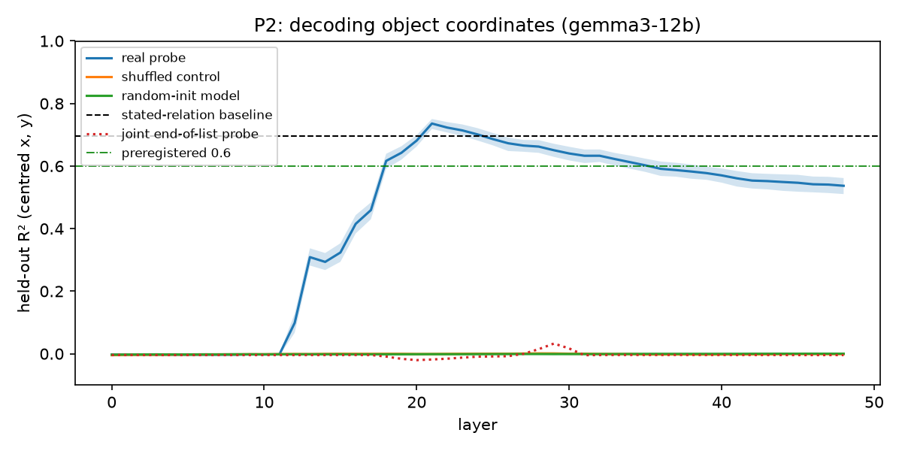

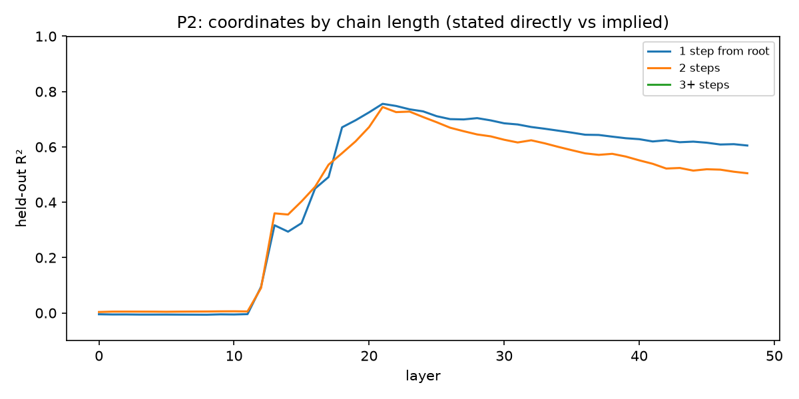

## 2026-11-10 03:45 · P4 slider (gemma3-12b)
Model **gemma3-12b**, layer 21, using probe directions; 50 scenes, x and y sweeps of ±5.0 units in 0.5-unit steps (including positions no sentence states).

- Agreement with geometry along the sweeps: 0.64 [0.60, 0.68]
- Sweeps where geometry predicts a flip: 268; the model also flips in 2% of them
- Predicted vs observed flip position: r = 0.03; median offset -2.50 units
- Steered activations within the natural norm range (1st–99th percentile): 100%

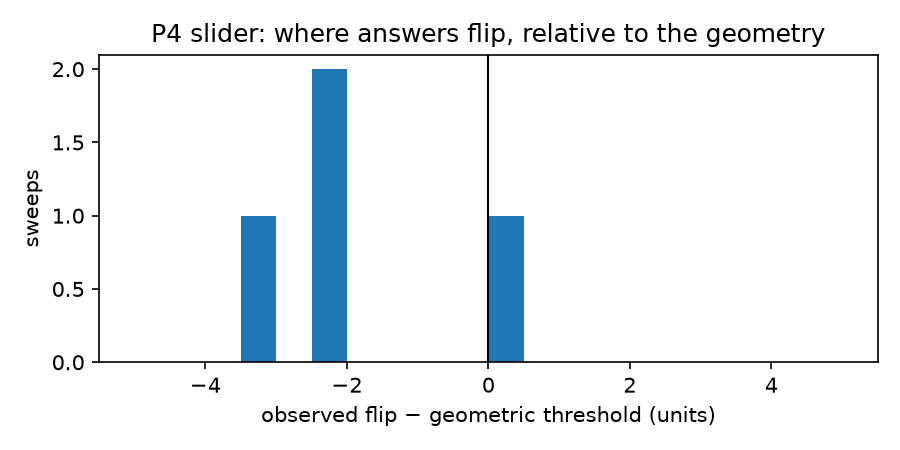

## 2026-11-10 05:09 · P3 patching (gemma3-12b)
Model **gemma3-12b**. Each pair differs in one sentence that moves one leaf object; the source's activations are copied into the base run at one site and layer, then every question is asked.

**Joint agreement** = share of pairs where, after patching, *every* answer equals what the model says when the object really is elsewhere (pairs where at least one of those answers differs from the base run). Geometric joint consistency (all answers match the true layout) is shown for reference.

- Positive control (copy the whole prefix, earliest layer): 0.95 (should be 1.00)
- Best layers in the sweep: list → [18, 20], relation → [2, 6], eol → [2, 6]

Confirmation run:

| site | layer | joint agreement [95% CI] | per-question agreement | geometric joint | pairs |
|---|---|---|---|---|---|
| all | 2 | 0.95 [0.93, 0.97] | 0.99 | 0.28 | 390 |
| all | 6 | 0.95 [0.93, 0.97] | 0.99 | 0.28 | 390 |
| all | 18 | 0.50 [0.45, 0.55] | 0.76 | 0.22 | 390 |
| all | 20 | 0.23 [0.19, 0.27] | 0.55 | 0.14 | 390 |
| eol | 2 | 0.00 [0.00, 0.00] | 0.00 | 0.01 | 390 |
| eol | 6 | 0.00 [0.00, 0.00] | 0.00 | 0.01 | 390 |
| eol | 18 | 0.00 [0.00, 0.00] | 0.00 | 0.01 | 390 |
| eol | 20 | 0.00 [0.00, 0.00] | 0.00 | 0.01 | 390 |
| list | 2 | 0.00 [0.00, 0.00] | 0.00 | 0.01 | 390 |
| list | 6 | 0.00 [0.00, 0.00] | 0.00 | 0.01 | 390 |
| list | 18 | 0.00 [0.00, 0.00] | 0.01 | 0.01 | 390 |
| list | 20 | 0.00 [0.00, 0.00] | 0.01 | 0.01 | 390 |
| relation | 2 | 0.94 [0.92, 0.96] | 0.99 | 0.28 | 390 |
| relation | 6 | 0.94 [0.91, 0.96] | 0.99 | 0.28 | 390 |
| relation | 18 | 0.36 [0.32, 0.41] | 0.67 | 0.19 | 390 |
| relation | 20 | 0.18 [0.15, 0.22] | 0.50 | 0.13 | 390 |

Pairs the model answers fully correctly when unpatched (44 pairs):

| site | layer | joint agreement [95% CI] | per-question agreement | geometric joint | pairs |
|---|---|---|---|---|---|
| all | 2 | 0.98 [0.93, 1.00] | 1.00 | 0.98 | 44 |
| all | 6 | 0.98 [0.93, 1.00] | 0.99 | 0.98 | 44 |
| all | 18 | 0.64 [0.48, 0.77] | 0.76 | 0.64 | 44 |
| all | 20 | 0.34 [0.20, 0.48] | 0.54 | 0.34 | 44 |
| eol | 2 | 0.00 [0.00, 0.00] | 0.00 | 0.00 | 44 |
| eol | 6 | 0.00 [0.00, 0.00] | 0.00 | 0.00 | 44 |
| eol | 18 | 0.00 [0.00, 0.00] | 0.00 | 0.00 | 44 |
| eol | 20 | 0.00 [0.00, 0.00] | 0.00 | 0.00 | 44 |
| list | 2 | 0.00 [0.00, 0.00] | 0.00 | 0.00 | 44 |
| list | 6 | 0.00 [0.00, 0.00] | 0.00 | 0.00 | 44 |
| list | 18 | 0.00 [0.00, 0.00] | 0.00 | 0.00 | 44 |
| list | 20 | 0.00 [0.00, 0.00] | 0.01 | 0.00 | 44 |
| relation | 2 | 0.98 [0.93, 1.00] | 0.99 | 0.98 | 44 |
| relation | 6 | 1.00 [1.00, 1.00] | 1.00 | 1.00 | 44 |
| relation | 18 | 0.57 [0.41, 0.70] | 0.70 | 0.57 | 44 |
| relation | 20 | 0.34 [0.20, 0.48] | 0.53 | 0.34 | 44 |

Against the preregistered P3 criteria (as clarified):
- H-map: joint agreement ≥ 0.6 at the object's list position or the end of list → best 0.00 (layer 2) → not met
- H-rel: < 0.2 at the readout positions, and at that layer the relation sentence carries more → readout 0.00, relation sentence at layer 2: 0.94 → met

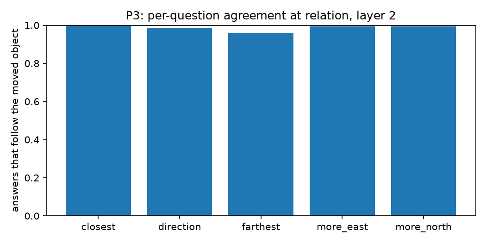

## 2026-11-10 05:10 · E1 summary
Model **gemma3-12b**. Verdict against `docs/preregistration.md`: **Mixed**: see the per-criterion breakdown.

| criterion | met |
|---|---|
| map_r2 | yes |
| map_hops | yes |
| rel_r2 | no |
| map_jc | no |
| rel_jc | yes |

Not yet evaluated: map_das

- P2: best layer 21, R² 0.74; 1-step 0.76 vs 2-step 0.74; stated-relation baseline on 2-step objects 0.22
- P3: joint agreement at readout positions 0.00 (layer 2); relation sentence at that layer 0.94

Prior work to engage in the write-up: Tehenan et al. 2025 (linear spatial models, single-answer steering) and An et al. 2026 (weak, fragmented coordinate probes in 7–8B models).

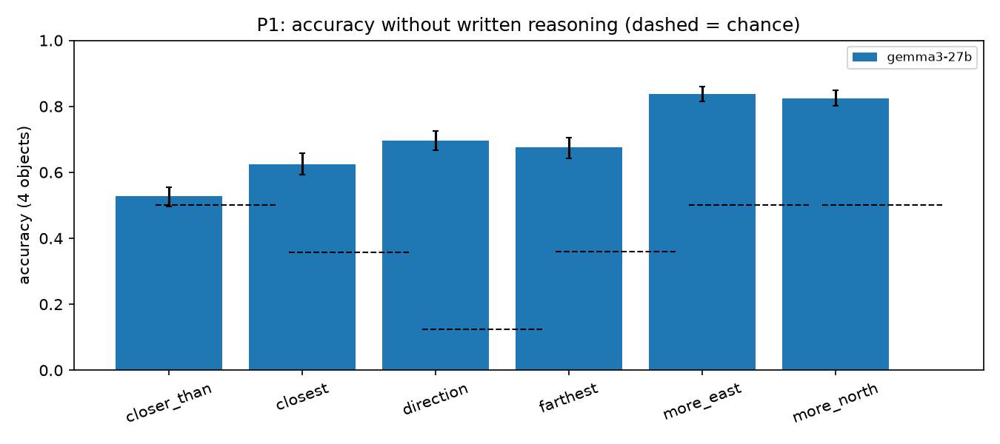

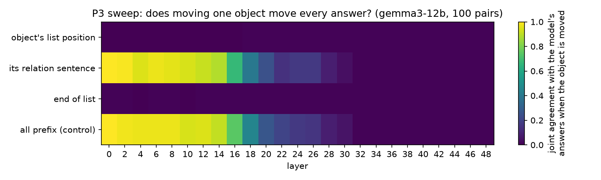

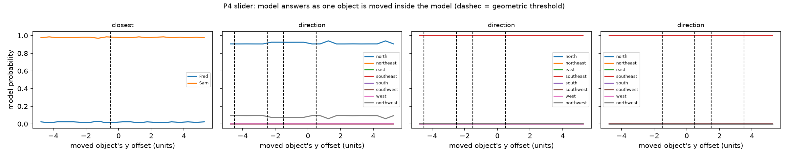

## 2026-11-10 07:56 · P3 necessity (gemma3-12b) — exploratory
Model **gemma3-12b**, 100 pairs (the P3 sweep's pairs). Exploratory, not preregistered: added after P3 showed that patching the readout positions alone changes no answer (insufficiency). Here the source description is copied everywhere *except* the objects' list positions and the end of the list.

| layer | whole description | all but readout positions | difference |
|---|---|---|---|
| 6 | 0.97 [0.93, 1.00] | 0.98 [0.95, 1.00] | +0.01 |
| 14 | 0.92 [0.86, 0.97] | 0.89 [0.82, 0.94] | -0.03 |
| 18 | 0.45 [0.35, 0.56] | 0.42 [0.32, 0.53] | -0.03 |
| 21 | 0.25 [0.16, 0.34] | 0.20 [0.12, 0.28] | -0.05 |
| 24 | 0.15 [0.08, 0.23] | 0.16 [0.09, 0.24] | +0.01 |

Effect sizes in the P3 sweep (mean |change in log-probability of the base answer|, nats):

| layer | all | eol | list | relation |
|---|---|---|---|---|
| 6 | 7.51 | 0.05 | 0.05 | 7.50 |
| 10 | 7.45 | 0.05 | 0.05 | 7.41 |
| 14 | 7.42 | 0.05 | 0.04 | 7.32 |
| 18 | 5.45 | 0.05 | 0.13 | 4.89 |
| 20 | 4.10 | 0.05 | 0.10 | 3.90 |
| 24 | 2.99 | 0.04 | 0.10 | 2.88 |
| 30 | 1.71 | 0.04 | 0.06 | 1.63 |

## 2026-11-10 08:04 · P2b sentence-end probe (gemma3-12b) — exploratory
Model **gemma3-12b**, same 3,000 scenes and split as P2. Exploratory: added after P3 showed that patching the object's sentence moves the answers while patching its list mention does not.

- Sentence end: best layer 24, R² 0.44 [0.42, 0.46]; one-step objects 0.42, two-step objects 0.76 (stated-sentence baseline 0.22); shuffled -0.00
- List mention (P2): best layer 21, R² 0.74; two-step 0.74

| layer | sentence end | sentence end, two-step | list mention | list, two-step |
|---|---|---|---|---|
| 4 | 0.26 | 0.43 | -0.00 | 0.00 |
| 8 | 0.26 | 0.43 | -0.00 | 0.01 |
| 10 | 0.27 | 0.44 | -0.00 | 0.01 |
| 12 | 0.28 | 0.48 | 0.10 | 0.09 |
| 14 | 0.34 | 0.61 | 0.29 | 0.36 |
| 16 | 0.38 | 0.68 | 0.42 | 0.46 |
| 18 | 0.39 | 0.69 | 0.62 | 0.58 |
| 21 | 0.43 | 0.76 | 0.74 | 0.74 |
| 24 | 0.44 | 0.76 | 0.70 | 0.71 |
| 30 | 0.40 | 0.70 | 0.64 | 0.63 |
| 40 | 0.33 | 0.56 | 0.57 | 0.55 |
| 48 | 0.29 | 0.48 | 0.54 | 0.50 |

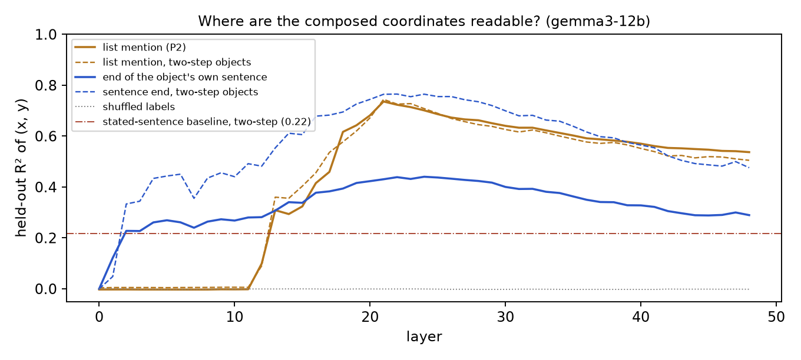

## 2026-11-10 08:49 · E2 composition timing (gemma3-12b)
Model **gemma3-12b**, 150 chain pairs (R → M → C, M's sentence first). M's sentence is copied from a scene where M (and therefore C) sits elsewhere. *follow* = answer equals the model's answer on that scene; *stay* = answer equals the model's answer on a scene where M moved but C kept its old position.

| layer | M follows | C follows | C stays | M-questions | C-questions |
|---|---|---|---|---|---|
| 0 | 1.00 [1.00, 1.00] | 1.00 [1.00, 1.00] | 0.00 [0.00, 0.00] | 293 | 348 |
| 4 | 1.00 [1.00, 1.00] | 0.99 [0.97, 1.00] | 0.01 [0.00, 0.02] | 293 | 348 |
| 8 | 0.98 [0.95, 0.99] | 0.98 [0.97, 0.99] | 0.02 [0.01, 0.03] | 293 | 348 |
| 10 | 0.99 [0.97, 1.00] | 0.98 [0.96, 0.99] | 0.02 [0.01, 0.04] | 293 | 348 |
| 12 | 0.97 [0.94, 0.99] | 0.95 [0.92, 0.97] | 0.04 [0.02, 0.06] | 293 | 348 |
| 14 | 0.96 [0.94, 0.98] | 0.95 [0.92, 0.97] | 0.05 [0.02, 0.07] | 293 | 348 |
| 16 | 0.92 [0.89, 0.96] | 0.85 [0.81, 0.89] | 0.09 [0.06, 0.12] | 293 | 348 |
| 18 | 0.79 [0.74, 0.84] | 0.77 [0.72, 0.82] | 0.15 [0.11, 0.19] | 293 | 348 |
| 20 | 0.66 [0.61, 0.72] | 0.72 [0.67, 0.77] | 0.20 [0.15, 0.26] | 293 | 348 |
| 24 | 0.58 [0.53, 0.64] | 0.69 [0.63, 0.75] | 0.22 [0.16, 0.27] | 293 | 348 |
| 28 | 0.51 [0.46, 0.57] | 0.68 [0.62, 0.73] | 0.24 [0.19, 0.29] | 293 | 348 |
| 32 | 0.08 [0.05, 0.11] | 0.61 [0.55, 0.66] | 0.25 [0.20, 0.31] | 293 | 348 |

Preregistered verdict: **lazy**

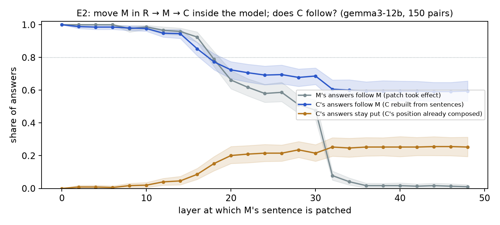

## 2026-11-10 08:53 · P2d distance probe (gemma3-12b) — exploratory
Model **gemma3-12b**, same 3,000 scenes and split as P2, readout at the list mention. Exploratory. Target: each non-root object's distance to the root. Distance is not a sum of the stated offsets, so the best *additive* baseline (one-hot codes of the object's own and its parent's offsets) cannot fully fit it for two-step objects. Activations that beat it carry an interaction of the two offsets.

- Best layer for two-step objects: 21, R² 0.62 [0.56, 0.67]
- Best additive baseline: two-step -0.05, one-step 0.91
- Reference from the true position (x, y, x², y², xy): two-step 0.95

| layer | two-step | one-step |
|---|---|---|
| 0 | -0.12 | -0.04 |
| 8 | -0.02 | 0.24 |
| 12 | 0.13 | 0.40 |
| 14 | 0.16 | 0.46 |
| 16 | 0.33 | 0.55 |
| 18 | 0.45 | 0.74 |
| 21 | 0.62 | 0.80 |
| 24 | 0.60 | 0.78 |
| 30 | 0.52 | 0.73 |
| 40 | 0.39 | 0.66 |
| 48 | 0.42 | 0.67 |

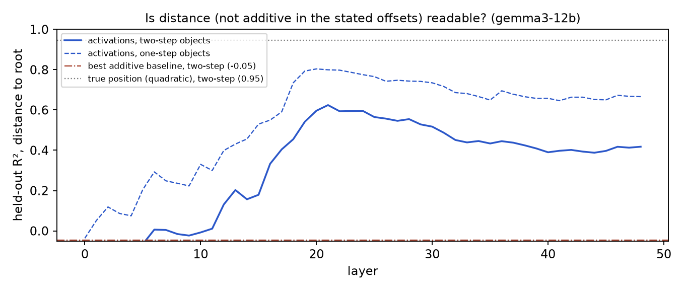

## 2026-11-10 08:58 · E2 strict question set (gemma3-12b) — deviation
Model **gemma3-12b**. Deviation from the E2 preregistration (dated there): C-questions restricted to those whose model answers differ across base, source and hybrid. Under the preregistered definition, a C-question whose answer the move leaves unchanged counts as "follow" even when the patch does nothing.

| layer | M follows | C follows | C stays | C-questions |
|---|---|---|---|---|
| 0 | 1.00 | 1.00 [1.00, 1.00] | 0.00 [0.00, 0.00] | 53 |
| 8 | 0.98 | 0.98 [0.93, 1.00] | 0.00 [0.00, 0.00] | 53 |
| 12 | 0.97 | 0.92 [0.84, 0.98] | 0.02 [0.00, 0.06] | 53 |
| 14 | 0.96 | 0.92 [0.85, 0.98] | 0.02 [0.00, 0.06] | 53 |
| 16 | 0.92 | 0.70 [0.60, 0.81] | 0.04 [0.00, 0.10] | 53 |
| 18 | 0.79 | 0.55 [0.44, 0.67] | 0.09 [0.02, 0.18] | 53 |
| 20 | 0.66 | 0.51 [0.40, 0.62] | 0.11 [0.03, 0.20] | 53 |
| 22 | 0.62 | 0.43 [0.33, 0.56] | 0.15 [0.07, 0.26] | 53 |
| 24 | 0.58 | 0.34 [0.22, 0.46] | 0.17 [0.08, 0.28] | 53 |
| 26 | 0.59 | 0.34 [0.23, 0.47] | 0.19 [0.09, 0.29] | 53 |
| 28 | 0.51 | 0.28 [0.18, 0.39] | 0.23 [0.13, 0.35] | 53 |
| 30 | 0.48 | 0.32 [0.21, 0.43] | 0.13 [0.04, 0.24] | 53 |
| 32 | 0.08 | 0.04 [0.00, 0.12] | 0.04 [0.00, 0.10] | 53 |

Decision rule applied to the strict set: **mixed**

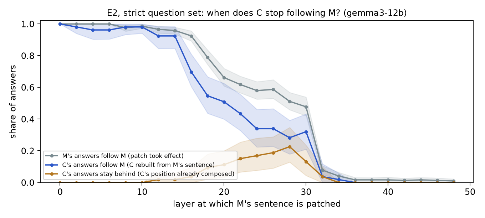

## 2026-11-10 10:18 · P3c which tokens carry the position (gemma3-12b) — exploratory
Model **gemma3-12b**, 100 pairs (the P3 sweep's pairs). Exploratory. Joint agreement (all answers equal the model's answers on the moved scene) after copying one part of the moved object's sentence.

| layer | whole sentence | last token of the sentence only | rest of the sentence |
|---|---|---|---|
| 0 | 1.00 | 0.01 | 1.00 |
| 2 | 0.99 | 0.00 | 0.97 |
| 4 | 0.95 | 0.00 | 0.96 |
| 6 | 0.97 | 0.00 | 0.97 |
| 8 | 0.96 | 0.01 | 0.95 |
| 10 | 0.94 | 0.01 | 0.96 |
| 12 | 0.93 | 0.01 | 0.90 |
| 14 | 0.89 | 0.01 | 0.85 |
| 16 | 0.67 | 0.01 | 0.65 |
| 18 | 0.40 | 0.01 | 0.36 |
| 20 | 0.25 | 0.01 | 0.20 |
| 22 | 0.14 | 0.01 | 0.16 |
| 24 | 0.16 | 0.01 | 0.12 |
| 26 | 0.16 | 0.01 | 0.13 |
| 28 | 0.08 | 0.01 | 0.08 |
| 30 | 0.04 | 0.01 | 0.04 |
| 32 | 0.01 | 0.01 | 0.01 |

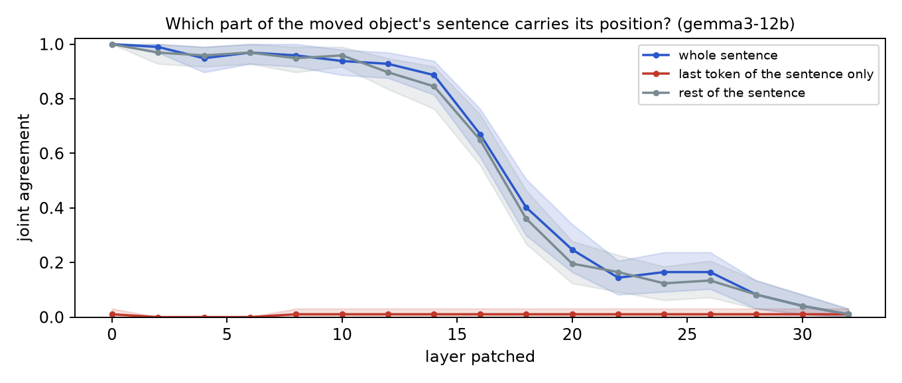

## 2026-11-10 10:32 · P3q hand-off to the question (gemma3-12b) — exploratory
Model **gemma3-12b**, 100 pairs (the P3 sweep's pairs). Exploratory. Joint agreement after copying the question tokens (or only the final position) from the run where the object sits elsewhere. The question text is identical, so the copied states differ only through what they read from the description.

| layer | sentence (sweep) | question tokens | final position |
|---|---|---|---|
| 0 | 1.00 | 0.00 | 0.01 |
| 2 | 0.99 | 0.00 | 0.01 |
| 4 | 0.95 | 0.00 | 0.01 |
| 6 | 0.97 | 0.00 | 0.01 |
| 8 | 0.96 | 0.00 | 0.01 |
| 10 | 0.94 | 0.00 | 0.01 |
| 12 | 0.92 | 0.01 | 0.01 |
| 14 | 0.89 | 0.01 | 0.01 |
| 16 | 0.67 | 0.01 | 0.01 |
| 18 | 0.40 | 0.02 | 0.01 |
| 20 | 0.25 | 0.04 | 0.01 |
| 22 | 0.14 | 0.06 | 0.01 |
| 24 | 0.16 | 0.13 | 0.01 |
| 26 | 0.16 | 0.12 | 0.01 |
| 28 | 0.08 | 0.20 | 0.01 |
| 30 | 0.04 | 0.24 | 0.05 |
| 32 | 0.01 | 0.78 | 0.06 |
| 34 | 0.01 | 0.76 | 0.07 |
| 36 | 0.01 | 0.81 | 0.08 |
| 38 | 0.01 | 0.80 | 0.08 |
| 40 | 0.01 | 0.76 | 0.08 |
| 42 | 0.01 | 0.75 | 0.12 |
| 44 | 0.01 | 0.73 | 0.35 |
| 46 | 0.01 | 0.66 | 0.56 |
| 48 | 0.01 | 0.64 | 0.64 |

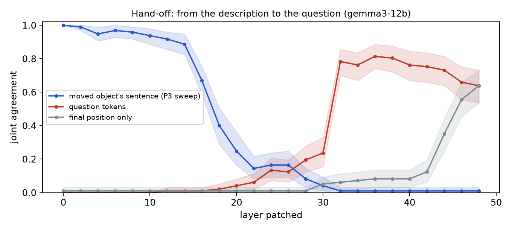

## 2026-11-10 10:34 · P2m question-mention probe (gemma3-12b) — exploratory
Model **gemma3-12b**, same 3,000 scenes and split as P2. Exploratory. Readout: the object's name in "Which object is farthest from X?" (one prompt per object).

- (x, y): best layer for two-step objects 21, R² 0.74 (all objects 0.73 [0.72, 0.75]); list mention best 0.74; shuffled -0.00
- Distance to root, two-step: best layer 22, R² 0.63; list mention best 0.62; best additive baseline -0.05

| layer | (x, y) two-step | (x, y) all | distance two-step |
|---|---|---|---|
| 0 | 0.00 | -0.00 | -0.12 |
| 8 | 0.02 | 0.02 | 0.03 |
| 12 | 0.15 | 0.19 | 0.20 |
| 14 | 0.41 | 0.35 | 0.30 |
| 16 | 0.47 | 0.43 | 0.43 |
| 18 | 0.57 | 0.60 | 0.52 |
| 21 | 0.74 | 0.73 | 0.61 |
| 24 | 0.72 | 0.72 | 0.63 |
| 28 | 0.71 | 0.71 | 0.60 |
| 32 | 0.67 | 0.68 | 0.57 |
| 40 | 0.59 | 0.61 | 0.51 |
| 48 | 0.56 | 0.59 | 0.49 |

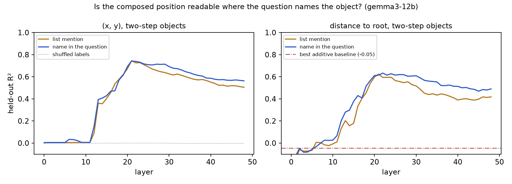

## 2026-11-10 10:57 · P3m one-token patch at the question's mention (gemma3-12b) — exploratory
Model **gemma3-12b**, 100 of the P3 sweep's pairs (questions that name the moved object). Exploratory. Joint agreement after copying only the moved object's name token in the question from the run where it sits elsewhere.

| layer | joint agreement [95% CI] |
|---|---|
| 0 | 0.00 [0.00, 0.00] |
| 2 | 0.00 [0.00, 0.00] |
| 4 | 0.00 [0.00, 0.00] |
| 6 | 0.00 [0.00, 0.00] |
| 8 | 0.00 [0.00, 0.00] |
| 10 | 0.00 [0.00, 0.00] |
| 12 | 0.00 [0.00, 0.00] |
| 14 | 0.00 [0.00, 0.00] |
| 16 | 0.00 [0.00, 0.00] |
| 18 | 0.00 [0.00, 0.00] |
| 20 | 0.00 [0.00, 0.00] |
| 22 | 0.00 [0.00, 0.00] |
| 24 | 0.00 [0.00, 0.00] |
| 26 | 0.00 [0.00, 0.00] |
| 28 | 0.00 [0.00, 0.00] |
| 30 | 0.00 [0.00, 0.00] |
| 32 | 0.00 [0.00, 0.00] |
| 34 | 0.00 [0.00, 0.00] |
| 36 | 0.00 [0.00, 0.00] |
| 38 | 0.00 [0.00, 0.00] |
| 40 | 0.00 [0.00, 0.00] |
| 42 | 0.00 [0.00, 0.00] |
| 44 | 0.00 [0.00, 0.00] |
| 46 | 0.00 [0.00, 0.00] |
| 48 | 0.00 [0.00, 0.00] |

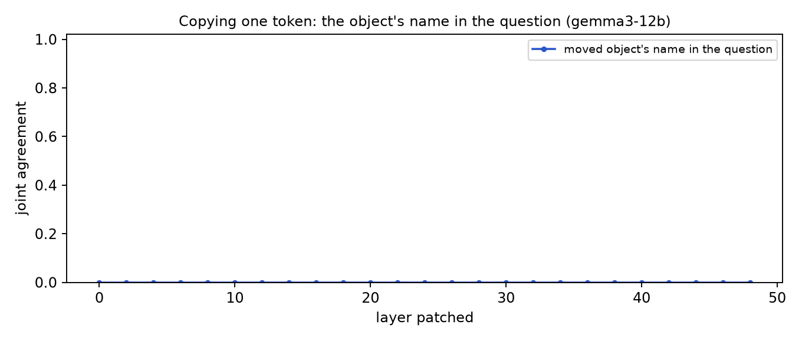

## 2026-11-10 12:37 · P4 DAS (gemma3-12b) — exploratory: relation site, layer 14
Model **gemma3-12b**, layer 14, site relation; 300 training pairs, 300 test pairs. Interchange accuracy = on questions where the model answers differently when the object is really elsewhere, the share whose answer after swapping only the learned subspace equals that answer (ceiling 1). Geometric accuracy (answers equal the moved layout) in the last column.

| method | closest | direction | farthest | more_east | more_north | ALL | |
|---|---|---|---|---|---|---|---|
| random k=2 | 0.00 [0.00, 0.00] | 0.00 [0.00, 0.00] | 0.03 [0.00, 0.09] | 0.00 [0.00, 0.00] | 0.00 [0.00, 0.01] | 0.00 [0.00, 0.00] | geometric 0.10 |
| DAS k=2 | 0.54 [0.37, 0.70] | 0.73 [0.69, 0.77] | 0.53 [0.37, 0.70] | 0.93 [0.90, 0.96] | 0.92 [0.88, 0.95] | 0.81 [0.78, 0.83] | geometric 0.72 |

Preregistered criterion (k = 2, ≥ 0.7 on every question type): **not met** (lowest: 0.53 on farthest).

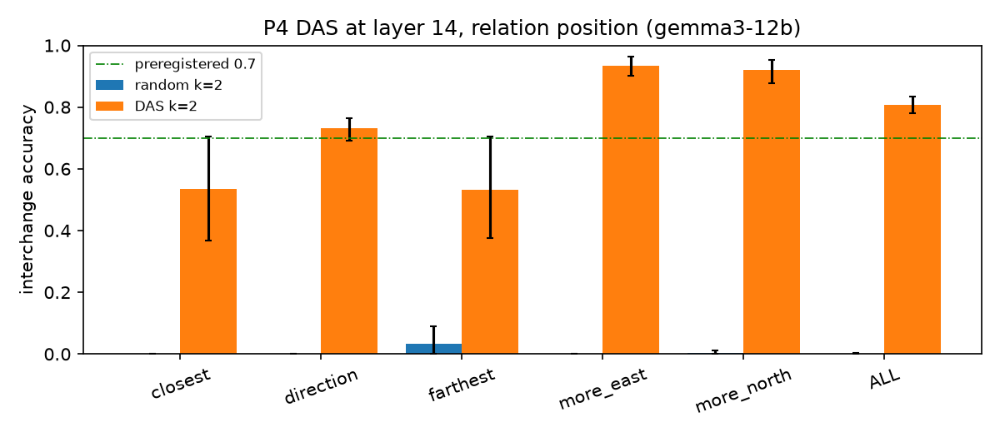

## 2026-11-10 14:10 · P4 DAS (gemma3-12b)
Model **gemma3-12b**, layer 18, site list; 300 training pairs, 300 test pairs. Interchange accuracy = on questions where the model answers differently when the object is really elsewhere, the share whose answer after swapping only the learned subspace equals that answer (ceiling 1). Geometric accuracy (answers equal the moved layout) in the last column.

| method | closest | direction | farthest | more_east | more_north | ALL | |
|---|---|---|---|---|---|---|---|
| random k=2 | 0.00 [0.00, 0.00] | 0.00 [0.00, 0.01] | 0.00 [0.00, 0.00] | 0.00 [0.00, 0.01] | 0.01 [0.00, 0.02] | 0.00 [0.00, 0.01] | geometric 0.10 |
| DAS k=2 | 0.14 [0.03, 0.30] | 0.02 [0.01, 0.03] | 0.17 [0.04, 0.30] | 0.15 [0.08, 0.22] | 0.10 [0.05, 0.15] | 0.07 [0.05, 0.09] | geometric 0.14 |

Preregistered criterion (k = 2, ≥ 0.7 on every question type): **not met** (lowest: 0.02 on direction).

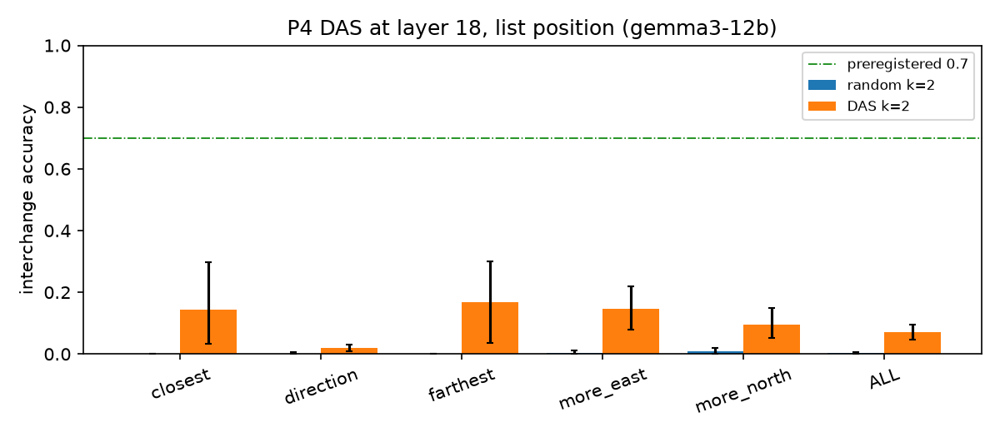

## 2026-11-10 14:46 · P4i 2-D code set to unstated positions (gemma3-12b) — exploratory
Model **gemma3-12b**, the 2-D subspace learned by DAS at the relation site, layer 14; 150 of its held-out test pairs. Exploratory. The subspace is set to base + α·(moved − base); answers are scored against the layout with the object at the matching interpolated position (questions with margin ≥ 1 unit / 10° there). *Novel*: questions whose answer at that position differs from the answer in both stated layouts (chance 0.15). Clean model accuracy on the base layouts: 0.85.

| α | agrees with interpolated layout | novel: interpolated answer | novel: original-layout answer | novel: moved-layout answer | n novel |
|---|---|---|---|---|---|
| 0 | 0.85 [0.82, 0.87] | – | – | – | 0 |
| 0.25 | 0.86 [0.83, 0.88] | 0.00 [0.00, 0.00] | 0.85 [0.54, 1.00] | 0.00 [0.00, 0.00] | 13 |
| 0.5 | 0.66 [0.63, 0.68] | 0.06 [0.02, 0.10] | 0.63 [0.54, 0.72] | 0.23 [0.16, 0.31] | 150 |
| 0.75 | 0.75 [0.72, 0.78] | 0.00 [0.00, 0.00] | 0.18 [0.00, 0.44] | 0.73 [0.33, 1.00] | 11 |
| 1 | 0.78 [0.75, 0.81] | – | – | – | 0 |
| 1.5 | 0.80 [0.77, 0.83] | 0.26 [0.09, 0.45] | 0.22 [0.07, 0.42] | 0.59 [0.37, 0.81] | 27 |

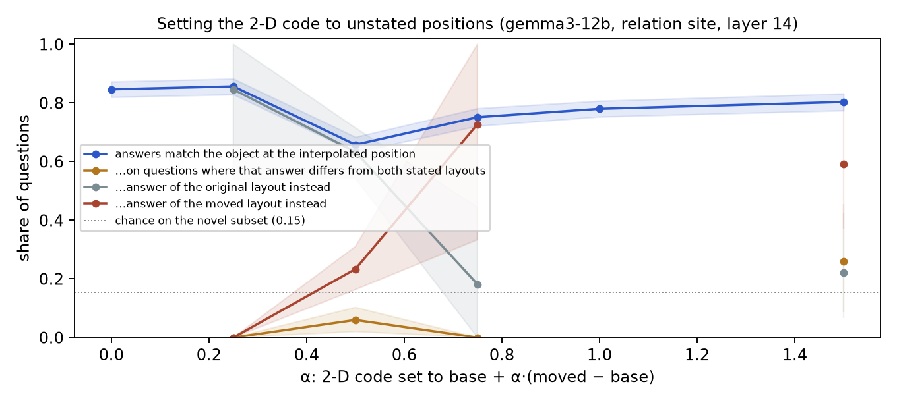

## 2026-11-10 14:46 · E1 summary
Model **gemma3-12b**. Verdict against `docs/preregistration.md`: **Mixed**: see the per-criterion breakdown.

| criterion | met |
|---|---|
| map_r2 | yes |
| map_hops | yes |
| rel_r2 | no |
| map_jc | no |
| rel_jc | yes |
| map_das | no |

- P2: best layer 21, R² 0.74; 1-step 0.76 vs 2-step 0.74; stated-relation baseline on 2-step objects 0.22
- P3: joint agreement at readout positions 0.00 (layer 2); relation sentence at that layer 0.94
- P4: DAS k=2 lowest per-type interchange accuracy 0.02

Prior work to engage in the write-up: Tehenan et al. 2025 (linear spatial models, single-answer steering) and An et al. 2026 (weak, fragmented coordinate probes in 7–8B models).

## 2026-11-10 18:59 · P4 DAS (gemma3-12b) — preregistered 'confirm' run: relation site, layer 14
Model **gemma3-12b**, layer 14, site relation; 300 training pairs, 300 test pairs. Interchange accuracy = on questions where the model answers differently when the object is really elsewhere, the share whose answer after swapping only the learned subspace equals that answer (ceiling 1). Geometric accuracy (answers equal the moved layout) in the last column.

| method | closest | direction | farthest | more_east | more_north | ALL | |
|---|---|---|---|---|---|---|---|
| random k=2 | 0.00 [0.00, 0.00] | 0.00 [0.00, 0.01] | 0.00 [0.00, 0.00] | 0.01 [0.00, 0.03] | 0.00 [0.00, 0.01] | 0.00 [0.00, 0.01] | geometric 0.13 |
| DAS k=2 | 0.38 [0.19, 0.55] | 0.60 [0.54, 0.65] | 0.33 [0.19, 0.48] | 0.90 [0.85, 0.94] | 0.94 [0.91, 0.96] | 0.72 [0.68, 0.75] | geometric 0.65 |

Preregistered criterion (k = 2, ≥ 0.7 on every question type): **not met** (lowest: 0.33 on farthest).
Seeds (train, test): 105, 106. Decision rule: see docs/preregistration_p4c.md.

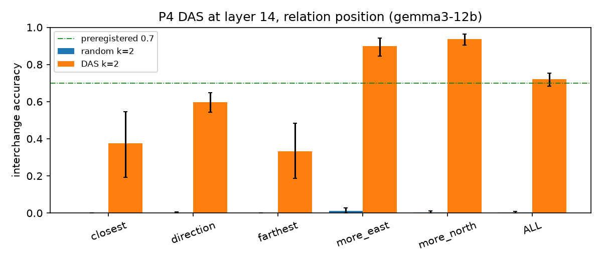

## 2026-11-10 19:39 · E3 composed-position transfer (gemma3-12b)
Model **gemma3-12b**, 150 chain pairs (R → M → C). Only M's sentence differs between the two runs; C's sentence is copied (same words) from the run where M, and with it C, sits elsewhere. *Follows target* = answer equals the model's answer on a scene with C at its moved position and M unmoved.

| layer | follows target | follows source (M moved too) | controls stable | target Qs | control Qs |
|---|---|---|---|---|---|
| 0 | 0.00 [0.00, 0.00] | 0.85 | 1.00 [1.00, 1.00] | 369 | 625 |
| 2 | 0.00 [0.00, 0.01] | 0.85 | 1.00 [0.99, 1.00] | 369 | 625 |
| 4 | 0.00 [0.00, 0.00] | 0.85 | 1.00 [0.99, 1.00] | 369 | 625 |
| 6 | 0.00 [0.00, 0.01] | 0.85 | 0.99 [0.99, 1.00] | 369 | 625 |
| 8 | 0.01 [0.00, 0.02] | 0.85 | 0.99 [0.99, 1.00] | 369 | 625 |
| 10 | 0.01 [0.00, 0.03] | 0.86 | 0.99 [0.98, 1.00] | 369 | 625 |
| 12 | 0.02 [0.01, 0.04] | 0.86 | 0.98 [0.97, 0.99] | 369 | 625 |
| 14 | 0.02 [0.01, 0.04] | 0.86 | 0.98 [0.97, 0.99] | 369 | 625 |
| 16 | 0.05 [0.03, 0.08] | 0.86 | 0.97 [0.96, 0.98] | 369 | 625 |
| 18 | 0.07 [0.04, 0.09] | 0.87 | 0.97 [0.96, 0.98] | 369 | 625 |
| 20 | 0.05 [0.03, 0.08] | 0.88 | 0.98 [0.96, 0.99] | 369 | 625 |
| 22 | 0.04 [0.02, 0.06] | 0.88 | 0.98 [0.97, 0.99] | 369 | 625 |
| 24 | 0.01 [0.00, 0.02] | 0.86 | 0.98 [0.97, 0.99] | 369 | 625 |
| 26 | 0.01 [0.00, 0.02] | 0.86 | 0.98 [0.97, 0.99] | 369 | 625 |
| 28 | 0.01 [0.00, 0.02] | 0.85 | 0.99 [0.98, 1.00] | 369 | 625 |
| 30 | 0.01 [0.00, 0.01] | 0.85 | 0.99 [0.98, 1.00] | 369 | 625 |
| 32 | 0.00 [0.00, 0.01] | 0.85 | 1.00 [1.00, 1.00] | 369 | 625 |
| 34 | 0.00 [0.00, 0.01] | 0.85 | 1.00 [0.99, 1.00] | 369 | 625 |
| 36 | 0.00 [0.00, 0.01] | 0.86 | 1.00 [0.99, 1.00] | 369 | 625 |
| 38 | 0.00 [0.00, 0.00] | 0.86 | 1.00 [1.00, 1.00] | 369 | 625 |
| 40 | 0.00 [0.00, 0.00] | 0.86 | 1.00 [1.00, 1.00] | 369 | 625 |

Preregistered verdict: **not carried**

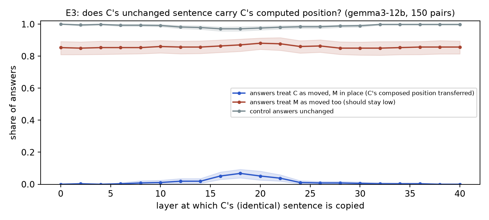

## 2026-11-10 19:53 · P4i 2-D code set to unstated positions (gemma3-12b) — preregistered 'confirm' run
Model **gemma3-12b**, the 2-D subspace learned by DAS at the relation site, layer 14; 150 of its held-out test pairs. Exploratory. The subspace is set to base + α·(moved − base); answers are scored against the layout with the object at the matching interpolated position (questions with margin ≥ 1 unit / 10° there). *Novel*: questions whose answer at that position differs from the answer in both stated layouts (chance 0.15). Clean model accuracy on the base layouts: 0.82.

| α | agrees with interpolated layout | novel: interpolated answer | novel: original-layout answer | novel: moved-layout answer | n novel |
|---|---|---|---|---|---|
| 0 | 0.82 [0.79, 0.85] | – | – | – | 0 |
| 0.25 | 0.82 [0.79, 0.85] | 0.10 [0.00, 0.25] | 0.81 [0.65, 0.95] | 0.05 [0.00, 0.17] | 21 |
| 0.5 | 0.66 [0.63, 0.69] | 0.09 [0.04, 0.14] | 0.60 [0.51, 0.68] | 0.23 [0.16, 0.31] | 164 |
| 0.75 | 0.76 [0.72, 0.78] | 0.00 [0.00, 0.00] | 0.25 [0.06, 0.48] | 0.50 [0.25, 0.75] | 20 |
| 1 | 0.74 [0.70, 0.76] | – | – | – | 0 |
| 1.5 | 0.78 [0.74, 0.81] | 0.24 [0.10, 0.38] | 0.17 [0.06, 0.33] | 0.35 [0.18, 0.53] | 46 |

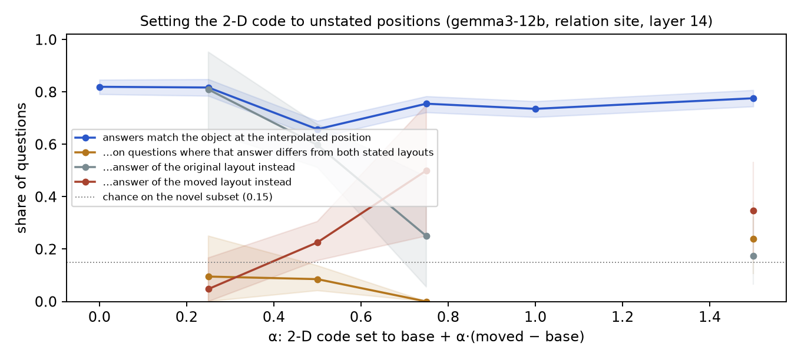

## 2026-11-10 23:14 · P4 DAS (gemma3-27b) — preregistered 'confirm' run: relation site, layer 18
Model **gemma3-27b**, layer 18, site relation; 300 training pairs, 300 test pairs. Interchange accuracy = on questions where the model answers differently when the object is really elsewhere, the share whose answer after swapping only the learned subspace equals that answer (ceiling 1). Geometric accuracy (answers equal the moved layout) in the last column.

| method | closest | direction | farthest | more_east | more_north | ALL | |
|---|---|---|---|---|---|---|---|
| random k=2 | 0.00 [0.00, 0.00] | 0.00 [0.00, 0.00] | 0.04 [0.00, 0.12] | 0.00 [0.00, 0.00] | 0.01 [0.00, 0.02] | 0.00 [0.00, 0.01] | geometric 0.10 |
| DAS k=2 | 0.43 [0.28, 0.58] | 0.81 [0.77, 0.85] | 0.38 [0.23, 0.56] | 0.84 [0.78, 0.90] | 0.94 [0.90, 0.97] | 0.83 [0.80, 0.85] | geometric 0.74 |

Preregistered criterion (k = 2, ≥ 0.7 on every question type): **not met** (lowest: 0.38 on farthest).
Seeds (train, test): 105, 106. Decision rule: see docs/preregistration_p4c.md.

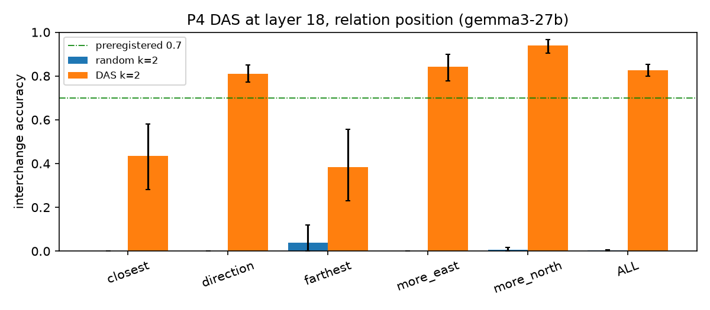

## 2026-11-11 00:38 · P4i 2-D code set to unstated positions (gemma3-27b) — preregistered 'confirm' run
Model **gemma3-27b**, the 2-D subspace learned by DAS at the relation site, layer 18; 150 of its held-out test pairs. Exploratory. The subspace is set to base + α·(moved − base); answers are scored against the layout with the object at the matching interpolated position (questions with margin ≥ 1 unit / 10° there). *Novel*: questions whose answer at that position differs from the answer in both stated layouts (chance 0.15). Clean model accuracy on the base layouts: 0.85.

| α | agrees with interpolated layout | novel: interpolated answer | novel: original-layout answer | novel: moved-layout answer | n novel |
|---|---|---|---|---|---|
| 0 | 0.85 [0.82, 0.87] | – | – | – | 0 |
| 0.25 | 0.84 [0.80, 0.86] | 0.00 [0.00, 0.00] | 0.81 [0.60, 1.00] | 0.05 [0.00, 0.17] | 21 |
| 0.5 | 0.64 [0.61, 0.67] | 0.05 [0.02, 0.10] | 0.73 [0.64, 0.81] | 0.21 [0.14, 0.28] | 164 |
| 0.75 | 0.79 [0.75, 0.81] | 0.05 [0.00, 0.16] | 0.20 [0.00, 0.42] | 0.70 [0.45, 0.95] | 20 |
| 1 | 0.80 [0.77, 0.83] | – | – | – | 0 |
| 1.5 | 0.80 [0.77, 0.83] | 0.20 [0.08, 0.33] | 0.11 [0.04, 0.21] | 0.63 [0.47, 0.79] | 46 |

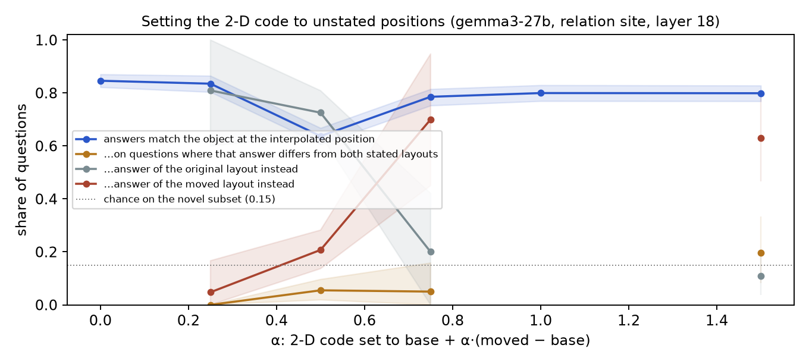

### Note on the 2026-11-10/11 'confirm' entries (added by hand)

Decision rules: docs/preregistration_p4c.md (P4c) and docs/preregistration_e3.md (E3). The auto-printed "Preregistered criterion (≥ 0.7 on every question type) … not met" lines apply the original per-type rule, which P4c demoted to reported-only; the P4c rule is ALL ≥ 0.70 and random ≤ 0.05. The P4i entries' "Exploratory" wording comes from the script template; the 'confirm' runs are the preregistered ones. Their "chance 0.15" pools all α; at α = ½ the chance on the novel subset is 0.141 (n = 164, both models).

| test | gemma3-12b (L14) | gemma3-27b (L18) |
|---|---|---|
| P4c DAS k=2, ALL | 0.72 [0.68, 0.75] | 0.83 [0.80, 0.85] |
| random k=2, ALL | 0.00 | 0.00 |
| verdict | **2-D code confirmed** | **2-D code confirmed** |
| P4i α = ½, novel rate | 0.085 [0.041, 0.137] | 0.055 [0.019, 0.096] |
| verdict (upper CI < 0.141) | **switch** | **switch** |

- **E3 (gemma3-12b):** follow_T ≤ 0.07 at every layer ≥ 1 → **not carried**. The "follows source" column is ≈ 0.85 already at layer 0 (base and source answers mostly agree on those questions), so it is not informative.
