# E1 results log

Dated entries are appended after each phase. Every number carries a 95% bootstrap CI. Thresholds are preregistered in `docs/preregistration.md`.

## 2026-11-09 16:06 · P1 behaviour screen
**No model passed the gate**, so the fallback applies: qwen3-8b locally, then 14B on a rented GPU, then 3-object scenes.

### qwen3-1.7b
- 4-object accuracy: 0.40 [0.38, 0.43]; accuracy above chance on 2+ hop questions: 0.03 [0.01, 0.04] → gate **fail**

| question | chance | 3 objects | 4 objects | 5 objects |
|---|---|---|---|---|
| closer_than | 0.50 | 0.49 [0.44, 0.53] | 0.52 [0.47, 0.58] | 0.52 [0.47, 0.57] |
| closest | 0.36 | 0.54 [0.48, 0.61] | 0.37 [0.31, 0.43] | 0.30 [0.25, 0.35] |
| direction | 0.12 | 0.24 [0.19, 0.28] | 0.15 [0.11, 0.19] | 0.18 [0.14, 0.23] |
| farthest | 0.36 | 0.50 [0.44, 0.57] | 0.33 [0.27, 0.40] | 0.23 [0.17, 0.28] |
| more_east | 0.50 | 0.54 [0.47, 0.61] | 0.53 [0.47, 0.59] | 0.54 [0.48, 0.60] |
| more_north | 0.50 | 0.57 [0.51, 0.63] | 0.52 [0.46, 0.57] | 0.52 [0.47, 0.57] |

- By deepest object involved: hop 1: 0.42 [0.40, 0.44]; hop 2: 0.43 [0.41, 0.44]; hop 3: 0.41 [0.38, 0.44]; hop 4: 0.43 [0.37, 0.50]
- Error signature (standardised logistic coefficients): hop -0.04 [-0.11, 0.02], log margin 0.07 [0.02, 0.11]
- Near-tie set (margin 0.25–1 unit / 2.5–10°): 0.32 [0.29, 0.35]
- Object-list line: with 0.38, without 0.38, difference -0.01 [-0.03, 0.02]
- Chain of thought on: 0.52 [0.40, 0.63] vs off 0.42 [0.30, 0.53] (same 60 questions; unparsed 38%, median 1024 tokens)

## 2026-11-09 16:42 · P1 behaviour screen
**No model passed the gate**, so the fallback applies: qwen3-8b locally, then 14B on a rented GPU, then 3-object scenes.

### llama3.2-3b
- 4-object accuracy: 0.55 [0.52, 0.58]; accuracy above chance on 2+ hop questions: 0.13 [0.11, 0.15] → gate **fail**

| question | chance | 3 objects | 4 objects | 5 objects |
|---|---|---|---|---|
| closer_than | 0.50 | 0.51 [0.46, 0.55] | 0.52 [0.47, 0.58] | 0.52 [0.47, 0.57] |
| closest | 0.36 | 0.64 [0.58, 0.70] | 0.54 [0.47, 0.59] | 0.48 [0.42, 0.54] |
| direction | 0.12 | 0.53 [0.47, 0.58] | 0.47 [0.41, 0.52] | 0.39 [0.34, 0.45] |
| farthest | 0.36 | 0.66 [0.60, 0.73] | 0.54 [0.48, 0.60] | 0.40 [0.33, 0.47] |
| more_east | 0.50 | 0.56 [0.48, 0.62] | 0.63 [0.57, 0.68] | 0.61 [0.56, 0.67] |
| more_north | 0.50 | 0.66 [0.59, 0.72] | 0.62 [0.56, 0.68] | 0.64 [0.58, 0.70] |

- By deepest object involved: hop 1: 0.61 [0.58, 0.63]; hop 2: 0.54 [0.52, 0.56]; hop 3: 0.50 [0.46, 0.53]; hop 4: 0.48 [0.41, 0.56]
- Error signature (standardised logistic coefficients): hop -0.16 [-0.22, -0.10], log margin 0.23 [0.17, 0.29]
- Near-tie set (margin 0.25–1 unit / 2.5–10°): 0.36 [0.32, 0.39]
- Object-list line: with 0.53, without 0.51, difference 0.02 [-0.01, 0.04]

## 2026-11-09 17:34 · P1 behaviour screen
**No model passed the gate**, so the fallback applies: qwen3-8b locally, then 14B on a rented GPU, then 3-object scenes.

### qwen3-4b
- 4-object accuracy: 0.44 [0.42, 0.46]; accuracy above chance on 2+ hop questions: 0.03 [0.01, 0.05] → gate **fail**

| question | chance | 3 objects | 4 objects | 5 objects |
|---|---|---|---|---|
| closer_than | 0.50 | 0.53 [0.47, 0.58] | 0.52 [0.47, 0.58] | 0.52 [0.47, 0.57] |
| closest | 0.36 | 0.53 [0.47, 0.60] | 0.41 [0.34, 0.47] | 0.27 [0.22, 0.32] |
| direction | 0.12 | 0.44 [0.38, 0.50] | 0.26 [0.21, 0.30] | 0.22 [0.18, 0.27] |
| farthest | 0.36 | 0.53 [0.46, 0.59] | 0.31 [0.25, 0.38] | 0.19 [0.14, 0.25] |
| more_east | 0.50 | 0.71 [0.64, 0.77] | 0.54 [0.48, 0.60] | 0.48 [0.41, 0.54] |
| more_north | 0.50 | 0.72 [0.65, 0.78] | 0.59 [0.53, 0.65] | 0.53 [0.48, 0.59] |

- By deepest object involved: hop 1: 0.53 [0.50, 0.56]; hop 2: 0.45 [0.43, 0.47]; hop 3: 0.37 [0.34, 0.40]; hop 4: 0.39 [0.33, 0.45]
- Error signature (standardised logistic coefficients): hop -0.27 [-0.33, -0.21], log margin 0.10 [0.04, 0.15]
- Near-tie set (margin 0.25–1 unit / 2.5–10°): 0.31 [0.28, 0.35]
- Object-list line: with 0.42, without 0.44, difference -0.02 [-0.05, 0.01]
- Chain of thought on: 0.43 [0.32, 0.57] vs off 0.45 [0.32, 0.58] (same 60 questions; unparsed 43%, median 1024 tokens)

## 2026-11-09 18:05 · P1 behaviour screen
**No model passed the gate**, so the fallback applies: qwen3-8b locally, then 14B on a rented GPU, then 3-object scenes.

### gemma3-4b
- 4-object accuracy: 0.53 [0.51, 0.55]; accuracy above chance on 2+ hop questions: 0.13 [0.11, 0.14] → gate **fail**

| question | chance | 3 objects | 4 objects | 5 objects |
|---|---|---|---|---|
| closer_than | 0.50 | 0.49 [0.44, 0.53] | 0.52 [0.47, 0.58] | 0.52 [0.47, 0.57] |
| closest | 0.36 | 0.61 [0.54, 0.66] | 0.43 [0.37, 0.48] | 0.37 [0.32, 0.42] |
| direction | 0.12 | 0.48 [0.43, 0.54] | 0.48 [0.42, 0.53] | 0.38 [0.33, 0.44] |
| farthest | 0.36 | 0.62 [0.56, 0.68] | 0.45 [0.38, 0.52] | 0.44 [0.37, 0.50] |
| more_east | 0.50 | 0.71 [0.65, 0.77] | 0.62 [0.56, 0.68] | 0.60 [0.54, 0.66] |
| more_north | 0.50 | 0.64 [0.58, 0.70] | 0.66 [0.60, 0.72] | 0.67 [0.61, 0.73] |

- By deepest object involved: hop 1: 0.57 [0.55, 0.60]; hop 2: 0.52 [0.50, 0.54]; hop 3: 0.50 [0.47, 0.54]; hop 4: 0.55 [0.49, 0.62]
- Error signature (standardised logistic coefficients): hop -0.08 [-0.14, -0.03], log margin 0.21 [0.16, 0.26]
- Near-tie set (margin 0.25–1 unit / 2.5–10°): 0.36 [0.32, 0.39]
- Object-list line: with 0.53, without 0.48, difference 0.05 [0.01, 0.08]

## 2026-11-09 19:27 · P1 behaviour screen
**No model passed the gate**, so the fallback applies: qwen3-8b locally, then 14B on a rented GPU, then 3-object scenes.

### qwen3-8b
- 4-object accuracy: 0.42 [0.41, 0.44]; accuracy above chance on 2+ hop questions: 0.01 [0.00, 0.02] → gate **fail**

| question | chance | 3 objects | 4 objects | 5 objects |
|---|---|---|---|---|
| closer_than | 0.50 | 0.49 [0.46, 0.51] | 0.49 [0.46, 0.51] | 0.48 [0.45, 0.51] |
| closest | 0.36 | 0.59 [0.55, 0.62] | 0.34 [0.31, 0.38] | 0.26 [0.24, 0.29] |
| direction | 0.12 | 0.36 [0.33, 0.39] | 0.18 [0.15, 0.20] | 0.13 [0.11, 0.15] |
| farthest | 0.36 | 0.44 [0.40, 0.47] | 0.32 [0.29, 0.35] | 0.22 [0.19, 0.26] |
| more_east | 0.50 | 0.69 [0.66, 0.73] | 0.57 [0.54, 0.60] | 0.50 [0.47, 0.53] |
| more_north | 0.50 | 0.73 [0.70, 0.76] | 0.63 [0.60, 0.66] | 0.55 [0.52, 0.58] |

- By deepest object involved: hop 1: 0.52 [0.50, 0.53]; hop 2: 0.42 [0.41, 0.43]; hop 3: 0.36 [0.34, 0.38]; hop 4: 0.35 [0.31, 0.38]
- Error signature (standardised logistic coefficients): hop -0.29 [-0.32, -0.26], log margin 0.08 [0.05, 0.11]
- Near-tie set (margin 0.25–1 unit / 2.5–10°): 0.36 [0.34, 0.39]
- Object-list line: with 0.43, without 0.42, difference 0.00 [-0.01, 0.02]
- Chain of thought on: 0.87 [0.77, 0.95] vs off 0.27 [0.17, 0.38] (same 60 questions; unparsed 10%, median 1625 tokens)

## 2026-11-09 20:44 · P1 behaviour screen
**No model passed the gate**, so the fallback applies: qwen3-8b locally, then 14B on a rented GPU, then 3-object scenes.

### qwen3-14b
- 4-object accuracy: 0.58 [0.57, 0.60]; accuracy above chance on 2+ hop questions: 0.17 [0.16, 0.18] → gate **fail**

| question | chance | 3 objects | 4 objects | 5 objects |
|---|---|---|---|---|
| closer_than | 0.50 | 0.57 [0.54, 0.60] | 0.59 [0.56, 0.62] | 0.60 [0.57, 0.64] |
| closest | 0.36 | 0.63 [0.59, 0.66] | 0.39 [0.35, 0.42] | 0.28 [0.25, 0.30] |
| direction | 0.12 | 0.61 [0.57, 0.64] | 0.45 [0.41, 0.48] | 0.33 [0.30, 0.36] |
| farthest | 0.36 | 0.73 [0.70, 0.76] | 0.53 [0.49, 0.56] | 0.29 [0.26, 0.33] |
| more_east | 0.50 | 0.81 [0.79, 0.84] | 0.74 [0.71, 0.77] | 0.71 [0.68, 0.74] |
| more_north | 0.50 | 0.87 [0.85, 0.90] | 0.80 [0.77, 0.82] | 0.77 [0.75, 0.80] |

- By deepest object involved: hop 1: 0.66 [0.65, 0.67]; hop 2: 0.58 [0.57, 0.60]; hop 3: 0.52 [0.50, 0.54]; hop 4: 0.48 [0.44, 0.52]
- Error signature (standardised logistic coefficients): hop -0.27 [-0.30, -0.24], log margin 0.33 [0.29, 0.37]
- Near-tie set (margin 0.25–1 unit / 2.5–10°): 0.40 [0.37, 0.43]
- Object-list line: with 0.57, without 0.55, difference 0.02 [-0.00, 0.04]
- Chain of thought on: 0.98 [0.95, 1.00] vs off 0.57 [0.43, 0.70] (same 60 questions; unparsed 2%, median 844 tokens)

## 2026-11-09 21:08 · P1 behaviour screen
**No model passed the gate**, so the fallback applies: qwen3-8b locally, then 14B on a rented GPU, then 3-object scenes.

### gemma3-12b
- 4-object accuracy: 0.66 [0.65, 0.68]; accuracy above chance on 2+ hop questions: 0.22 [0.21, 0.23] → gate **fail**

| question | chance | 3 objects | 4 objects | 5 objects |
|---|---|---|---|---|
| closer_than | 0.50 | 0.50 [0.47, 0.53] | 0.49 [0.46, 0.52] | 0.48 [0.45, 0.51] |
| closest | 0.36 | 0.79 [0.76, 0.82] | 0.65 [0.62, 0.68] | 0.55 [0.51, 0.58] |
| direction | 0.12 | 0.72 [0.69, 0.75] | 0.56 [0.53, 0.60] | 0.48 [0.45, 0.51] |
| farthest | 0.36 | 0.75 [0.72, 0.78] | 0.60 [0.56, 0.64] | 0.45 [0.41, 0.49] |
| more_east | 0.50 | 0.86 [0.83, 0.88] | 0.85 [0.83, 0.87] | 0.78 [0.76, 0.81] |
| more_north | 0.50 | 0.87 [0.85, 0.89] | 0.84 [0.81, 0.86] | 0.81 [0.78, 0.83] |

- By deepest object involved: hop 1: 0.77 [0.75, 0.78]; hop 2: 0.63 [0.62, 0.64]; hop 3: 0.59 [0.57, 0.61]; hop 4: 0.56 [0.53, 0.60]
- Error signature (standardised logistic coefficients): hop -0.29 [-0.33, -0.25], log margin 0.35 [0.31, 0.39]
- Near-tie set (margin 0.25–1 unit / 2.5–10°): 0.44 [0.41, 0.46]
- Object-list line: with 0.65, without 0.65, difference 0.01 [-0.01, 0.02]

## 2026-11-09 21:56 · P1 behaviour screen
**No model passed the gate**, so the fallback applies: qwen3-8b locally, then 14B on a rented GPU, then 3-object scenes.

### gemma3-27b
- 4-object accuracy: 0.68 [0.67, 0.69]; accuracy above chance on 2+ hop questions: 0.27 [0.26, 0.27] → gate **fail**

| question | chance | 3 objects | 4 objects | 5 objects |
|---|---|---|---|---|
| closer_than | 0.50 | 0.53 [0.50, 0.56] | 0.53 [0.50, 0.56] | 0.54 [0.51, 0.57] |
| closest | 0.36 | 0.76 [0.73, 0.79] | 0.62 [0.59, 0.66] | 0.55 [0.52, 0.58] |
| direction | 0.12 | 0.77 [0.75, 0.80] | 0.60 [0.57, 0.64] | 0.53 [0.50, 0.56] |
| farthest | 0.36 | 0.77 [0.74, 0.80] | 0.68 [0.64, 0.71] | 0.59 [0.55, 0.62] |
| more_east | 0.50 | 0.87 [0.84, 0.89] | 0.84 [0.81, 0.86] | 0.79 [0.76, 0.81] |
| more_north | 0.50 | 0.86 [0.83, 0.89] | 0.82 [0.80, 0.85] | 0.79 [0.76, 0.82] |

- By deepest object involved: hop 1: 0.75 [0.74, 0.76]; hop 2: 0.67 [0.66, 0.68]; hop 3: 0.63 [0.61, 0.65]; hop 4: 0.62 [0.58, 0.66]
- Error signature (standardised logistic coefficients): hop -0.18 [-0.21, -0.13], log margin 0.33 [0.30, 0.36]
- Near-tie set (margin 0.25–1 unit / 2.5–10°): 0.48 [0.45, 0.51]
- Object-list line: with 0.67, without 0.64, difference 0.03 [0.02, 0.05]

## 2026-11-09 21:57 · P1 behaviour screen
**No model passed the gate**, so the fallback applies: qwen3-8b locally, then 14B on a rented GPU, then 3-object scenes.

### qwen3-1.7b
- 4-object accuracy: 0.40 [0.38, 0.43]; accuracy above chance on 2+ hop questions: 0.03 [0.01, 0.04] → gate **fail**

| question | chance | 3 objects | 4 objects | 5 objects |
|---|---|---|---|---|
| closer_than | 0.50 | 0.49 [0.44, 0.53] | 0.52 [0.47, 0.58] | 0.52 [0.47, 0.57] |
| closest | 0.36 | 0.54 [0.48, 0.61] | 0.37 [0.31, 0.43] | 0.30 [0.25, 0.35] |
| direction | 0.12 | 0.24 [0.19, 0.28] | 0.15 [0.11, 0.19] | 0.18 [0.14, 0.23] |
| farthest | 0.36 | 0.50 [0.44, 0.57] | 0.33 [0.27, 0.40] | 0.23 [0.17, 0.28] |
| more_east | 0.50 | 0.54 [0.47, 0.61] | 0.53 [0.47, 0.59] | 0.54 [0.48, 0.60] |
| more_north | 0.50 | 0.57 [0.51, 0.63] | 0.52 [0.46, 0.57] | 0.52 [0.47, 0.57] |

- By deepest object involved: hop 1: 0.42 [0.40, 0.44]; hop 2: 0.43 [0.41, 0.44]; hop 3: 0.41 [0.38, 0.44]; hop 4: 0.43 [0.37, 0.50]
- Error signature (standardised logistic coefficients): hop -0.04 [-0.11, 0.02], log margin 0.07 [0.02, 0.11]
- Near-tie set (margin 0.25–1 unit / 2.5–10°): 0.32 [0.29, 0.35]
- Object-list line: with 0.38, without 0.38, difference -0.01 [-0.03, 0.02]
- Chain of thought on: 0.52 [0.40, 0.63] vs off 0.42 [0.30, 0.53] (same 60 questions; unparsed 38%, median 1024 tokens)

### llama3.2-3b
- 4-object accuracy: 0.55 [0.52, 0.58]; accuracy above chance on 2+ hop questions: 0.13 [0.11, 0.15] → gate **fail**

| question | chance | 3 objects | 4 objects | 5 objects |
|---|---|---|---|---|
| closer_than | 0.50 | 0.51 [0.46, 0.55] | 0.52 [0.47, 0.58] | 0.52 [0.47, 0.57] |
| closest | 0.36 | 0.64 [0.58, 0.70] | 0.54 [0.47, 0.59] | 0.48 [0.42, 0.54] |
| direction | 0.12 | 0.53 [0.47, 0.58] | 0.47 [0.41, 0.52] | 0.39 [0.34, 0.45] |
| farthest | 0.36 | 0.66 [0.60, 0.73] | 0.54 [0.48, 0.60] | 0.40 [0.33, 0.47] |
| more_east | 0.50 | 0.56 [0.48, 0.62] | 0.63 [0.57, 0.68] | 0.61 [0.56, 0.67] |
| more_north | 0.50 | 0.66 [0.59, 0.72] | 0.62 [0.56, 0.68] | 0.64 [0.58, 0.70] |

- By deepest object involved: hop 1: 0.61 [0.58, 0.63]; hop 2: 0.54 [0.52, 0.56]; hop 3: 0.50 [0.46, 0.53]; hop 4: 0.48 [0.41, 0.56]
- Error signature (standardised logistic coefficients): hop -0.16 [-0.22, -0.10], log margin 0.23 [0.17, 0.29]
- Near-tie set (margin 0.25–1 unit / 2.5–10°): 0.36 [0.32, 0.39]
- Object-list line: with 0.53, without 0.51, difference 0.02 [-0.01, 0.04]

### qwen3-4b
- 4-object accuracy: 0.44 [0.42, 0.46]; accuracy above chance on 2+ hop questions: 0.03 [0.01, 0.05] → gate **fail**

| question | chance | 3 objects | 4 objects | 5 objects |
|---|---|---|---|---|
| closer_than | 0.50 | 0.53 [0.47, 0.58] | 0.52 [0.47, 0.58] | 0.52 [0.47, 0.57] |
| closest | 0.36 | 0.53 [0.47, 0.60] | 0.41 [0.34, 0.47] | 0.27 [0.22, 0.32] |
| direction | 0.12 | 0.44 [0.38, 0.50] | 0.26 [0.21, 0.30] | 0.22 [0.18, 0.27] |
| farthest | 0.36 | 0.53 [0.46, 0.59] | 0.31 [0.25, 0.38] | 0.19 [0.14, 0.25] |
| more_east | 0.50 | 0.71 [0.64, 0.77] | 0.54 [0.48, 0.60] | 0.48 [0.41, 0.54] |
| more_north | 0.50 | 0.72 [0.65, 0.78] | 0.59 [0.53, 0.65] | 0.53 [0.48, 0.59] |

- By deepest object involved: hop 1: 0.53 [0.50, 0.56]; hop 2: 0.45 [0.43, 0.47]; hop 3: 0.37 [0.34, 0.40]; hop 4: 0.39 [0.33, 0.45]
- Error signature (standardised logistic coefficients): hop -0.27 [-0.33, -0.21], log margin 0.10 [0.04, 0.15]
- Near-tie set (margin 0.25–1 unit / 2.5–10°): 0.31 [0.28, 0.35]
- Object-list line: with 0.42, without 0.44, difference -0.02 [-0.05, 0.01]
- Chain of thought on: 0.43 [0.32, 0.57] vs off 0.45 [0.32, 0.58] (same 60 questions; unparsed 43%, median 1024 tokens)

### gemma3-4b
- 4-object accuracy: 0.53 [0.51, 0.55]; accuracy above chance on 2+ hop questions: 0.13 [0.11, 0.14] → gate **fail**

| question | chance | 3 objects | 4 objects | 5 objects |
|---|---|---|---|---|
| closer_than | 0.50 | 0.49 [0.44, 0.53] | 0.52 [0.47, 0.58] | 0.52 [0.47, 0.57] |
| closest | 0.36 | 0.61 [0.54, 0.66] | 0.43 [0.37, 0.48] | 0.37 [0.32, 0.42] |
| direction | 0.12 | 0.48 [0.43, 0.54] | 0.48 [0.42, 0.53] | 0.38 [0.33, 0.44] |
| farthest | 0.36 | 0.62 [0.56, 0.68] | 0.45 [0.38, 0.52] | 0.44 [0.37, 0.50] |
| more_east | 0.50 | 0.71 [0.65, 0.77] | 0.62 [0.56, 0.68] | 0.60 [0.54, 0.66] |
| more_north | 0.50 | 0.64 [0.58, 0.70] | 0.66 [0.60, 0.72] | 0.67 [0.61, 0.73] |

- By deepest object involved: hop 1: 0.57 [0.55, 0.60]; hop 2: 0.52 [0.50, 0.54]; hop 3: 0.50 [0.47, 0.54]; hop 4: 0.55 [0.49, 0.62]
- Error signature (standardised logistic coefficients): hop -0.08 [-0.14, -0.03], log margin 0.21 [0.16, 0.26]
- Near-tie set (margin 0.25–1 unit / 2.5–10°): 0.36 [0.32, 0.39]
- Object-list line: with 0.53, without 0.48, difference 0.05 [0.01, 0.08]

### qwen3-8b
- 4-object accuracy: 0.42 [0.41, 0.44]; accuracy above chance on 2+ hop questions: 0.01 [0.00, 0.02] → gate **fail**

| question | chance | 3 objects | 4 objects | 5 objects |
|---|---|---|---|---|
| closer_than | 0.50 | 0.49 [0.46, 0.51] | 0.49 [0.46, 0.51] | 0.48 [0.45, 0.51] |
| closest | 0.36 | 0.59 [0.55, 0.62] | 0.34 [0.31, 0.38] | 0.26 [0.24, 0.29] |
| direction | 0.12 | 0.36 [0.33, 0.39] | 0.18 [0.15, 0.20] | 0.13 [0.11, 0.15] |
| farthest | 0.36 | 0.44 [0.40, 0.47] | 0.32 [0.29, 0.35] | 0.22 [0.19, 0.26] |
| more_east | 0.50 | 0.69 [0.66, 0.73] | 0.57 [0.54, 0.60] | 0.50 [0.47, 0.53] |
| more_north | 0.50 | 0.73 [0.70, 0.76] | 0.63 [0.60, 0.66] | 0.55 [0.52, 0.58] |

- By deepest object involved: hop 1: 0.52 [0.50, 0.53]; hop 2: 0.42 [0.41, 0.43]; hop 3: 0.36 [0.34, 0.38]; hop 4: 0.35 [0.31, 0.38]
- Error signature (standardised logistic coefficients): hop -0.29 [-0.32, -0.26], log margin 0.08 [0.05, 0.11]
- Near-tie set (margin 0.25–1 unit / 2.5–10°): 0.36 [0.34, 0.39]
- Object-list line: with 0.43, without 0.42, difference 0.00 [-0.01, 0.02]
- Chain of thought on: 0.87 [0.77, 0.95] vs off 0.27 [0.17, 0.38] (same 60 questions; unparsed 10%, median 1625 tokens)

### qwen3-14b
- 4-object accuracy: 0.58 [0.57, 0.60]; accuracy above chance on 2+ hop questions: 0.17 [0.16, 0.18] → gate **fail**

| question | chance | 3 objects | 4 objects | 5 objects |
|---|---|---|---|---|
| closer_than | 0.50 | 0.57 [0.54, 0.60] | 0.59 [0.56, 0.62] | 0.60 [0.57, 0.64] |
| closest | 0.36 | 0.63 [0.59, 0.66] | 0.39 [0.35, 0.42] | 0.28 [0.25, 0.30] |
| direction | 0.12 | 0.61 [0.57, 0.64] | 0.45 [0.41, 0.48] | 0.33 [0.30, 0.36] |
| farthest | 0.36 | 0.73 [0.70, 0.76] | 0.53 [0.49, 0.56] | 0.29 [0.26, 0.33] |
| more_east | 0.50 | 0.81 [0.79, 0.84] | 0.74 [0.71, 0.77] | 0.71 [0.68, 0.74] |
| more_north | 0.50 | 0.87 [0.85, 0.90] | 0.80 [0.77, 0.82] | 0.77 [0.75, 0.80] |

- By deepest object involved: hop 1: 0.66 [0.65, 0.67]; hop 2: 0.58 [0.57, 0.60]; hop 3: 0.52 [0.50, 0.54]; hop 4: 0.48 [0.44, 0.52]
- Error signature (standardised logistic coefficients): hop -0.27 [-0.30, -0.24], log margin 0.33 [0.29, 0.37]
- Near-tie set (margin 0.25–1 unit / 2.5–10°): 0.40 [0.37, 0.43]
- Object-list line: with 0.57, without 0.55, difference 0.02 [-0.00, 0.04]
- Chain of thought on: 0.98 [0.95, 1.00] vs off 0.57 [0.43, 0.70] (same 60 questions; unparsed 2%, median 844 tokens)

### gemma3-12b
- 4-object accuracy: 0.66 [0.65, 0.68]; accuracy above chance on 2+ hop questions: 0.22 [0.21, 0.23] → gate **fail**

| question | chance | 3 objects | 4 objects | 5 objects |
|---|---|---|---|---|
| closer_than | 0.50 | 0.50 [0.47, 0.53] | 0.49 [0.46, 0.52] | 0.48 [0.45, 0.51] |
| closest | 0.36 | 0.79 [0.76, 0.82] | 0.65 [0.62, 0.68] | 0.55 [0.51, 0.58] |
| direction | 0.12 | 0.72 [0.69, 0.75] | 0.56 [0.53, 0.60] | 0.48 [0.45, 0.51] |
| farthest | 0.36 | 0.75 [0.72, 0.78] | 0.60 [0.56, 0.64] | 0.45 [0.41, 0.49] |
| more_east | 0.50 | 0.86 [0.83, 0.88] | 0.85 [0.83, 0.87] | 0.78 [0.76, 0.81] |
| more_north | 0.50 | 0.87 [0.85, 0.89] | 0.84 [0.81, 0.86] | 0.81 [0.78, 0.83] |

- By deepest object involved: hop 1: 0.77 [0.75, 0.78]; hop 2: 0.63 [0.62, 0.64]; hop 3: 0.59 [0.57, 0.61]; hop 4: 0.56 [0.53, 0.60]
- Error signature (standardised logistic coefficients): hop -0.29 [-0.33, -0.25], log margin 0.35 [0.31, 0.39]
- Near-tie set (margin 0.25–1 unit / 2.5–10°): 0.44 [0.41, 0.46]
- Object-list line: with 0.65, without 0.65, difference 0.01 [-0.01, 0.02]

### gemma3-27b
- 4-object accuracy: 0.68 [0.67, 0.69]; accuracy above chance on 2+ hop questions: 0.27 [0.26, 0.27] → gate **fail**

| question | chance | 3 objects | 4 objects | 5 objects |
|---|---|---|---|---|
| closer_than | 0.50 | 0.53 [0.50, 0.56] | 0.53 [0.50, 0.56] | 0.54 [0.51, 0.57] |
| closest | 0.36 | 0.76 [0.73, 0.79] | 0.62 [0.59, 0.66] | 0.55 [0.52, 0.58] |
| direction | 0.12 | 0.77 [0.75, 0.80] | 0.60 [0.57, 0.64] | 0.53 [0.50, 0.56] |
| farthest | 0.36 | 0.77 [0.74, 0.80] | 0.68 [0.64, 0.71] | 0.59 [0.55, 0.62] |
| more_east | 0.50 | 0.87 [0.84, 0.89] | 0.84 [0.81, 0.86] | 0.79 [0.76, 0.81] |
| more_north | 0.50 | 0.86 [0.83, 0.89] | 0.82 [0.80, 0.85] | 0.79 [0.76, 0.82] |

- By deepest object involved: hop 1: 0.75 [0.74, 0.76]; hop 2: 0.67 [0.66, 0.68]; hop 3: 0.63 [0.61, 0.65]; hop 4: 0.62 [0.58, 0.66]
- Error signature (standardised logistic coefficients): hop -0.18 [-0.21, -0.13], log margin 0.33 [0.30, 0.36]
- Near-tie set (margin 0.25–1 unit / 2.5–10°): 0.48 [0.45, 0.51]
- Object-list line: with 0.67, without 0.64, difference 0.03 [0.02, 0.05]

## 2026-11-09 23:13 · P1 behaviour screen
**No model passed the gate**, so the fallback applies: qwen3-8b locally, then 14B on a rented GPU, then 3-object scenes.

### gemma3-12b
- 4-object accuracy: 0.68 [0.66, 0.69]; accuracy above chance on 2+ hop questions: 0.23 [0.22, 0.24] → gate **fail**

| question | chance | 3 objects | 4 objects | 5 objects |
|---|---|---|---|---|
| closer_than | 0.50 | 0.51 [0.48, 0.54] | 0.49 [0.46, 0.52] | 0.48 [0.45, 0.51] |
| closest | 0.36 | 0.79 [0.76, 0.82] | 0.65 [0.62, 0.69] | 0.55 [0.51, 0.58] |
| direction | 0.12 | 0.77 [0.74, 0.79] | 0.62 [0.59, 0.66] | 0.50 [0.47, 0.53] |
| farthest | 0.36 | 0.75 [0.72, 0.78] | 0.60 [0.57, 0.64] | 0.45 [0.41, 0.49] |
| more_east | 0.50 | 0.86 [0.83, 0.88] | 0.85 [0.83, 0.87] | 0.78 [0.76, 0.81] |
| more_north | 0.50 | 0.87 [0.85, 0.89] | 0.83 [0.81, 0.86] | 0.81 [0.78, 0.83] |

- By deepest object involved: hop 1: 0.78 [0.76, 0.79]; hop 2: 0.64 [0.63, 0.65]; hop 3: 0.59 [0.57, 0.61]; hop 4: 0.57 [0.53, 0.61]
- Error signature (standardised logistic coefficients): hop -0.30 [-0.33, -0.26], log margin 0.31 [0.27, 0.33]
- Validity: median probability on the allowed answers 1.00 (5th percentile 0.95)
- Near-tie set (margin 0.25–1 unit / 2.5–10°): 0.45 [0.42, 0.48]
- Object-list line: with 0.66, without 0.66, difference 0.01 [-0.01, 0.03]

## 2026-11-09 23:27 · P1 behaviour screen
**No model passed the gate**, so the fallback applies: qwen3-8b locally, then 14B on a rented GPU, then 3-object scenes.

### qwen3-14b
- 4-object accuracy: 0.56 [0.55, 0.57]; accuracy above chance on 2+ hop questions: 0.15 [0.14, 0.16] → gate **fail**

| question | chance | 3 objects | 4 objects | 5 objects |
|---|---|---|---|---|
| closer_than | 0.50 | 0.55 [0.52, 0.58] | 0.53 [0.50, 0.56] | 0.51 [0.48, 0.55] |
| closest | 0.36 | 0.63 [0.59, 0.66] | 0.39 [0.35, 0.42] | 0.28 [0.25, 0.30] |
| direction | 0.12 | 0.55 [0.52, 0.58] | 0.38 [0.34, 0.41] | 0.25 [0.22, 0.28] |
| farthest | 0.36 | 0.73 [0.70, 0.76] | 0.53 [0.49, 0.56] | 0.29 [0.25, 0.33] |
| more_east | 0.50 | 0.82 [0.79, 0.85] | 0.74 [0.71, 0.77] | 0.71 [0.68, 0.74] |
| more_north | 0.50 | 0.87 [0.85, 0.90] | 0.80 [0.77, 0.82] | 0.77 [0.75, 0.80] |

- By deepest object involved: hop 1: 0.63 [0.62, 0.65]; hop 2: 0.57 [0.56, 0.58]; hop 3: 0.49 [0.47, 0.50]; hop 4: 0.45 [0.41, 0.48]
- Error signature (standardised logistic coefficients): hop -0.27 [-0.31, -0.24], log margin 0.25 [0.21, 0.28]
- Validity: median probability on the allowed answers 0.02 (5th percentile 0.00)
- Near-tie set (margin 0.25–1 unit / 2.5–10°): 0.41 [0.38, 0.44]
- Object-list line: with 0.55, without 0.53, difference 0.02 [-0.01, 0.04]

## 2026-11-09 23:34 · P1 behaviour screen
**No model passed the gate**, so the fallback applies: qwen3-8b locally, then 14B on a rented GPU, then 3-object scenes.

### qwen3-8b
- 4-object accuracy: 0.45 [0.43, 0.47]; accuracy above chance on 2+ hop questions: 0.04 [0.02, 0.05] → gate **fail**

| question | chance | 3 objects | 4 objects | 5 objects |
|---|---|---|---|---|
| closer_than | 0.50 | 0.49 [0.45, 0.54] | 0.53 [0.47, 0.58] | 0.52 [0.47, 0.57] |
| closest | 0.36 | 0.54 [0.48, 0.60] | 0.40 [0.34, 0.47] | 0.27 [0.22, 0.33] |
| direction | 0.12 | 0.31 [0.26, 0.36] | 0.25 [0.21, 0.30] | 0.21 [0.17, 0.26] |
| farthest | 0.36 | 0.45 [0.39, 0.52] | 0.34 [0.28, 0.41] | 0.23 [0.18, 0.29] |
| more_east | 0.50 | 0.69 [0.63, 0.75] | 0.55 [0.49, 0.60] | 0.51 [0.44, 0.57] |
| more_north | 0.50 | 0.76 [0.69, 0.81] | 0.61 [0.55, 0.67] | 0.56 [0.50, 0.62] |

- By deepest object involved: hop 1: 0.50 [0.48, 0.53]; hop 2: 0.44 [0.42, 0.46]; hop 3: 0.41 [0.38, 0.44]; hop 4: 0.43 [0.37, 0.50]
- Error signature (standardised logistic coefficients): hop -0.17 [-0.22, -0.11], log margin 0.12 [0.06, 0.17]
- Validity: median probability on the allowed answers 0.00 (5th percentile 0.00)

## 2026-11-10 00:32 · P1 behaviour screen
**No model passed the gate**, so the fallback applies: qwen3-8b locally, then 14B on a rented GPU, then 3-object scenes.

### gemma3-27b
- 4-object accuracy: 0.70 [0.68, 0.71]; accuracy above chance on 2+ hop questions: 0.28 [0.27, 0.29] → gate **fail**

| question | chance | 3 objects | 4 objects | 5 objects |
|---|---|---|---|---|
| closer_than | 0.50 | 0.53 [0.50, 0.56] | 0.53 [0.50, 0.56] | 0.54 [0.51, 0.57] |
| closest | 0.36 | 0.76 [0.73, 0.79] | 0.62 [0.59, 0.66] | 0.55 [0.52, 0.58] |
| direction | 0.12 | 0.86 [0.83, 0.88] | 0.70 [0.67, 0.73] | 0.59 [0.56, 0.62] |
| farthest | 0.36 | 0.77 [0.74, 0.80] | 0.68 [0.64, 0.71] | 0.59 [0.55, 0.62] |
| more_east | 0.50 | 0.87 [0.84, 0.89] | 0.84 [0.81, 0.86] | 0.79 [0.76, 0.81] |
| more_north | 0.50 | 0.86 [0.83, 0.89] | 0.82 [0.80, 0.85] | 0.79 [0.76, 0.82] |

- By deepest object involved: hop 1: 0.76 [0.75, 0.78]; hop 2: 0.69 [0.68, 0.70]; hop 3: 0.64 [0.62, 0.66]; hop 4: 0.62 [0.58, 0.67]
- Error signature (standardised logistic coefficients): hop -0.18 [-0.22, -0.15], log margin 0.28 [0.24, 0.31]
- Validity: median probability on the allowed answers 1.00 (5th percentile 0.05)
- Near-tie set (margin 0.25–1 unit / 2.5–10°): 0.51 [0.48, 0.54]
- Object-list line: with 0.68, without 0.64, difference 0.05 [0.03, 0.07]

## 2026-11-10 00:32 · P1 rescored: model choice
**Chosen: gemma3-12b** on 3-object scenes; excluded question types (at chance): closer_than.

| model | 4-object accuracy | 3-object accuracy | 4-object gate |
|---|---|---|---|
| qwen3-1.7b | 0.42 | 0.47 | fail |
| llama3.2-3b | 0.56 | 0.61 | fail |
| qwen3-4b | 0.43 | 0.55 | fail |
| gemma3-4b | 0.53 | 0.60 | fail |
| qwen3-8b | 0.45 | 0.53 | fail |
| gemma3-12b | 0.68 | 0.76 | fail |
| qwen3-14b | 0.56 | 0.69 | fail |
| gemma3-27b | 0.70 | 0.77 | fail |

## 2026-11-10 00:53 · P2 probes (gemma3-12b)
Model **gemma3-12b**, 3000 scenes (80/20 split by scene), per-object readout in the object list; ridge penalty chosen by scene-grouped cross-validation.

- **Best layer 21: R² = 0.74 [0.72, 0.75]** (1000 bootstrap resamples over test scenes)
- Controls at that layer: shuffled -0.00, layer 0 -0.00, random-init (same layer) -0.00
- Stated-relation baseline (each object's own sentence only): overall 0.70; 1-step 0.92, 2+-step 0.22
- By chain length at layer 21: probe 1-step 0.76, 2+-step 0.74 (gap +0.01); 2+-step advantage over the stated-relation baseline +0.53
- RSA (activation vs true distances, Spearman) at layer 21: 0.19 [0.16, 0.21]; peak 0.20 at layer 19
- Joint end-of-list probe (all objects from one position): peak R² 0.03 at layer 29

Against the preregistered P2 criteria (as clarified):
- R² ≥ 0.6: yes
- beats shuffled, layer-0 and random-init by ≥ 0.3, and the stated-relation baseline by ≥ 0.3 on 2-step objects: yes
- 2-step objects within 0.1 of 1-step: yes
- H-rel signature (R² < 0.3, or 2-step more than 0.2 below 1-step): no

## 2026-11-10 03:45 · P4 slider (gemma3-12b)
Model **gemma3-12b**, layer 21, using probe directions; 50 scenes, x and y sweeps of ±5.0 units in 0.5-unit steps (including positions no sentence states).

- Agreement with geometry along the sweeps: 0.64 [0.60, 0.68]
- Sweeps where geometry predicts a flip: 268; the model also flips in 2% of them
- Predicted vs observed flip position: r = 0.03; median offset -2.50 units
- Steered activations within the natural norm range (1st–99th percentile): 100%

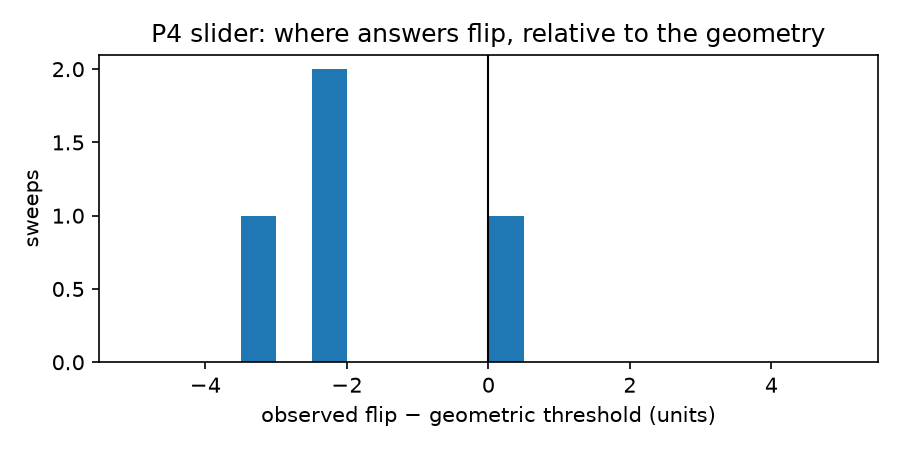

## 2026-11-10 05:09 · P3 patching (gemma3-12b)
Model **gemma3-12b**. Each pair differs in one sentence that moves one leaf object; the source's activations are copied into the base run at one site and layer, then every question is asked.

**Joint agreement** = share of pairs where, after patching, *every* answer equals what the model says when the object really is elsewhere (pairs where at least one of those answers differs from the base run). Geometric joint consistency (all answers match the true layout) is shown for reference.

- Positive control (copy the whole prefix, earliest layer): 0.95 (should be 1.00)
- Best layers in the sweep: list → [18, 20], relation → [2, 6], eol → [2, 6]

Confirmation run:

| site | layer | joint agreement [95% CI] | per-question agreement | geometric joint | pairs |
|---|---|---|---|---|---|
| all | 2 | 0.95 [0.93, 0.97] | 0.99 | 0.28 | 390 |
| all | 6 | 0.95 [0.93, 0.97] | 0.99 | 0.28 | 390 |
| all | 18 | 0.50 [0.45, 0.55] | 0.76 | 0.22 | 390 |
| all | 20 | 0.23 [0.19, 0.27] | 0.55 | 0.14 | 390 |
| eol | 2 | 0.00 [0.00, 0.00] | 0.00 | 0.01 | 390 |
| eol | 6 | 0.00 [0.00, 0.00] | 0.00 | 0.01 | 390 |
| eol | 18 | 0.00 [0.00, 0.00] | 0.00 | 0.01 | 390 |
| eol | 20 | 0.00 [0.00, 0.00] | 0.00 | 0.01 | 390 |
| list | 2 | 0.00 [0.00, 0.00] | 0.00 | 0.01 | 390 |
| list | 6 | 0.00 [0.00, 0.00] | 0.00 | 0.01 | 390 |
| list | 18 | 0.00 [0.00, 0.00] | 0.01 | 0.01 | 390 |
| list | 20 | 0.00 [0.00, 0.00] | 0.01 | 0.01 | 390 |
| relation | 2 | 0.94 [0.92, 0.96] | 0.99 | 0.28 | 390 |
| relation | 6 | 0.94 [0.91, 0.96] | 0.99 | 0.28 | 390 |
| relation | 18 | 0.36 [0.32, 0.41] | 0.67 | 0.19 | 390 |
| relation | 20 | 0.18 [0.15, 0.22] | 0.50 | 0.13 | 390 |

Pairs the model answers fully correctly when unpatched (44 pairs):

| site | layer | joint agreement [95% CI] | per-question agreement | geometric joint | pairs |
|---|---|---|---|---|---|
| all | 2 | 0.98 [0.93, 1.00] | 1.00 | 0.98 | 44 |
| all | 6 | 0.98 [0.93, 1.00] | 0.99 | 0.98 | 44 |
| all | 18 | 0.64 [0.48, 0.77] | 0.76 | 0.64 | 44 |
| all | 20 | 0.34 [0.20, 0.48] | 0.54 | 0.34 | 44 |
| eol | 2 | 0.00 [0.00, 0.00] | 0.00 | 0.00 | 44 |
| eol | 6 | 0.00 [0.00, 0.00] | 0.00 | 0.00 | 44 |
| eol | 18 | 0.00 [0.00, 0.00] | 0.00 | 0.00 | 44 |
| eol | 20 | 0.00 [0.00, 0.00] | 0.00 | 0.00 | 44 |
| list | 2 | 0.00 [0.00, 0.00] | 0.00 | 0.00 | 44 |
| list | 6 | 0.00 [0.00, 0.00] | 0.00 | 0.00 | 44 |
| list | 18 | 0.00 [0.00, 0.00] | 0.00 | 0.00 | 44 |
| list | 20 | 0.00 [0.00, 0.00] | 0.01 | 0.00 | 44 |
| relation | 2 | 0.98 [0.93, 1.00] | 0.99 | 0.98 | 44 |
| relation | 6 | 1.00 [1.00, 1.00] | 1.00 | 1.00 | 44 |
| relation | 18 | 0.57 [0.41, 0.70] | 0.70 | 0.57 | 44 |
| relation | 20 | 0.34 [0.20, 0.48] | 0.53 | 0.34 | 44 |

Against the preregistered P3 criteria (as clarified):
- H-map: joint agreement ≥ 0.6 at the object's list position or the end of list → best 0.00 (layer 2) → not met
- H-rel: < 0.2 at the readout positions, and at that layer the relation sentence carries more → readout 0.00, relation sentence at layer 2: 0.94 → met

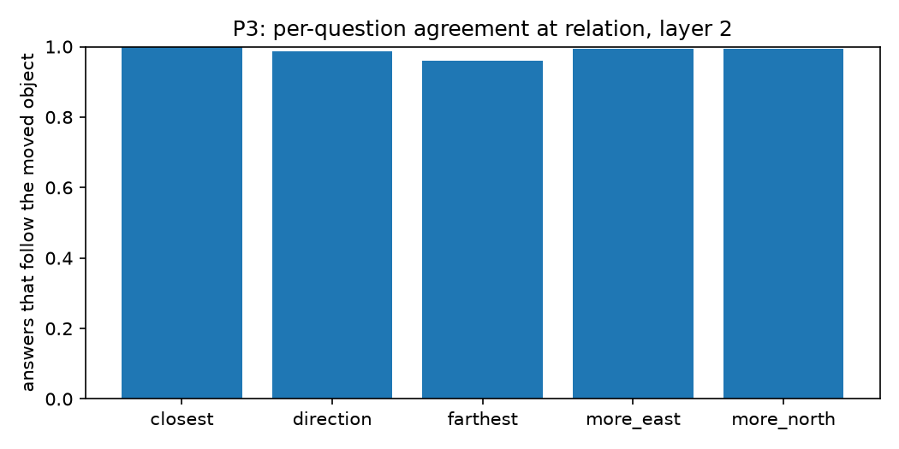

## 2026-11-10 05:10 · E1 summary
Model **gemma3-12b**. Verdict against `docs/preregistration.md`: **Mixed**: see the per-criterion breakdown.

| criterion | met |
|---|---|
| map_r2 | yes |
| map_hops | yes |
| rel_r2 | no |
| map_jc | no |
| rel_jc | yes |

Not yet evaluated: map_das

- P2: best layer 21, R² 0.74; 1-step 0.76 vs 2-step 0.74; stated-relation baseline on 2-step objects 0.22
- P3: joint agreement at readout positions 0.00 (layer 2); relation sentence at that layer 0.94

Prior work to engage in the write-up: Tehenan et al. 2025 (linear spatial models, single-answer steering) and An et al. 2026 (weak, fragmented coordinate probes in 7–8B models).

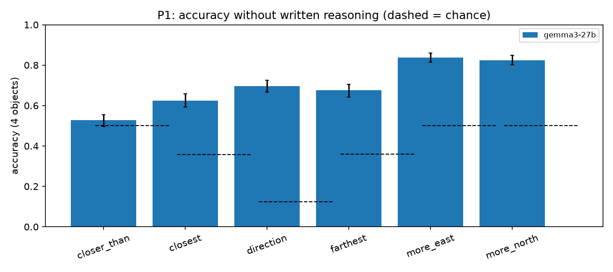

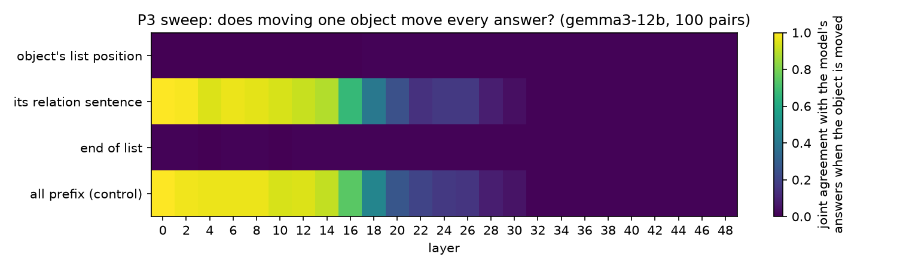

## 2026-11-10 07:56 · P3 necessity (gemma3-12b) — exploratory
Model **gemma3-12b**, 100 pairs (the P3 sweep's pairs). Exploratory, not preregistered: added after P3 showed that patching the readout positions alone changes no answer (insufficiency). Here the source description is copied everywhere *except* the objects' list positions and the end of the list.

| layer | whole description | all but readout positions | difference |
|---|---|---|---|
| 6 | 0.97 [0.93, 1.00] | 0.98 [0.95, 1.00] | +0.01 |
| 14 | 0.92 [0.86, 0.97] | 0.89 [0.82, 0.94] | -0.03 |
| 18 | 0.45 [0.35, 0.56] | 0.42 [0.32, 0.53] | -0.03 |
| 21 | 0.25 [0.16, 0.34] | 0.20 [0.12, 0.28] | -0.05 |
| 24 | 0.15 [0.08, 0.23] | 0.16 [0.09, 0.24] | +0.01 |

Effect sizes in the P3 sweep (mean |change in log-probability of the base answer|, nats):

| layer | all | eol | list | relation |
|---|---|---|---|---|
| 6 | 7.51 | 0.05 | 0.05 | 7.50 |
| 10 | 7.45 | 0.05 | 0.05 | 7.41 |
| 14 | 7.42 | 0.05 | 0.04 | 7.32 |
| 18 | 5.45 | 0.05 | 0.13 | 4.89 |
| 20 | 4.10 | 0.05 | 0.10 | 3.90 |
| 24 | 2.99 | 0.04 | 0.10 | 2.88 |
| 30 | 1.71 | 0.04 | 0.06 | 1.63 |

## 2026-11-10 08:04 · P2b sentence-end probe (gemma3-12b) — exploratory
Model **gemma3-12b**, same 3,000 scenes and split as P2. Exploratory: added after P3 showed that patching the object's sentence moves the answers while patching its list mention does not.

- Sentence end: best layer 24, R² 0.44 [0.42, 0.46]; one-step objects 0.42, two-step objects 0.76 (stated-sentence baseline 0.22); shuffled -0.00
- List mention (P2): best layer 21, R² 0.74; two-step 0.74

| layer | sentence end | sentence end, two-step | list mention | list, two-step |
|---|---|---|---|---|
| 4 | 0.26 | 0.43 | -0.00 | 0.00 |
| 8 | 0.26 | 0.43 | -0.00 | 0.01 |
| 10 | 0.27 | 0.44 | -0.00 | 0.01 |
| 12 | 0.28 | 0.48 | 0.10 | 0.09 |
| 14 | 0.34 | 0.61 | 0.29 | 0.36 |
| 16 | 0.38 | 0.68 | 0.42 | 0.46 |
| 18 | 0.39 | 0.69 | 0.62 | 0.58 |
| 21 | 0.43 | 0.76 | 0.74 | 0.74 |
| 24 | 0.44 | 0.76 | 0.70 | 0.71 |
| 30 | 0.40 | 0.70 | 0.64 | 0.63 |
| 40 | 0.33 | 0.56 | 0.57 | 0.55 |
| 48 | 0.29 | 0.48 | 0.54 | 0.50 |

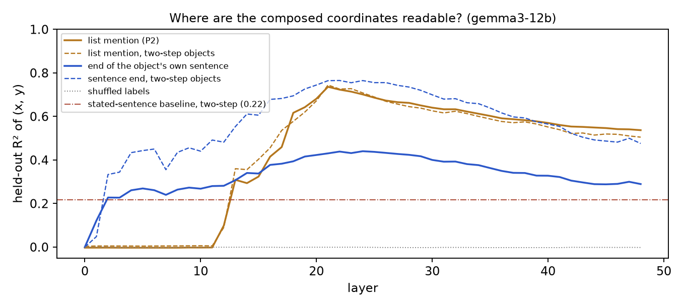

## 2026-11-10 08:49 · E2 composition timing (gemma3-12b)
Model **gemma3-12b**, 150 chain pairs (R → M → C, M's sentence first). M's sentence is copied from a scene where M (and therefore C) sits elsewhere. *follow* = answer equals the model's answer on that scene; *stay* = answer equals the model's answer on a scene where M moved but C kept its old position.

| layer | M follows | C follows | C stays | M-questions | C-questions |
|---|---|---|---|---|---|
| 0 | 1.00 [1.00, 1.00] | 1.00 [1.00, 1.00] | 0.00 [0.00, 0.00] | 293 | 348 |
| 4 | 1.00 [1.00, 1.00] | 0.99 [0.97, 1.00] | 0.01 [0.00, 0.02] | 293 | 348 |
| 8 | 0.98 [0.95, 0.99] | 0.98 [0.97, 0.99] | 0.02 [0.01, 0.03] | 293 | 348 |
| 10 | 0.99 [0.97, 1.00] | 0.98 [0.96, 0.99] | 0.02 [0.01, 0.04] | 293 | 348 |
| 12 | 0.97 [0.94, 0.99] | 0.95 [0.92, 0.97] | 0.04 [0.02, 0.06] | 293 | 348 |
| 14 | 0.96 [0.94, 0.98] | 0.95 [0.92, 0.97] | 0.05 [0.02, 0.07] | 293 | 348 |
| 16 | 0.92 [0.89, 0.96] | 0.85 [0.81, 0.89] | 0.09 [0.06, 0.12] | 293 | 348 |
| 18 | 0.79 [0.74, 0.84] | 0.77 [0.72, 0.82] | 0.15 [0.11, 0.19] | 293 | 348 |
| 20 | 0.66 [0.61, 0.72] | 0.72 [0.67, 0.77] | 0.20 [0.15, 0.26] | 293 | 348 |
| 24 | 0.58 [0.53, 0.64] | 0.69 [0.63, 0.75] | 0.22 [0.16, 0.27] | 293 | 348 |
| 28 | 0.51 [0.46, 0.57] | 0.68 [0.62, 0.73] | 0.24 [0.19, 0.29] | 293 | 348 |
| 32 | 0.08 [0.05, 0.11] | 0.61 [0.55, 0.66] | 0.25 [0.20, 0.31] | 293 | 348 |

Preregistered verdict: **lazy**

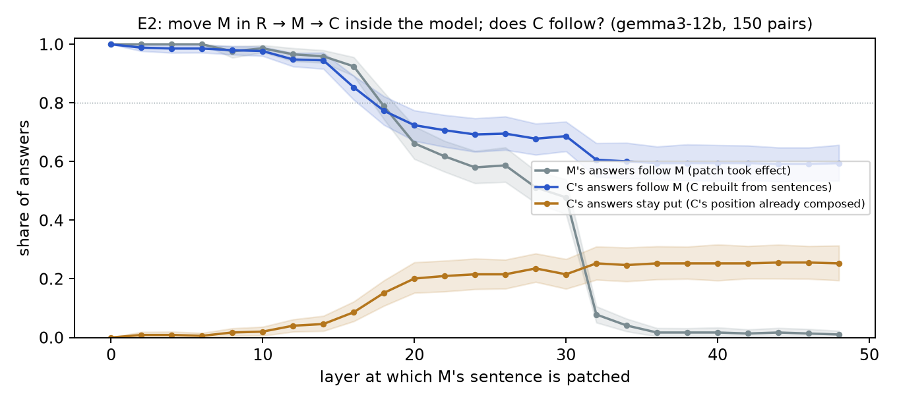

## 2026-11-10 08:53 · P2d distance probe (gemma3-12b) — exploratory
Model **gemma3-12b**, same 3,000 scenes and split as P2, readout at the list mention. Exploratory. Target: each non-root object's distance to the root. Distance is not a sum of the stated offsets, so the best *additive* baseline (one-hot codes of the object's own and its parent's offsets) cannot fully fit it for two-step objects. Activations that beat it carry an interaction of the two offsets.

- Best layer for two-step objects: 21, R² 0.62 [0.56, 0.67]
- Best additive baseline: two-step -0.05, one-step 0.91
- Reference from the true position (x, y, x², y², xy): two-step 0.95

| layer | two-step | one-step |
|---|---|---|
| 0 | -0.12 | -0.04 |
| 8 | -0.02 | 0.24 |
| 12 | 0.13 | 0.40 |
| 14 | 0.16 | 0.46 |
| 16 | 0.33 | 0.55 |
| 18 | 0.45 | 0.74 |
| 21 | 0.62 | 0.80 |
| 24 | 0.60 | 0.78 |
| 30 | 0.52 | 0.73 |
| 40 | 0.39 | 0.66 |
| 48 | 0.42 | 0.67 |

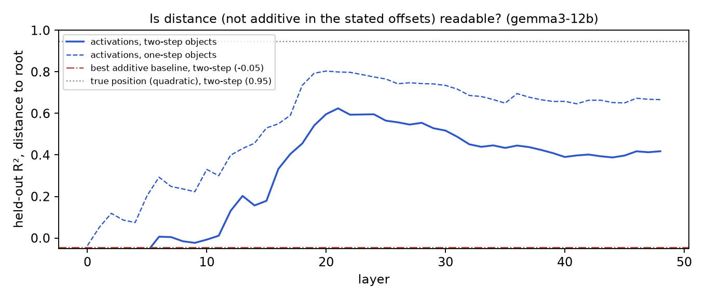

## 2026-11-10 08:58 · E2 strict question set (gemma3-12b) — deviation
Model **gemma3-12b**. Deviation from the E2 preregistration (dated there): C-questions restricted to those whose model answers differ across base, source and hybrid. Under the preregistered definition, a C-question whose answer the move leaves unchanged counts as "follow" even when the patch does nothing.

| layer | M follows | C follows | C stays | C-questions |
|---|---|---|---|---|
| 0 | 1.00 | 1.00 [1.00, 1.00] | 0.00 [0.00, 0.00] | 53 |
| 8 | 0.98 | 0.98 [0.93, 1.00] | 0.00 [0.00, 0.00] | 53 |
| 12 | 0.97 | 0.92 [0.84, 0.98] | 0.02 [0.00, 0.06] | 53 |
| 14 | 0.96 | 0.92 [0.85, 0.98] | 0.02 [0.00, 0.06] | 53 |
| 16 | 0.92 | 0.70 [0.60, 0.81] | 0.04 [0.00, 0.10] | 53 |
| 18 | 0.79 | 0.55 [0.44, 0.67] | 0.09 [0.02, 0.18] | 53 |
| 20 | 0.66 | 0.51 [0.40, 0.62] | 0.11 [0.03, 0.20] | 53 |
| 22 | 0.62 | 0.43 [0.33, 0.56] | 0.15 [0.07, 0.26] | 53 |
| 24 | 0.58 | 0.34 [0.22, 0.46] | 0.17 [0.08, 0.28] | 53 |
| 26 | 0.59 | 0.34 [0.23, 0.47] | 0.19 [0.09, 0.29] | 53 |
| 28 | 0.51 | 0.28 [0.18, 0.39] | 0.23 [0.13, 0.35] | 53 |
| 30 | 0.48 | 0.32 [0.21, 0.43] | 0.13 [0.04, 0.24] | 53 |
| 32 | 0.08 | 0.04 [0.00, 0.12] | 0.04 [0.00, 0.10] | 53 |

Decision rule applied to the strict set: **mixed**

## 2026-11-10 10:18 · P3c which tokens carry the position (gemma3-12b) — exploratory
Model **gemma3-12b**, 100 pairs (the P3 sweep's pairs). Exploratory. Joint agreement (all answers equal the model's answers on the moved scene) after copying one part of the moved object's sentence.

| layer | whole sentence | last token of the sentence only | rest of the sentence |
|---|---|---|---|
| 0 | 1.00 | 0.01 | 1.00 |
| 2 | 0.99 | 0.00 | 0.97 |
| 4 | 0.95 | 0.00 | 0.96 |
| 6 | 0.97 | 0.00 | 0.97 |
| 8 | 0.96 | 0.01 | 0.95 |
| 10 | 0.94 | 0.01 | 0.96 |
| 12 | 0.93 | 0.01 | 0.90 |
| 14 | 0.89 | 0.01 | 0.85 |
| 16 | 0.67 | 0.01 | 0.65 |
| 18 | 0.40 | 0.01 | 0.36 |
| 20 | 0.25 | 0.01 | 0.20 |
| 22 | 0.14 | 0.01 | 0.16 |
| 24 | 0.16 | 0.01 | 0.12 |
| 26 | 0.16 | 0.01 | 0.13 |
| 28 | 0.08 | 0.01 | 0.08 |
| 30 | 0.04 | 0.01 | 0.04 |
| 32 | 0.01 | 0.01 | 0.01 |

## 2026-11-10 10:32 · P3q hand-off to the question (gemma3-12b) — exploratory
Model **gemma3-12b**, 100 pairs (the P3 sweep's pairs). Exploratory. Joint agreement after copying the question tokens (or only the final position) from the run where the object sits elsewhere. The question text is identical, so the copied states differ only through what they read from the description.

| layer | sentence (sweep) | question tokens | final position |
|---|---|---|---|
| 0 | 1.00 | 0.00 | 0.01 |
| 2 | 0.99 | 0.00 | 0.01 |
| 4 | 0.95 | 0.00 | 0.01 |
| 6 | 0.97 | 0.00 | 0.01 |
| 8 | 0.96 | 0.00 | 0.01 |
| 10 | 0.94 | 0.00 | 0.01 |
| 12 | 0.92 | 0.01 | 0.01 |
| 14 | 0.89 | 0.01 | 0.01 |
| 16 | 0.67 | 0.01 | 0.01 |
| 18 | 0.40 | 0.02 | 0.01 |
| 20 | 0.25 | 0.04 | 0.01 |
| 22 | 0.14 | 0.06 | 0.01 |
| 24 | 0.16 | 0.13 | 0.01 |
| 26 | 0.16 | 0.12 | 0.01 |
| 28 | 0.08 | 0.20 | 0.01 |
| 30 | 0.04 | 0.24 | 0.05 |
| 32 | 0.01 | 0.78 | 0.06 |
| 34 | 0.01 | 0.76 | 0.07 |
| 36 | 0.01 | 0.81 | 0.08 |
| 38 | 0.01 | 0.80 | 0.08 |
| 40 | 0.01 | 0.76 | 0.08 |
| 42 | 0.01 | 0.75 | 0.12 |
| 44 | 0.01 | 0.73 | 0.35 |
| 46 | 0.01 | 0.66 | 0.56 |
| 48 | 0.01 | 0.64 | 0.64 |

## 2026-11-10 10:34 · P2m question-mention probe (gemma3-12b) — exploratory
Model **gemma3-12b**, same 3,000 scenes and split as P2. Exploratory. Readout: the object's name in "Which object is farthest from X?" (one prompt per object).

- (x, y): best layer for two-step objects 21, R² 0.74 (all objects 0.73 [0.72, 0.75]); list mention best 0.74; shuffled -0.00
- Distance to root, two-step: best layer 22, R² 0.63; list mention best 0.62; best additive baseline -0.05

| layer | (x, y) two-step | (x, y) all | distance two-step |
|---|---|---|---|
| 0 | 0.00 | -0.00 | -0.12 |
| 8 | 0.02 | 0.02 | 0.03 |
| 12 | 0.15 | 0.19 | 0.20 |
| 14 | 0.41 | 0.35 | 0.30 |
| 16 | 0.47 | 0.43 | 0.43 |
| 18 | 0.57 | 0.60 | 0.52 |
| 21 | 0.74 | 0.73 | 0.61 |
| 24 | 0.72 | 0.72 | 0.63 |
| 28 | 0.71 | 0.71 | 0.60 |
| 32 | 0.67 | 0.68 | 0.57 |
| 40 | 0.59 | 0.61 | 0.51 |
| 48 | 0.56 | 0.59 | 0.49 |

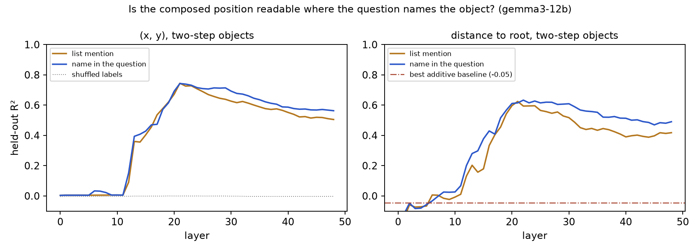

## 2026-11-10 10:57 · P3m one-token patch at the question's mention (gemma3-12b) — exploratory
Model **gemma3-12b**, 100 of the P3 sweep's pairs (questions that name the moved object). Exploratory. Joint agreement after copying only the moved object's name token in the question from the run where it sits elsewhere.

| layer | joint agreement [95% CI] |
|---|---|
| 0 | 0.00 [0.00, 0.00] |
| 2 | 0.00 [0.00, 0.00] |
| 4 | 0.00 [0.00, 0.00] |
| 6 | 0.00 [0.00, 0.00] |
| 8 | 0.00 [0.00, 0.00] |
| 10 | 0.00 [0.00, 0.00] |
| 12 | 0.00 [0.00, 0.00] |
| 14 | 0.00 [0.00, 0.00] |
| 16 | 0.00 [0.00, 0.00] |
| 18 | 0.00 [0.00, 0.00] |
| 20 | 0.00 [0.00, 0.00] |
| 22 | 0.00 [0.00, 0.00] |
| 24 | 0.00 [0.00, 0.00] |
| 26 | 0.00 [0.00, 0.00] |
| 28 | 0.00 [0.00, 0.00] |
| 30 | 0.00 [0.00, 0.00] |
| 32 | 0.00 [0.00, 0.00] |
| 34 | 0.00 [0.00, 0.00] |
| 36 | 0.00 [0.00, 0.00] |
| 38 | 0.00 [0.00, 0.00] |
| 40 | 0.00 [0.00, 0.00] |
| 42 | 0.00 [0.00, 0.00] |
| 44 | 0.00 [0.00, 0.00] |
| 46 | 0.00 [0.00, 0.00] |
| 48 | 0.00 [0.00, 0.00] |

## 2026-11-10 12:37 · P4 DAS (gemma3-12b) — exploratory: relation site, layer 14
Model **gemma3-12b**, layer 14, site relation; 300 training pairs, 300 test pairs. Interchange accuracy = on questions where the model answers differently when the object is really elsewhere, the share whose answer after swapping only the learned subspace equals that answer (ceiling 1). Geometric accuracy (answers equal the moved layout) in the last column.

| method | closest | direction | farthest | more_east | more_north | ALL | |
|---|---|---|---|---|---|---|---|
| random k=2 | 0.00 [0.00, 0.00] | 0.00 [0.00, 0.00] | 0.03 [0.00, 0.09] | 0.00 [0.00, 0.00] | 0.00 [0.00, 0.01] | 0.00 [0.00, 0.00] | geometric 0.10 |
| DAS k=2 | 0.54 [0.37, 0.70] | 0.73 [0.69, 0.77] | 0.53 [0.37, 0.70] | 0.93 [0.90, 0.96] | 0.92 [0.88, 0.95] | 0.81 [0.78, 0.83] | geometric 0.72 |

Preregistered criterion (k = 2, ≥ 0.7 on every question type): **not met** (lowest: 0.53 on farthest).

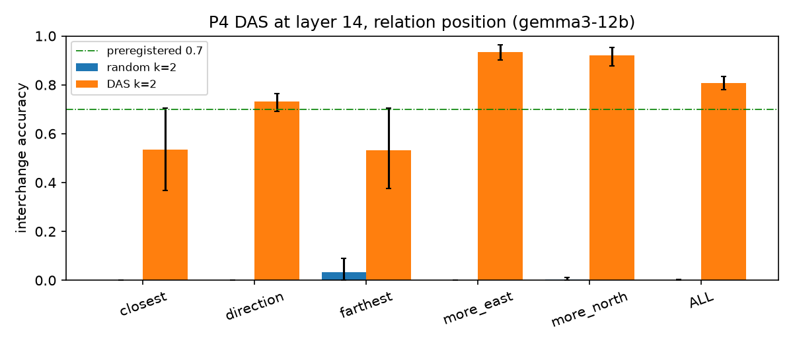

## 2026-11-10 14:10 · P4 DAS (gemma3-12b)
Model **gemma3-12b**, layer 18, site list; 300 training pairs, 300 test pairs. Interchange accuracy = on questions where the model answers differently when the object is really elsewhere, the share whose answer after swapping only the learned subspace equals that answer (ceiling 1). Geometric accuracy (answers equal the moved layout) in the last column.

| method | closest | direction | farthest | more_east | more_north | ALL | |
|---|---|---|---|---|---|---|---|
| random k=2 | 0.00 [0.00, 0.00] | 0.00 [0.00, 0.01] | 0.00 [0.00, 0.00] | 0.00 [0.00, 0.01] | 0.01 [0.00, 0.02] | 0.00 [0.00, 0.01] | geometric 0.10 |
| DAS k=2 | 0.14 [0.03, 0.30] | 0.02 [0.01, 0.03] | 0.17 [0.04, 0.30] | 0.15 [0.08, 0.22] | 0.10 [0.05, 0.15] | 0.07 [0.05, 0.09] | geometric 0.14 |

Preregistered criterion (k = 2, ≥ 0.7 on every question type): **not met** (lowest: 0.02 on direction).

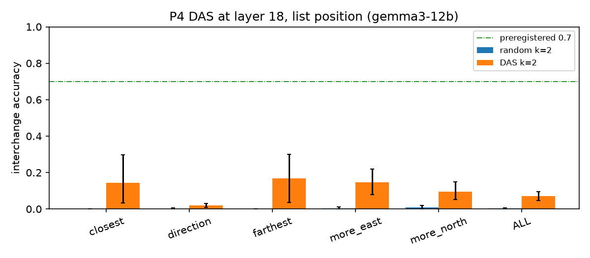

## 2026-11-10 14:46 · P4i 2-D code set to unstated positions (gemma3-12b) — exploratory
Model **gemma3-12b**, the 2-D subspace learned by DAS at the relation site, layer 14; 150 of its held-out test pairs. Exploratory. The subspace is set to base + α·(moved − base); answers are scored against the layout with the object at the matching interpolated position (questions with margin ≥ 1 unit / 10° there). *Novel*: questions whose answer at that position differs from the answer in both stated layouts (chance 0.15). Clean model accuracy on the base layouts: 0.85.

| α | agrees with interpolated layout | novel: interpolated answer | novel: original-layout answer | novel: moved-layout answer | n novel |
|---|---|---|---|---|---|
| 0 | 0.85 [0.82, 0.87] | – | – | – | 0 |
| 0.25 | 0.86 [0.83, 0.88] | 0.00 [0.00, 0.00] | 0.85 [0.54, 1.00] | 0.00 [0.00, 0.00] | 13 |
| 0.5 | 0.66 [0.63, 0.68] | 0.06 [0.02, 0.10] | 0.63 [0.54, 0.72] | 0.23 [0.16, 0.31] | 150 |
| 0.75 | 0.75 [0.72, 0.78] | 0.00 [0.00, 0.00] | 0.18 [0.00, 0.44] | 0.73 [0.33, 1.00] | 11 |
| 1 | 0.78 [0.75, 0.81] | – | – | – | 0 |
| 1.5 | 0.80 [0.77, 0.83] | 0.26 [0.09, 0.45] | 0.22 [0.07, 0.42] | 0.59 [0.37, 0.81] | 27 |

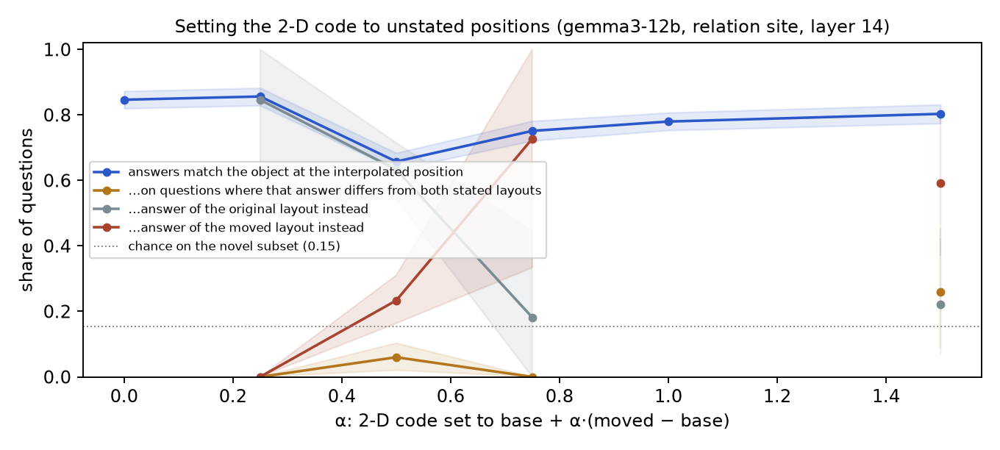

## 2026-11-10 14:46 · E1 summary
Model **gemma3-12b**. Verdict against `docs/preregistration.md`: **Mixed**: see the per-criterion breakdown.

| criterion | met |
|---|---|
| map_r2 | yes |
| map_hops | yes |
| rel_r2 | no |
| map_jc | no |
| rel_jc | yes |
| map_das | no |

- P2: best layer 21, R² 0.74; 1-step 0.76 vs 2-step 0.74; stated-relation baseline on 2-step objects 0.22
- P3: joint agreement at readout positions 0.00 (layer 2); relation sentence at that layer 0.94
- P4: DAS k=2 lowest per-type interchange accuracy 0.02

Prior work to engage in the write-up: Tehenan et al. 2025 (linear spatial models, single-answer steering) and An et al. 2026 (weak, fragmented coordinate probes in 7–8B models).

## 2026-11-10 18:59 · P4 DAS (gemma3-12b) — preregistered 'confirm' run: relation site, layer 14
Model **gemma3-12b**, layer 14, site relation; 300 training pairs, 300 test pairs. Interchange accuracy = on questions where the model answers differently when the object is really elsewhere, the share whose answer after swapping only the learned subspace equals that answer (ceiling 1). Geometric accuracy (answers equal the moved layout) in the last column.

| method | closest | direction | farthest | more_east | more_north | ALL | |
|---|---|---|---|---|---|---|---|
| random k=2 | 0.00 [0.00, 0.00] | 0.00 [0.00, 0.01] | 0.00 [0.00, 0.00] | 0.01 [0.00, 0.03] | 0.00 [0.00, 0.01] | 0.00 [0.00, 0.01] | geometric 0.13 |
| DAS k=2 | 0.38 [0.19, 0.55] | 0.60 [0.54, 0.65] | 0.33 [0.19, 0.48] | 0.90 [0.85, 0.94] | 0.94 [0.91, 0.96] | 0.72 [0.68, 0.75] | geometric 0.65 |

Preregistered criterion (k = 2, ≥ 0.7 on every question type): **not met** (lowest: 0.33 on farthest).
Seeds (train, test): 105, 106. Decision rule: see docs/preregistration_p4c.md.

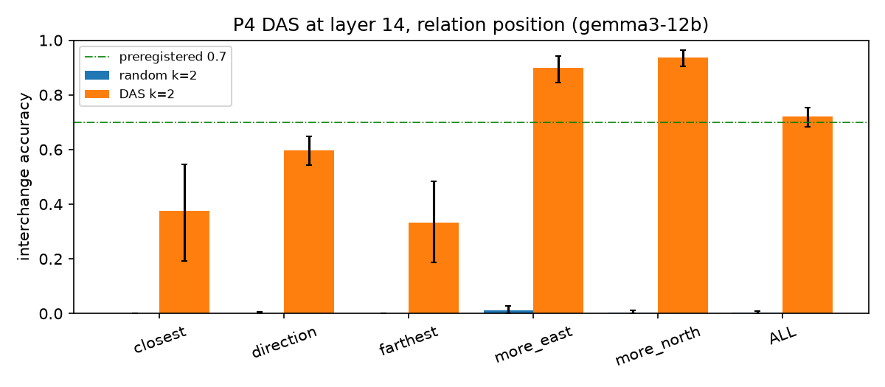

## 2026-11-10 19:39 · E3 composed-position transfer (gemma3-12b)
Model **gemma3-12b**, 150 chain pairs (R → M → C). Only M's sentence differs between the two runs; C's sentence is copied (same words) from the run where M, and with it C, sits elsewhere. *Follows target* = answer equals the model's answer on a scene with C at its moved position and M unmoved.

| layer | follows target | follows source (M moved too) | controls stable | target Qs | control Qs |
|---|---|---|---|---|---|
| 0 | 0.00 [0.00, 0.00] | 0.85 | 1.00 [1.00, 1.00] | 369 | 625 |
| 2 | 0.00 [0.00, 0.01] | 0.85 | 1.00 [0.99, 1.00] | 369 | 625 |
| 4 | 0.00 [0.00, 0.00] | 0.85 | 1.00 [0.99, 1.00] | 369 | 625 |
| 6 | 0.00 [0.00, 0.01] | 0.85 | 0.99 [0.99, 1.00] | 369 | 625 |
| 8 | 0.01 [0.00, 0.02] | 0.85 | 0.99 [0.99, 1.00] | 369 | 625 |
| 10 | 0.01 [0.00, 0.03] | 0.86 | 0.99 [0.98, 1.00] | 369 | 625 |
| 12 | 0.02 [0.01, 0.04] | 0.86 | 0.98 [0.97, 0.99] | 369 | 625 |
| 14 | 0.02 [0.01, 0.04] | 0.86 | 0.98 [0.97, 0.99] | 369 | 625 |
| 16 | 0.05 [0.03, 0.08] | 0.86 | 0.97 [0.96, 0.98] | 369 | 625 |
| 18 | 0.07 [0.04, 0.09] | 0.87 | 0.97 [0.96, 0.98] | 369 | 625 |
| 20 | 0.05 [0.03, 0.08] | 0.88 | 0.98 [0.96, 0.99] | 369 | 625 |
| 22 | 0.04 [0.02, 0.06] | 0.88 | 0.98 [0.97, 0.99] | 369 | 625 |
| 24 | 0.01 [0.00, 0.02] | 0.86 | 0.98 [0.97, 0.99] | 369 | 625 |
| 26 | 0.01 [0.00, 0.02] | 0.86 | 0.98 [0.97, 0.99] | 369 | 625 |
| 28 | 0.01 [0.00, 0.02] | 0.85 | 0.99 [0.98, 1.00] | 369 | 625 |
| 30 | 0.01 [0.00, 0.01] | 0.85 | 0.99 [0.98, 1.00] | 369 | 625 |
| 32 | 0.00 [0.00, 0.01] | 0.85 | 1.00 [1.00, 1.00] | 369 | 625 |
| 34 | 0.00 [0.00, 0.01] | 0.85 | 1.00 [0.99, 1.00] | 369 | 625 |
| 36 | 0.00 [0.00, 0.01] | 0.86 | 1.00 [0.99, 1.00] | 369 | 625 |
| 38 | 0.00 [0.00, 0.00] | 0.86 | 1.00 [1.00, 1.00] | 369 | 625 |
| 40 | 0.00 [0.00, 0.00] | 0.86 | 1.00 [1.00, 1.00] | 369 | 625 |

Preregistered verdict: **not carried**

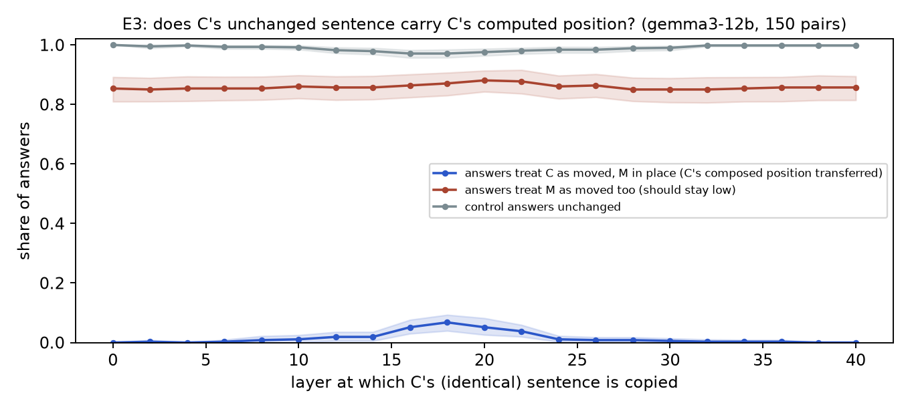

## 2026-11-10 19:53 · P4i 2-D code set to unstated positions (gemma3-12b) — preregistered 'confirm' run
Model **gemma3-12b**, the 2-D subspace learned by DAS at the relation site, layer 14; 150 of its held-out test pairs. Exploratory. The subspace is set to base + α·(moved − base); answers are scored against the layout with the object at the matching interpolated position (questions with margin ≥ 1 unit / 10° there). *Novel*: questions whose answer at that position differs from the answer in both stated layouts (chance 0.15). Clean model accuracy on the base layouts: 0.82.

| α | agrees with interpolated layout | novel: interpolated answer | novel: original-layout answer | novel: moved-layout answer | n novel |
|---|---|---|---|---|---|
| 0 | 0.82 [0.79, 0.85] | – | – | – | 0 |
| 0.25 | 0.82 [0.79, 0.85] | 0.10 [0.00, 0.25] | 0.81 [0.65, 0.95] | 0.05 [0.00, 0.17] | 21 |
| 0.5 | 0.66 [0.63, 0.69] | 0.09 [0.04, 0.14] | 0.60 [0.51, 0.68] | 0.23 [0.16, 0.31] | 164 |
| 0.75 | 0.76 [0.72, 0.78] | 0.00 [0.00, 0.00] | 0.25 [0.06, 0.48] | 0.50 [0.25, 0.75] | 20 |
| 1 | 0.74 [0.70, 0.76] | – | – | – | 0 |
| 1.5 | 0.78 [0.74, 0.81] | 0.24 [0.10, 0.38] | 0.17 [0.06, 0.33] | 0.35 [0.18, 0.53] | 46 |

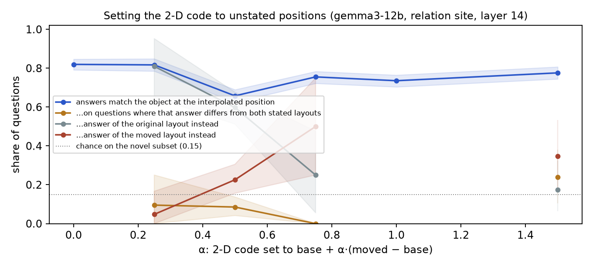

## 2026-11-10 23:14 · P4 DAS (gemma3-27b) — preregistered 'confirm' run: relation site, layer 18
Model **gemma3-27b**, layer 18, site relation; 300 training pairs, 300 test pairs. Interchange accuracy = on questions where the model answers differently when the object is really elsewhere, the share whose answer after swapping only the learned subspace equals that answer (ceiling 1). Geometric accuracy (answers equal the moved layout) in the last column.

| method | closest | direction | farthest | more_east | more_north | ALL | |
|---|---|---|---|---|---|---|---|
| random k=2 | 0.00 [0.00, 0.00] | 0.00 [0.00, 0.00] | 0.04 [0.00, 0.12] | 0.00 [0.00, 0.00] | 0.01 [0.00, 0.02] | 0.00 [0.00, 0.01] | geometric 0.10 |
| DAS k=2 | 0.43 [0.28, 0.58] | 0.81 [0.77, 0.85] | 0.38 [0.23, 0.56] | 0.84 [0.78, 0.90] | 0.94 [0.90, 0.97] | 0.83 [0.80, 0.85] | geometric 0.74 |

Preregistered criterion (k = 2, ≥ 0.7 on every question type): **not met** (lowest: 0.38 on farthest).
Seeds (train, test): 105, 106. Decision rule: see docs/preregistration_p4c.md.

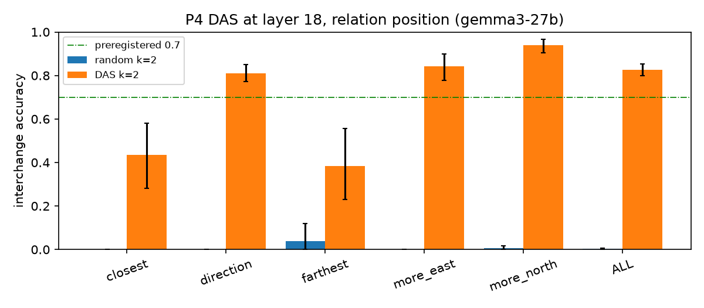

## 2026-11-11 00:38 · P4i 2-D code set to unstated positions (gemma3-27b) — preregistered 'confirm' run
Model **gemma3-27b**, the 2-D subspace learned by DAS at the relation site, layer 18; 150 of its held-out test pairs. Exploratory. The subspace is set to base + α·(moved − base); answers are scored against the layout with the object at the matching interpolated position (questions with margin ≥ 1 unit / 10° there). *Novel*: questions whose answer at that position differs from the answer in both stated layouts (chance 0.15). Clean model accuracy on the base layouts: 0.85.

| α | agrees with interpolated layout | novel: interpolated answer | novel: original-layout answer | novel: moved-layout answer | n novel |
|---|---|---|---|---|---|
| 0 | 0.85 [0.82, 0.87] | – | – | – | 0 |
| 0.25 | 0.84 [0.80, 0.86] | 0.00 [0.00, 0.00] | 0.81 [0.60, 1.00] | 0.05 [0.00, 0.17] | 21 |
| 0.5 | 0.64 [0.61, 0.67] | 0.05 [0.02, 0.10] | 0.73 [0.64, 0.81] | 0.21 [0.14, 0.28] | 164 |
| 0.75 | 0.79 [0.75, 0.81] | 0.05 [0.00, 0.16] | 0.20 [0.00, 0.42] | 0.70 [0.45, 0.95] | 20 |
| 1 | 0.80 [0.77, 0.83] | – | – | – | 0 |
| 1.5 | 0.80 [0.77, 0.83] | 0.20 [0.08, 0.33] | 0.11 [0.04, 0.21] | 0.63 [0.47, 0.79] | 46 |

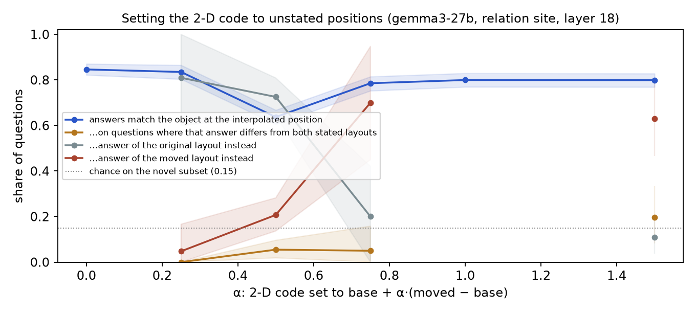

### Note on the 2026-11-10/11 'confirm' entries (added by hand)

Decision rules: docs/preregistration_p4c.md (P4c) and docs/preregistration_e3.md (E3). The auto-printed "Preregistered criterion (≥ 0.7 on every question type) … not met" lines apply the original per-type rule, which P4c demoted to reported-only; the P4c rule is ALL ≥ 0.70 and random ≤ 0.05. The P4i entries' "Exploratory" wording comes from the script template; the 'confirm' runs are the preregistered ones. Their "chance 0.15" pools all α; at α = ½ the chance on the novel subset is 0.141 (n = 164, both models).

| test | gemma3-12b (L14) | gemma3-27b (L18) |
|---|---|---|
| P4c DAS k=2, ALL | 0.72 [0.68, 0.75] | 0.83 [0.80, 0.85] |
| random k=2, ALL | 0.00 | 0.00 |
| verdict | **2-D code confirmed** | **2-D code confirmed** |
| P4i α = ½, novel rate | 0.085 [0.041, 0.137] | 0.055 [0.019, 0.096] |
| verdict (upper CI < 0.141) | **switch** | **switch** |

- **E3 (gemma3-12b):** follow_T ≤ 0.07 at every layer ≥ 1 → **not carried**. The "follows source" column is ≈ 0.85 already at layer 0 (base and source answers mostly agree on those questions), so it is not informative.

## 2026-11-11 23:44 · P5a/P5b natural encoding and write-in (gemma3-12b) — preregistered
Model **gemma3-12b**, the preregistered P4c subspace (layer 14, moved object's sentence).

**P5a, natural encoding.** Change in the 2 subspace coordinates predicted linearly from the change in the stated offset (one 2×2 map per token from the sentence end), 600 new pairs, pair-grouped 5-fold CV: **R² = 0.31**. Random 2-D subspaces (200): 95th percentile 0.35, 99th 0.39, max 0.42. Preregistered verdict: **no linear encoding**.

**P5b, write-in.** On the 300 P4c test pairs, interchange accuracy (ALL question types):

| edit | ALL | 95% CI |
|---|---|---|
| copy (P4c edit) | 0.72 | [0.68, 0.75] |
| write-in | 0.27 | [0.22, 0.31] |
| write-in, random subspace | 0.00 | [0.00, 0.01] |

Write-in / copy = 0.37. Preregistered verdict: **partial**.
Rules: docs/preregistration_p5.md.

## 2026-11-12 00:08 · P5c erase the map (gemma3-12b) — preregistered
Model **gemma3-12b**. INLP basis fitted per layer at the object-list positions (2000 scenes); erased at every token position. Rank per layer 0–10; probe R² before 0.01–0.69, after ≤ 0.088. Test: 300 new chains, 5320 questions.

| erased at | questions | clean acc | drop (probe basis) | drop (random basis) | excess drop [95% CI] | n |
|---|---|---|---|---|---|---|
| L14 | stated only | 0.91 | 0.003 | -0.002 | 0.006 [-0.005, 0.016] | 1266 |
| L14 | composed (involve C) | 0.77 | -0.004 | -0.001 | -0.003 [-0.008, 0.001] | 4054 |
| L21 | stated only | 0.91 | 0.058 | 0.087 | -0.028 [-0.052, -0.004] | 1266 |
| L21 | composed (involve C) | 0.77 | 0.010 | 0.031 | -0.022 [-0.032, -0.012] | 4054 |
| L28 | stated only | 0.91 | 0.036 | 0.028 | 0.008 [-0.005, 0.020] | 1266 |
| L28 | composed (involve C) | 0.77 | 0.007 | 0.017 | -0.011 [-0.018, -0.002] | 4054 |
| window 12-30 | stated only | 0.91 | 0.171 | 0.237 | -0.066 [-0.094, -0.036] | 1266 |
| window 12-30 | composed (involve C) | 0.77 | 0.069 | 0.095 | -0.027 [-0.042, -0.012] | 4054 |

Preregistered verdict: **map not used (in this subspace)**. Rules: docs/preregistration_p5.md.

## 2026-11-12 18:37 · P6 is the map used when chaining is hard? (gemma3-12b) — preregistered
Model **gemma3-12b**, scenes of 4–5 objects. INLP basis fitted per layer at the object-list positions (2000 scenes); erased at every token position. Rank per layer 0–8; probe R² before 0.01–0.60, after ≤ 0.095. Test: 300 new scenes, 7200 questions.

Clean accuracy by depth (deepest object involved): 1: 0.82 (chance 0.37, n = 1734); 2: 0.69 (chance 0.37, n = 3125); 3: 0.65 (chance 0.36, n = 1950); 4: 0.66 (chance 0.35, n = 391). Headroom on deep questions: 0.29.

| erased at | questions | clean acc | drop (probe basis) | drop (random basis) | excess drop [95% CI] | n |
|---|---|---|---|---|---|---|
| L14 | shallow | 0.82 | 0.004 | -0.006 | 0.010 [0.002, 0.018] | 1734 |
| L14 | middle | 0.69 | 0.000 | -0.002 | 0.002 [-0.005, 0.008] | 3125 |
| L14 | deep | 0.65 | 0.002 | 0.007 | -0.005 [-0.013, 0.003] | 2341 |
| L21 | shallow | 0.82 | 0.052 | 0.057 | -0.004 [-0.022, 0.012] | 1734 |
| L21 | middle | 0.69 | 0.040 | 0.026 | 0.014 [-0.000, 0.030] | 3125 |
| L21 | deep | 0.65 | 0.045 | 0.022 | 0.023 [0.004, 0.041] | 2341 |
| L28 | shallow | 0.82 | 0.020 | 0.013 | 0.007 [-0.004, 0.019] | 1734 |
| L28 | middle | 0.69 | 0.002 | 0.008 | -0.006 [-0.016, 0.004] | 3125 |
| L28 | deep | 0.65 | 0.012 | 0.011 | 0.001 [-0.010, 0.013] | 2341 |
| window 12-30 | shallow | 0.82 | 0.091 | 0.123 | -0.032 [-0.052, -0.010] | 1734 |
| window 12-30 | middle | 0.69 | 0.055 | 0.075 | -0.020 [-0.039, 0.001] | 3125 |
| window 12-30 | deep | 0.65 | 0.053 | 0.084 | -0.031 [-0.053, -0.011] | 2341 |

Preregistered verdict: **still not used**. Rules: docs/preregistration_p6.md.

## 2026-11-12 20:14 · P7 attention knockout: what does the question read? (gemma3-12b) — preregistered
Model **gemma3-12b**, 300 new chains R → M → C, 4842 questions (CM: 744, CR: 2802, MR: 1296). The question tokens (everything after the object list) may not attend to one span, in the given layers. Clean accuracy: CM 0.96, CR 0.70, MR 0.90.

Accuracy drop (clean − knocked out), with scene-bootstrap 95% CIs:

| blocked span | layers | CR (needs C's composed position) | CM (C vs its parent) | MR (no C) |
|---|---|---|---|---|
| list | all | 0.018 [0.003, 0.031] | -0.017 [-0.030, -0.004] | 0.015 [0.001, 0.032] |
| list | 0-15 | 0.003 [-0.004, 0.010] | -0.004 [-0.014, 0.005] | 0.010 [-0.002, 0.022] |
| list | 16-31 | 0.004 [-0.008, 0.015] | -0.013 [-0.022, -0.005] | 0.011 [-0.004, 0.026] |
| list | 32-47 | 0.002 [-0.001, 0.006] | 0.000 [-0.005, 0.005] | 0.002 [-0.002, 0.006] |
| own | all | 0.133 [0.110, 0.154] | 0.351 [0.317, 0.384] | -0.065 [-0.081, -0.049] |
| own | 0-15 | 0.000 [-0.007, 0.007] | 0.030 [0.013, 0.046] | -0.017 [-0.028, -0.007] |
| own | 16-31 | 0.124 [0.103, 0.144] | 0.259 [0.223, 0.294] | -0.062 [-0.079, -0.048] |
| own | 32-47 | 0.007 [0.001, 0.013] | -0.005 [-0.011, -0.001] | 0.002 [-0.002, 0.006] |
| parent | all | 0.027 [0.017, 0.039] | -0.015 [-0.028, -0.001] | 0.410 [0.380, 0.443] |
| parent | 0-15 | 0.005 [-0.001, 0.011] | -0.008 [-0.019, 0.001] | 0.046 [0.032, 0.059] |
| parent | 16-31 | 0.020 [0.011, 0.031] | 0.003 [-0.012, 0.017] | 0.327 [0.302, 0.354] |
| parent | 32-47 | 0.001 [-0.004, 0.006] | -0.004 [-0.008, 0.000] | 0.009 [-0.003, 0.021] |

Preregistered verdicts: **composed position available without M's sentence**; **list not read**. Rules: docs/preregistration_p7.md.

## 2026-11-12 20:44 · P8 multi-layer transfer of the dependent's sentence (gemma3-12b) — preregistered
Model **gemma3-12b**, 150 new chain pairs (R → M → C). Only M's sentence differs between base and source; C's word-identical sentence is copied from the source run at **every layer from L to the last** (0 = embeddings). *Follows target* = answer equals the model's answer on a scene with C at its moved position and M unmoved. L = 48 copies only final outputs, which nothing downstream reads (a null).

| copied from layer L onward | follows target | follows source (M moved too) | controls stable | target Qs | control Qs |
|---|---|---|---|---|---|
| 0 | 0.13 [0.09, 0.17] | 0.90 | 0.96 [0.94, 0.97] | 374 | 606 |
| 4 | 0.12 [0.09, 0.16] | 0.91 | 0.96 [0.94, 0.97] | 374 | 606 |
| 8 | 0.12 [0.08, 0.16] | 0.91 | 0.96 [0.94, 0.97] | 374 | 606 |
| 12 | 0.12 [0.08, 0.16] | 0.91 | 0.96 [0.94, 0.97] | 374 | 606 |
| 16 | 0.12 [0.09, 0.16] | 0.90 | 0.96 [0.93, 0.97] | 374 | 606 |
| 20 | 0.09 [0.06, 0.12] | 0.87 | 0.98 [0.96, 0.99] | 374 | 606 |
| 24 | 0.02 [0.01, 0.04] | 0.86 | 0.99 [0.98, 1.00] | 374 | 606 |
| 28 | 0.02 [0.01, 0.03] | 0.87 | 1.00 [0.99, 1.00] | 374 | 606 |
| 32 | 0.00 [0.00, 0.01] | 0.89 | 1.00 [0.99, 1.00] | 374 | 606 |
| 36 | 0.00 [0.00, 0.01] | 0.89 | 1.00 [0.99, 1.00] | 374 | 606 |
| 40 | 0.00 [0.00, 0.01] | 0.89 | 1.00 [0.99, 1.00] | 374 | 606 |
| 44 | 0.00 [0.00, 0.00] | 0.89 | 1.00 [0.99, 1.00] | 374 | 606 |
| 48 | 0.00 [0.00, 0.00] | 0.88 | 1.00 [0.99, 1.00] | 374 | 606 |

Preregistered verdict: **partial**. Rules: docs/preregistration_p8.md.

## 2026-11-12 21:53 · P8b does the model use M's offset for C at all? (gemma3-12b) — exploratory
Exploratory (added after P8's data). Model **gemma3-12b**, the 150 P8 chain pairs (R → M → C), clean answers only. In the *source* only M's sentence changed (M and C moved); in the *target* only C's own sentence changed (M unmoved); C sits at the same new position in both. On questions whose geometric answer changes when C moves, the share where the model moves to the correct new answer:

| questions | n | when C's own sentence changes | when only M's sentence changes | answer unchanged (M changed) |
|---|---|---|---|---|
| C&M only | 153 | 0.66 [0.58, 0.73] | 0.06 [0.03, 0.10] | 0.88 |
| C&R only | 290 | 0.39 [0.32, 0.45] | 0.21 [0.15, 0.26] | 0.72 |
| all three | 237 | 0.24 [0.18, 0.29] | 0.05 [0.02, 0.08] | 0.93 |

For C&R-only questions the geometric change is identical in both scenes, so a model that composes C's position from the chain should update equally often in both columns.

### Note on P7 question classes (added by hand, 2026-11-13)

A bug in `p7_class` counted the compass words offered by direction questions as if they were objects. Direction
questions about C and M alone therefore got no class and were dropped before scoring, so P7's **CM** class contains only
the further-north / further-east questions about C and M (744). CR (questions involving C and R) and MR (questions not
involving C) were classified correctly, and the preregistered verdicts rest on CR and on the effectiveness checks, which
are unchanged. Fixed in `src/geomap/followups.py` (only object names count), with a regression test. The exploratory P8b
analysis had the same issue in its "all three" group; it was rerun after the fix (entry above), and its key C&R-only
row is unchanged.

## 2026-11-12 21:02 · P9 would the model's own map have answered better? (gemma3-12b) — preregistered
Model **gemma3-12b**. Linear probes for scene-centred (x, y) at the object-list positions, fitted on 2000 new 3-object scenes. Test: 300 new chains R → M → C, 5350 questions. The *map* answers each question geometrically from the decoded positions; the *model* answers as usual. Accuracy against the true layout (95% scene-bootstrap CI for the difference):

| layer (probe CV R²) | questions | n | model | map | map − model | agreement |
|---|---|---|---|---|---|---|
| 18 (0.56) | CM | 1286 | 0.89 | 0.82 | -0.067 [-0.099, -0.033] | 0.75 |
| 18 (0.56) | CR | 2772 | 0.73 | 0.71 | -0.024 [-0.056, +0.007] | 0.61 |
| 18 (0.56) | MR | 1292 | 0.90 | 0.83 | -0.071 [-0.103, -0.042] | 0.77 |
| 21 (0.71) | CM | 1286 | 0.89 | 0.91 | +0.019 [-0.009, +0.047] | 0.82 |
| 21 (0.71) | CR | 2772 | 0.73 | 0.80 | +0.069 [+0.042, +0.094] | 0.67 |
| 21 (0.71) | MR | 1292 | 0.90 | 0.90 | -0.005 [-0.033, +0.022] | 0.82 |
| 24 (0.68) | CM | 1286 | 0.89 | 0.89 | +0.005 [-0.025, +0.034] | 0.81 |
| 24 (0.68) | CR | 2772 | 0.73 | 0.79 | +0.056 [+0.029, +0.082] | 0.66 |
| 24 (0.68) | MR | 1292 | 0.90 | 0.88 | -0.020 [-0.050, +0.009] | 0.80 |
| 28 (0.65) | CM | 1286 | 0.89 | 0.87 | -0.020 [-0.049, +0.009] | 0.80 |
| 28 (0.65) | CR | 2772 | 0.73 | 0.74 | +0.010 [-0.017, +0.037] | 0.63 |
| 28 (0.65) | MR | 1292 | 0.90 | 0.87 | -0.026 [-0.057, +0.002] | 0.81 |

Preregistered verdict (layer 21, CR questions): **the map would have answered better**. Rules: docs/preregistration_p9.md.

## 2026-11-12 21:45 · P10 attention boost toward the map (gemma3-12b) — preregistered
Model **gemma3-12b**, 300 new chains R → M → C, 5334 questions. In attention layers 16–31, +b is added to the attention logits from every query after the object list to the three object-name tokens in the list (*names*, where the map is decoded), or to the list token just before each name (*control*). Accuracy change vs clean; contrast = Δ(names) − Δ(control) with a scene-bootstrap 95% CI.

| boost b | questions | clean | Δ names | Δ control | contrast [95% CI] | n |
|---|---|---|---|---|---|---|
| +1 | CM | 0.90 | -0.016 | -0.007 | -0.009 [-0.018, +0.000] | 1254 |
| +1 | CR | 0.71 | -0.004 | +0.001 | -0.005 [-0.013, +0.002] | 2804 |
| +1 | MR | 0.89 | -0.007 | -0.007 | +0.000 [-0.012, +0.011] | 1276 |
| +2 | CM | 0.90 | -0.065 | -0.015 | -0.049 [-0.065, -0.033] | 1254 |
| +2 | CR | 0.71 | -0.017 | -0.007 | -0.010 [-0.021, +0.001] | 2804 |
| +2 | MR | 0.89 | -0.009 | -0.023 | +0.014 [-0.002, +0.031] | 1276 |
| +4 | CM | 0.90 | -0.262 | -0.127 | -0.136 [-0.167, -0.106] | 1254 |
| +4 | CR | 0.71 | -0.083 | -0.091 | +0.009 [-0.010, +0.027] | 2804 |
| +4 | MR | 0.89 | -0.123 | -0.099 | -0.024 [-0.051, +0.002] | 1276 |
| +8 | CM | 0.90 | -0.555 | -0.534 | -0.021 [-0.049, +0.009] | 1254 |
| +8 | CR | 0.71 | -0.253 | -0.271 | +0.018 [-0.003, +0.039] | 2804 |
| +8 | MR | 0.89 | -0.493 | -0.492 | -0.001 [-0.037, +0.035] | 1276 |

Preregistered verdict (CR): **no benefit**. Rules: docs/preregistration_p10.md.

## 2026-11-13 10:34 · Study 2 pilot: can the model tell inside the triangle? (gemma3-12b) — preregistered
Model **gemma3-12b**. 400 new triangle scenes (seed 702), 4017 questions. Balanced accuracy with a 95% scene-bootstrap CI; *hard* = P inside the triangle vs inside its bounding box but outside the triangle. Baselines fitted on 2000 other scenes (seed 701); box and feature and magnitude rules are map-free, the centroid rule is a reference only. *model − best map-free* is a paired scene-bootstrap difference.

| who | rung | subset | n | balanced acc [95% CI] | acc | prob. on yes/no or names |
|---|---|---|---|---|---|---|
| model | 1 direct | all | 722 | 0.90 [0.88, 0.92] | 0.90 | 1.00 |
| model | 2 chain | all | 1403 | 0.66 [0.63, 0.68] | 0.65 | 1.00 |
| model | 3 extremes | all | 1492 | 0.76 [0.73, 0.79] | 0.61 | 1.00 |
| model | 4 inside | all | 400 | 0.52 [0.49, 0.54] | 0.46 | 1.00 |
| model | 4 inside | hard | 342 | 0.51 [0.49, 0.54] | 0.37 | 1.00 |
| model | 4 inside | inside | 226 | – [–, –] | 0.08 | 1.00 |
| model | 4 inside | box_hard | 116 | – [–, –] | 0.95 | 1.00 |
| model | 4 inside | outside_box | 58 | – [–, –] | 0.97 | 1.00 |
| box | 4 inside | hard | 342 | 0.50 [0.50, 0.50] | 0.66 | – |
| feature | 4 inside | hard | 342 | 0.49 [0.43, 0.54] | 0.44 | – |
| magnitude | 4 inside | hard | 342 | 0.63 [0.58, 0.69] | 0.63 | – |
| centroid | 4 inside | hard | 342 | 0.92 [0.89, 0.95] | 0.92 | – |
| model − magnitude | 4 inside | hard | 342 | -0.12 [-0.18, -0.06] | – | – |

Preregistered verdict: **fail**. Rules: docs/preregistration_s2_pilot.md.

*Hand note (exploratory, not preregistered).* The model answers "no" to 93.5% of rung-4 questions. With people names
(even scenes) it never says "yes" in any stratum; with object names it says "yes" to 16% of inside and 11% of box_hard
points. Rung 3 says "yes" to 93% of true-yes and 40% of true-no items. The run saved only the chosen answer, not the
yes/no log-probabilities, so whether the model's yes-score separates inside from outside (despite the "no" answers)
cannot be checked from these files. Per the preregistration, the main study does not start; next step decided with
the author.

## 2026-11-13 16:36 · Study 2: does the yes-score separate inside from outside? (gemma3-12b) — exploratory
Model **gemma3-12b**, exploratory (not preregistered). The pilot's 400 rung-4 questions (same scenes, seed 702), re-scored keeping log P(yes) and log P(no). AUC: how often the score ranks an inside point above a box_hard point (0.5 = no separation), 95% scene-bootstrap CI. *Refit BA*: balanced accuracy if the yes/no cut-off on the model's score were chosen on half the scenes and tested on the other half (removes the 'no' bias).

| subset | score | n | AUC [95% CI] | refit BA |
|---|---|---|---|---|
| hard | model yes − no | 342 | 0.58 [0.52, 0.64] | 0.57 |
| hard | magnitude rule (map-free) | 342 | 0.68 [0.62, 0.74] | – |
| hard | centroid (reference) | 342 | 0.98 [0.96, 0.99] | – |
| hard, people names | model yes − no | 174 | 0.62 [0.53, 0.70] | 0.56 |
| hard, people names | magnitude rule (map-free) | 174 | 0.68 [0.59, 0.76] | – |
| hard, people names | centroid (reference) | 174 | 0.97 [0.95, 0.99] | – |
| hard, object names | model yes − no | 168 | 0.55 [0.45, 0.63] | 0.49 |
| hard, object names | magnitude rule (map-free) | 168 | 0.67 [0.58, 0.76] | – |
| hard, object names | centroid (reference) | 168 | 0.98 [0.97, 1.00] | – |

Mean yes − no (log-odds): inside -3.36, box_hard -3.83, outside_box -4.50.
Check: the argmax reproduces 99.8% of the pilot's rung-4 answers.

*Hand note (exploratory).* The model's yes − no score adds nothing beyond the size shortcut: cross-validated AUC of the
magnitude rule alone 0.674, magnitude + model score 0.671 (hard subset, 10-fold). The score correlates with the size
cues (Spearman 0.25 with the magnitude rule's probability, −0.23 with the length of P's stated offset). So the weak
lean (AUC 0.58) is consistent with "a short stated offset means inside", not with reading the triangle's shape.

## 2026-11-13 18:04 · Study 2: could the model's own map tell inside the triangle? (gemma3-12b) — preregistered
Model **gemma3-12b**. Linear probes for scene-centred (x, y) at the object-list positions, fitted on 2000 new triangle scenes (seed 711); primary layer = best training CV R² (**L21**). Test: the pilot's 400 scenes (seed 702), 4017 questions. The *map* answers every question geometrically from the decoded positions; the *model* answers are the pilot's. Balanced accuracy with 95% scene-bootstrap CIs; differences are paired.

| layer (CV R² / test R²) | rung | subset | n | model | map | map − model | agreement | map − size rule |
|---|---|---|---|---|---|---|---|---|
| 14 (0.11 / 0.19) | 1 direct | all | 722 | 0.90 | 0.80 [0.77, 0.83] | -0.10 [-0.13, -0.06] | 0.78 |  |
| 14 (0.11 / 0.19) | 2 chain | all | 1403 | 0.66 | 0.58 [0.56, 0.61] | -0.07 [-0.10, -0.04] | 0.60 |  |
| 14 (0.11 / 0.19) | 3 extremes | all | 1492 | 0.76 | 0.64 [0.58, 0.69] | -0.13 [-0.18, -0.07] | 0.66 |  |
| 14 (0.11 / 0.19) | 4 inside | all | 400 | 0.52 | 0.50 [0.48, 0.53] | -0.01 [-0.05, 0.02] | 0.86 | -0.17 [-0.22, -0.11] |
| 14 (0.11 / 0.19) | 4 inside | hard | 342 | 0.51 | 0.50 [0.47, 0.53] | -0.01 [-0.05, 0.03] | 0.86 | -0.13 [-0.19, -0.07] |
| 18 (0.47 / 0.53) | 1 direct | all | 722 | 0.90 | 0.95 [0.94, 0.97] | 0.05 [0.02, 0.07] | 0.88 |  |
| 18 (0.47 / 0.53) | 2 chain | all | 1403 | 0.66 | 0.68 [0.66, 0.71] | 0.03 [-0.00, 0.06] | 0.67 |  |
| 18 (0.47 / 0.53) | 3 extremes | all | 1492 | 0.76 | 0.69 [0.64, 0.75] | -0.07 [-0.13, -0.01] | 0.67 |  |
| 18 (0.47 / 0.53) | 4 inside | all | 400 | 0.52 | 0.50 [0.46, 0.53] | -0.02 [-0.06, 0.02] | 0.81 | -0.17 [-0.23, -0.12] |
| 18 (0.47 / 0.53) | 4 inside | hard | 342 | 0.51 | 0.48 [0.44, 0.52] | -0.03 [-0.08, 0.02] | 0.80 | -0.15 [-0.21, -0.07] |
| 21 (0.57 / 0.62) | 1 direct | all | 722 | 0.90 | 0.95 [0.94, 0.97] | 0.05 [0.03, 0.08] | 0.87 |  |
| 21 (0.57 / 0.62) | 2 chain | all | 1403 | 0.66 | 0.76 [0.74, 0.79] | 0.11 [0.08, 0.14] | 0.68 |  |
| 21 (0.57 / 0.62) | 3 extremes | all | 1492 | 0.76 | 0.76 [0.70, 0.81] | -0.01 [-0.06, 0.05] | 0.66 |  |
| 21 (0.57 / 0.62) | 4 inside | all | 400 | 0.52 | 0.51 [0.47, 0.56] | -0.00 [-0.05, 0.05] | 0.75 | -0.16 [-0.21, -0.10] |
| 21 (0.57 / 0.62) | 4 inside | hard | 342 | 0.51 | 0.47 [0.41, 0.52] | -0.05 [-0.10, 0.02] | 0.72 | -0.16 [-0.24, -0.09] |
| 24 (0.56 / 0.61) | 1 direct | all | 722 | 0.90 | 0.94 [0.92, 0.96] | 0.04 [0.01, 0.06] | 0.85 |  |
| 24 (0.56 / 0.61) | 2 chain | all | 1403 | 0.66 | 0.76 [0.74, 0.78] | 0.10 [0.08, 0.13] | 0.69 |  |
| 24 (0.56 / 0.61) | 3 extremes | all | 1492 | 0.76 | 0.75 [0.70, 0.81] | -0.01 [-0.07, 0.05] | 0.66 |  |
| 24 (0.56 / 0.61) | 4 inside | all | 400 | 0.52 | 0.54 [0.50, 0.57] | 0.02 [-0.02, 0.06] | 0.78 | -0.13 [-0.19, -0.08] |
| 24 (0.56 / 0.61) | 4 inside | hard | 342 | 0.51 | 0.52 [0.48, 0.56] | 0.00 [-0.04, 0.06] | 0.75 | -0.11 [-0.18, -0.04] |
| 28 (0.52 / 0.56) | 1 direct | all | 722 | 0.90 | 0.94 [0.93, 0.96] | 0.04 [0.02, 0.07] | 0.88 |  |
| 28 (0.52 / 0.56) | 2 chain | all | 1403 | 0.66 | 0.72 [0.70, 0.75] | 0.07 [0.04, 0.10] | 0.69 |  |
| 28 (0.52 / 0.56) | 3 extremes | all | 1492 | 0.76 | 0.75 [0.69, 0.81] | -0.02 [-0.07, 0.05] | 0.68 |  |
| 28 (0.52 / 0.56) | 4 inside | all | 400 | 0.52 | 0.54 [0.50, 0.57] | 0.02 [-0.02, 0.06] | 0.81 | -0.13 [-0.19, -0.07] |
| 28 (0.52 / 0.56) | 4 inside | hard | 342 | 0.51 | 0.53 [0.49, 0.56] | 0.01 [-0.03, 0.06] | 0.80 | -0.11 [-0.17, -0.04] |

Preregistered verdict (layer 21, rung 4 hard): **no evidence the map carries the shape**. Rules: docs/preregistration_s2_map.md.

*Hand note (2026-11-13).* The decoded map gets chain questions right more often than the model does (rung 2, L21: 0.76 vs
0.66, as in P9), but at every layer it is at chance on "inside" (hard subset 0.47–0.53), below the size rule (0.63). It
says "yes" for 31% of box_hard points and only 24% of inside points. *Exploratory check, not preregistered*
(`scripts/s2_noise_ceiling.py`): true positions blurred with random noise to the same R² (0.62, about 2 grid units)
still score 0.59 on the hard subset. So the decoded map is worse than a randomly blurred true map: its errors are
systematic and wipe out the shape. Caveat: even that blurred map scores below the size rule (0.63); a decoded map would
need R² ≈ 0.85 to clear it. The test could therefore have passed only with a much more accurate probe than Study 1's (0.74).

## 2026-11-13 21:51 · Study 2 pilot: can the model tell inside the triangle? (gemma3-27b) — preregistered
Model **gemma3-27b**. 400 new triangle scenes (seed 702), 4017 questions. Balanced accuracy with a 95% scene-bootstrap CI; *hard* = P inside the triangle vs inside its bounding box but outside the triangle. Baselines fitted on 2000 other scenes (seed 701); box and feature and magnitude rules are map-free, the centroid rule is a reference only. *model − best map-free* is a paired scene-bootstrap difference.

| who | rung | subset | n | balanced acc [95% CI] | acc | prob. on yes/no or names |
|---|---|---|---|---|---|---|
| model | 1 direct | all | 722 | 0.91 [0.89, 0.93] | 0.91 | 1.00 |
| model | 2 chain | all | 1403 | 0.67 [0.64, 0.69] | 0.67 | 1.00 |
| model | 3 extremes | all | 1492 | 0.78 [0.71, 0.84] | 0.95 | 1.00 |
| model | 4 inside | all | 400 | 0.56 [0.51, 0.61] | 0.55 | 1.00 |
| model | 4 inside | hard | 342 | 0.54 [0.49, 0.59] | 0.51 | 1.00 |
| model | 4 inside | inside | 226 | – [–, –] | 0.44 | 1.00 |
| model | 4 inside | box_hard | 116 | – [–, –] | 0.65 | 1.00 |
| model | 4 inside | outside_box | 58 | – [–, –] | 0.76 | 1.00 |
| box | 4 inside | hard | 342 | 0.50 [0.50, 0.50] | 0.66 | – |
| feature | 4 inside | hard | 342 | 0.49 [0.43, 0.54] | 0.44 | – |
| magnitude | 4 inside | hard | 342 | 0.63 [0.58, 0.69] | 0.63 | – |
| centroid | 4 inside | hard | 342 | 0.92 [0.89, 0.95] | 0.92 | – |
| model − magnitude | 4 inside | hard | 342 | -0.09 [-0.16, -0.02] | – | – |

Preregistered verdict: **fail**. Rules: docs/preregistration_s2_pilot.md.

*Hand note (2026-11-13).* Run on Colab (G4, whole model on the GPU). The 27B model is less biased than the 12B (says
"yes" to 38% of rung-4 questions vs 6.5%), but on the hard subset it is still near chance (0.54 vs 0.51 for 12B) and
below the size rule (0.63). There is a weak signal with people names only ("yes" for 45% of inside points, 28% of
box_hard, 15% of outside_box) and none with object names (43% / 43% / 31%). Rungs 1–3 barely move from 12B (0.91 / 0.67
/ 0.78 vs 0.90 / 0.66 / 0.76). Doubling the model size does not make "inside" judgeable from text.

## 2026-11-13 23:01 · Study 2: can the model tell inside the triangle when it thinks step by step? (gemma3-27b) — preregistered
Model **gemma3-27b**. The pilot's 400 rung-4 questions (same scenes, seed 702), with the one-word instruction replaced by *think it through step by step, then end with 'Answer: yes' or 'Answer: no'*. Greedy decoding, up to 1536 new tokens; a reply with no final answer line counts as wrong. *One word* = the same model's pilot answers. Balanced accuracy with 95% scene-bootstrap CIs; differences are paired.

| subset | n | step by step | one word | size rule | step by step − one word | step by step − size rule |
|---|---|---|---|---|---|---|
| hard | 342 | 0.73 [0.69, 0.78] | 0.54 | 0.63 | 0.19 [0.12, 0.27] | 0.10 [0.03, 0.18] |
| all | 400 | 0.76 [0.72, 0.80] | 0.56 | 0.67 | 0.20 [0.13, 0.26] | 0.09 [0.02, 0.14] |

Says yes: inside 0.78, box_hard 0.31, outside_box 0.17. No final answer: 1; hit the token limit: 1; median reply length 686 tokens.
Exploratory: 342 of 342 hard replies write (x, y) coordinates (accuracy 0.75), 0 do not (accuracy –).

Preregistered verdict (hard subset): **step-by-step reasoning can tell inside**. Rules: docs/preregistration_s2_reasoning.md.

*Hand note (2026-11-14).* Run on Colab (G4). Every hard reply writes explicit (x, y) coordinates for the objects and then
applies a textbook test (barycentric coordinates or "same side of each edge"). *Exploratory, not preregistered*
(`scripts/s2_reasoning_coords.py`, positions compared up to a shift): in 322 of the 342 hard replies all four written
positions are correct, in 2 at least one is wrong, and in 18 the parser could not find all four. With correct
coordinates the final answer is still right only 75% of the time ("yes" for 79% of inside points, "no" for 69% of
box_hard), and the errors are slips in the edge test (a sign or comparison read the wrong way). So in writing, the
model builds the map almost perfectly; what fails is the 2-D test applied to it. In one step (pilot) neither happens
reliably: the one-word answer is at chance, and the 12B model's internal map is too distorted to answer from.

## 2026-11-14 01:29 · Study 2: can the model tell inside the triangle when it thinks step by step? (gemma3-12b) — preregistered
Model **gemma3-12b**. The pilot's 400 rung-4 questions (same scenes, seed 702), with the one-word instruction replaced by *think it through step by step, then end with 'Answer: yes' or 'Answer: no'*. Greedy decoding, up to 1536 new tokens; a reply with no final answer line counts as wrong. *One word* = the same model's pilot answers. Balanced accuracy with 95% scene-bootstrap CIs; differences are paired.

| subset | n | step by step | one word | size rule | step by step − one word | step by step − size rule |
|---|---|---|---|---|---|---|
| hard | 342 | 0.67 [0.62, 0.72] | 0.51 | 0.63 | 0.15 [0.10, 0.21] | 0.04 [-0.04, 0.11] |
| all | 400 | 0.67 [0.62, 0.71] | 0.52 | 0.67 | 0.15 [0.10, 0.20] | -0.00 [-0.07, 0.05] |

Says yes: inside 0.52, box_hard 0.11, outside_box 0.16. No final answer: 19; hit the token limit: 19; median reply length 950 tokens.
Exploratory: 342 of 342 hard replies write (x, y) coordinates (accuracy 0.62), 0 do not (accuracy –).

Preregistered verdict (hard subset): **partial**. Rules: docs/preregistration_s2_reasoning.md.

*Hand note (2026-11-14).* Run on Colab (A100). Like the 27B, the 12B model writes explicit (x, y) coordinates in every
hard reply and then applies an edge or barycentric test. *Exploratory, not preregistered*
(`scripts/s2_reasoning_coords.py`, positions compared up to a shift): all four written positions are correct in 333 of
the 342 hard replies (97%), and the parser could not find all four in 9. With correct coordinates the final answer is
right only 62% of the time ("yes" for 52% of inside points, "no" for 80% of box_hard), against 75% for the 27B. 19
replies hit the 1536-token limit without a final answer and count as wrong. So the 12B model turns the sentences into
correct coordinates as reliably as the 27B; what is weaker is the geometric test it then runs on them in writing.

## 2026-11-14 08:49 · Check A: do the model's mistakes follow its decoded map? (gemma3-12b) — preregistered
Model **gemma3-12b**, P9's 300 test chains (5,350 questions; scenes regenerated from the seed and matched). *Follows the map's mistakes* = among questions the probe-decoded map gets wrong, the share where the model gives that same answer. *Blurred map* = the true positions plus Gaussian noise, with the noise calibrated per question type × class so it is as accurate as the decoded map (200 draws). 95% scene-bootstrap CIs.

| layer | questions | n | map wrong | follows decoded map | follows blurred map | difference [95% CI] | phi (decoded / blurred) |
|---|---|---|---|---|---|---|---|
| 18 | all | 5350 | 1258 | 0.17 | 0.16 | +0.017 [-0.008, +0.040] | 0.12 / 0.16 |
| 18 | CM | 1286 | 228 | 0.04 | 0.06 | -0.023 [-0.046, -0.002] | 0.11 / 0.14 |
| 18 | CR | 2772 | 810 | 0.24 | 0.22 | +0.024 [-0.012, +0.057] | 0.09 / 0.15 |
| 18 | MR | 1292 | 220 | 0.06 | 0.03 | +0.027 [-0.006, +0.067] | 0.08 / 0.02 |
| 21 | all | 5350 | 804 | 0.22 | 0.17 | +0.053 [+0.023, +0.086] | 0.16 / 0.16 |
| 21 | CM | 1286 | 118 | 0.05 | 0.06 | -0.009 [-0.047, +0.028] | 0.11 / 0.09 |
| 21 | CR | 2772 | 552 | 0.30 | 0.22 | +0.081 [+0.040, +0.123] | 0.16 / 0.14 |
| 21 | MR | 1292 | 134 | 0.04 | 0.03 | +0.004 [-0.030, +0.043] | 0.04 / 0.04 |
| 24 | all | 5350 | 878 | 0.19 | 0.16 | +0.033 [+0.003, +0.062] | 0.13 / 0.15 |
| 24 | CM | 1286 | 136 | 0.06 | 0.06 | +0.003 [-0.036, +0.050] | 0.10 / 0.09 |
| 24 | CR | 2772 | 588 | 0.27 | 0.22 | +0.049 [+0.005, +0.093] | 0.13 / 0.15 |
| 24 | MR | 1292 | 154 | 0.03 | 0.04 | -0.010 [-0.035, +0.023] | 0.05 / 0.03 |
| 28 | all | 5350 | 1046 | 0.19 | 0.17 | +0.024 [-0.005, +0.050] | 0.15 / 0.18 |
| 28 | CM | 1286 | 168 | 0.05 | 0.06 | -0.010 [-0.043, +0.026] | 0.15 / 0.11 |
| 28 | CR | 2772 | 716 | 0.25 | 0.22 | +0.033 [-0.004, +0.067] | 0.12 / 0.15 |
| 28 | MR | 1292 | 162 | 0.06 | 0.03 | +0.027 [-0.011, +0.071] | 0.10 / 0.03 |

Preregistered verdict (layer 21, all questions): **the model's mistakes follow the map**. Rules: docs/preregistration_map_use_checks.md (check A).

*Hand note (2026-11-14).* The noise calibration matched the decoded map's accuracy within 0.01 in every stratum. The
overlap is just over the preregistered 0.05 and sits almost entirely in the **CR** questions (C relative to R, the ones
that need C's composed position): there the model gives the decoded map's wrong answer in 30% of its mistakes, against
22% for an equally accurate blurred map (+0.08 [+0.04, +0.12]). CM and MR show none. It is largest at layer 21, the
layer with the best probe (R² 0.71), and smaller at 18, 24 and 28. So where the decoded map misplaces the composed
object, the model tends to misplace it the same way. As stated in advance, this shows a shared source of error, not
necessarily that the answer reads the map. It sits beside P5c, where erasing the linear map did not hurt the answers.
Check B (nonlinear probe after erasure) tests one way both can be true.

## 2026-11-14 08:09 · Check B: does a nonlinear map survive the erasure? (gemma3-12b) — preregistered
Model **gemma3-12b**. 2000 new 3-object scenes (seed 901); object-list positions. Erasure as in P5c's "window 12–30": the INLP basis (rank 0–10 per layer) or a random basis of the same rank, removed at every token at the output of layers 12–30, and the activations captured after it. Probes on scene-centred activations, 3-fold scene-grouped CV; R² pooled over x and y, 95% scene-bootstrap CIs. MLP: 2 × 512 GELU, early stopping.

| layer | probe | no erasure | probe basis erased | random basis erased |
|---|---|---|---|---|
| 14 | linear | 0.21 [0.19, 0.23] | 0.12 [0.10, 0.13] | 0.21 [0.19, 0.22] |
| 14 | mlp | 0.10 [0.07, 0.12] | -0.06 [-0.08, -0.05] | 0.07 [0.05, 0.09] |
| 21 | linear | 0.68 [0.67, 0.69] | 0.57 [0.56, 0.58] | 0.64 [0.63, 0.66] |
| 21 | mlp | 0.73 [0.72, 0.74] | 0.60 [0.59, 0.62] | 0.69 [0.68, 0.70] |
| 28 | linear | 0.63 [0.61, 0.64] | 0.44 [0.42, 0.45] | 0.56 [0.54, 0.57] |
| 28 | mlp | 0.64 [0.63, 0.66] | 0.35 [0.34, 0.37] | 0.57 [0.55, 0.58] |
| 36 | linear | 0.54 [0.53, 0.55] | 0.43 [0.42, 0.45] | 0.50 [0.48, 0.51] |
| 36 | mlp | 0.42 [0.40, 0.44] | 0.20 [0.18, 0.21] | 0.40 [0.38, 0.41] |

MLP R² by hop at layer 21 (hop 0, hop 1, hop 2): clean 0.68 / 0.74 / 0.76; probe 0.56 / 0.62 / 0.63; random 0.62 / 0.72 / 0.72.

Preregistered verdict (layer 21): **a nonlinear map survives the erasure**. Rules: docs/preregistration_map_use_checks.md (check B).

*Hand note (2026-11-14).* The MLP passed the validity check (clean, layer 21: 0.73 vs linear 0.68). The striking number
is the **linear** probe: refitted on the erased run's activations it still reads positions with R² 0.57 at layer 21
(0.64 after random erasure, 0.68 clean), even though P5c's INLP basis took the probe's R² to 0.02 on the activations it
was fitted on. The erasure removes the map's *original* directions, but in the erased forward pass the map reappears
in other directions (the model recomputes it from the text downstream of the erased layers, or holds redundant
copies). So P5c's erasure was not effective in the running model: about 85% of the linearly readable map was still
there while the answers were scored. P5c's "erasing the map costs no more than random" therefore does not show that the
map is unused, and the same applies to any erasure fitted once on clean activations. (Its own "R² after" figure was
measured on the fitting activations, not on the erased run.) With check A (the model's mistakes follow the decoded
map on the composed C–R questions), the "decodable but not used" conclusion is now open again. The next test is an
erasure that holds in the running model: fit the basis iteratively on activations captured under the erasure until a
freshly fitted probe fails, then rescore the answers against a matched random erasure.

## 2026-11-14 09:24 · Closed-loop erasure: does erasing the map (for real) hurt the answers? (gemma3-12b) — preregistered
Model **gemma3-12b**. Erasure at every token except the first, at every layer 12–48. Basis fitted in closed loop on 2000 scenes (seed 1001), starting from P5c's: 7 rounds, converged (every layer's refitted probe R² < 0.05); rank per layer 0–24 (total 494). Random control: random orthonormal bases of the same rank.

**Is the map gone?** Fresh scenes (seed 1002, 1000): largest linear-probe R² over the erased layers after the erasure **0.135** (layer 24).

| layer | linear R², map erased | linear R², random erased | MLP R², map erased | MLP R², random erased |
|---|---|---|---|---|
| 14 | 0.00 | 0.08 | -0.12 | -0.08 |
| 21 | 0.05 | 0.66 | 0.02 | 0.65 |
| 28 | 0.04 | 0.60 | -0.08 | 0.56 |
| 36 | 0.00 | 0.48 | -0.12 | 0.36 |
| 44 | 0.02 | 0.40 | -0.13 | 0.30 |

**Do the answers suffer?** P5c's test set (300 chains, 5320 questions). Excess drop = drop with the map erased − drop with the random basis; 95% scene-bootstrap CIs.

| erasure | questions | clean acc | drop (map erased) | drop (random) | excess drop [95% CI] | n |
|---|---|---|---|---|---|---|
| P5c bases, first token spared | stated only | 0.91 | 0.164 | 0.083 | +0.081 [+0.056, +0.106] | 1266 |
| P5c bases, first token spared | composed (involve C) | 0.77 | 0.027 | 0.002 | +0.024 [+0.014, +0.034] | 4054 |
| closed loop | stated only | 0.91 | 0.205 | 0.142 | +0.062 [+0.033, +0.095] | 1266 |
| closed loop | composed (involve C) | 0.77 | 0.051 | 0.044 | +0.007 [-0.008, +0.021] | 4054 |

Accuracy by question class (CM: C and M; CR: C and R; MR: no C):

| erasure | condition | CM | CR | MR |
|---|---|---|---|---|
| - | clean | 0.89 | 0.71 | 0.91 |
| P5c bases, first token spared | probe | 0.84 | 0.69 | 0.74 |
| P5c bases, first token spared | random | 0.88 | 0.71 | 0.82 |
| closed loop | probe | 0.79 | 0.68 | 0.70 |
| closed loop | random | 0.85 | 0.66 | 0.76 |

Random erasure, composed accuracy 0.72 (chance 0.42). MLP R² at layer 21 after the erasure: 0.02. Fit rounds: max refitted R² per round 0.59, 0.46, 0.33, 0.27, 0.16, 0.08, 0.05.

Preregistered verdict: **the map could not be erased**. Rules: docs/preregistration_erase_closed_loop.md.

*Hand note (2026-11-14).* **Preregistered verdict as above: the map could not be erased.** On the fresh scenes the
linear probe stays above 0.10 at three layers (20: 0.13, 24: 0.13, 25: 0.11); everywhere else it is below 0.10, at
most layers below 0.03, and the MLP probe is at or below 0.02 at all five probed layers (clean, layer 21: 0.68 linear,
0.73 MLP). The fit converged on its own 2,000 scenes but not quite on new ones, so the basis overfits a little. About
80–95% of the readable map is gone, but by the rule that is not enough for a verdict on use.

What the answers did, reported without a verdict:

- **Overall, composed questions lose nothing beyond random** (+0.007 [−0.008, +0.021]); stated-only ones lose +0.062
  [+0.033, +0.095].
- **By question type (exploratory, `results/erase/gemma3-12b_erase_closed_loop_by_qtype.csv`) the overall number hides
  a split.** Erasing the map hurts the single-axis comparisons (*more east*, *more north*) beyond random in every class:
  stated MR +0.16 and +0.13, CM +0.08 and +0.09, and the truly composed CR +0.06 [+0.02, +0.10] and +0.04 [+0.01,
  +0.08]. It does not hurt distance (*closest*, *farthest*) or *direction* questions beyond random; there the random
  erasure hurts more (CR direction: random 0.34, map erased 0.48, clean 0.53), which cancels the axis effect in the
  composed total.
- **The same split appears with P5c's original bases once the first token is spared** (CR more east +0.05 [+0.02,
  +0.08]; MR +0.14 and +0.17), so it does not depend on the closed-loop fit.
- **The first-token explanation holds.** Sparing the first token cuts the damage of P5c's random erasure from 0.237 to
  0.083 (stated-only) and from 0.095 to 0.002 (composed), while the map erasure costs about the same as before
  (0.171 → 0.164; 0.069 → 0.027). With a fair random control, P5c's own erasure now shows a positive excess drop
  (stated-only +0.081 [+0.056, +0.106], composed +0.024 [+0.014, +0.034]) instead of P5c's negative one. P5c's
  "not used" verdict rested partly on a random control that broke the model at the first token.

Reading: the answers to "which is further east / north" depend on the map's coordinates, including for the composed
object C relative to R, which no single sentence states. Distance and direction answers do not show it, and the random
control is not neutral for them. This is exploratory and was not the preregistered test; it needs its own
preregistered run with an erasure that passes the 0.10 check on fresh scenes.

## 2026-11-14 14:22 · Confirmatory erasure: do composed axis answers use the map? (gemma3-12b) — preregistered
Model **gemma3-12b**. Erasure at every token except the first, at every layer 12–48, fitted in closed loop from the closed-loop test's bases on 4000 scenes (seed 1101) down to refitted probe R² < 0.02: 8 rounds; dev checks: seed 1103 after round 8: max R² 0.018 (layer 21). Rank per layer 2–40 (total 960). Matched random control: α 0.00–0.07; removed variance matched/probe 0.98–43.57; isotropic/probe 10.11 (median).

**Is the map gone?** Fresh scenes (seed 1102, 1000): largest linear-probe R² over the erased layers **0.009** (layer 24); layers ≥ 0.10: none.

| layer | linear, map erased | linear, matched random | linear, isotropic | MLP, map erased | MLP, matched random | MLP, isotropic |
|---|---|---|---|---|---|---|
| 14 | -0.00 | 0.09 | 0.09 | -0.10 | -0.09 | -0.07 |
| 21 | 0.00 | 0.60 | 0.63 | -0.02 | 0.59 | 0.62 |
| 28 | 0.00 | 0.53 | 0.54 | -0.07 | 0.50 | 0.52 |
| 36 | -0.00 | 0.39 | 0.40 | -0.10 | 0.28 | 0.28 |
| 44 | -0.00 | 0.29 | 0.29 | -0.10 | 0.21 | 0.22 |

**Do the answers suffer?** New test set (600 chains, seed 1203, 10700 questions). Excess drop = random-erased accuracy − map-erased accuracy; 95% scene-bootstrap CIs. Primary: **CR axis** against the matched control.

| control | questions | n | clean | map erased | random | excess drop [95% CI] |
|---|---|---|---|---|---|---|
| isotropic random | CM axis | 1530 | 0.95 | 0.86 | 0.74 | -0.124 [-0.155, -0.093] |
| isotropic random | CM direction | 1036 | 0.83 | 0.75 | 0.57 | -0.171 [-0.194, -0.148] |
| isotropic random | CR axis | 2092 | 0.73 | 0.67 | 0.62 | -0.053 [-0.082, -0.023] |
| isotropic random | CR direction | 778 | 0.51 | 0.38 | 0.30 | -0.080 [-0.112, -0.046] |
| isotropic random | CR distance | 2670 | 0.75 | 0.74 | 0.63 | -0.109 [-0.129, -0.087] |
| isotropic random | MR axis | 1564 | 0.89 | 0.70 | 0.67 | -0.027 [-0.067, +0.014] |
| isotropic random | MR direction | 1030 | 0.89 | 0.65 | 0.65 | -0.004 [-0.034, +0.025] |
| matched random (primary) | CM axis | 1530 | 0.95 | 0.86 | 0.63 | -0.225 [-0.260, -0.192] |
| matched random (primary) | CM direction | 1036 | 0.83 | 0.75 | 0.54 | -0.204 [-0.230, -0.176] |
| matched random (primary) | CR axis **(primary)** | 2092 | 0.73 | 0.67 | 0.64 | -0.036 [-0.066, -0.005] |
| matched random (primary) | CR direction | 778 | 0.51 | 0.38 | 0.29 | -0.091 [-0.125, -0.055] |
| matched random (primary) | CR distance | 2670 | 0.75 | 0.74 | 0.56 | -0.183 [-0.207, -0.157] |
| matched random (primary) | MR axis | 1564 | 0.89 | 0.70 | 0.60 | -0.101 [-0.128, -0.074] |
| matched random (primary) | MR direction | 1030 | 0.89 | 0.65 | 0.52 | -0.128 [-0.160, -0.097] |

Overall:

| control | questions | n | clean | excess drop [95% CI] |
|---|---|---|---|---|
| matched random (primary) | stated only | 2594 | 0.89 | -0.112 [-0.134, -0.090] |
| matched random (primary) | composed | 8106 | 0.77 | -0.147 [-0.164, -0.130] |
| isotropic random | stated only | 2594 | 0.89 | -0.018 [-0.046, +0.010] |
| isotropic random | composed | 8106 | 0.77 | -0.102 [-0.116, -0.087] |

Matched random erasure, composed accuracy 0.56 (chance 0.42).

Preregistered verdict: **uninformative**. Rules: docs/preregistration_erase_axis_confirm.md.

*Hand note (2026-11-14).* **Preregistered verdict: uninformative**, by a hair: the matched random erasure left composed
accuracy at 0.56, under the 0.57 floor (chance 0.42 + 0.15).

- **The erasure worked this time.** On the fresh scenes the linear probe reads nothing at any layer 12–48 (max 0.009),
  and the MLP probe is at or below −0.02 at all five probed layers. The dev check passed on the first try (0.018).
- **The random controls were not fair, and the cause is a design error in the matched control.** The map lives in
  *low-variance* directions: isotropic random directions of the same rank remove a median 10× more variance than the
  map's basis (0.5× to 57× by layer). `variance_matched_random` only searched from isotropic towards higher-variance
  directions, so where the target was below isotropic it returned isotropic directions. The 2% match the
  preregistration required held at only 7 of 37 layers (24–30); elsewhere the "matched" basis removed up to 44× more
  variance than the map's. Both controls are much harsher than the map erasure, so the negative excess drops say
  nothing about map use.
- **What stands without a control.** With the map gone at every layer, accuracy changes as follows (clean → map erased):

  | questions | clean | map erased |
  |---|---|---|
  | composed, all | 0.77 | 0.71 |
  | CR distance | 0.75 | 0.74 |
  | CR axis | 0.73 | 0.67 |
  | CR direction | 0.51 | 0.38 |
  | CM axis | 0.95 | 0.86 |
  | stated MR axis | 0.89 | 0.70 |
  | stated MR direction | 0.89 | 0.65 |

  These drops are upper bounds on map use, because they also include whatever damage removing 960 directions does by
  itself. The composed distance answers survive the erasure intact. Axis and direction answers lose 0.06–0.13. The
  largest losses are on the stated R–M questions, which suggests the erased directions also carry the stated relation
  itself.

A fair control needs random directions matched downward in removed variance (towards the low-variance end). That is a
new, small run: the bases are saved, so only one extra scoring pass is needed.

## 2026-11-14 15:26 · Fair random control for the verified erasure (gemma3-12b) — preregistered amendment
Model **gemma3-12b**. Amends the confirmatory erasure: same map bases (rank 2–40 per layer, layers 12–48, every token except the first), same test set and the same clean and map-erased answers. New control: random bases matched in removed variance in both directions (α -0.37 to +0.07); removed variance fair/map 0.980–1.018 on the fit scenes, 0.97–1.07 on the validation scenes.

Probes under the fair control (validation scenes; clean layer 21: linear 0.68, MLP 0.73): L14 linear 0.09, MLP -0.07; L21 linear 0.63, MLP 0.64; L28 linear 0.56, MLP 0.54; L36 linear 0.44, MLP 0.31; L44 linear 0.35, MLP 0.23.

Test set: 600 chains (seed 1203), 10700 questions. Excess drop = fair-control accuracy − map-erased accuracy; 95% scene-bootstrap CIs.

| questions | n | clean | map erased | fair random | excess drop [95% CI] |
|---|---|---|---|---|---|
| all stated-only | 2594 | 0.89 | 0.68 | 0.67 | -0.011 [-0.032, +0.009] |
| **all composed** (primary B) | 8106 | 0.77 | 0.71 | 0.69 | -0.025 [-0.036, -0.014] |
| CM axis | 1530 | 0.95 | 0.86 | 0.83 | -0.031 [-0.055, -0.007] |
| CM direction | 1036 | 0.83 | 0.75 | 0.66 | -0.088 [-0.113, -0.062] |
| CR axis **(primary A)** | 2092 | 0.73 | 0.67 | 0.73 | +0.055 [+0.040, +0.071] |
| CR direction | 778 | 0.51 | 0.38 | 0.40 | +0.015 [-0.018, +0.048] |
| CR distance | 2670 | 0.75 | 0.74 | 0.67 | -0.071 [-0.090, -0.052] |
| MR axis | 1564 | 0.89 | 0.70 | 0.70 | -0.003 [-0.022, +0.016] |
| MR direction | 1030 | 0.89 | 0.65 | 0.63 | -0.023 [-0.058, +0.011] |

Fair-control composed accuracy 0.69 (chance 0.42).

Preregistered verdicts: primary A (C–R axis) **confirmed: composed axis answers use the map**; primary B (all composed) **map not used beyond generic damage**. Rules: docs/preregistration_erase_fair_control.md.

*Hand note (2026-11-14).* **The control is valid this time.** It removes the same variance as the map erasure at
every layer (0.98–1.02 on the fit scenes, 0.97–1.07 on held-out ones), with α between −0.37 and +0.07. A small lean
towards low-variance directions was enough, because the eigenvalues span a very wide range. It leaves the map
readable (layer 21: linear 0.63, MLP 0.64, against 0.68 and 0.73 clean), so it is a fair "same-size, not-the-map"
erasure. Composed accuracy under it is 0.69, well above the 0.57 floor.

**Primary A, confirmed:** on the C–R axis questions the map erasure costs 0.055 [0.040, 0.071] more than the fair
control. The fair control leaves them exactly at clean accuracy (0.73 → 0.73), while erasing the map drops them to
0.67. Chance is 0.50, so that removes about a quarter of the model's above-chance performance on these questions
(0.23 → 0.17). Both halves show it: more east +0.065 [0.042, 0.088], more north +0.046 [0.025, 0.067].

**Primary B, not used overall:** across all composed questions the map erasure costs *less* than the control (−0.025
[−0.036, −0.014]). The control hurts C–R distance (0.75 → 0.67) and C–M direction (0.83 → 0.66) more than the map
erasure does (0.74, 0.75).

**The pattern:** the C–R axis questions are the only subset where erasing the map hurts beyond a same-size erasure.
They are also the ones that need both the composition (C's position relative to R is stated nowhere) and a coordinate
read-out (compare x or y). The one-step C–M axis questions (−0.031) and the stated R–M axis questions (−0.003) do not
show it, and neither do the composed distance questions. This matches check A, where the model's mistakes followed
the map's on C–R questions.

**How much weight it bears:**
- The subset was named in a preregistration before this test set existed, and the same effect appeared on P5c's
  test set in the closed-loop run (+0.06, then against an isotropic control).
- This control was added after the confirmatory test failed, but before any data of it. The amendment did not change
  the subset, the test set or the thresholds.
- The result depends on the control. Against the controls that removed 10–40× more variance, the excess was negative.
  The fair control is the only one of the three that matches the size of the edit.
- 12B only, 3-object scenes.

## 2026-11-14 15:52 · Bulk C–R axis test: composed map or own-step shortcut? (gemma3-12b) — preregistered
Model **gemma3-12b**. 5250 new C–R axis questions (*which is farther east / north, C or R?*) in 2031 chains R → M → C (seed 1301), split by the steps on the asked axis (d1 = R→M, d2 = M→C). Erasures from earlier runs, not refitted: the map (confirmatory test's bases, layers 12–48, every token except the first) and the fair random control (variance-matched). Excess drop = fair-control accuracy − map-erased accuracy; 95% scene-bootstrap CIs. Chance 0.50.

| cell | n | clean | map erased | fair random | excess drop [95% CI] |
|---|---|---|---|---|---|
| own step only | 750 | 0.98 | 0.89 | 0.94 | +0.048 [+0.023, +0.075] |
| agree | 750 | 0.97 | 0.91 | 0.94 | +0.027 [+0.007, +0.047] |
| first step only | 750 | 0.53 | 0.52 | 0.57 | +0.057 [+0.043, +0.075] |
| conflict, C larger | 1500 | 0.88 | 0.68 | 0.83 | +0.147 [+0.117, +0.175] |
| conflict, M larger **(decisive)** | 1500 | 0.34 | 0.45 | 0.38 | -0.071 [-0.093, -0.049] |
| all (balanced pool) | 5250 | 0.70 | 0.65 | 0.70 | +0.041 [+0.029, +0.052] |

By question type and by which object is named first:

| split | n | clean | map erased | fair random | excess drop [95% CI] |
|---|---|---|---|---|---|
| more_east | 2622 | 0.71 | 0.64 | 0.70 | +0.060 [+0.043, +0.078] |
| more_north | 2628 | 0.69 | 0.67 | 0.69 | +0.021 [+0.006, +0.036] |
| C first | 2625 | 0.70 | 0.68 | 0.69 | +0.007 [-0.003, +0.018] |
| R first | 2625 | 0.70 | 0.63 | 0.70 | +0.074 [+0.055, +0.092] |

Clean accuracy in *conflict, M larger*: 0.336 [0.304, 0.368].

Preregistered verdicts: behaviour **the model follows C's own step**; erasure **the erased directions support the own-step shortcut, not the composed position**; replication **the C–R axis effect replicates**. Rules: docs/preregistration_axis_bulk.md.

*Hand note (2026-11-14).* All three preregistered verdicts are clear, and they replicate the exploratory split
(made on the fair-control test set) on 5,250 new questions.

**Behaviour: the model answers "is C farther east / north than R?" with the direction of C's own sentence.**
- When that direction gives the answer, it is near perfect: 0.98 when only C's step moves on the axis, 0.97 when both
  steps agree.
- When C's sentence says nothing about the axis and the answer comes from the first sentence alone, it is at chance:
  0.53. It does not use the R→M sentence on its own.
- When the two steps conflict, it follows C's step in 77% of answers: 0.88 correct when C's step is larger, 0.34
  [0.30, 0.37] when M's step is larger, which is below chance. The gap between 0.88 and 0.98 and the 0.34 above zero
  show that it composes a little, but the one-sentence shortcut dominates.

**Erasure: the erased "map" directions feed that shortcut, not C's composed position.** In the deciding cell (M's step
larger), where the composed position gives the right answer and C's step the wrong one, erasing the map *raises*
accuracy: 0.34 → 0.45 (fair control 0.38; excess −0.071 [−0.093, −0.049]). Erasing the map lowers the share of
conflict answers that follow C's step from 0.77 to 0.62 (fair control 0.73). Erasing pushes both conflict cells
towards chance, which is what removing the shortcut's input does. If the answers read C's composed position, erasing
it would have hurt the deciding cell.

**Replication:** the C–R axis effect itself replicates on the balanced pool (+0.041 [+0.029, +0.052]). So the
confirmed effect is real, but its explanation is the shortcut. The directions the probe finds at the object list carry
C's own step from its parent, which is part of its position, and the answer uses that part. It does not use the part
that requires composing with M's step.

Exploratory splits: the effect is larger for *more east* (+0.060) than *more north* (+0.021). It appears when R is
named first in the question (+0.074 [+0.055, +0.092]) and not when C is (+0.007 [−0.003, +0.018]).

What this means for the programme: on the question type where the map would be most useful (the steps conflict), the
model does not consult its composed map. It takes a one-sentence shortcut and answers below chance. Whether the map
itself has the right answer on these exact questions has not been measured here. P9 showed it does on chain
questions in general (0.80 vs 0.73); a probe read-out on this bulk set would make it direct.

## 2026-11-14 23:20 · Walk pilot: does the model know which landmark a long walk came back to? (gemma3-12b) — preregistered
Model **gemma3-12b**. 2400 new walks (seed 1401): walk length N ∈ [14, 20, 26] moves × loop length ℓ ∈ [2, 6, 8, 12] (moves since the target landmark was seen), 200 walks per cell, 4 landmarks per walk (chance 0.25), each scored in two formats (*user*: walk in the user message; *prefill*: walk in the model's own turn). ℓ = 2 is the shortcut-sufficient control (one block out and back). Accuracy with a 95% walk-bootstrap CI; *gap* = model − best map-free baseline in that cell, paired over walks. A cell passes at accuracy ≥ 0.60 with gap CI lower bound > 0.

**user**

| N | ℓ | accuracy [95% CI] | best map-free | gap [95% CI] | prob. on answers | passes |
|---|---|---|---|---|---|---|
| 14 | 2 | 0.53 [0.46, 0.59] | recency 1.00 | -0.47 [-0.54, -0.41] | 1.00 | no |
| 14 | 6 | 0.28 [0.23, 0.34] | rank 3 0.53 | -0.24 [-0.33, -0.17] | 1.00 | no |
| 14 | 8 | 0.22 [0.17, 0.28] | primacy 0.36 | -0.14 [-0.24, -0.06] | 1.00 | no |
| 14 | 12 | 0.09 [0.06, 0.13] | primacy 0.52 | -0.43 [-0.51, -0.35] | 1.00 | no |
| 20 | 2 | 0.45 [0.38, 0.51] | recency 1.00 | -0.56 [-0.62, -0.49] | 1.00 | no |
| 20 | 6 | 0.22 [0.17, 0.28] | rank 2 0.50 | -0.28 [-0.38, -0.18] | 1.00 | no |
| 20 | 8 | 0.17 [0.12, 0.22] | primacy 0.36 | -0.20 [-0.28, -0.10] | 1.00 | no |
| 20 | 12 | 0.25 [0.18, 0.31] | rank 2 0.35 | -0.10 [-0.20, -0.02] | 1.00 | no |
| 26 | 2 | 0.30 [0.24, 0.37] | recency 1.00 | -0.69 [-0.76, -0.63] | 1.00 | no |
| 26 | 6 | 0.24 [0.19, 0.30] | rank 3 0.57 | -0.33 [-0.41, -0.24] | 1.00 | no |
| 26 | 8 | 0.12 [0.07, 0.17] | primacy 0.36 | -0.24 [-0.33, -0.15] | 1.00 | no |
| 26 | 12 | 0.23 [0.17, 0.29] | primacy 0.36 | -0.13 [-0.23, -0.03] | 1.00 | no |

**prefill**

| N | ℓ | accuracy [95% CI] | best map-free | gap [95% CI] | prob. on answers | passes |
|---|---|---|---|---|---|---|
| 14 | 2 | 0.10 [0.06, 0.14] | recency 1.00 | -0.90 [-0.94, -0.85] | 1.00 | no |
| 14 | 6 | 0.05 [0.02, 0.09] | rank 3 0.53 | -0.48 [-0.56, -0.41] | 0.99 | no |
| 14 | 8 | 0.23 [0.17, 0.29] | primacy 0.36 | -0.14 [-0.20, -0.08] | 0.99 | no |
| 14 | 12 | 0.76 [0.69, 0.81] | primacy 0.52 | +0.23 [+0.17, +0.31] | 1.00 | yes |
| 20 | 2 | 0.21 [0.15, 0.27] | recency 1.00 | -0.79 [-0.84, -0.73] | 0.99 | no |
| 20 | 6 | 0.02 [0.01, 0.04] | rank 2 0.50 | -0.48 [-0.56, -0.41] | 0.99 | no |
| 20 | 8 | 0.15 [0.11, 0.20] | primacy 0.36 | -0.21 [-0.28, -0.14] | 0.98 | no |
| 20 | 12 | 0.17 [0.12, 0.23] | rank 2 0.35 | -0.18 [-0.28, -0.10] | 0.99 | no |
| 26 | 2 | 0.41 [0.35, 0.49] | recency 1.00 | -0.58 [-0.65, -0.51] | 0.99 | no |
| 26 | 6 | 0.06 [0.03, 0.09] | rank 3 0.57 | -0.52 [-0.59, -0.44] | 0.98 | no |
| 26 | 8 | 0.14 [0.10, 0.20] | primacy 0.36 | -0.22 [-0.28, -0.16] | 0.98 | no |
| 26 | 12 | 0.20 [0.15, 0.26] | primacy 0.36 | -0.15 [-0.21, -0.10] | 0.98 | no |

Baseline accuracy by ℓ (all N, user format walks; the same walks in both formats):

| ℓ | recency | primacy | rank 1 | rank 2 | rank 3 | rank 4 | parity guess |
|---|---|---|---|---|---|---|---|
| 2 | 1.00 | 0.00 | 0.00 | 0.00 | 0.00 | 1.00 | 0.25 |
| 6 | 0.00 | 0.00 | 0.00 | 0.47 | 0.54 | 0.00 | 0.25 |
| 8 | 0.00 | 0.36 | 0.36 | 0.33 | 0.30 | 0.00 | 0.25 |
| 12 | 0.00 | 0.40 | 0.40 | 0.39 | 0.21 | 0.00 | 0.25 |

Preregistered verdict: **go**. Main study: prefill format, N = 14, ℓ = 12 (with ℓ = 2 at the same N). Rules: docs/preregistration_walk_pilot.md.

*Hand note (2026-11-15, post hoc, not part of the preregistered rule).* The **go is an artifact of the design and
should be read as a fail.** In the one passing cell (prefill, N = 14, ℓ = 12) the target is 2 moves after the start,
so it is always **the first object announced with "There is a … here"**, a map-free rule the preregistration did not
list (it differs from "rank 1" when an object stands at the start). The model names that object in 0.76 of the walks
there, exactly its accuracy (0.88 when no object stands at the start, 0.61 when one does, matching the rule both
times). Across the prefill cells the model names that same object 42–74% of the time whatever the loop; in the user
format it almost never names the first object and leans to the last. Gemma 3 12B therefore shows no sign of tracking
where the walk is: accuracy is at or below chance (0.25) in every other cell, and even the 2-move control ("one block
out, one block back", where naming the last object seen is always right) scores only 0.30–0.53 (user) and
0.10–0.42 (prefill). Per the preregistration, a fail stops here and the next step is decided with the author.

## 2026-11-15 11:48 · Walk pilot: does the model know which landmark a long walk came back to? (gemma3-27b) — preregistered
Model **gemma3-27b**. 2400 new walks (seed 1401): walk length N ∈ [14, 20, 26] moves × loop length ℓ ∈ [2, 6, 8, 12] (moves since the target landmark was seen), 200 walks per cell, 4 landmarks per walk (chance 0.25), each scored in two formats (*user*: walk in the user message; *prefill*: walk in the model's own turn). ℓ = 2 is the shortcut-sufficient control (one block out and back). Accuracy with a 95% walk-bootstrap CI; *gap* = model − best map-free baseline in that cell, paired over walks. A cell passes at accuracy ≥ 0.60 with gap CI lower bound > 0.

**user**

| N | ℓ | accuracy [95% CI] | best map-free | gap [95% CI] | prob. on answers | passes |
|---|---|---|---|---|---|---|
| 14 | 2 | 0.17 [0.12, 0.23] | recency 1.00 | -0.82 [-0.88, -0.78] | 0.99 | no |
| 14 | 6 | 0.14 [0.10, 0.18] | announced 2 0.67 | -0.53 [-0.60, -0.44] | 0.98 | no |
| 14 | 8 | 0.17 [0.12, 0.21] | announced 1 0.46 | -0.29 [-0.38, -0.20] | 0.97 | no |
| 14 | 12 | 0.46 [0.39, 0.53] | announced 1 1.00 | -0.55 [-0.61, -0.47] | 0.98 | no |
| 20 | 2 | 0.15 [0.10, 0.20] | recency 1.00 | -0.84 [-0.90, -0.80] | 0.96 | no |
| 20 | 6 | 0.18 [0.13, 0.24] | announced 2 0.57 | -0.39 [-0.47, -0.29] | 0.92 | no |
| 20 | 8 | 0.14 [0.09, 0.18] | announced 1 0.46 | -0.32 [-0.40, -0.24] | 0.94 | no |
| 20 | 12 | 0.21 [0.15, 0.27] | announced 1 0.42 | -0.21 [-0.30, -0.13] | 0.86 | no |
| 26 | 2 | 0.10 [0.06, 0.14] | recency 1.00 | -0.91 [-0.94, -0.86] | 0.97 | no |
| 26 | 6 | 0.15 [0.10, 0.20] | rank 3 0.57 | -0.42 [-0.51, -0.34] | 0.93 | no |
| 26 | 8 | 0.13 [0.09, 0.18] | announced 1 0.41 | -0.28 [-0.37, -0.19] | 0.94 | no |
| 26 | 12 | 0.19 [0.14, 0.25] | announced 1 0.41 | -0.22 [-0.30, -0.13] | 0.90 | no |

**prefill**

| N | ℓ | accuracy [95% CI] | best map-free | gap [95% CI] | prob. on answers | passes |
|---|---|---|---|---|---|---|
| 14 | 2 | 0.34 [0.28, 0.41] | recency 1.00 | -0.66 [-0.72, -0.58] | 1.00 | no |
| 14 | 6 | 0.13 [0.09, 0.18] | announced 2 0.67 | -0.54 [-0.61, -0.45] | 1.00 | no |
| 14 | 8 | 0.23 [0.17, 0.29] | announced 1 0.46 | -0.22 [-0.31, -0.14] | 1.00 | no |
| 14 | 12 | 0.38 [0.31, 0.45] | announced 1 1.00 | -0.62 [-0.69, -0.56] | 1.00 | no |
| 20 | 2 | 0.54 [0.47, 0.61] | recency 1.00 | -0.46 [-0.53, -0.39] | 1.00 | no |
| 20 | 6 | 0.17 [0.12, 0.23] | announced 2 0.57 | -0.40 [-0.49, -0.29] | 1.00 | no |
| 20 | 8 | 0.11 [0.07, 0.15] | announced 1 0.46 | -0.34 [-0.43, -0.27] | 0.99 | no |
| 20 | 12 | 0.14 [0.10, 0.18] | announced 1 0.42 | -0.28 [-0.37, -0.20] | 1.00 | no |
| 26 | 2 | 0.65 [0.57, 0.71] | recency 1.00 | -0.35 [-0.42, -0.28] | 1.00 | no |
| 26 | 6 | 0.14 [0.10, 0.19] | rank 3 0.57 | -0.43 [-0.51, -0.35] | 1.00 | no |
| 26 | 8 | 0.07 [0.04, 0.12] | announced 1 0.41 | -0.34 [-0.41, -0.26] | 0.99 | no |
| 26 | 12 | 0.13 [0.09, 0.18] | announced 1 0.41 | -0.28 [-0.37, -0.19] | 0.99 | no |

Baseline accuracy by ℓ (all N, user format walks; the same walks in both formats):

| ℓ | recency | primacy | rank 1 | rank 2 | rank 3 | rank 4 | parity guess | announced 1 | announced 2 | announced 3 | announced 4 |
|---|---|---|---|---|---|---|---|---|---|---|---|
| 2 | 1.00 | 0.00 | 0.00 | 0.00 | 0.00 | 1.00 | 0.25 | 0.00 | 0.00 | 0.39 | 0.61 |
| 6 | 0.00 | 0.00 | 0.00 | 0.47 | 0.54 | 0.00 | 0.25 | 0.07 | 0.57 | 0.35 | 0.00 |
| 8 | 0.00 | 0.36 | 0.36 | 0.33 | 0.30 | 0.00 | 0.25 | 0.44 | 0.39 | 0.17 | 0.00 |
| 12 | 0.00 | 0.40 | 0.40 | 0.39 | 0.21 | 0.00 | 0.25 | 0.61 | 0.26 | 0.13 | 0.00 |

Preregistered verdict: **fail**. Rules: docs/preregistration_walk_pilot.md, amended by docs/preregistration_walk_ladder.md (extended baselines).

## 2026-11-15 12:01 · Walk pilot: does the model know which landmark a long walk came back to? (qwen3-32b) — preregistered
Model **qwen3-32b**. 2400 new walks (seed 1401): walk length N ∈ [14, 20, 26] moves × loop length ℓ ∈ [2, 6, 8, 12] (moves since the target landmark was seen), 200 walks per cell, 4 landmarks per walk (chance 0.25), each scored in two formats (*user*: walk in the user message; *prefill*: walk in the model's own turn). ℓ = 2 is the shortcut-sufficient control (one block out and back). Accuracy with a 95% walk-bootstrap CI; *gap* = model − best map-free baseline in that cell, paired over walks. A cell passes at accuracy ≥ 0.60 with gap CI lower bound > 0.

**user**

| N | ℓ | accuracy [95% CI] | best map-free | gap [95% CI] | prob. on answers | passes |
|---|---|---|---|---|---|---|
| 14 | 2 | 0.26 [0.20, 0.32] | recency 1.00 | -0.74 [-0.80, -0.69] | 0.34 | no |
| 14 | 6 | 0.18 [0.13, 0.24] | announced 2 0.67 | -0.48 [-0.56, -0.39] | 0.28 | no |
| 14 | 8 | 0.20 [0.14, 0.26] | announced 1 0.46 | -0.26 [-0.34, -0.17] | 0.30 | no |
| 14 | 12 | 0.29 [0.23, 0.35] | announced 1 1.00 | -0.70 [-0.77, -0.65] | 0.28 | no |
| 20 | 2 | 0.28 [0.21, 0.34] | recency 1.00 | -0.71 [-0.79, -0.66] | 0.33 | no |
| 20 | 6 | 0.12 [0.07, 0.16] | announced 2 0.57 | -0.46 [-0.54, -0.37] | 0.30 | no |
| 20 | 8 | 0.12 [0.09, 0.17] | announced 1 0.46 | -0.33 [-0.41, -0.24] | 0.29 | no |
| 20 | 12 | 0.23 [0.17, 0.29] | announced 1 0.42 | -0.20 [-0.28, -0.11] | 0.28 | no |
| 26 | 2 | 0.29 [0.23, 0.35] | recency 1.00 | -0.71 [-0.77, -0.65] | 0.38 | no |
| 26 | 6 | 0.13 [0.09, 0.17] | rank 3 0.57 | -0.45 [-0.52, -0.37] | 0.38 | no |
| 26 | 8 | 0.14 [0.09, 0.19] | announced 1 0.41 | -0.28 [-0.36, -0.18] | 0.39 | no |
| 26 | 12 | 0.12 [0.08, 0.17] | announced 1 0.41 | -0.29 [-0.37, -0.21] | 0.36 | no |

**prefill**

| N | ℓ | accuracy [95% CI] | best map-free | gap [95% CI] | prob. on answers | passes |
|---|---|---|---|---|---|---|
| 14 | 2 | 0.14 [0.10, 0.19] | recency 1.00 | -0.86 [-0.91, -0.81] | 0.94 | no |
| 14 | 6 | 0.03 [0.01, 0.06] | announced 2 0.67 | -0.64 [-0.70, -0.56] | 0.85 | no |
| 14 | 8 | 0.36 [0.29, 0.43] | announced 1 0.46 | -0.10 [-0.14, -0.05] | 0.80 | no |
| 14 | 12 | 0.48 [0.41, 0.55] | announced 1 1.00 | -0.52 [-0.59, -0.45] | 0.82 | no |
| 20 | 2 | 0.23 [0.17, 0.28] | recency 1.00 | -0.78 [-0.83, -0.71] | 0.93 | no |
| 20 | 6 | 0.04 [0.02, 0.07] | announced 2 0.57 | -0.53 [-0.61, -0.44] | 0.83 | no |
| 20 | 8 | 0.34 [0.28, 0.41] | announced 1 0.46 | -0.11 [-0.15, -0.07] | 0.80 | no |
| 20 | 12 | 0.32 [0.25, 0.38] | announced 1 0.42 | -0.11 [-0.16, -0.06] | 0.82 | no |
| 26 | 2 | 0.34 [0.27, 0.40] | recency 1.00 | -0.67 [-0.73, -0.60] | 0.91 | no |
| 26 | 6 | 0.03 [0.01, 0.05] | rank 3 0.57 | -0.55 [-0.62, -0.47] | 0.82 | no |
| 26 | 8 | 0.36 [0.30, 0.43] | announced 1 0.41 | -0.05 [-0.09, -0.01] | 0.79 | no |
| 26 | 12 | 0.34 [0.27, 0.40] | announced 1 0.41 | -0.07 [-0.12, -0.04] | 0.77 | no |

Baseline accuracy by ℓ (all N, user format walks; the same walks in both formats):

| ℓ | recency | primacy | rank 1 | rank 2 | rank 3 | rank 4 | parity guess | announced 1 | announced 2 | announced 3 | announced 4 |
|---|---|---|---|---|---|---|---|---|---|---|---|
| 2 | 1.00 | 0.00 | 0.00 | 0.00 | 0.00 | 1.00 | 0.25 | 0.00 | 0.00 | 0.39 | 0.61 |
| 6 | 0.00 | 0.00 | 0.00 | 0.47 | 0.54 | 0.00 | 0.25 | 0.07 | 0.57 | 0.35 | 0.00 |
| 8 | 0.00 | 0.36 | 0.36 | 0.33 | 0.30 | 0.00 | 0.25 | 0.44 | 0.39 | 0.17 | 0.00 |
| 12 | 0.00 | 0.40 | 0.40 | 0.39 | 0.21 | 0.00 | 0.25 | 0.61 | 0.26 | 0.13 | 0.00 |

Landmark words this tokenizer splits into several tokens (scored over all of them): barrel, fence, kite, piano, shoe.

Preregistered verdict: **fail**. Rules: docs/preregistration_walk_pilot.md, amended by docs/preregistration_walk_ladder.md (extended baselines).

*Note (added by hand, 2026-11-15).* Llama 3.3 70B did not run in this session (no result files); the ladder so far is
Gemma 3 12B, Gemma 3 27B and Qwen3-32B, all **fail**. No ℓ ≥ 4 cell comes near the best map-free rule, and the 2-move
control is not solved either (Gemma 27B user 0.10–0.18, Qwen user 0.26–0.29), so the models are not even reversing the
last move. Which object each model names barely changes with the loop length: Qwen3 prefill names the first object
92–94% of the time for ℓ ≥ 6, Gemma 27B user leans to the first object (34–47%) whatever the walk. Exploratory, not
preregistered: within each cell, how much more often a model names the k-th object when it *is* the answer than when
it is not is ≈ 0 or slightly negative for every model and format (−0.07 to +0.00; 12B user +0.00 [−0.02, +0.03]), so
there is no sign that the answers depend on where the walk ended. Qwen3 in the user format puts only 0.28–0.38 of its
probability on the four lowercase candidates (most likely it would capitalise the answer), so those cells say less.

## 2026-11-15 18:12 · Walk pilot: does the model know which landmark a long walk came back to? (llama3.3-70b) — preregistered
Model **llama3.3-70b**. 2400 new walks (seed 1401): walk length N ∈ [14, 20, 26] moves × loop length ℓ ∈ [2, 6, 8, 12] (moves since the target landmark was seen), 200 walks per cell, 4 landmarks per walk (chance 0.25), each scored in two formats (*user*: walk in the user message; *prefill*: walk in the model's own turn). ℓ = 2 is the shortcut-sufficient control (one block out and back). Accuracy with a 95% walk-bootstrap CI; *gap* = model − best map-free baseline in that cell, paired over walks. A cell passes at accuracy ≥ 0.60 with gap CI lower bound > 0.

**user**

| N | ℓ | accuracy [95% CI] | best map-free | gap [95% CI] | prob. on answers | passes |
|---|---|---|---|---|---|---|
| 14 | 2 | 0.74 [0.69, 0.81] | recency 1.00 | -0.26 [-0.32, -0.20] | 1.00 | no |
| 14 | 6 | 0.15 [0.11, 0.21] | announced 2 0.67 | -0.51 [-0.59, -0.42] | 1.00 | no |
| 14 | 8 | 0.09 [0.06, 0.13] | announced 1 0.46 | -0.36 [-0.46, -0.28] | 1.00 | no |
| 14 | 12 | 0.06 [0.03, 0.09] | announced 1 1.00 | -0.94 [-0.97, -0.91] | 1.00 | no |
| 20 | 2 | 0.79 [0.73, 0.84] | recency 1.00 | -0.21 [-0.27, -0.15] | 1.00 | no |
| 20 | 6 | 0.18 [0.13, 0.23] | announced 2 0.57 | -0.39 [-0.49, -0.29] | 1.00 | no |
| 20 | 8 | 0.10 [0.06, 0.14] | announced 1 0.46 | -0.35 [-0.45, -0.27] | 1.00 | no |
| 20 | 12 | 0.09 [0.05, 0.13] | announced 1 0.42 | -0.34 [-0.42, -0.26] | 1.00 | no |
| 26 | 2 | 0.77 [0.71, 0.82] | recency 1.00 | -0.23 [-0.29, -0.17] | 1.00 | no |
| 26 | 6 | 0.18 [0.13, 0.24] | rank 3 0.57 | -0.39 [-0.47, -0.30] | 1.00 | no |
| 26 | 8 | 0.09 [0.06, 0.13] | announced 1 0.41 | -0.33 [-0.41, -0.24] | 1.00 | no |
| 26 | 12 | 0.10 [0.06, 0.14] | announced 1 0.41 | -0.31 [-0.40, -0.23] | 1.00 | no |

**prefill**

| N | ℓ | accuracy [95% CI] | best map-free | gap [95% CI] | prob. on answers | passes |
|---|---|---|---|---|---|---|
| 14 | 2 | 0.01 [0.00, 0.03] | recency 1.00 | -0.99 [-1.00, -0.97] | 0.97 | no |
| 14 | 6 | 0.07 [0.04, 0.10] | announced 2 0.67 | -0.59 [-0.67, -0.52] | 0.96 | no |
| 14 | 8 | 0.28 [0.21, 0.34] | announced 1 0.46 | -0.17 [-0.24, -0.11] | 0.95 | no |
| 14 | 12 | 0.58 [0.51, 0.65] | announced 1 1.00 | -0.42 [-0.49, -0.35] | 0.97 | no |
| 20 | 2 | 0.03 [0.01, 0.04] | recency 1.00 | -0.97 [-0.99, -0.95] | 0.97 | no |
| 20 | 6 | 0.07 [0.04, 0.10] | announced 2 0.57 | -0.51 [-0.58, -0.43] | 0.95 | no |
| 20 | 8 | 0.21 [0.15, 0.27] | announced 1 0.46 | -0.24 [-0.31, -0.18] | 0.95 | no |
| 20 | 12 | 0.26 [0.20, 0.32] | announced 1 0.42 | -0.17 [-0.24, -0.10] | 0.95 | no |
| 26 | 2 | 0.04 [0.01, 0.06] | recency 1.00 | -0.96 [-0.99, -0.94] | 0.96 | no |
| 26 | 6 | 0.10 [0.06, 0.14] | rank 3 0.57 | -0.48 [-0.57, -0.39] | 0.95 | no |
| 26 | 8 | 0.27 [0.21, 0.33] | announced 1 0.41 | -0.14 [-0.22, -0.07] | 0.93 | no |
| 26 | 12 | 0.25 [0.19, 0.31] | announced 1 0.41 | -0.16 [-0.23, -0.10] | 0.93 | no |

Baseline accuracy by ℓ (all N, user format walks; the same walks in both formats):

| ℓ | recency | primacy | rank 1 | rank 2 | rank 3 | rank 4 | parity guess | announced 1 | announced 2 | announced 3 | announced 4 |
|---|---|---|---|---|---|---|---|---|---|---|---|
| 2 | 1.00 | 0.00 | 0.00 | 0.00 | 0.00 | 1.00 | 0.25 | 0.00 | 0.00 | 0.39 | 0.61 |
| 6 | 0.00 | 0.00 | 0.00 | 0.47 | 0.54 | 0.00 | 0.25 | 0.07 | 0.57 | 0.35 | 0.00 |
| 8 | 0.00 | 0.36 | 0.36 | 0.33 | 0.30 | 0.00 | 0.25 | 0.44 | 0.39 | 0.17 | 0.00 |
| 12 | 0.00 | 0.40 | 0.40 | 0.39 | 0.21 | 0.00 | 0.25 | 0.61 | 0.26 | 0.13 | 0.00 |

Landmark words this tokenizer splits into several tokens (scored over all of them): barrel, fence, kite, piano, shoe.

Preregistered verdict: **fail**. Rules: docs/preregistration_walk_pilot.md, amended by docs/preregistration_walk_ladder.md (extended baselines).

*Note (added by hand, 2026-11-15).* Llama 3.3 70B (8-bit) completes the preregistered ladder (docs/preregistration_walk_ladder.md):
Gemma 3 12B, Gemma 3 27B, Qwen3-32B and Llama 3.3 70B all **fail**. Llama's 0.74–0.79 on the 2-move control in the user
format is not tracking: it names the last object seen 67–77% of the time whatever the loop, so it is right exactly
where recency is right and wrong elsewhere (0.06–0.18 for ℓ ≥ 6). In the prefill format it names the first object
65–76% of the time and almost never solves the 2-move control (0.01–0.04). Exploratory, not preregistered: the
"answer depends on the true target" lift is +0.00 [−0.02, +0.02] (user) and −0.07 [−0.10, −0.05] (prefill). Per the
amendment: walk tracking without written reasoning is absent up to 70B in this task; the next step is the author's.

## 2026-11-15 18:43 · Sum-of-parts test: does the model combine the two sentences? (gemma3-12b) — preregistered
Model **gemma3-12b**. 3000 new scenes (seed 1501), 3551 two-step objects (2847 train / 704 test rows, split by scene). Targets relative to the root, none a sum of the stated offsets. *Parts baseline*: one one-hot code per sentence over its joint (dx, dy), the object's own and its parent's (the best a side-by-side store can do). *Gap* = probe − baseline, held-out R², paired 95% scene-bootstrap CI.

| site | layer | target | probe R² | parts baseline R² | gap [95% CI] |
|---|---|---|---|---|---|
| list mention | 21 | dist | 0.29 | 0.15 | +0.14 [+0.07, +0.22] |
| list mention | 21 | abs_x | 0.23 | 0.21 | +0.02 [-0.05, +0.09] |
| list mention | 21 | abs_y | 0.24 | 0.21 | +0.03 [-0.05, +0.11] |
| sentence end | 24 | dist | 0.61 | 0.15 | +0.45 [+0.38, +0.53] |
| sentence end | 24 | abs_x | 0.53 | 0.21 | +0.32 [+0.25, +0.40] |
| sentence end | 24 | abs_y | 0.56 | 0.21 | +0.35 [+0.27, +0.43] |

True-position reference (x, y, x², y², xy): distance 0.95, |x| 0.91, |y| 0.92.

- list mention (layer 21): shuffled-target control R² 0.00; test rows with an (own, parent) offset pair unseen in training: 253, probe R² 0.24, baseline -0.03
- sentence end (layer 24): shuffled-target control R² 0.01; test rows with an (own, parent) offset pair unseen in training: 253, probe R² 0.51, baseline -0.03

Distance, layer sweep (probe R² / gap):

| layer | list mention | sentence end |
|---|---|---|
| 0 | -0.00 / -0.16 | -0.00 / -0.15 |
| 6 | -0.01 / -0.16 | 0.12 / -0.03 |
| 12 | -0.00 / -0.16 | 0.36 / +0.21 |
| 14 | 0.03 / -0.12 | 0.41 / +0.26 |
| 16 | 0.07 / -0.08 | 0.46 / +0.31 |
| 18 | 0.21 / +0.06 | 0.47 / +0.32 |
| 21 | 0.29 / +0.14 | 0.59 / +0.44 |
| 24 | 0.32 / +0.17 | 0.61 / +0.45 |
| 27 | 0.27 / +0.12 | 0.60 / +0.45 |
| 30 | 0.24 / +0.09 | 0.54 / +0.39 |
| 36 | 0.18 / +0.03 | 0.43 / +0.28 |
| 42 | 0.10 / -0.05 | 0.34 / +0.19 |
| 48 | 0.10 / -0.05 | 0.33 / +0.18 |

Preregistered verdict: **composed by the model**. Sites: sentence end. Rules: docs/preregistration_compose.md.

*Hand note (2026-11-15).* **Preregistered verdict: composed by the model, at the sentence end.** At the end of a
two-step object's own sentence (layer 24) its distance to the root is readable with R² 0.61 against 0.15 for the best
side-by-side store of the two sentences (gap +0.45 [+0.38, +0.53]); |x| and |y| show the same (+0.32, +0.35). The gap
is positive from layer 12 on and peaks at 21–27. It holds on test rows whose pair of offsets never occurs in training
(253 rows: probe 0.51, baseline −0.03), so the probe is not reading a lookup code of seen pairs. Shuffled targets give
0.00–0.01.

At the list mention the composition is weak: distance 0.29 vs 0.15 (gap +0.14 [+0.07, +0.22], just under the 0.15
threshold, CI above 0), and |x|, |y| no better than the baseline. This is lower than the exploratory P2d (0.62 at the
same site and layer). The likely cause is a design difference, not checked here: P2d trained the probe on all non-root
objects (one-step and two-step, about 3× the rows, with one-step distances that the baseline fits at 0.91) and scored
two-step objects; this test trains on two-step objects only, as preregistered. So P2d's list-mention number probably
borrowed a distance direction learned from one-step objects. The sentence end does not need that help.

Reading: the model does combine the two sentences, and the combined position is clearest at the end of the object's
own sentence, which is the site whose patching moves the answers (P3). Yet on the conflict questions the answer follows
the object's own step (0.34 when the parent's step is larger and opposite). The composed information is therefore
present where the answers read, and the read-out takes the one-sentence part. The failure is in the read-out, not in
building the map. Probes, one model (12B); presence, not use.

## 2026-11-15 20:33 · Flow map: where is the first step lost on the way to the answer? (gemma3-12b) — preregistered
Model **gemma3-12b**. 2400 new C–R axis questions (seed 1601) on 859 chains R → M → C; d1 = M's step from R on the asked axis, d2 = C's own step, truth = sign(d1 + d2). Probes: ridge, fitted separately for east and north questions, held-out scenes (80/20).

**Clean accuracy:** own step only 0.99, agree 0.97, first step only 0.50, conflict, C larger 0.89, conflict, M larger 0.40

**Where each step is present** (held-out R², first step d1 / own step d2):

| layer | M_end | C_end | Q_C | Q_R | Q_after | final |
|---|---|---|---|---|---|---|
| 0 | -0.02 / -0.02 | -0.02 / -0.02 | -0.02 / -0.02 | -0.02 / -0.01 | -0.02 / -0.02 | -0.02 / -0.02 |
| 4 | 0.72 / -0.03 | 0.55 / 0.45 | -0.02 / -0.02 | -0.02 / -0.01 | 0.08 / -0.03 | 0.28 / -0.06 |
| 8 | 0.73 / 0.02 | 0.52 / 0.55 | -0.02 / -0.02 | 0.09 / -0.01 | 0.55 / 0.42 | 0.52 / -0.02 |
| 12 | 0.72 / 0.01 | 0.49 / 0.63 | 0.09 / 0.16 | 0.36 / 0.27 | 0.66 / 0.60 | 0.57 / 0.40 |
| 16 | 0.78 / 0.03 | 0.71 / 0.74 | 0.68 / 0.67 | 0.70 / 0.69 | 0.80 / 0.82 | 0.76 / 0.71 |
| 20 | 0.79 / 0.03 | 0.75 / 0.82 | 0.75 / 0.80 | 0.75 / 0.76 | 0.84 / 0.85 | 0.81 / 0.82 |
| 24 | 0.77 / -0.00 | 0.75 / 0.82 | 0.79 / 0.87 | 0.80 / 0.83 | 0.82 / 0.86 | 0.82 / 0.86 |
| 28 | 0.75 / -0.01 | 0.69 / 0.77 | 0.80 / 0.86 | 0.79 / 0.81 | 0.83 / 0.87 | 0.84 / 0.89 |
| 32 | 0.74 / -0.00 | 0.61 / 0.71 | 0.76 / 0.84 | 0.76 / 0.76 | 0.80 / 0.85 | 0.81 / 0.85 |
| 36 | 0.68 / -0.00 | 0.44 / 0.61 | 0.73 / 0.80 | 0.73 / 0.73 | 0.77 / 0.81 | 0.76 / 0.81 |
| 40 | 0.64 / -0.01 | 0.39 / 0.58 | 0.73 / 0.79 | 0.71 / 0.72 | 0.75 / 0.80 | 0.74 / 0.80 |
| 44 | 0.60 / -0.02 | 0.27 / 0.53 | 0.73 / 0.78 | 0.71 / 0.72 | 0.71 / 0.76 | 0.67 / 0.74 |
| 48 | 0.66 / -0.02 | 0.16 / 0.54 | 0.69 / 0.75 | 0.69 / 0.69 | 0.65 / 0.69 | 0.64 / 0.70 |

Best d1 R² per hop: C's sentence end (layers 12–32) 0.76, question tokens (16–40) 0.84, final position (28–48) 0.84; d2 at the final position 0.89.

**Right answer at the final position** (truth probe, held-out *conflict, M larger*): best layer 28, 0.86; the model on the same questions 0.32. Truth probe on held-out *first step only*: 1.00.

**Logit lens** (share of questions where the layer's C-vs-R logit points to the right answer; check: last layer vs the model's answer r = 1.000):

| layer | own step only | agree | first step only | conflict, C larger | conflict, M larger |
|---|---|---|---|---|---|
| 24 | 0.55 | 0.48 | 0.47 | 0.56 | 0.56 |
| 28 | 0.56 | 0.53 | 0.45 | 0.52 | 0.52 |
| 32 | 0.65 | 0.66 | 0.51 | 0.58 | 0.48 |
| 36 | 0.98 | 0.96 | 0.51 | 0.86 | 0.39 |
| 40 | 0.98 | 0.96 | 0.50 | 0.87 | 0.38 |
| 44 | 0.97 | 0.97 | 0.51 | 0.87 | 0.40 |
| 48 | 0.99 | 0.97 | 0.50 | 0.89 | 0.40 |

**How much the answer moves when one step points the other way** (C-vs-R logit difference, oriented so + = the way the flipped step points; scene-bootstrap 95% CI):

| flipped step | cell | n | full effect |
|---|---|---|---|
| own | own step only | 100 | +31.10 [+29.44, +32.80] |
| own | agree | 98 | +26.77 [+23.57, +30.08] |
| own | conflict, C larger | 100 | +29.97 [+27.24, +32.32] |
| own | conflict, M larger | 100 | +20.55 [+17.37, +23.99] |
| parent | agree | 98 | +9.76 [+7.25, +12.43] |
| parent | first step only | 100 | +2.64 [+1.65, +3.76] |
| parent | conflict, C larger | 100 | +5.90 [+3.80, +8.30] |
| parent | conflict, M larger | 100 | +12.11 [+9.16, +15.07] |

Share of the full effect carried by copying one site at one layer from the run with the own step flipped (all cells pooled; full effect +27.10):

| layer | M_sentence | C_sentence | question | final |
|---|---|---|---|---|
| 0 | 0.00 | 1.00 | 0.00 | 0.00 |
| 4 | 0.00 | 1.00 | -0.00 | 0.00 |
| 8 | 0.00 | 1.00 | 0.01 | 0.00 |
| 12 | 0.00 | 1.00 | 0.02 | 0.00 |
| 16 | 0.00 | 0.91 | 0.11 | 0.00 |
| 20 | 0.00 | 0.26 | 0.74 | 0.00 |
| 24 | 0.00 | -0.00 | 0.96 | 0.04 |
| 28 | 0.00 | -0.00 | 0.49 | 0.51 |
| 32 | 0.00 | 0.00 | 0.29 | 0.71 |
| 36 | 0.00 | 0.00 | 0.20 | 0.80 |
| 40 | 0.00 | 0.00 | 0.20 | 0.80 |
| 44 | 0.00 | 0.00 | 0.19 | 0.82 |
| 46 | 0.00 | 0.00 | 0.08 | 0.92 |

Share of the full effect carried by copying one site at one layer from the run with the first step flipped (all cells pooled; full effect +7.59):

| layer | M_sentence | C_sentence | question | final |
|---|---|---|---|---|
| 0 | 1.00 | -0.00 | -0.00 | -0.00 |
| 4 | 1.01 | -0.00 | -0.01 | -0.00 |
| 8 | 0.98 | 0.04 | 0.01 | -0.00 |
| 12 | 0.92 | 0.20 | -0.01 | -0.00 |
| 16 | 0.67 | 0.45 | 0.10 | -0.00 |
| 20 | 0.22 | 0.29 | 0.53 | -0.00 |
| 24 | -0.01 | 0.01 | 0.95 | 0.03 |
| 28 | -0.00 | -0.01 | 0.53 | 0.48 |
| 32 | 0.00 | -0.01 | 0.33 | 0.67 |
| 36 | 0.01 | -0.01 | 0.24 | 0.75 |
| 40 | 0.01 | -0.01 | 0.24 | 0.76 |
| 44 | 0.00 | -0.00 | 0.22 | 0.78 |
| 46 | 0.00 | -0.00 | 0.09 | 0.92 |

Preregistered verdict: **reaches the answer position (the read-out ignores it)**. Rules: docs/preregistration_flow.md.

*Hand note (2026-11-15).* **Preregistered verdict: the first step reaches the answer position, and the read-out
ignores it.** M's step is not lost anywhere on the route. It is as readable as C's own step at every hop (final
position, layer 28: d1 R² 0.84, d2 0.89), it travels the same route at the same layers (sentences → question tokens at
layers 20–24 → final position from layer 28; both flips carry 95% of their effect through the question tokens at
layer 24 and 92% through the final position at layer 46), and at layer 28 the final position holds the right answer:
a truth probe gets 0.86 on held-out *conflict, M larger* questions, where the model gets 0.32, and 1.00 on *first step
only*, where the model gets 0.50. (Best layer chosen on the test rows; the gap is far larger than that bias.)

The answer is written late. Before layer 32 the logit lens is at chance in every cell; by layer 36 it holds the final
answer (own step only 0.98, conflict M larger 0.39). So the decision is made at the final position in layers ~32–36,
from information that is all there at layer 28.

What the read-out does with it (exploratory, `_items.csv`):
- **When C's sentence has no step on the asked axis, the model answers R** (98% of *first step only* questions,
  either question order; mean logit difference −15.4). Its answer is "C is farther east only if C's own sentence says
  east". M's step shifts this by only 0.5 logits per unit (corr 0.32), never enough to flip it.
- **When C's sentence has a step, M's step only shades the confidence.** The logit difference toward C's own
  direction falls from about +17 when M's step agrees or is 0 to about +4 when M's step is 5 units the other way
  (≈ 1.9 logits per unit against ≈ 9.4 + 1.6·|d2| for the own sign). It shrinks but rarely flips, so *conflict, M
  larger* stays at 0.40.
- In counterfactual terms: flipping M's step moves the answer +12.1 logits in *conflict, M larger* and +9.8 in
  *agree*, but only +2.6 in *first step only*, where it alone decides; flipping C's own step moves it +20 to +31.

Reading: the model carries both steps, and the right answer, to the position where it answers. The final read-out
(layers ~32–36) uses C's own direction as the answer and M's step only as a weight on its confidence. The next step
is to find which components in layers 28–40 write that read-out, and how they weigh the two steps (Stage 2).

## 2026-11-15 21:55 · Stage 2: which components write the answer? (gemma3-12b) — preregistered
Model **gemma3-12b**. Discovery: 1500 new C–R axis questions (seed 1701); test: 1900 (seed 1801). Direct contributions to logit(C) − logit(R) at the final position; each component's contribution regressed on own_yes (C's own step points the asked way), d1 (M's step, per unit), d2 (C's step, per unit) and the question order. Logit units.

Checks: components sum to the model's logit difference r = 1.0000 (max |diff| 0.30); head parts by source token sum to the head 0.0132; final logit softcap None.

**The model's answer** (discovery, same regression): own_yes +22.3, d1 +1.20/unit, d2 +0.90/unit, order +0.24.

**Own-direction writers** (top 20 by own_yes; the top 10 carry 161% of the total own_yes weight):

| component | own_yes | d1 | d2 | mean | own_yes comes from |
|---|---|---|---|---|---|
| L44H10 | +6.61 | +0.357 | +0.195 | -1.69 | Q_other 0.80, final 0.13 |
| L47H2 | +4.64 | +0.213 | +0.125 | -1.40 | Q_C 0.30, list 0.27 |
| L45H1 | +4.47 | +0.269 | +0.199 | -1.43 | Q_other 0.79, final 0.13 |
| L41H0 | +3.73 | +0.540 | +0.262 | -1.57 | Q_C 0.35, list 0.33 |
| L41H11 | +3.48 | +0.184 | +0.112 | -0.88 | list 0.29, C_sentence 0.28 |
| L42H0 | +2.76 | +0.130 | +0.090 | -0.66 | Q_other 0.83, final 0.08 |
| L41H5 | +2.60 | +0.038 | +0.243 | -1.32 | list 0.38, Q_C 0.28 |
| L41H3 | +2.60 | +0.096 | +0.089 | -0.77 | list 0.31, Q_C 0.26 |
| L35H8 | +2.50 | +0.127 | +0.035 | -0.61 | Q_C 0.37, list 0.23 |
| L47H10 | +2.47 | +0.130 | +0.091 | -0.90 | Q_C 0.31, list 0.25 |
| L47H8 | +1.95 | +0.103 | +0.062 | -0.41 | Q_other 0.52, final 0.48 |
| L35H3 | +1.66 | +0.080 | +0.079 | -0.55 | list 0.41, Q_C 0.25 |
| L41H4 | +1.61 | +0.045 | -0.134 | -0.14 | Q_C 0.35, list 0.30 |
| MLP40 | +1.48 | +0.085 | +0.061 | -0.48 | – |
| L35H12 | +1.45 | +0.050 | +0.008 | -0.35 | Q_C 0.36, list 0.28 |
| L46H4 | +1.43 | +0.049 | +0.061 | -0.51 | – |
| L47H7 | +1.39 | +0.060 | +0.039 | -0.36 | – |
| MLP43 | +1.20 | +0.047 | -0.075 | -0.29 | – |
| L41H1 | +1.13 | +0.050 | +0.079 | -0.11 | – |
| L32H7 | +1.12 | +0.050 | +0.036 | -0.32 | – |

**First-step writers** (top 10 by d1):

| component | own_yes | d1 | d2 | d1 comes from |
|---|---|---|---|---|
| L41H0 | +3.73 | +0.540 | +0.262 | list 0.31, Q_R 0.27 |
| L44H10 | +6.61 | +0.357 | +0.195 | Q_other 0.83, final 0.10 |
| L45H1 | +4.47 | +0.269 | +0.199 | Q_other 0.81, final 0.10 |
| L47H2 | +4.64 | +0.213 | +0.125 | list 0.30, Q_C 0.24 |
| L41H11 | +3.48 | +0.184 | +0.112 | list 0.29, C_sentence 0.26 |
| L42H0 | +2.76 | +0.130 | +0.090 | Q_other 0.83, final 0.07 |
| L47H10 | +2.47 | +0.130 | +0.091 | Q_R 0.33, list 0.24 |
| L35H8 | +2.50 | +0.127 | +0.035 | Q_C 0.34, Q_R 0.26 |
| L43H0 | +0.70 | +0.111 | +0.126 | Q_R 0.40, list 0.29 |
| L47H8 | +1.95 | +0.103 | +0.062 | final 0.50, Q_other 0.50 |

Everything except the top 10 own-direction writers, summed: own_yes -13.6, d1 -0.89/unit, d2 -0.53/unit.

**Test set, mean ablation at the final position** (accuracy):

| condition | own step only | agree | first step only | conflict, C larger | conflict, M larger | regression: own_yes / d1 / d2 |
|---|---|---|---|---|---|---|
| clean | 0.98 | 0.98 | 0.47 | 0.92 | 0.34 | +19.8 / +1.25 / +1.37 |
| own5 | 0.95 | 0.98 | 0.47 | 0.86 | 0.34 | +19.2 / +1.19 / +1.40 |
| own10 | 0.95 | 0.96 | 0.47 | 0.85 | 0.35 | +21.3 / +1.30 / +1.61 |
| own20 | 0.89 | 0.91 | 0.47 | 0.82 | 0.34 | +12.4 / +0.63 / +0.87 |
| random | 0.98 | 0.98 | 0.47 | 0.90 | 0.34 | +20.2 / +1.28 / +1.41 |
| first10 | 0.88 | 0.89 | 0.47 | 0.79 | 0.35 | +18.7 / +1.09 / +1.29 |
| first10_x3 | 0.98 | 0.98 | 0.47 | 0.90 | 0.34 | +17.4 / +1.08 / +1.15 |

(random = 3 draws of 10 matched components, averaged per question.)

Shortcut-right questions lost beyond the matched control: +0.03. Decisive questions (*conflict, M larger* and *first step only*) with the top 10 ablated: 0.41 [0.37, 0.45]; minus the control +0.00 [-0.02, +0.03].

Preregistered verdict: **ineffective**. Rules: docs/preregistration_components.md.

*Hand note (2026-11-15).* Run on Colab (A100), eager attention; the attribution is exact (parts sum to the model's
logit difference, r = 1.0000). **Preregistered verdict: ineffective.** What the attribution and the ablations show,
exploratory and not part of the rule (per-question logit differences in `gemma3-12b_components_test.csv`):

- **Who writes the shortcut.** A few late attention heads, layers 41–47 (L44H10, L47H2, L45H1, L41H0, L41H11, …),
  write it directly; the top 10 together write +36 logits of "C's own sentence points the asked way", more than the
  model's net +22, and the rest of the model writes −14 against it. These heads read mostly from the question and
  template tokens and from C's name in the question and the object list, not from C's sentence. So the decision has
  already been moved onto the question tokens before layer 41. They are also the main writers of M's step, and they
  weigh it a little *more* than C's own step per unit (L41H0: d1 +0.54, d2 +0.26). M's step is not missing from the
  read-out; it is outweighed by a step of about +22 logits for "C's sentence says so".
- **Why the ablation was ineffective.** Replacing these heads with their mean output changes each answer a lot (sd
  8.8 logits for the top 10, against 0.7–1.2 for the matched random control), but 81–86% of that change is explained
  by which two names C and R are. The heads copy names to the output, so their average output adds an average-name
  bias rather than a neutral value. Meanwhile the shortcut coefficient comes back at full size (clean +19.8, top 10
  ablated +21.3; only top 20 lowers it, to +12.4), although under a linear reading removing them should take off
  about +36. Something downstream at the final position rewrites the shortcut when its main writers are removed
  (self-repair; the final norm and later heads are candidates; not tested here).
- **No sign of a correct path in any condition**, though this test cannot rule one out: on the decisive questions the
  logit difference never tracks the truth better than clean. AUC on *first step only* goes from 0.62 clean to 0.53–0.55
  ablated; on *conflict, M larger* from 0.16 (the shortcut, against the truth) toward 0.25. The ablations add name noise
  and weaken the shortcut a little; they do not uncover a read-out that combines the two steps.

Next: an ablation that keeps the names (replace each head's output by its average over the question and the same
question with C's own step flipped), and the attribution re-run under ablation, to see who rewrites the shortcut.

## 2026-11-19 11:10 · Stage 2b: removing the shortcut while keeping the names; who rewrites it? (gemma3-12b) — preregistered
Model **gemma3-12b**. 1474 new C–R axis questions (seed 1901; 26 dropped because the twin collides), each with a twin: the same question with C's own step on the asked axis negated. Components fixed from Stage 2. *Twin mean* = each component's value at the final position replaced by the average of its clean values on the question and the twin; *swap* = by its value in the twin. Shortcut = own_yes coefficient of logit(C) − logit(R), regressed on own_yes, truth, d1, d2, order. Matched controls: 3 draws each (same kind and layer).

| condition | own step only | agree | conflict, C larger | conflict, M larger | shortcut | truth | d1 | d2 |
|---|---|---|---|---|---|---|---|---|
| clean | 0.95 | 0.97 | 0.86 | 0.32 | +20.3 | +1.5 | +1.06 | +0.81 |
| twinmean_top20 | 0.89 | 0.89 | 0.71 | 0.46 | +6.2 | +0.4 | +1.11 | +0.19 |
| twinmean_rand20 | 0.96 | 0.98 | 0.87 | 0.29 | +28.0 | +2.1 | +1.01 | +1.02 |
| twinmean_top10 | 0.93 | 0.96 | 0.82 | 0.39 | +11.0 | +0.8 | +1.08 | +0.41 |
| twinmean_rand10 | 0.96 | 0.97 | 0.86 | 0.31 | +22.0 | +1.7 | +1.05 | +0.87 |
| swap_top20 | 0.02 | 0.28 | 0.01 | 0.93 | -10.8 | -1.4 | +1.23 | -0.52 |
| swap_top10 | 0.29 | 0.57 | 0.18 | 0.76 | -1.2 | -0.5 | +1.21 | -0.19 |
| linear prediction | 0.59 | 0.61 | 0.54 | 0.47 | 0 | | | |

Shortcut with scene-bootstrap 95% CI: clean +20.3 [+17.7, +23.0]; twinmean_top20 +6.2 [+4.5, +8.0]; twinmean_rand20 +28.0 [+24.8, +31.2].

*Linear prediction* = the clean logit difference minus the clean shortcut term: the answers if the shortcut were removed and nothing else changed.

**Swap**, share of answers that follow the twin's shortcut (C iff the twin's C step points the asked way): swap_top20: own step only 0.98, agree 0.72, conflict, C larger 0.99, conflict, M larger 0.93; swap_top10: own step only 0.71, agree 0.43, conflict, C larger 0.80, conflict, M larger 0.76; clean: own step only 0.05, agree 0.03, conflict, C larger 0.14, conflict, M larger 0.32.

**top 20** (twin mean vs matched control): shortcut +6.2 vs +28.0 (ratio 0.22); *conflict, M larger* accuracy 0.46 [0.41, 0.51], minus control +0.17 [+0.14, +0.20]; rule gives *no correct path underneath the shortcut*.
**top 10** (twin mean vs matched control): shortcut +11.0 vs +22.0 (ratio 0.50); *conflict, M larger* accuracy 0.39 [0.34, 0.44], minus control +0.08 [+0.06, +0.10]; rule gives *ineffective*.

**Who rewrites the shortcut** (exact attribution on 600 test questions, 150 per cell; attribution sums to the model, max |diff| 0.303 clean). Change in the own_yes coefficient by group, with the removal; components taken at the clean run's final-norm scale, the rescaling by the final norm counted separately:

| removed | shortcut clean → removed | removed components | other heads, same layers | later components | earlier (should be 0) | final norm | final-norm scale removed ÷ clean |
|---|---|---|---|---|---|---|---|
| top20 | +18.1 → +4.3 | -46.3 | +15.7 | +15.5 | -0.00 | +1.3 | 1.119 |
| top10 | +18.1 → +9.2 | -34.2 | +9.3 | +14.2 | -0.00 | +1.9 | 1.143 |

Components whose shortcut grows most when the top20 are removed: MLP47 +6.29, L44H11 +4.57, MLP46 +4.41, L42H1 +2.53, L46H11 +2.38, MLP45 +1.70, MLP44 +1.24, L43H13 +1.22, L45H0 +1.06, L42H3 +0.88.

Components whose shortcut grows most when the top10 are removed: MLP47 +5.23, MLP46 +3.70, L44H11 +3.19, L46H11 +2.02, L42H1 +1.99, MLP45 +1.52, L43H13 +1.09, MLP44 +0.97, L45H0 +0.79, L42H3 +0.75.

Preregistered verdict (top 20): **no correct path underneath the shortcut**. Rules: docs/preregistration_components2.md.

*Hand note (2026-11-19).* Run on Colab (A100). **Preregistered verdict: no correct path underneath the shortcut.** The
removal worked this time: removing the top 20 by twin mean (names kept) cuts the shortcut from +20.3 to +6.2. Accuracy
on *conflict, M larger* rises only to 0.46 [0.41, 0.51], close to the linear prediction (0.47). What else the run shows,
exploratory and not part of the rule:

- **These 20 components set the answer.** Given the twin's values (swap), the answer follows the twin's shortcut in
  93–99% of questions (72% on *agree*); on *conflict, M larger* accuracy goes to 0.93 because there the twin's shortcut
  agrees with the truth. Twenty components at the final position, mostly heads in layers 32–47, are sufficient to set
  the answer.
- **The self-repair is mostly brakes letting go, not backup writers.** About two thirds of the removed shortcut comes
  back (top 20: −46.3 removed, +31.2 back). The components that account for it pushed *against* the shortcut in the
  clean run and stop doing so once the vote is gone: MLP47 −6.6 → −0.3, L44H11 −4.9 → −0.3, MLP46 −3.4 → +1.0, L42H1
  −2.6 → −0.1 (own_yes coefficients, clean → removed, `gemma3-12b_components2_repair_top20.csv`). Only L46H11 (−0.3 →
  +2.1) and L43H13 (−0.8 → +0.4) turn into writers. These brakes are the "−14 from the rest of the model" of Stage 2:
  they scale the vote's confidence back. The final norm adds little (+1.3), and heads in layer 32, which only the
  post-attention norm could change, are unchanged (0.0).
- **The random control is not neutral, for the same reason.** Its draws include brakes (L42H1, L41H2, MLP45, MLP46;
  Stage 2 shortcut coefficients summing to −3 to −12 per draw), so averaging them raises the shortcut to +28. Against
  the clean run instead of the control, the result is the same: shortcut 20.3 → 6.2, *conflict, M larger* 0.32 → 0.46,
  CI upper bound below 0.60.
- **What is left after the removal is weak and biased, not a hidden correct read-out.** On *conflict, M larger* the
  logit difference ranks by the truth with AUC 0.67 (clean 0.16, control 0.06); M's step still counts about 1.1 logits
  per unit, C's step almost nothing (0.19; the removed components carried it), and a bias towards answering R remains
  (intercept −8). Even with the remaining shortcut term subtracted, accuracy there is 0.52. A linear probe on the same
  final position at layer 28 gets 0.86 (flow map).

Reading, with the flow map: the information needed for the right answer is linearly present at the final position by
layer 28. The answer is then set by about 20 late components that vote on whether C's own sentence points the asked
way, while others brake that vote. With the vote removed, nothing else in the model turns the combined information
into an answer. The map is built and carried to the answer, but no component reads it out for this question.

## 2026-11-19 20:55 · Flow map: where is the first step lost on the way to the answer? (gemma3-27b) — preregistered
Model **gemma3-27b**. 2400 new C–R axis questions (seed 1601) on 859 chains R → M → C; d1 = M's step from R on the asked axis, d2 = C's own step, truth = sign(d1 + d2). Probes: ridge, fitted separately for east and north questions, held-out scenes (80/20).

**Clean accuracy:** own step only 0.99, agree 0.90, first step only 0.55, conflict, C larger 0.96, conflict, M larger 0.23

**Where each step is present** (held-out R², first step d1 / own step d2):

| layer | M_end | C_end | Q_C | Q_R | Q_after | final |
|---|---|---|---|---|---|---|
| 0 | -0.02 / -0.02 | -0.02 / -0.02 | -0.02 / -0.02 | -0.02 / -0.01 | -0.02 / -0.02 | -0.02 / -0.02 |
| 4 | 0.71 / -0.02 | 0.36 / 0.53 | -0.02 / -0.01 | -0.02 / -0.01 | 0.24 / -0.02 | 0.11 / 0.09 |
| 8 | 0.74 / -0.03 | 0.44 / 0.60 | -0.02 / -0.02 | -0.02 / -0.01 | 0.28 / 0.06 | 0.33 / 0.08 |
| 12 | 0.75 / 0.02 | 0.60 / 0.67 | -0.05 / -0.01 | -0.02 / -0.01 | 0.52 / 0.36 | 0.47 / 0.28 |
| 16 | 0.71 / 0.03 | 0.54 / 0.70 | 0.03 / -0.01 | -0.02 / -0.01 | 0.67 / 0.56 | 0.62 / 0.40 |
| 20 | 0.78 / 0.04 | 0.63 / 0.75 | 0.57 / 0.39 | 0.60 / 0.44 | 0.80 / 0.69 | 0.69 / 0.51 |
| 24 | 0.81 / 0.04 | 0.72 / 0.82 | 0.75 / 0.79 | 0.78 / 0.75 | 0.86 / 0.89 | 0.79 / 0.74 |
| 28 | 0.82 / 0.05 | 0.78 / 0.85 | 0.84 / 0.89 | 0.84 / 0.84 | 0.89 / 0.90 | 0.87 / 0.86 |
| 32 | 0.83 / 0.02 | 0.78 / 0.85 | 0.86 / 0.91 | 0.85 / 0.86 | 0.89 / 0.90 | 0.88 / 0.92 |
| 36 | 0.80 / 0.03 | 0.77 / 0.84 | 0.85 / 0.91 | 0.84 / 0.84 | 0.88 / 0.92 | 0.89 / 0.92 |
| 40 | 0.77 / 0.03 | 0.74 / 0.80 | 0.83 / 0.89 | 0.82 / 0.82 | 0.88 / 0.92 | 0.88 / 0.92 |
| 44 | 0.74 / 0.01 | 0.69 / 0.77 | 0.82 / 0.89 | 0.81 / 0.81 | 0.87 / 0.92 | 0.85 / 0.91 |
| 48 | 0.73 / -0.01 | 0.54 / 0.68 | 0.79 / 0.87 | 0.79 / 0.78 | 0.85 / 0.89 | 0.84 / 0.89 |
| 52 | 0.70 / -0.01 | 0.54 / 0.67 | 0.76 / 0.87 | 0.79 / 0.77 | 0.83 / 0.89 | 0.84 / 0.89 |
| 56 | 0.66 / -0.02 | 0.49 / 0.62 | 0.76 / 0.85 | 0.76 / 0.74 | 0.82 / 0.88 | 0.81 / 0.86 |
| 60 | 0.57 / -0.02 | 0.46 / 0.61 | 0.76 / 0.84 | 0.75 / 0.73 | 0.78 / 0.85 | 0.79 / 0.84 |

Best d1 R² per hop: C's sentence end (layers 16–42) 0.78, question tokens (20–52) 0.89, final position (36–62) 0.89; d2 at the final position 0.92.

**Right answer at the final position** (truth probe, held-out *conflict, M larger*): best layer 38, 0.98; the model on the same questions 0.25. Truth probe on held-out *first step only*: 1.00.

**Logit lens** (share of questions where the layer's C-vs-R logit points to the right answer; check: last layer vs the model's answer r = 1.000):

| layer | own step only | agree | first step only | conflict, C larger | conflict, M larger |
|---|---|---|---|---|---|
| 32 | 0.54 | 0.60 | 0.49 | 0.53 | 0.51 |
| 36 | 0.54 | 0.58 | 0.55 | 0.54 | 0.49 |
| 40 | 0.57 | 0.59 | 0.54 | 0.55 | 0.50 |
| 44 | 0.90 | 0.85 | 0.57 | 0.82 | 0.38 |
| 48 | 0.97 | 0.89 | 0.54 | 0.90 | 0.31 |
| 52 | 0.97 | 0.87 | 0.57 | 0.90 | 0.32 |
| 56 | 0.99 | 0.90 | 0.56 | 0.95 | 0.27 |
| 60 | 0.99 | 0.90 | 0.55 | 0.96 | 0.23 |

**How much the answer moves when one step points the other way** (C-vs-R logit difference, oriented so + = the way the flipped step points; scene-bootstrap 95% CI):

| flipped step | cell | n | full effect |
|---|---|---|---|
| own | own step only | 100 | +58.60 [+56.18, +61.18] |
| own | agree | 98 | +39.85 [+34.72, +44.95] |
| own | conflict, C larger | 100 | +49.81 [+46.46, +52.71] |
| own | conflict, M larger | 100 | +33.02 [+29.40, +36.97] |
| parent | agree | 98 | +8.68 [+5.87, +11.81] |
| parent | first step only | 100 | +7.82 [+6.13, +9.55] |
| parent | conflict, C larger | 100 | +3.59 [+1.47, +6.01] |
| parent | conflict, M larger | 100 | +12.38 [+8.92, +15.98] |

Share of the full effect carried by copying one site at one layer from the run with the own step flipped (all cells pooled; full effect +45.35):

| layer | M_sentence | C_sentence | question | final |
|---|---|---|---|---|
| 0 | 0.00 | 1.00 | 0.00 | 0.00 |
| 4 | -0.00 | 1.00 | -0.00 | 0.00 |
| 8 | -0.00 | 1.00 | 0.00 | 0.00 |
| 12 | -0.00 | 1.00 | 0.00 | 0.00 |
| 16 | -0.00 | 1.00 | 0.01 | 0.00 |
| 20 | 0.00 | 0.98 | 0.05 | 0.00 |
| 24 | -0.00 | 0.61 | 0.44 | 0.00 |
| 28 | 0.00 | 0.31 | 0.70 | 0.01 |
| 32 | 0.00 | 0.02 | 0.72 | 0.30 |
| 36 | 0.00 | 0.00 | 0.29 | 0.74 |
| 40 | 0.00 | 0.00 | 0.14 | 0.85 |
| 44 | 0.00 | 0.00 | 0.13 | 0.87 |
| 48 | 0.00 | -0.00 | 0.12 | 0.87 |
| 52 | 0.00 | 0.00 | 0.12 | 0.87 |
| 56 | 0.00 | 0.00 | 0.09 | 0.91 |
| 60 | 0.00 | 0.00 | 0.04 | 0.96 |

Share of the full effect carried by copying one site at one layer from the run with the first step flipped (all cells pooled; full effect +8.12):

| layer | M_sentence | C_sentence | question | final |
|---|---|---|---|---|
| 0 | 1.00 | -0.00 | -0.00 | -0.00 |
| 4 | 1.00 | -0.00 | -0.00 | -0.00 |
| 8 | 1.01 | -0.01 | -0.02 | -0.00 |
| 12 | 1.02 | -0.01 | -0.01 | -0.00 |
| 16 | 0.94 | 0.07 | 0.01 | -0.00 |
| 20 | 0.86 | 0.20 | -0.04 | -0.00 |
| 24 | 0.24 | 0.29 | 0.21 | -0.00 |
| 28 | 0.10 | 0.24 | 0.57 | 0.03 |
| 32 | 0.00 | 0.02 | 0.66 | 0.32 |
| 36 | 0.00 | 0.00 | 0.42 | 0.57 |
| 40 | 0.00 | 0.00 | 0.25 | 0.68 |
| 44 | 0.01 | 0.00 | 0.21 | 0.73 |
| 48 | 0.01 | -0.01 | 0.19 | 0.76 |
| 52 | 0.01 | -0.00 | 0.19 | 0.77 |
| 56 | -0.00 | -0.00 | 0.13 | 0.84 |
| 60 | -0.00 | -0.00 | 0.04 | 0.96 |

Preregistered verdict: **reaches the answer position (the read-out ignores it)**. Rules: docs/preregistration_flow.md.

*Hand note (2026-11-19).* Run on Colab (one GPU, whole model) as part of the preregistered 27B replication
(`docs/preregistration_replication_27b.md`; layer windows scaled to 62 layers). **Preregistered verdict: reaches the
answer position (the read-out ignores it)**, as on 12B. Next to 12B (`seed 1601`, same questions): the gap between
what is decodable and what is answered is larger in the bigger model. *Conflict, M larger* accuracy 0.23 (12B 0.40);
the truth probe at the final position 0.98 at layer 38 (12B 0.86 at layer 28); M's step at the final position R² 0.89
(12B 0.84). The route is the same at the same share of depth: C's step leaves its sentence over layers 20–32 for the
question tokens and reaches the final position by layer 36 (58% of depth); the logit lens is at chance until layer 40
and the answer appears at layer 44 (71% of depth). Flipping M's step moves the answer by 4–12 logits, flipping C's own
step by 33–59.

## 2026-11-19 21:03 · Stage 2: which components write the answer? (gemma3-27b) — preregistered
Model **gemma3-27b**. Discovery: 1500 new C–R axis questions (seed 1701); test: 1900 (seed 1801). Direct contributions to logit(C) − logit(R) at the final position; each component's contribution regressed on own_yes (C's own step points the asked way), d1 (M's step, per unit), d2 (C's step, per unit) and the question order. Logit units.

Checks: components sum to the model's logit difference r = 1.0000 (max |diff| 0.55); head parts by source token sum to the head 0.0275; final logit softcap None.

**The model's answer** (discovery, same regression): own_yes +36.9, d1 +1.70/unit, d2 +1.86/unit, order +5.36.

**Own-direction writers** (top 20 by own_yes; the top 10 carry 92% of the total own_yes weight):

| component | own_yes | d1 | d2 | mean | own_yes comes from |
|---|---|---|---|---|---|
| L57H18 | +7.26 | +0.311 | +0.155 | -1.08 | Q_other 0.75, final 0.18 |
| L59H28 | +5.95 | +0.194 | +0.266 | -0.92 | list 0.23, Q_C 0.23 |
| L59H27 | +3.47 | +0.128 | +0.186 | -0.50 | list 0.23, Q_C 0.20 |
| L47H12 | +2.96 | +0.110 | +0.141 | -0.47 | Q_C 0.34, list 0.24 |
| L58H19 | +2.66 | +0.071 | +0.171 | -0.26 | Q_other 0.73, final 0.24 |
| L53H11 | +2.60 | +0.022 | +0.006 | -0.35 | list 0.27, Q_C 0.23 |
| L60H30 | +2.42 | +0.095 | +0.111 | -0.30 | final 0.68, Q_other 0.32 |
| L55H28 | +2.41 | +0.170 | +0.212 | -0.34 | list 0.34, Q_C 0.21 |
| L53H27 | +2.18 | +0.167 | +0.157 | -0.78 | list 0.28, Q_R 0.25 |
| L58H15 | +1.94 | +0.059 | +0.093 | -0.38 | list 0.34, C_sentence 0.21 |
| MLP52 | +1.91 | +0.090 | +0.018 | -0.36 | – |
| L54H0 | +1.89 | +0.050 | +0.047 | -0.29 | Q_other 0.78, final 0.14 |
| MLP54 | +1.88 | +0.124 | +0.109 | -0.30 | – |
| L53H30 | +1.85 | +0.061 | +0.050 | -0.14 | list 0.29, Q_C 0.26 |
| L59H4 | +1.71 | +0.043 | +0.087 | -0.38 | Q_C 0.25, list 0.22 |
| L47H22 | +1.56 | +0.023 | +0.121 | -0.37 | – |
| L56H1 | +1.56 | +0.032 | +0.052 | -0.33 | – |
| L55H9 | +1.51 | +0.060 | -0.067 | -0.20 | – |
| L47H26 | +1.48 | +0.003 | -0.069 | -0.24 | – |
| L58H9 | +1.48 | -0.013 | +0.015 | -0.14 | – |

**First-step writers** (top 10 by d1):

| component | own_yes | d1 | d2 | d1 comes from |
|---|---|---|---|---|
| L57H18 | +7.26 | +0.311 | +0.155 | Q_other 0.70, final 0.23 |
| L59H28 | +5.95 | +0.194 | +0.266 | Q_C 0.47, list 0.28 |
| L55H28 | +2.41 | +0.170 | +0.212 | Q_C 0.43, list 0.31 |
| L53H27 | +2.18 | +0.167 | +0.157 | Q_C 0.46, list 0.26 |
| L56H21 | +1.11 | +0.161 | +0.210 | Q_other 0.65, final 0.14 |
| MLP56 | +0.29 | +0.132 | -0.005 | – |
| L59H27 | +3.47 | +0.128 | +0.186 | Q_C 0.49, list 0.19 |
| L59H20 | -0.15 | +0.125 | +0.131 | Q_C 0.29, Q_R 0.29 |
| MLP54 | +1.88 | +0.124 | +0.109 | – |
| L53H26 | +1.44 | +0.121 | +0.036 | Q_C 0.40, list 0.25 |

Everything except the top 10 own-direction writers, summed: own_yes +3.1, d1 +0.37/unit, d2 +0.36/unit.

**Test set, mean ablation at the final position** (accuracy):

| condition | own step only | agree | first step only | conflict, C larger | conflict, M larger | regression: own_yes / d1 / d2 |
|---|---|---|---|---|---|---|
| clean | 0.99 | 0.91 | 0.50 | 0.98 | 0.23 | +35.4 / +1.74 / +2.15 |
| own5 | 0.99 | 0.91 | 0.50 | 0.98 | 0.23 | +39.1 / +1.85 / +2.40 |
| own10 | 0.99 | 0.90 | 0.49 | 0.97 | 0.23 | +37.4 / +1.86 / +2.34 |
| own20 | 0.97 | 0.89 | 0.51 | 0.92 | 0.26 | +35.3 / +1.81 / +2.44 |
| random | 0.99 | 0.91 | 0.50 | 0.98 | 0.23 | +35.3 / +1.74 / +2.14 |
| first10 | 0.99 | 0.91 | 0.49 | 0.97 | 0.23 | +42.5 / +2.04 / +2.59 |
| first10_x3 | 0.99 | 0.90 | 0.50 | 0.97 | 0.23 | +28.9 / +1.48 / +1.87 |

(random = 3 draws of 10 matched components, averaged per question.)

Shortcut-right questions lost beyond the matched control: +0.01. Decisive questions (*conflict, M larger* and *first step only*) with the top 10 ablated: 0.36 [0.33, 0.40]; minus the control -0.00 [-0.01, +0.01].

Preregistered verdict: **ineffective**. Rules: docs/preregistration_components.md.

*Hand note (2026-11-19).* Part of the 27B replication; Stage 2's verdict is reported only, not part of the replication
criteria. **Preregistered verdict: ineffective**, as on 12B, and for a reason the method already showed on 12B (mean
ablation of name-copying heads). The writers are of the same kind and place: late heads (layers 47–60, 76–97% of
depth; 12B 32–47) reading the question tokens, with a few late MLPs. They are more spread out than in 12B:
the top 20 carry 56% of all shortcut writing (12B 75%), and 80% of it needs 44 components (12B 25; corrected 2026-11-19, an earlier count kept adding past the positive contributions). Writers +90.5,
brakes −53.6, net +36.9 (12B +67.4, −45.2, +22.3).

## 2026-11-19 21:15 · Stage 2b: removing the shortcut while keeping the names; who rewrites it? (gemma3-27b) — preregistered
Model **gemma3-27b**. 1474 new C–R axis questions (seed 1901; 26 dropped because the twin collides), each with a twin: the same question with C's own step on the asked axis negated. Components fixed from Stage 2. *Twin mean* = each component's value at the final position replaced by the average of its clean values on the question and the twin; *swap* = by its value in the twin. Shortcut = own_yes coefficient of logit(C) − logit(R), regressed on own_yes, truth, d1, d2, order. Matched controls: 3 draws each (same kind and layer).

| condition | own step only | agree | conflict, C larger | conflict, M larger | shortcut | truth | d1 | d2 |
|---|---|---|---|---|---|---|---|---|
| clean | 0.98 | 0.86 | 0.98 | 0.21 | +33.3 | +6.1 | -0.16 | +0.59 |
| twinmean_top20 | 0.98 | 0.86 | 0.96 | 0.29 | +18.6 | +4.4 | +0.10 | +0.60 |
| twinmean_rand20 | 0.98 | 0.86 | 0.98 | 0.21 | +33.8 | +6.1 | -0.12 | +0.64 |
| twinmean_top10 | 0.98 | 0.86 | 0.97 | 0.27 | +21.1 | +4.7 | +0.05 | +0.53 |
| twinmean_rand10 | 0.98 | 0.86 | 0.98 | 0.21 | +33.4 | +6.2 | -0.16 | +0.58 |
| swap_top20 | 0.63 | 0.73 | 0.51 | 0.58 | +1.0 | +1.5 | +0.70 | +0.27 |
| swap_top10 | 0.91 | 0.83 | 0.79 | 0.43 | +7.2 | +2.7 | +0.47 | +0.43 |
| linear prediction | 0.76 | 0.65 | 0.58 | 0.51 | 0 | | | |

Shortcut with scene-bootstrap 95% CI: clean +33.3 [+30.0, +36.7]; twinmean_top20 +18.6 [+15.9, +21.4]; twinmean_rand20 +33.8 [+30.5, +37.1].

*Linear prediction* = the clean logit difference minus the clean shortcut term: the answers if the shortcut were removed and nothing else changed.

**Swap**, share of answers that follow the twin's shortcut (C iff the twin's C step points the asked way): swap_top20: own step only 0.37, agree 0.27, conflict, C larger 0.47, conflict, M larger 0.59; swap_top10: own step only 0.08, agree 0.17, conflict, C larger 0.20, conflict, M larger 0.43; clean: own step only 0.02, agree 0.14, conflict, C larger 0.02, conflict, M larger 0.21.

**top 20** (twin mean vs matched control): shortcut +18.6 vs +33.8 (ratio 0.55); *conflict, M larger* accuracy 0.29 [0.26, 0.33], minus control +0.08 [+0.06, +0.10]; rule gives *ineffective*.
**top 10** (twin mean vs matched control): shortcut +21.1 vs +33.4 (ratio 0.63); *conflict, M larger* accuracy 0.27 [0.23, 0.30], minus control +0.06 [+0.04, +0.07]; rule gives *ineffective*.

**Who rewrites the shortcut** (exact attribution on 600 test questions, 150 per cell; attribution sums to the model, max |diff| 0.456 clean). Change in the own_yes coefficient by group, with the removal; components taken at the clean run's final-norm scale, the rescaling by the final norm counted separately:

| removed | shortcut clean → removed | removed components | other heads, same layers | later components | earlier (should be 0) | final norm | final-norm scale removed ÷ clean |
|---|---|---|---|---|---|---|---|
| top20 | +36.9 → +21.9 | -52.6 | +11.4 | +22.8 | +0.00 | +3.4 | 1.159 |
| top10 | +36.9 → +24.4 | -37.1 | +4.5 | +17.4 | +0.00 | +2.6 | 1.098 |

Components whose shortcut grows most when the top20 are removed: MLP60 +7.22, MLP59 +7.12, MLP58 +3.38, MLP61 +2.40, L57H19 +2.01, MLP57 +1.69, L58H21 +1.65, MLP55 +0.92, L55H12 +0.81, MLP56 +0.74.

Components whose shortcut grows most when the top10 are removed: MLP60 +6.09, MLP59 +5.50, MLP58 +2.36, MLP61 +1.92, L57H19 +1.37, L58H21 +0.70, MLP57 +0.63, L54H1 +0.50, L60H31 +0.45, L59H9 +0.41.

Preregistered verdict (top 20): **ineffective**. Rules: docs/preregistration_components2.md.

*Hand note (2026-11-19).* **Preregistered verdict (Stage 2b, top 20): ineffective**: the shortcut with the top 20
removed is 0.55 of the control's (the rule's limit is 0.50). The 12B account therefore **replicates partially** on 27B
under the criteria of `docs/preregistration_replication_27b.md`:

1. Behaviour, **holds**: *conflict, M larger* accuracy 0.23 in the flow run (limit 0.5).
2. Flow map, **holds**: *reaches the answer position (the read-out ignores it)*.
3. Stage 2b, **does not hold**: verdict *ineffective*, not *no correct path underneath the shortcut*; given the twin's
   values, the answer follows the twin's shortcut on 0.37 of *own step only* questions (required 0.80; 12B 0.98).

What failed is the claim that a fixed set of 20 components carries the shortcut. Exploratory, not part of the
criteria:
- **The shortcut is spread over more components.** From Stage 2's table, the top 20 do 56% of the shortcut's writing
  (12B 75%). Twin-mean removal takes −52.6 out directly; +37.6 comes back (71%; 12B 67%), so +21.9 of +36.9 remains
  (12B +4.3 of +18.1).
- **The self-repair works the same way as in 12B.** About 78% of what comes back is brakes letting go (components
  that pushed against the shortcut in the clean run and move towards zero; 12B 78%), mostly the last MLPs: MLP60
  −6.3 → +1.0, MLP59 −6.5 → +0.7, MLP58 −3.8 → −0.5, L57H19 −4.8 → −2.8 (`gemma3-27b_components2_repair_top20.csv`).
  Heads in the removed layers +11.4, later components +22.8, final norm +3.4, earlier components 0.0.
- **Swap cancels the shortcut instead of reversing it.** With the twin's values in the top 20 the shortcut
  coefficient falls from +33.3 to +1.0 (12B: reversed, to −10.8). This is the one condition with the shortcut near
  zero. There accuracy is 0.63 / 0.73 / 0.51 / 0.58 (*own step only*, *agree*, *conflict, C larger*, *conflict, M
  larger*), with truth +1.5, d1 +0.70, d2 +0.27. The linear prediction (shortcut subtracted, nothing else changed)
  gives *conflict, M larger* 0.51 (12B 0.47). Neither shows a read-out that turns the two steps into the right answer,
  but neither is the preregistered test, and swap is not a clean removal.

Reading: on 27B the map is built, carried to the answer position and decodable there better than on 12B, and the
model follows the one-sentence shortcut more strongly. The shortcut is written late by heads that read the question
tokens and is damped by late brakes that let go when the writers are removed, as on 12B. What does not replicate is
the count: 20 components are not enough to remove it or to set it in the bigger model. Whether there is a correct path
underneath it on 27B is not settled by a preregistered test.

## 2026-11-20 08:01 · Order and voice: what does the one-sentence rule follow? (gemma3-12b) — preregistered
Model **gemma3-12b**. 1800 new C–R axis questions (seed 2001), each in four renderings of the same scene: sentence order MC (C's sentence last, as before) or CM (C's sentence first), and C's relation in subject voice ("C is d east of M") or object voice ("M is d west of C"). Answer = sign of logit(C) − logit(R). Scene-bootstrap 95% CIs.

**Rule coefficients** (pooled regression of the logit difference on own_yes, word_yes, last_yes, d1, d2, name order, order and voice):

| feature | coefficient [95% CI] |
|---|---|
| own_yes | +8.03 [+6.85, +9.20] |
| word_yes | +11.19 [+10.66, +11.72] |
| last_yes | -1.32 [-1.84, -0.78] |

| difference | estimate [95% CI] |
|---|---|
| own − word | -3.15 [-4.52, -1.88] |
| own − last | +9.36 [+8.09, +10.60] |
| word − last | +12.51 [+11.60, +13.33] |

Other coefficients: d1 +0.43/unit, d2 +0.72/unit, C named first -0.40, CM order +6.10, object voice +5.04.

**Accuracy** by kind of question and rendering:

| kind | MC-subj | CM-subj | MC-obj | CM-obj |
|---|---|---|---|---|
| own step only | 0.97 | 0.97 | 0.41 | 0.47 |
| agree | 0.95 | 0.91 | 0.59 | 0.54 |
| first step only | 0.49 | 0.52 | 0.45 | 0.44 |
| conflict, C larger | 0.86 | 0.88 | 0.35 | 0.62 |
| conflict, M larger | 0.31 | 0.18 | 0.54 | 0.38 |

**Share answering C**, by the three features (own, word, last):

| rendering | own | word | last | n | answers C |
|---|---|---|---|---|---|
| CM-obj | 0 | 0 | 0 | 140 | 0.49 |
| CM-obj | 0 | 0 | 1 | 160 | 0.38 |
| CM-obj | 0 | 1 | 0 | 288 | 0.81 |
| CM-obj | 0 | 1 | 1 | 456 | 0.61 |
| CM-obj | 1 | 0 | 0 | 590 | 0.87 |
| CM-obj | 1 | 0 | 1 | 166 | 0.69 |
| CM-subj | 0 | 0 | 0 | 428 | 0.02 |
| CM-subj | 0 | 0 | 1 | 616 | 0.04 |
| CM-subj | 1 | 1 | 0 | 590 | 0.75 |
| CM-subj | 1 | 1 | 1 | 166 | 0.85 |
| MC-obj | 0 | 0 | 0 | 300 | 0.03 |
| MC-obj | 0 | 1 | 1 | 744 | 0.33 |
| MC-obj | 1 | 0 | 0 | 756 | 0.25 |
| MC-subj | 0 | 0 | 0 | 1044 | 0.01 |
| MC-subj | 1 | 1 | 1 | 756 | 0.68 |

**Decisive questions** (M's step larger and opposite) by rendering:

| rendering | accuracy | right when C correct | right when R correct | AUC |
|---|---|---|---|---|
| MC-subj | 0.31 | 0.01 | 0.65 | 0.14 |
| CM-subj | 0.18 | 0.00 | 0.39 | 0.09 |
| MC-obj | 0.54 | 0.21 | 0.92 | 0.57 |
| CM-obj | 0.38 | 0.54 | 0.20 | 0.37 |

Weight of M's step (d1 coefficient, logits/unit) by rendering: MC-subj +1.20, CM-subj +0.51, MC-obj +0.18, CM-obj -0.42.

Preregistered verdict: **the rule follows the direction word**. Rules: docs/preregistration_order_voice.md.

*Hand note (2026-11-20).* Run on Colab (L4, part of the model in CPU memory; same bfloat16 weights). **Preregistered
verdict: the rule follows the direction word** (word_yes +11.2 vs own_yes +8.0, difference CI [−4.5, −1.9] for own −
word; last sentence −1.3). Two parts of this need to be kept apart:
- **Not recency, solidly.** In subject voice, putting C's sentence first instead of last leaves the behaviour unchanged:
  own-step-only accuracy 0.97 in both orders, and the model still answers C on 0.01 (C's step away) vs 0.94–0.95 (C's
  step the asked way) of these questions. The last-sentence coefficient is slightly negative.
- **Word vs C's actual step, weakly.** The contrast between the direction word and C's true step comes only from the
  object-voice renderings ("M is d west of C"), and the model mostly fails to read those. On own-step-only questions
  in CM-obj it answers C on 0.93–0.96 whatever the direction; in MC-obj it answers C on 0.66 when the word points the
  asked way and 0.47 when C's true step does. So the rule is tied to the sentence that places C and leans on its
  direction word, but the object voice also disrupts parsing (the limit stated in the preregistration), and the
  separation from C's true step is weaker than the verdict alone suggests.
- Moving M's sentence to the end lowers the weight of M's step (d1 1.20 → 0.51 logits/unit in subject voice), and
  decisive accuracy drops from 0.31 to 0.18: being the last sentence does not make M's step more influential.

## 2026-11-20 19:37 · Flow map: where is the first step lost on the way to the answer? (qwen3-8b) — preregistered
Model **qwen3-8b**. 2400 new C–R axis questions (seed 1601) on 859 chains R → M → C; d1 = M's step from R on the asked axis, d2 = C's own step, truth = sign(d1 + d2). Probes: ridge, fitted separately for east and north questions, held-out scenes (80/20).

**Clean accuracy:** own step only 0.70, agree 0.77, first step only 0.54, conflict, C larger 0.69, conflict, M larger 0.36

**Where each step is present** (held-out R², first step d1 / own step d2):

| layer | M_end | C_end | Q_C | Q_R | Q_after | final |
|---|---|---|---|---|---|---|
| 0 | -0.02 / -0.02 | -0.02 / -0.02 | -0.02 / -0.02 | -0.02 / -0.01 | -0.02 / -0.02 | -0.02 / -0.02 |
| 4 | 0.75 / -0.00 | 0.62 / 0.59 | -0.03 / -0.02 | -0.02 / -0.01 | 0.44 / 0.26 | 0.61 / 0.45 |
| 8 | 0.76 / -0.02 | 0.53 / 0.62 | 0.28 / -0.01 | 0.31 / -0.01 | 0.68 / 0.46 | 0.67 / 0.44 |
| 12 | 0.82 / 0.02 | 0.63 / 0.76 | 0.45 / 0.39 | 0.53 / 0.44 | 0.70 / 0.60 | 0.65 / 0.41 |
| 16 | 0.82 / 0.01 | 0.69 / 0.78 | 0.68 / 0.69 | 0.68 / 0.66 | 0.80 / 0.77 | 0.66 / 0.55 |
| 20 | 0.79 / -0.01 | 0.69 / 0.78 | 0.73 / 0.80 | 0.74 / 0.71 | 0.79 / 0.79 | 0.74 / 0.69 |
| 24 | 0.78 / -0.03 | 0.67 / 0.70 | 0.73 / 0.79 | 0.73 / 0.72 | 0.80 / 0.80 | 0.78 / 0.75 |
| 28 | 0.76 / -0.02 | 0.68 / 0.67 | 0.68 / 0.75 | 0.72 / 0.67 | 0.79 / 0.79 | 0.76 / 0.75 |
| 32 | 0.71 / -0.01 | 0.65 / 0.60 | 0.65 / 0.73 | 0.68 / 0.62 | 0.76 / 0.74 | 0.71 / 0.68 |
| 36 | 0.63 / -0.01 | 0.58 / 0.49 | 0.62 / 0.70 | 0.68 / 0.59 | 0.75 / 0.71 | 0.64 / 0.59 |

Best d1 R² per hop: C's sentence end (layers 8–24) 0.69, question tokens (12–30) 0.81, final position (20–36) 0.78; d2 at the final position 0.75.

**Right answer at the final position** (truth probe, held-out *conflict, M larger*): best layer 24, 0.86; the model on the same questions 0.25. Truth probe on held-out *first step only*: 1.00.

**Logit lens** (share of questions where the layer's C-vs-R logit points to the right answer; check: last layer vs the model's answer r = 1.000):

| layer | own step only | agree | first step only | conflict, C larger | conflict, M larger |
|---|---|---|---|---|---|
| 18 | 0.49 | 0.48 | 0.48 | 0.51 | 0.49 |
| 22 | 0.48 | 0.49 | 0.53 | 0.51 | 0.52 |
| 26 | 0.51 | 0.57 | 0.47 | 0.56 | 0.46 |
| 30 | 0.56 | 0.64 | 0.50 | 0.53 | 0.40 |
| 34 | 0.67 | 0.77 | 0.53 | 0.67 | 0.37 |

**How much the answer moves when one step points the other way** (C-vs-R logit difference, oriented so + = the way the flipped step points; scene-bootstrap 95% CI):

| flipped step | cell | n | full effect |
|---|---|---|---|
| own | own step only | 100 | +8.60 [+7.04, +10.30] |
| own | agree | 98 | +6.70 [+4.97, +8.60] |
| own | conflict, C larger | 100 | +8.81 [+7.02, +10.66] |
| own | conflict, M larger | 100 | +6.31 [+4.86, +7.87] |
| parent | agree | 98 | +2.10 [+1.45, +2.83] |
| parent | first step only | 100 | +1.28 [+0.11, +2.46] |
| parent | conflict, C larger | 100 | +2.59 [+1.69, +3.56] |
| parent | conflict, M larger | 100 | +3.13 [+2.27, +4.11] |

Share of the full effect carried by copying one site at one layer from the run with the own step flipped (all cells pooled; full effect +7.61):

| layer | M_sentence | C_sentence | question | final |
|---|---|---|---|---|
| 0 | 0.00 | 1.00 | 0.00 | 0.00 |
| 4 | 0.00 | 0.99 | 0.02 | -0.00 |
| 8 | 0.00 | 0.96 | 0.05 | -0.00 |
| 12 | 0.00 | 0.91 | 0.08 | -0.00 |
| 16 | 0.00 | 0.59 | 0.35 | 0.01 |
| 20 | 0.00 | 0.03 | 0.88 | 0.05 |
| 24 | 0.00 | 0.01 | 0.44 | 0.52 |
| 28 | 0.00 | 0.00 | 0.09 | 0.91 |
| 32 | 0.00 | 0.00 | 0.05 | 0.95 |
| 34 | 0.00 | -0.00 | 0.03 | 0.97 |

Share of the full effect carried by copying one site at one layer from the run with the first step flipped (all cells pooled; full effect +2.28):

| layer | M_sentence | C_sentence | question | final |
|---|---|---|---|---|
| 0 | 1.00 | 0.00 | 0.00 | 0.00 |
| 4 | 1.02 | 0.06 | -0.00 | -0.00 |
| 8 | 0.93 | 0.11 | 0.03 | -0.01 |
| 12 | 0.96 | 0.08 | -0.03 | 0.02 |
| 16 | 0.51 | 0.06 | 0.23 | 0.04 |
| 20 | 0.02 | 0.06 | 0.65 | 0.12 |
| 24 | 0.04 | -0.01 | 0.59 | 0.33 |
| 28 | 0.01 | -0.01 | 0.14 | 0.84 |
| 32 | 0.02 | 0.00 | 0.10 | 0.88 |
| 34 | 0.02 | -0.00 | 0.05 | 0.95 |

Preregistered verdict: **reaches the answer position (the read-out ignores it)**. Rules: docs/preregistration_flow.md.

## 2026-11-20 19:59 · Flow map: where is the first step lost on the way to the answer? (llama3.1-8b) — preregistered
Model **llama3.1-8b**. 2400 new C–R axis questions (seed 1601) on 859 chains R → M → C; d1 = M's step from R on the asked axis, d2 = C's own step, truth = sign(d1 + d2). Probes: ridge, fitted separately for east and north questions, held-out scenes (80/20).

**Clean accuracy:** own step only 0.76, agree 0.89, first step only 0.48, conflict, C larger 0.93, conflict, M larger 0.18

**Where each step is present** (held-out R², first step d1 / own step d2):

| layer | M_end | C_end | Q_C | Q_R | Q_after | final |
|---|---|---|---|---|---|---|
| 0 | -0.02 / -0.02 | -0.02 / -0.02 | -0.02 / -0.02 | -0.02 / -0.01 | -0.02 / -0.02 | -0.02 / -0.02 |
| 4 | 0.81 / 0.02 | 0.67 / 0.60 | 0.08 / -0.02 | 0.10 / -0.01 | 0.64 / 0.39 | 0.53 / 0.44 |
| 8 | 0.80 / 0.03 | 0.73 / 0.75 | 0.72 / 0.59 | 0.71 / 0.66 | 0.80 / 0.76 | 0.70 / 0.60 |
| 12 | 0.76 / 0.03 | 0.69 / 0.66 | 0.80 / 0.81 | 0.79 / 0.74 | 0.82 / 0.81 | 0.81 / 0.76 |
| 16 | 0.76 / 0.00 | 0.62 / 0.70 | 0.80 / 0.85 | 0.80 / 0.78 | 0.84 / 0.86 | 0.84 / 0.85 |
| 20 | 0.75 / -0.01 | 0.56 / 0.65 | 0.77 / 0.82 | 0.76 / 0.74 | 0.81 / 0.85 | 0.79 / 0.81 |
| 24 | 0.72 / -0.02 | 0.55 / 0.60 | 0.73 / 0.79 | 0.72 / 0.70 | 0.78 / 0.82 | 0.74 / 0.77 |
| 28 | 0.66 / -0.03 | 0.54 / 0.57 | 0.72 / 0.78 | 0.71 / 0.68 | 0.73 / 0.77 | 0.67 / 0.72 |
| 32 | 0.62 / -0.03 | 0.50 / 0.54 | 0.71 / 0.74 | 0.66 / 0.63 | 0.72 / 0.73 | 0.63 / 0.67 |

Best d1 R² per hop: C's sentence end (layers 8–22) 0.73, question tokens (10–26) 0.84, final position (18–32) 0.81; d2 at the final position 0.83.

**Right answer at the final position** (truth probe, held-out *conflict, M larger*): best layer 18, 0.91; the model on the same questions 0.14. Truth probe on held-out *first step only*: 1.00.

**Logit lens** (share of questions where the layer's C-vs-R logit points to the right answer; check: last layer vs the model's answer r = 1.000):

| layer | own step only | agree | first step only | conflict, C larger | conflict, M larger |
|---|---|---|---|---|---|
| 16 | 0.53 | 0.45 | 0.52 | 0.47 | 0.44 |
| 20 | 0.58 | 0.61 | 0.50 | 0.61 | 0.40 |
| 24 | 0.66 | 0.67 | 0.49 | 0.65 | 0.34 |
| 28 | 0.73 | 0.87 | 0.48 | 0.90 | 0.21 |
| 32 | 0.76 | 0.89 | 0.48 | 0.93 | 0.18 |

**How much the answer moves when one step points the other way** (C-vs-R logit difference, oriented so + = the way the flipped step points; scene-bootstrap 95% CI):

| flipped step | cell | n | full effect |
|---|---|---|---|
| own | own step only | 100 | +4.37 [+3.94, +4.80] |
| own | agree | 98 | +5.39 [+4.58, +6.21] |
| own | conflict, C larger | 100 | +7.26 [+6.54, +7.92] |
| own | conflict, M larger | 100 | +4.39 [+3.74, +5.05] |
| parent | agree | 98 | +0.83 [+0.37, +1.35] |
| parent | first step only | 100 | -0.10 [-0.42, +0.23] |
| parent | conflict, C larger | 100 | +0.36 [-0.17, +0.97] |
| parent | conflict, M larger | 100 | +0.73 [+0.34, +1.09] |

Share of the full effect carried by copying one site at one layer from the run with the own step flipped (all cells pooled; full effect +5.35):

| layer | M_sentence | C_sentence | question | final |
|---|---|---|---|---|
| 0 | 0.00 | 1.00 | 0.00 | 0.00 |
| 4 | 0.00 | 0.98 | 0.02 | -0.00 |
| 8 | 0.00 | 0.89 | 0.10 | 0.00 |
| 12 | 0.00 | 0.25 | 0.67 | 0.01 |
| 16 | -0.00 | 0.00 | 0.16 | 0.82 |
| 20 | -0.00 | 0.00 | 0.11 | 0.89 |
| 24 | -0.00 | 0.00 | 0.06 | 0.94 |
| 28 | -0.00 | -0.00 | 0.04 | 0.97 |
| 30 | -0.00 | 0.00 | 0.02 | 0.98 |

Share of the full effect carried by copying one site at one layer from the run with the first step flipped (all cells pooled; full effect +0.45):

| layer | M_sentence | C_sentence | question | final |
|---|---|---|---|---|
| 0 | 1.00 | -0.00 | -0.00 | -0.00 |
| 4 | 0.85 | 0.43 | 0.14 | 0.00 |
| 8 | 0.45 | 0.88 | 0.25 | 0.00 |
| 12 | 0.26 | 0.80 | -0.71 | -0.01 |
| 16 | -0.02 | -0.07 | 0.37 | 0.52 |
| 20 | -0.01 | -0.04 | 0.23 | 0.78 |
| 24 | -0.01 | -0.05 | 0.20 | 0.81 |
| 28 | -0.00 | -0.01 | 0.10 | 0.96 |
| 30 | 0.01 | -0.01 | 0.05 | 0.99 |

Preregistered verdict: **reaches the answer position (the read-out ignores it)**. Rules: docs/preregistration_flow.md.

## 2026-11-20 19:59 · Cross-family check: Qwen3-8B and Llama 3.1 8B — preregistered
Models from two other families, run through `scripts/flow_test.py` unchanged (seed 1601, same question counts, layers scaled to depth). Criteria: decisive accuracy < 0.5; flow verdict *reaches the answer position*; truth probe's Wilson 95% lower bound above the model's upper bound on the held-out decisive questions. Gemma 3 for comparison: decisive accuracy 12B 0.40, 27B 0.23; probe vs model 12B 0.86 [0.78, 0.91] vs 0.32 [0.24, 0.41], 27B 0.98 [0.93, 0.99] vs 0.25 [0.18, 0.34].

| model | layers | decisive accuracy | R² d1 / d2 at the final position | probe (best layer) | model, same questions | n | verdict |
|---|---|---|---|---|---|---|---|
| Qwen3-8B | 36 | 0.36 | 0.78 / 0.75 | 0.86 [0.78, 0.91] (layer 24) | 0.25 [0.18, 0.34] | 104 | **replicates** |
| Llama 3.1 8B | 32 | 0.18 | 0.81 / 0.83 | 0.91 [0.84, 0.95] (layer 18) | 0.14 [0.09, 0.22] | 104 | **replicates** |

**Clean accuracy by kind:**

| model | own step only | agree | first step only | conflict, C larger | conflict, M larger |
|---|---|---|---|---|---|
| Qwen3-8B | 0.70 | 0.77 | 0.54 | 0.69 | 0.36 |
| Llama 3.1 8B | 0.76 | 0.89 | 0.48 | 0.93 | 0.18 |

Qwen3-8B: flow verdict *reaches the answer position (the read-out ignores it)*; probe at the first layer of the final window (20–36) 0.78, mean over the window 0.81.
Llama 3.1 8B: flow verdict *reaches the answer position (the read-out ignores it)*; probe at the first layer of the final window (18–32) 0.91, mean over the window 0.81.

Preregistered verdict: **the account holds across families**. Rules: docs/preregistration_cross_family.md; full flow reports in the flow entries of each model.

*Hand note (2026-11-20).* Run on Colab (L4, both models whole on the GPU). **Preregistered verdict: the account holds
across families.** Both models fail the decisive questions (Qwen3-8B 0.36, Llama 3.1 8B 0.18 on all 600), M's step
reaches the final position (R² 0.78 and 0.81), and on the 104 held-out decisive questions the truth probe beats the
model by a wide margin (Qwen 0.86 [0.78, 0.91] vs 0.25 [0.18, 0.34]; Llama 0.91 [0.84, 0.95] vs 0.14 [0.09, 0.22]).
Recomputed locally from the raw files with the committed summary script: identical.

*Exploratory (not preregistered), same files.* It is the same rule with the same default. Share answering C when C's
own step points the asked way / away / is zero: Llama 0.84 / 0.15 / 0.00, Qwen 0.75 / 0.38 / 0.23 (Gemma 12B 0.70 /
0.00 / 0.02, 27B 0.82 / 0.03 / 0.07). Regression of logit(C) − logit(R) on own_yes, d1, d2 and name order: own_yes
+7.13 (Llama) and +8.93 (Qwen) against a logit-difference SD of 4.05 and 7.30, intercept −3.58 and −3.18 (the R default),
M's step d1 +0.07 and +0.44 per unit; in neither model does the size of C's own step matter (d2 −0.21, −0.10). Qwen
follows the rule less cleanly (lower accuracy on own-step-only questions, 0.70, and some weight on M's step). The truth
probe peaks before the end and declines towards the output in Llama (0.95 at layer 14, 0.72 at 32) as in Gemma 12B
(0.92 at 22, 0.75 at 48); in Qwen it stays near 0.8. Not tested in these models: the components that write the rule
and their removal (they need exact attribution per architecture).

## 2026-11-21 11:52 · Step by step: does written reasoning fix the one-sentence rule? (llama3.1-8b) — preregistered
Model **llama3.1-8b**. 600 C–R axis questions from the flow set's generator (seed 1601; the first 300 decisive and 75 of each other kind). Same weights, two conditions: *one word* (sign of logit(C) − logit(R)) and *step by step* (greedy, up to 1024 new tokens, last 'Answer: <name>' line; none = wrong). Balanced accuracy (mean of the accuracies when the answer is C and when it is R), 95% scene-bootstrap CIs, differences paired.

| questions | step by step | one word | step by step − one word |
|---|---|---|---|
| decisive (*conflict, M larger*) | 0.57 [0.52, 0.64] | 0.20 [0.15, 0.25] | 0.37 [0.31, 0.44] |
| the other four kinds | 0.82 [0.78, 0.86] | 0.72 [0.67, 0.78] | |

**Accuracy by kind:**

| kind | n | step by step | one word |
|---|---|---|---|
| own step only | 75 | 0.93 | 0.73 |
| agree | 75 | 0.93 | 0.83 |
| first step only | 75 | 0.48 | 0.33 |
| conflict, C larger | 75 | 0.89 | 0.92 |
| conflict, M larger | 300 | 0.59 | 0.21 |

No final answer: 60; hit the token limit: 31; median reply length 161 tokens.
Exploratory, decisive questions: 8 of 300 replies write (x, y) coordinates (accuracy 0.88), 292 do not (accuracy 0.58). Replies giving positions to both C and R: 4; the written positions put C on the correct side in 1.00, and the final answer agrees with them in 1.00.
Check: one-word accuracy on the decisive questions here 0.21; in the bfloat16 flow run of llama3.1-8b (all 600) 0.18.

Preregistered verdict: **reasoning helps**. Rules: docs/preregistration_cot_axis.md.

## 2026-11-21 12:27 · Step by step: does written reasoning fix the one-sentence rule? (qwen3-8b) — preregistered
Model **qwen3-8b**. 600 C–R axis questions from the flow set's generator (seed 1601; the first 300 decisive and 75 of each other kind). Same weights, two conditions: *one word* (sign of logit(C) − logit(R)) and *step by step* (greedy, up to 1024 new tokens, last 'Answer: <name>' line; none = wrong). Balanced accuracy (mean of the accuracies when the answer is C and when it is R), 95% scene-bootstrap CIs, differences paired.

| questions | step by step | one word | step by step − one word |
|---|---|---|---|
| decisive (*conflict, M larger*) | 0.46 [0.38, 0.53] | 0.36 [0.29, 0.43] | 0.10 [-0.01, 0.20] |
| the other four kinds | 0.54 [0.46, 0.62] | 0.65 [0.58, 0.71] | |

**Accuracy by kind:**

| kind | n | step by step | one word |
|---|---|---|---|
| own step only | 75 | 0.52 | 0.65 |
| agree | 75 | 0.61 | 0.69 |
| first step only | 75 | 0.61 | 0.52 |
| conflict, C larger | 75 | 0.48 | 0.73 |
| conflict, M larger | 300 | 0.45 | 0.36 |

No final answer: 295; hit the token limit: 1; median reply length 287 tokens.
Exploratory, decisive questions: 206 of 300 replies write (x, y) coordinates (accuracy 0.26), 94 do not (accuracy 0.86). Replies giving positions to both C and R: 202; the written positions put C on the correct side in 1.00, and the final answer agrees with them in 0.73.
Check: one-word accuracy on the decisive questions here 0.36; in the bfloat16 flow run of qwen3-8b (all 600) 0.36.

Preregistered verdict: **no help**. Rules: docs/preregistration_cot_axis.md.

## 2026-11-21 14:13 · Step by step: does written reasoning fix the one-sentence rule? (gemma3-12b-8bit) — preregistered
Model **gemma3-12b-8bit**. 600 C–R axis questions from the flow set's generator (seed 1601; the first 300 decisive and 75 of each other kind). Same weights, two conditions: *one word* (sign of logit(C) − logit(R)) and *step by step* (greedy, up to 1024 new tokens, last 'Answer: <name>' line; none = wrong). Balanced accuracy (mean of the accuracies when the answer is C and when it is R), 95% scene-bootstrap CIs, differences paired.

| questions | step by step | one word | step by step − one word |
|---|---|---|---|
| decisive (*conflict, M larger*) | 0.81 [0.76, 0.85] | 0.36 [0.32, 0.40] | 0.44 [0.38, 0.51] |
| the other four kinds | 0.93 [0.90, 0.96] | 0.81 [0.77, 0.85] | |

**Accuracy by kind:**

| kind | n | step by step | one word |
|---|---|---|---|
| own step only | 75 | 0.99 | 0.99 |
| agree | 75 | 1.00 | 0.91 |
| first step only | 75 | 0.72 | 0.36 |
| conflict, C larger | 75 | 1.00 | 0.89 |
| conflict, M larger | 300 | 0.83 | 0.42 |

No final answer: 5; hit the token limit: 0; median reply length 133 tokens.
Exploratory, decisive questions: 71 of 300 replies write (x, y) coordinates (accuracy 0.93), 229 do not (accuracy 0.80). Replies giving positions to both C and R: 26; the written positions put C on the correct side in 1.00, and the final answer agrees with them in 0.88.
Check: one-word accuracy on the decisive questions here 0.42; in the bfloat16 flow run of gemma3-12b (all 600) 0.40.

Preregistered verdict: **reasoning fixes the rule**. Rules: docs/preregistration_cot_axis.md.

## 2026-11-21 15:26 · Step by step: does written reasoning fix the one-sentence rule? (llama3.1-8b) — preregistered, rescored with the corrected answer parser
Model **llama3.1-8b**. 600 C–R axis questions from the flow set's generator (seed 1601; the first 300 decisive and 75 of each other kind). Same weights, two conditions: *one word* (sign of logit(C) − logit(R)) and *step by step* (greedy, up to 1024 new tokens, last 'Answer: <name>' line; none = wrong). Balanced accuracy (mean of the accuracies when the answer is C and when it is R), 95% scene-bootstrap CIs, differences paired.

| questions | step by step | one word | step by step − one word |
|---|---|---|---|
| decisive (*conflict, M larger*) | 0.57 [0.52, 0.64] | 0.20 [0.15, 0.25] | 0.37 [0.31, 0.44] |
| the other four kinds | 0.82 [0.78, 0.86] | 0.72 [0.67, 0.78] | |

**Accuracy by kind:**

| kind | n | step by step | one word |
|---|---|---|---|
| own step only | 75 | 0.93 | 0.73 |
| agree | 75 | 0.93 | 0.83 |
| first step only | 75 | 0.48 | 0.33 |
| conflict, C larger | 75 | 0.89 | 0.92 |
| conflict, M larger | 300 | 0.59 | 0.21 |

No final answer: 60; hit the token limit: 31; median reply length 161 tokens.
Exploratory, decisive questions: 8 of 300 replies write (x, y) coordinates (accuracy 0.88), 292 do not (accuracy 0.58). Replies giving positions to both C and R: 4; the written positions put C on the correct side in 1.00, and the final answer agrees with them in 1.00.
Check: one-word accuracy on the decisive questions here 0.21; in the bfloat16 flow run of llama3.1-8b (all 600) 0.18.

Preregistered verdict: **reasoning helps**. Rules: docs/preregistration_cot_axis.md.

## 2026-11-21 15:26 · Step by step: does written reasoning fix the one-sentence rule? (qwen3-8b) — preregistered, rescored with the corrected answer parser
Model **qwen3-8b**. 600 C–R axis questions from the flow set's generator (seed 1601; the first 300 decisive and 75 of each other kind). Same weights, two conditions: *one word* (sign of logit(C) − logit(R)) and *step by step* (greedy, up to 1024 new tokens, last 'Answer: <name>' line; none = wrong). Balanced accuracy (mean of the accuracies when the answer is C and when it is R), 95% scene-bootstrap CIs, differences paired.

| questions | step by step | one word | step by step − one word |
|---|---|---|---|
| decisive (*conflict, M larger*) | 0.99 [0.98, 1.00] | 0.36 [0.29, 0.43] | 0.63 [0.56, 0.71] |
| the other four kinds | 0.98 [0.96, 1.00] | 0.65 [0.58, 0.71] | |

**Accuracy by kind:**

| kind | n | step by step | one word |
|---|---|---|---|
| own step only | 75 | 0.99 | 0.65 |
| agree | 75 | 1.00 | 0.69 |
| first step only | 75 | 0.96 | 0.52 |
| conflict, C larger | 75 | 0.97 | 0.73 |
| conflict, M larger | 300 | 0.99 | 0.36 |

No final answer: 4; hit the token limit: 1; median reply length 287 tokens.
Exploratory, decisive questions: 206 of 300 replies write (x, y) coordinates (accuracy 1.00), 94 do not (accuracy 0.98). Replies giving positions to both C and R: 202; the written positions put C on the correct side in 1.00, and the final answer agrees with them in 1.00.
Check: one-word accuracy on the decisive questions here 0.36; in the bfloat16 flow run of qwen3-8b (all 600) 0.36.

Preregistered verdict: **reasoning fixes the rule**. Rules: docs/preregistration_cot_axis.md.

## 2026-11-21 15:26 · Step by step: does written reasoning fix the one-sentence rule? (gemma3-12b-8bit) — preregistered, rescored with the corrected answer parser
Model **gemma3-12b-8bit**. 600 C–R axis questions from the flow set's generator (seed 1601; the first 300 decisive and 75 of each other kind). Same weights, two conditions: *one word* (sign of logit(C) − logit(R)) and *step by step* (greedy, up to 1024 new tokens, last 'Answer: <name>' line; none = wrong). Balanced accuracy (mean of the accuracies when the answer is C and when it is R), 95% scene-bootstrap CIs, differences paired.

| questions | step by step | one word | step by step − one word |
|---|---|---|---|
| decisive (*conflict, M larger*) | 0.81 [0.76, 0.85] | 0.36 [0.32, 0.40] | 0.44 [0.38, 0.51] |
| the other four kinds | 0.93 [0.90, 0.96] | 0.81 [0.77, 0.85] | |

**Accuracy by kind:**

| kind | n | step by step | one word |
|---|---|---|---|
| own step only | 75 | 0.99 | 0.99 |
| agree | 75 | 1.00 | 0.91 |
| first step only | 75 | 0.72 | 0.36 |
| conflict, C larger | 75 | 1.00 | 0.89 |
| conflict, M larger | 300 | 0.83 | 0.42 |

No final answer: 5; hit the token limit: 0; median reply length 133 tokens.
Exploratory, decisive questions: 71 of 300 replies write (x, y) coordinates (accuracy 0.93), 229 do not (accuracy 0.80). Replies giving positions to both C and R: 26; the written positions put C on the correct side in 1.00, and the final answer agrees with them in 0.88.
Check: one-word accuracy on the decisive questions here 0.42; in the bfloat16 flow run of gemma3-12b (all 600) 0.40.

Preregistered verdict: **reasoning fixes the rule**. Rules: docs/preregistration_cot_axis.md.

*Hand note (2026-11-21).* Run on Colab (L4; Gemma 3 12B in 8-bit weights, its one-word accuracy 0.42 here vs 0.40 in
the bfloat16 flow run). **Answer-parser bug, fixed before these rescored entries.** The parser let a "### Final
Answer:" heading take the first word of the next line ("Answer") as the name, so 295 of Qwen3-8B's 600 replies, which
end "### Final Answer:\nAnswer: <name>", were scored as having no answer. The preregistration defines the answer as
the name in the last "Answer: …" line, so the fix (name on the same line as its "Answer:"; regression test
`test_parse_final_name_after_a_final_answer_heading`) implements the preregistered rule; the three entries above,
marked *rescored*, re-read the saved replies without rerunning the models. Llama 3.1 8B and Gemma 3 12B reproduce
their original entries exactly; only Qwen3-8B changes (no help → reasoning fixes the rule). A second bug appeared only
while rescoring locally (a newer pandas stores a missing answer as NaN, which the label code read as "R") and is fixed
with a test (`test_prediction_label_treats_missing_answers_as_none`); it did not affect the Colab run.

**Preregistered verdicts: Gemma 3 12B, reasoning fixes the rule** (decisive 0.81 [0.76, 0.85] vs one word 0.36);
**Qwen3-8B, reasoning fixes the rule** (0.99 [0.98, 1.00] vs 0.36); **Llama 3.1 8B, reasoning helps** (0.57 [0.52,
0.64] vs 0.20; 60 replies without an answer, 31 of them cut at 1024 tokens). Written reasoning composes the two steps
that the one-word answer ignores.

*Exploratory.* Qwen writes coordinates in 206 of 300 decisive replies; all 202 that give both C and R a position put C
on the correct side, and every final answer agrees with them. Gemma writes coordinates less often (71 of 300; accuracy
0.93 with them, 0.80 without); of 26 replies giving both positions, all are correct and 3 then answer against them.
Llama rarely writes coordinates (8 of 300) and its errors come from long, confused verbal reasoning. Gemma's weakest
kind under reasoning is *first step only* (0.72), where C's own sentence is silent on the asked axis.

## 2026-11-21 19:14 · Read-back: does written reasoning take M's step from its sentence or the processed state? (qwen3-8b) — preregistered
Model **qwen3-8b**. 200 decisive questions (flow set's generator, seed 1601) with a valid flipped version (M's step negated on the asked axis, which flips the answer). Greedy step-by-step replies in four conditions: original, flipped, and two mixes in which M's sentence comes from one version and every layer's state at every later position from the other (mixed A: sentence original, state flipped; mixed B: the reverse). Shares over replies with an answer.

| condition | replies with an answer | follows M's sentence | follows the downstream state |
|---|---|---|---|
| original | 199 of 200 | 0.99 | (same version) |
| flipped | 200 of 200 | 1.00 | (same version) |
| mixed A | 200 of 200 | 0.99 | 0.01 |
| mixed B | 200 of 200 | 1.00 | 0.00 |

Accuracy original 0.99, flipped 1.00; mixed replies following M's sentence 0.99. **Index** (1 = follows M's sentence, 0 = follows the downstream state): 1.00 [0.99, 1.01].

Exploratory, mixed replies: 273 give M a position relative to R, which follows M's sentence in 1.00; 277 give C one, which follows M's sentence in 1.00; of 269 giving both, 0 mix the versions (M from one, C from the other). No answer: original 1, flipped 0, mixed A 0, mixed B 0.

Preregistered verdict: **the reasoning re-reads the sentence**. Rules: docs/preregistration_readback.md.

## 2026-11-21 21:32 · Read-back: does written reasoning take M's step from its sentence or the processed state? (gemma3-12b-8bit) — preregistered
Model **gemma3-12b-8bit**. 200 decisive questions (flow set's generator, seed 1601) with a valid flipped version (M's step negated on the asked axis, which flips the answer). Greedy step-by-step replies in four conditions: original, flipped, and two mixes in which M's sentence comes from one version and every layer's state at every later position from the other (mixed A: sentence original, state flipped; mixed B: the reverse). Shares over replies with an answer.

| condition | replies with an answer | follows M's sentence | follows the downstream state |
|---|---|---|---|
| original | 198 of 200 | 0.87 | (same version) |
| flipped | 200 of 200 | 0.99 | (same version) |
| mixed A | 200 of 200 | 0.79 | 0.21 |
| mixed B | 200 of 200 | 1.00 | 0.00 |

Accuracy original 0.87, flipped 0.99; mixed replies following M's sentence 0.89. **Index** (1 = follows M's sentence, 0 = follows the downstream state): 0.95 [0.91, 0.99].

Exploratory, mixed replies: 50 give M a position relative to R, which follows M's sentence in 0.90; 25 give C one, which follows M's sentence in 0.96; of 19 giving both, 0 mix the versions (M from one, C from the other). No answer: original 2, flipped 0, mixed A 0, mixed B 0.

Preregistered verdict: **the reasoning re-reads the sentence**. Rules: docs/preregistration_readback.md.

*Hand note (2026-11-21).* Run on Colab (L4; Gemma 3 12B in 8-bit). Recomputed locally from the raw replies with an
independent parser: identical shares. **Preregistered verdict, both models: the reasoning re-reads the sentence**
(index Qwen3-8B 1.00 [0.99, 1.01], Gemma 3 12B 0.95 [0.91, 0.99]). When M's sentence and everything the model computed
after it disagree, the step-by-step reply follows the sentence: Qwen in 99–100% of mixed replies, writing M's and C's
positions from the sentence in every reply that gives them; Gemma in 79% (mixed A) and 100% (mixed B). So written
reasoning recomputes from the words; it does not read the composed state that the one-word answer also ignores.

*Exploratory.* Gemma's mixed A (sentence of the decisive version, state of the flipped version, whose answer is also
the one-sentence rule's answer) follows the sentence 0.075 less often than the plain decisive question (paired, [−0.15,
−0.005]; 32 questions go right → wrong, 17 wrong → right): a small pull of the processed state, towards the answer the
rule would give. Nothing comparable in mixed B or in Qwen.
